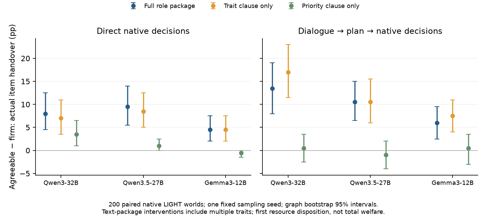

# Game NPC Agent｜上次审计后的重构与本轮进度报告

本报告接续 [2026-10-14报告](PROGRESS_REPORT_2026-10-14.md)，覆盖用户指正、恢复科研后至E62本轮收尾。时间采用Asia/Tokyo；原始记录中的UTC和游戏内时钟分别保留。

**已有可靠进展：在200个独立原生LIGHT场景、三个模型、三个配对种子上，全链一致的人物设定确实改变了实际物品交接。** agreeable相对firm的请求交付增量为32B **13.7pp [9.7,17.8]**、27B **8.5pp [5.7,11.7]**、Gemma **6.7pp [4.3,9.3]**。普通状态提醒后该效应仍在。研究已从给开源系统排错，转到解释角色怎样影响采纳请求、任务取舍、实现手段和具体接收者。

本轮同时推翻了几个容易误导选题的解释：大量不行动由未结束的对话阶段指令造成；角色效应并非只来自附加的责任/关系句；同一明确承诺后的角色效应并不统一衰减。白盒已实际运行，包括有原生行动后果的因果干预。**目前C02为有边界的L2实证，I04仍是探索中的SEED，尚未得到独立验证的新机制或新方法。** 下面区分已有结果、解释被改写的地方和剩余的研究问题。

## 1. 你指出的问题，实际怎样纠正

| 指正 | 此后实际执行 | 当前证据/状态 |
|---|---|---|
| PCSP/MeltingPot小MLP奖励与padding排错吞噬科研 | 冻结旧RL、追加种子及小模型白盒，不恢复旧E43 | E50–62均为原生LLM决策/相关数据工作；本轮新增RL训练0 |
| 把特定仓库的两个函数当科学机制 | 先重算LIGHT、E42、校园的矛盾表；日程/记忆只作实验因素 | [跨环境归因表](knowledge/persona-behavior/CROSS_ENVIRONMENT_CONTRADICTIONS_2026-10-15.md)，未锁定TCE/SFR或双信道方法 |
| 只改conversation是脏的人格对照 | 新总体对照在对话、更新、执行中使用同一完整P；无相反P历史 | E50/E55/E58；2×2阶段交叉另标为局部干预，不充当总体人格改变 |
| 三条校园历史不能支撑大样本结论 | 原图哈希固定划分40pilot/200confirm/120reserve，一图一任务 | 200是独立world graph，分支、seed、调用不算新独立场景 |
| 1200帧步行与无完成flag低信息量 | 使用原生物品交接/消费/装备，至首次资源裁决、最多6动作；动态双角色另用24turn上限 | 无新增1200帧漫游；物理完成由native event与持有者判断 |
| 白盒只登记不运行 | 已跑跨阶段residual、共同读出、物品词patch、接收者patch及真实解码概率 | E50/E52/E62；角度与能解码不直接冒充因果机制 |
| 提前钦定结论/自设bar | 成功、负结果、普通解释均按配对差与区间报告 | 没有用显著性或某个成功比例自动舍弃idea，未预定LoRA/GRPO/loss |
| Step5是搞数据，不是给科研审计代笔 | 用户纠正后固定用于自然请求、盲质检、文本语义与源动机抽取 | 固定step-5-preview + Step Plan专用入口；NPC、物理判定、报告与科学解释不交给Step |
| 定期上传main | 已多次小步提交，报告与本轮收尾另一次提交 | 资产与上传说明见末节 |

旧结果仍保留，纠正不是删掉负结果。E45/E49只能支持局部对话描述干预；E48仅阻断显式agenda，不能据此断言承诺总因果作用为零。新实验修正了这些解释范围，没有继续为旧数据补造总体人格故事。

另一个重要校正：**E42实际是Mini-Inzoi中一个LLM与15个固定MLP伙伴互动，DD是difference-in-differences，不是人格标签；它不是双LLM对话博弈。** 本轮只读取旧资产，不恢复该小模型线。真正双角色本地LLM互动是E57。

## 2. 这次怎样入手：先找矛盾，再选原生任务

先把旧成功和失败拉通，得到三条实质线索：

1. E42具体preferred-actions信息常提高收益，却让同状态两角色输入的首动作差27B从11/15降到4/15、32B从8/15降到2/15。额外信息与共同动作锚点能同时提高任务表现、压小角色选择差；这不是“Persona没用”的证据。
2. E22鸟的作者短目标是自己吃worm，中期目标是用nut喂幼鸟；其自我台词却说worm给幼鸟。目标物品提醒使放worm从9/32降到1/32，单纯物理事实提醒为10/32。优先检查目标解释/物品绑定，而非自动归为社交劫持或人格遗忘。
3. 校园中描述干预有时改路线、有时改起步时间、有时不改本人位置。旧人设控制和实体结果不足，因此不再用它直接检验总体人格机制。

选择LIGHT是因为它有作者人物、短中长动机、原生合法动作、可克隆世界和实体事件。固定源档案7486条quest/1787图，CPU实际执行两种资源路径，得到360个合格独立图。世界规则、角色、目标物品和原任务不改；加入的即时请求及多阶段LLM脚手架是本研究构造，**不是声称复现完整Dragon RL或原校园agent**。

原图按hash拆分：40pilot、200confirm、120reserve。200图原任务组成：give102、wear44、wield35、eat15、drink4。原任务事件只代表一项作者目标；give/equip可撤销，首次资源选择不等于最终私人效用。请求的即时接收者也不自动等于最终受益者。

总体人格操纵保留原persona与全部动机，只附加两套角色立场，所有阶段一致：

- firm：firm, dutiful, independent；重视既有责任。
- agreeable：agreeable, accommodating, attentive；重视个人关系。

两个Qwen模型加Gemma是三个模型、两个模型谱系，不称三个完全独立家族。这是一组多特质与价值语义的提示干预，不是纯Big Five单轴。表达在独立会话测量；对话采纳/拒绝/协商、计划/记忆内容、合法动作和实际物理后果分别保存。普通一句指令对照贯穿各轮。

## 3. 实际完成了哪些实验，分别改变了什么判断

| 实验 | 样本与实际执行 | 最重要的结果与判断变化 |
|---|---|---|
| **E50：重构pilot/阶段/白盒** | 三模型各40图×3seed，1680一致P分支；各640局部阶段交叉；两Qwen每模型native/common各480 forward | 完整渠道交付P差32B13.3、27B5.0、Gemma9.2pp；32B计划/记忆交互−11.7pp。统一action读出后32B跨阶段cos .140→.712，27B .018→−.047，统一人格耗散故事不成立 |
| **E51：完成状态×目标提醒** | 两Qwen各40图/1920分支，合计3840 | 32B在goal提醒下completed相对pending使请求交付降低firm20pp、agreeable14.2pp；27B同格约−2.5pp。状态词影响取舍，但“completed”存在意图形成/物理完成歧义 |
| **E52：旧鸟case的词位因果干预** | 同一个旧自然快照N=1；两Qwen各448 native动作、32配对draw/格 | 32B自己台词worm→nut：吃worm6/32→27/32；L31词位patch21、随机10、sham6。27B25→30，patch与随机都28。具体语义位置有作用，跨模型机制未统一 |
| **E53：错误状态的直接选择** | 三模型各40图×3seed/1440分支，4320总分支 | 无额外状态记录时P差27B5.8、32B11.7、Gemma8.3pp；假原任务已执行放大差，假请求已执行使实际请求交付为0。这是外加错误信息干预，不是自然错误频率 |
| **E54：已有文本盲标** | 40图共720自然文本+8锚点，Step仅标语义 | 436拒绝、138即时接受、111条件协商、35不确定；77条memory被标completed，但很多“offered/obliged/helped”歧义，不能称77个明确物理假事实 |
| **E55：独立200图确认** | 每模型200图×3seed，4800主分支+800强指令控制；5600/模型，16800总分支；另独立表达 | 三个模型实际角色效应确认，普通grounding后仍在；C02升L2。direct_history的无动作发现有阶段指令范围问题，交E56拆解 |
| **E56：普通阶段结束/状态/动作控制** | 每模型2000 native分支+1200独立事实回答；6000总分支 | 结束对话阶段一句使32B原任务180/400→361/400、Gemma278→383。追加事实帮助很小，采用普通指令作用范围解释；事实回答不喂策略 |
| **E57：真正双角色互动** | 两Qwen各39独立图×两P×3seed，234 episode/模型，468总局，3434本地调用 | agreeable消费差32B−6.8pp、27B−10.3pp；27B伙伴向自己交付+9.4pp。作用落在手段/取得与消费；39图food_energy均0，不能叫生存压力 |
| **E58：性格句/优先句分量** | 三模型各200图、六P包×direct/plan两结构，2400分支/模型；独立表达另1200/模型 | 只性格句仍产生17/10.5/7.5pp计划交付差，优先句约0。否定“第二句单独解释全部作用”；不是纯特质、等长控制或新机制证明 |
| **E59：同未来承诺与状态记录** | 每模型400 update+400独立事实回答；2400文本+24锚点完整盲标 | 同明确future句后past标签32B下降、Gemma为0、27B略升。措辞是重要普通解释，不能讲统一“agreeable伪造状态” |
| **E60：同承诺后的真实执行** | 每模型200图/400分支，1200总分支、1790本地调用；自然分支CPU回放全匹配 | 交付P差32B6.5pp、27B20pp、Gemma13pp；相对自然对话变化为−7/+9.5/+7pp，角色效应不统一衰减 |
| **E61：同历史、无生成plan/memory的直接决策** | 每模型200图/400分支，1200总分支、1380本地调用 | P差32B9.5pp、27B10.5pp、Gemma1.5pp。当前角色输入与生成计划都可能参与；表示与目标显著性不同，不能把直接/计划差称纯模块因果 |
| **E62：固定Give族后接收者与内部干预** | 全102作者give目标图；每模型4896 native选择，配套2448 exact概率读出 | 最终三模型结果与解释见第5节；与完整自由行为分开，不用限定动作任务证明总体能力 |

实验卡： [E50](experiments/E50-commitment-decision-snapshots.md)、[E51](experiments/E51-stage-persona-causal-transfer.md)、[E52](experiments/E52-dialogue-goal-binding-causal-probe.md)、[E53](experiments/E53-direct-goal-status-versus-persona-choice.md)、[E54](experiments/E54-natural-dialogue-data-labels.md)、[E55](experiments/E55-independent-native-role-confirmation.md)、[E56](experiments/E56-native-state-belief-and-action.md)、[E57](experiments/E57-native-private-goal-interaction.md)、[E58](experiments/E58-disposition-and-priority-components.md)、[E59](experiments/E59-fixed-history-state-invariance.md)、[E60](experiments/E60-common-commitment-native-choice.md)、[E61](experiments/E61-common-history-direct-decision.md)、[E62](experiments/E62-native-recipient-causal-diagnostic.md)。统计JSON在 [结果索引](results/README.md)，不是把实验编号当独立科学发现计数。

## 4. 最值得看的结果：角色有效，但作用位置与条件不同

### 4.1 角色的实际作用已独立确认

以下均为agreeable−firm的实际请求交付差，单位pp，95%区间按独立world graph簇bootstrap；同图全部seed先平均。

| 计划后原生执行 | 32B | 27B | Gemma |
|---|---:|---:|---:|
| E55完整角色，200图×3seed | 13.7 [9.7,17.8] | 8.5 [5.7,11.7] | 6.7 [4.3,9.3] |
| 普通“尚未物理执行”一句 | 13.8 [10.0,18.2] | 8.7 [5.8,11.8] | 7.0 [4.5,9.8] |
| E58新seed，完整角色 | 13.5 [8.0,19.0] | 10.5 [6.5,15.0] | 6.0 [2.5,9.5] |
| E58只性格句 | 17.0 [11.5,23.0] | 10.5 [6.0,15.5] | 7.5 [4.0,11.0] |
| E58只责任/关系句 | 0.5 [−2.5,3.5] | −1.0 [−4.0,2.0] | 0.5 [−3.0,3.5] |

这已经排除了两个简单说法：“角色只改变语气”和“全部是第二句明确优先级”。删除句子也改变语义和长度，下一步构念解释须按具体词义推进，而非把这些差直接叫内在稳定人格。

角色也不是全都无条件答应。E58完整包32B的firm/agreeable在200场景中的结构化自标：拒绝143/61、协商50/107、接受7/32。agreeable更多协商而非仅即时接受；冻结请求者的短切片可能停在条件未满足处。完整意图文本与真正物理执行要一起读。

### 4.2 普通解释实际解决了什么

E55历史结构保留了“对话阶段不执行物理动作”，随后没有明确结束范围。E56只加阶段结束一句，32B原任务完成增加181/400，Gemma增加105/400；加更多状态事实几乎没有进一步改善。**这些无动作不再被解释为人格丢失或记忆失效。** 原结果及普通修复并列保留。

独立事实回答中，32B物品持有者400/400答对，请求命令393/400答对；对请求已完成误报为0/400。读得出事实不等于一定采用它，也不是内在信念的直接测量。强Give请求控制仍同时含旧目标，32B实际88/400交付，Gemma129/400，说明相互竞争的指令与原任务会影响采用；它们不是孤立的动作执行能力测试。

E59用同一明确未来句“I will hand [item] to [requester] next.”，全图仍无物理交付。原自然memory的已交付盲标签firm/agreeable分别32B1/13、27B0/2、Gemma2/14；固定句后1/3、3/4、0/0（各分母200）。逐条对象/时态保守复核7条后自然数为1/9、0/1、2/12，原标签未删除；复核是本agent的POST-HOC敏感性分析，非独立人类金标。三个模型8锚点各8/8；0/200的Wilson95%上界约1.9%，不是总体永不错误。

### 4.3 同承诺后，角色也没有统一消失

| 同一明确未来承诺 | 32B firm/agreeable | 27B firm/agreeable | Gemma firm/agreeable |
|---|---:|---:|---:|
| E60生成更新后实际交付/200 | 164/177 | 124/164 | 88/114 |
| 对应P差pp | 6.5 [1.5,11.5] | 20.0 [14,26] | 13.0 [8,18.5] |
| E61直接看到相同历史交付/200 | 50/69 | 28/49 | 12/15 |
| 对应P差pp | 9.5 [5,14.5] | 10.5 [6.5,15] | 1.5 [0,3.5] |

同承诺能够改变真实选择，人设仍参与之后的取舍。计划结构把承诺编码进新agenda/memory；直接结构仍突出旧agenda，文本、模块数和信息表示不同。当前不能只凭这张表把差归为模型某一内部阶段。它明确把研究推进到：**角色怎样影响任务解释与优先采用，以及原目标与请求的表示怎样改变这种作用。**

### 4.4 真实伙伴与实现手段

E57两角色各保留源作者私有目标，实际轮流使用原生动作、对话可协商、取得/消费事件真实执行。agreeable相对firm的focal消费差32B−6.8pp [−12.8,−0.9]、27B−10.3pp [−18.8,−3.4]；27B伙伴给focal资源增加9.4pp [2.6,16.2]。

探索性分层中，自持食物10图消费差−20/−26.7pp，伙伴持有14图−2.4/−4.8pp，两模型偷取尝试均减少11.9pp。所有权、目标兼容与伙伴身份一起变，尚未分离各自因果；这组结果提供下一项最小同图对照的对象，不是宣布“依赖结构定律”。全部食物能量0，只能证明取得、转移、移除，没有健康增益。

源Dragon支持get/steal目标经伙伴give完成。按这一已有规则补报原生实现路径，32B9条、27B8条严格自己goal事件以外的达成；原指标与POST-HOC新增指标都保留。**任务实现途径不能被某个动作词绑死，也不能从give就推无私。**

## 5. E62收尾：原生接收者因果诊断

对全部102个作者give目标图，保留全部合法目标物品Give命令；本批每图恰好两个接收者。CPU资格204/204实际执行通过。强制两命令的最长共同token前缀，再由模型选接收者。完整人物/动机/原目标/请求仍在，只有动作族已经指定；这项局部诊断不覆盖E55–61的完整自由菜单行为。

三模型各4896次真实Give选择，总14688；另每模型612个residual捕获、1224次完整候选后缀语言打分。每图三种上下文×两P×baseline/sham/异P donor/同范数随机×两配对draw。三模型全部协议错误与native错误为0；3672个baseline/sham配对的命令全部相同。对照检查正确并不等于新机制成立。

| 实际接收者的agreeable−firm差，pp [95%] | 32B | 27B | Gemma |
|---|---:|---:|---:|
| 没有先前承诺 | 0.49 [0,1.47] | 0.98 [0,2.45] | 0.98 [0,2.45] |
| 同一明确未来承诺 | 1.47 [0,3.43] | 5.88 [2.94,9.31] | 0 [0,0] |
| 未来承诺+普通接收者绑定事实 | 0 [0,0] | 3.43 [0.98,6.37] | 1.96 [0,4.90] |

27B在给定动作族后仍有角色接收者差；另外两模型实际翻转少。普通绑定句没有统一提升方向。零bootstrap区间只反映本批配对动作，完整概率读出另外核对。全部单层donor的有向动作变化很小：32B三个上下文均0，27B未来/绑定各−0.245pp，Gemma无承诺+0.245pp；随机控制同样有零星变化。**中间层交换没有提供稳定、跨模型的角色定向控制证据**，本轮不继续扫层/种子刷阳性。

精确概率用相同模型、prompt、已保存residual、实际generation processor和temperature.7读取第一次分叉；两叶且之后只有唯一后缀，所以这是该条件化完整命令的真实概率。它与不受限suffix语言likelihood分开，未重抽主动作或重新执行世界。

三模型各2448个概率读出，总7344；sham概率变化全部精确为0，未重生成native行动。角色包造成的请求概率质量差为：

| exact完整Give请求概率的P差，pp [95%] | 32B | 27B | Gemma |
|---|---:|---:|---:|
| 没有先前承诺 | 0.32 [0.02,0.76] | 2.16 [1.10,3.49] | 1.77 [0.10,4.24] |
| 同一明确未来承诺 | 1.54 [0.32,3.14] | 5.36 [3.56,7.41] | 0.038 [0.001,0.103] |
| 未来承诺+普通绑定事实 | 0.68 [0.16,1.35] | 4.55 [3.09,6.31] | 2.02 [0.02,4.92] |

未来承诺格32B的firm/agreeable平均请求概率2.42%/3.96%，中位数0.0038%/0.0065%；27B平均3.27%/8.63%，中位数0.734%/1.929%；Gemma平均0.0040%/0.0421%，中位数约3–5×10⁻⁶%。分布强烈偏向原goal，角色包仍改变部分概率质量，动作零/小差不能被解释成人格信号彻底消失。

单层donor的有向概率变化也未形成统一机制：32B binding约−0.0465pp、27B future约−0.0882pp、Gemma binding约+0.0548pp，其他格及随机效应见完整统计。它是一个局部位置的检验结果，不是缺少全部角色表征的证据，也没有证明新steering方法。

**当前解释：** 原目标与Current agenda在输入中重复明确，很多场景请求交付基线很低。动作几乎不翻转不等于角色信息不存在；条件化action prefix也改变了选择协议。粗动作/细参数、原目标权重、受益关系和提示表示是不同竞争解释，下一步要做能分离它们的同图对照，而非给一个小幅概率变化命名新能力。

源动机盲DATA已完成200/200，所有非unknown类别有逐字引文，未展示P/模型/行动结果。102个give图的作者短期动机类别为self30、other61、self_and_other1、unspecified10；中期为56/31/5/10，长期为62/24/14/2。**这些是源文字的受益目的标注，不是实际效用金标，也不是同一NPC偏好随时间变化的实验。** 但它们明确揭示同verb组的目标构成并不均一。

例如原fisherman任务“give coin pouch to peasant”的短动机写明换取对方fishing pole；villager给man保护费；鸟给deer是想认识对方。交付动词相同，可服务自身交易、关系或别人。请求文本13/200被标为明确声称有助作者动机，186无此主张、1不确定；声称支持不等于真实兼容，更不证明请求者有权知道私有信息。原引文/标注与全部失败见 [源动机结果](results/E61_source_motivation_data.json)。

## 6. 强近邻对齐：哪些已有人做到，哪些阅读仍欠账

最初四篇强邻近的正文、关键表格/附录与可访问代码已在旧论文卡记录。本次补读并定位Persona Circuits/PSE、Persona Dynamics/PDD、Trait Activation、Role-Playing Beliefs、DREAM、PASB、PMBench及因果记忆等。它们分别拥有角色/assistant竞争、情境特质激活、角色信念、过去/未来状态、归属与状态扩张、延迟意图等相关主张，不能换一个NPC名词再冒领。

两项特别重要的参照系修正：

- **《The Story Shapes the Agent》不是仅单步/静态矩阵。** 论文有四阶段交互游戏。先前审计建议中“强邻近全部只做单步”这个概括不能作为我们的新颖性依据。
- **CT-Bench /《Commitment To Cooperation With Self-Negotiated Contracts》为COLM2026。** 已精读正文、关键合同/依赖实验、C/D/E/G附录和真实提示：空间多步博弈、未来chip支付承诺、履行与先后手、明确自利目标、合同自动执行与惩罚都已有。80board、6模型，主结果每配置1次，GPT4.1另5次×80×4=1600局；“多步资源依赖与承诺”本身不是新贡献。匿名代码README访问失败，未读取或复现，绝不把正文描述称代码事实。

PANDA为ACL2025 Main，25个Jiminy Cricket游戏、人格分类器与DRRN动作value塑形；已读正文§2–3/§5.2–5.4/部分§6及附录B，剩余附录及作者代码未完整审计。它已经展示人格可改变游戏行动与探索，**C02的正结果是研究起点，不是单独的新颖性主张**。本轮未恢复它的小模型RL。

《Rethinking Psychometric Evaluation》的定位为COLM2026/ICML2026 workshop，不能写NeurIPS main。自述、具体意图、行为的粒度与同/跨会话影响已是强既有解释。各论文本地读取范围、原文链接和代码访问债见 [RELATED_WORK](knowledge/persona-behavior/RELATED_WORK.md)、[机制近邻](knowledge/persona-behavior/MECHANISTIC_NEIGHBORS_2026-10-15.md)、[承诺/行动近邻](knowledge/persona-behavior/COMMITMENT_AND_NATIVE_ACTION_NEIGHBORS_2026-10-15.md) 与 [论文卡](knowledge/papers/)；未称全套论文结果已复现。

## 7. 数据、算力、负结果与执行错误

### 数据与Step Plan

Step只处理公开源素材或本地已生成文本，盲于模型/角色干预/行为效果；实际世界真值由LIGHT确定，不由API判定。自然请求构造保留所有200固定图，第二次澄清盲检185keep/14review/1reject，全200进入主分析，未按成功行为或“好看”的QC筛样本。75构造自标review及5条盲检unsupported-fact问题另存，读数也做质量分层。

早期opencode Free Big Pickle有效190/200（102keep/70review/18reject，另10未匹配）；360批量曾被自动审批拒绝，未执行，随后只发固定公开200范围。没有把免费工具缺行假装200齐全，也没有让API负责研究结论。

Step用量以provider返回total_tokens计，包括思考、失败与恢复；Credit余额/实际账单未由独立计费接口核对。所有调用固定Step Plan专用端点，未请求现金端点、未跳转/SDK回退。分项成本及源动机收尾另见附表。密钥只在仓库外私有文件，未写入代码、报告或Git。

| Step数据用途 | 有usage的独立响应数 | provider total_tokens，含失败/恢复 |
|---|---:|---:|
| 200自然请求构造，原截断+完整预算 | 23 | 338520 |
| 原有歧义盲检，保留 | 21 | 359570 |
| 澄清字段后盲检 | 20 | 277020 |
| E54已有720文本+锚点 | 42 | 1212231 |
| E59自然/fixed文本+锚点 | 125 | 836315 |
| E61源动机200行，原20批+补缺 | 40 | 453124 |
| **合计** | **271** | **3476780** |

源动机原20批142合格，15批只补58个缺失ID后195合格，再5个单行只补缺失ID达到200；20条缺枚举、1条ID复制错误、截断响应全部保留。60行只是显式JSON字段别名规范化，未从姓名凭空补语义。上述DATA调用不充当新的实验样本或科学发现。

### 本地实验与执行纠正

- 现有fgvd Conda、隔离overlay与模型缓存，未另建环境或第二套工作台。单卡独立进程，不跨节点同步训练；最多8卡，使用前查空闲。部分远端SSH banner超时后用现有本地卡推进，没有转去反复排连接故障。
- E50旧emoji renderer版本冲突按兼容overlay恢复，旧调用精确匹配才回放，未匹配确实重新推理。部分原进程没有完整runtime，记录的续跑成本不冒充完整总成本。
- E55 direct_history指令范围混杂已由E56明确纠正；E51的completed歧义、E54的performed语义歧义及E59的对象歧义全部保留，不把它们当统一深层人格缺陷。
- E52登记了动作logits，但实际没有保存logits；现有因果结论只引用词位patch与原生动作。独立N=1、不用448次抽样冒充448场景。
- E62本地adapter的Give类名和Gemma Transformers路径错误在资格阶段纠正，原失败保留，作者引擎和世界未修改；普通loader恢复不作为科学结果。
- E55 27B/Gemma各1个JSON错误、原生ErrorEvent和重试全部保留。合法输出、首次动作、失败重试、资源裁决与长程利益分开。

本轮没有SFT/LoRA/GRPO/RL训练。当前已有受控物理链路、200图独立确认与机制探针；算力消耗和分支数是成本，不当科研价值的替代物。

E51–61可完整计时的最终本地运行合计**15.3973GPU·小时、103672次生成/决策/独立事实调用**，包含对应载入。E50原中断进程缺完整runtime，白盒/资格/失败profile另存，所以该数字不是整个项目或本报告范围的全部GPU时。E62及全部可查Step响应的分项成本在 [成本账本](results/ROUND_PROGRESS_COSTS_2026-10-15.json)；provider response ID去重，截断/恢复均计入有usage的调用。

E62主运行及exact概率合计**2.1026GPU·小时**（含这六次模型载入），加上上述最终计时为17.4999GPU·小时；E62的prefill/候选打分已包含wall cost，不重复相加。本轮GPU模型任务已退出，本地四GPU现场复查均15MiB/0%利用率，源动机40个DATA请求亦已结束。

结果数量、全部sham/native读数、200图唯一性与本报告文件链接已核对；流程检查0 ERROR、33条其他工作台WARN。[本轮完成记录](results/ROUND_COMPLETE_2026-10-15.json)保存最终结果hash、进程与现场GPU读数。

## 8. 当前研究判断，以及怎样入手检查

**得到的科学认识：** 完整人物立场和性格分量能改变真实NPC行为；作用包含条件协商与实现手段。具体承诺、原目标的表示和决策机会改变其效果。一些表面失配已被普通指令/措辞解释，不宜再以统一“Persona失效”组织论文。

**仍需形成的增量：** 找到能跨角色/场景预测这些不同方向的解释，并用干净干预证明它。当前重点是原目标、具体请求与受益关系怎样被解释和排序，角色究竟在哪个选择环节发挥作用。目标知识可读与目标被采用分开；粗动作/细接收者的分层目前同时混入关系和任务构成，尚未独立识别。

**本轮仍有的战略问题：** 后半轮集中在同一个LIGHT切片族，E54/E59多轮语义标签消耗了不少Plan Credit；它们帮助纠正解释，却不是独立研究贡献。多阶段脚手架也尚未完成跨游戏确认或真正长程NPC验证。下一轮应把最有预测力的区别带回有真实伙伴/后果的任务，避免继续围着label字段、单层patch或记录格式打转。

下一步候选按信息量排序，**本轮没有启动**：先核源动机、委托与目标兼容，挑能区分“任务解释/优先级”和“细参数角色裁决”的同图反事实；把最有预测力的区别带到真实双角色任务，而非再铺一套泛化矩阵。E62单层阴性不触发遍历层/seed刷阳性；没有残余问题需要训练前，不预定新损失或训练方案。文献撞车用于调整增量，不作桌面关闭判决。

建议你按以下顺序检查：

1. 看本报告第1节是否真正落实了你的指正；第4节是否在回答NPC决策，而非修库。
2. 看 [C02混杂审计](knowledge/persona-behavior/C02_CONFIRM_AUDIT_2026-10-15.md) 与 `results/E55_*_independent_confirm.json`：200图、三seed、普通对照和失败是否齐全。
3. 对照E56的普通指令解释、E58的分量结果、E60/E61的共同承诺表；检查是否有把当前P与历史/计划混为同一因果效应。
4. 看E57双方真实轨迹、E62概率/行动/随机/sham，而非只看几个向量角度；检查原任务、实际受益者与“正确行为”有没有被我们偷换。
5. 对I04的研究品味与下轮优先级给判断。C01 L1、C02 L2、C03 L1；I04保持SEED，未进入投稿候选，也未声称顶会idea已独立验证。

## 9. 文件与上传

| 入口/资产 | 位置与用途 |
|---|---|
| 当前短状态页 | [README](README.md)，完整过程移至卡片/日志 |
| 科学综合 | [原生角色结果](knowledge/persona-behavior/NATIVE_ROLE_RESULTS_2026-10-15.md)、[矛盾表](knowledge/persona-behavior/CROSS_ENVIRONMENT_CONTRADICTIONS_2026-10-15.md) |
| 主张与idea | [CLAIMS](CLAIMS.md)、[I04](ideas/I04-commitment-conflict-stage-arbitration.md)，人的品味/状态权不变 |
| 200请求与质量 | [E55_natural_requests.jsonl](results/E55_natural_requests.jsonl)，源graph与完整原始请求保存在cache |
| 实验统计、图与代码 | [results](results/README.md)、[scripts](scripts/README.md)，SVG/PDF/PNG科学图可导出 |
| 当日记录 | [logs/2026-10-15](logs/2026-10-15.md)，含纠正、负结果与用途约束 |
| 原始模型输入输出、native状态、tensor与manifest | `/home/xiang/.cache/game-npc-research/runs/` 中各E##目录；不进Git，可在同机器按卡片路径复算 |
| 上游与模型 | 同cache下`sources/LIGHT`固定pin `71a06cae8573048b1af41507ac52fe33b650fab3`；HF model revision见各manifest |

同步与提交只包含`workbench/game-npc-agents/`，不动其他工作台的并发修改。此前main已上传到`a8982a7e`；本轮报告/最终统计的版本以Git提交历史为准，不将自身commit hash写回自身文件。完整大资产仍只在本地路径，GitHub含轻量证据与复算代码；这不等于raw已异地备份。

本报告是用户要求的本轮检查点：完成已启动实验/分析及文件整理后汇报，不追加下一轮实验。研究目标尚未标完成，探索线没有被agent自行关闭。
