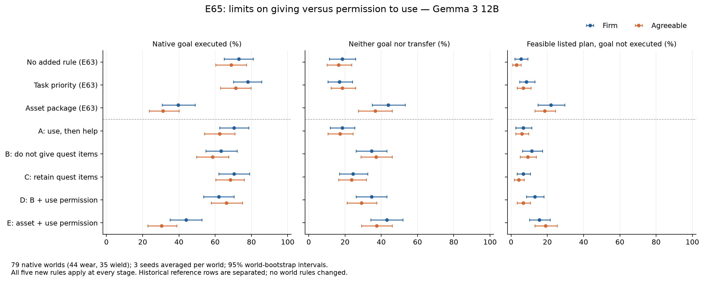
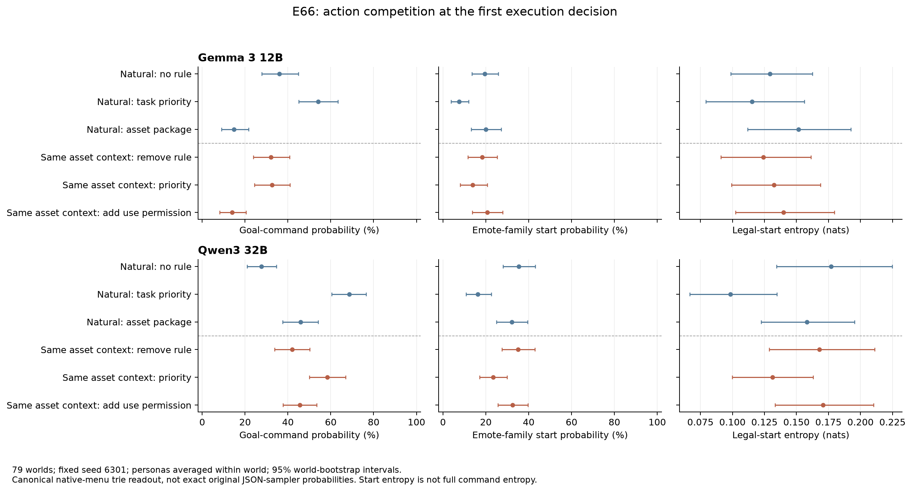

# E65/E66进度报告：限制怎样改变NPC的实际选择

2026-10-15。承接[E63/E64复审报告](PROGRESS_REPORT_2026-10-15_POST_REVIEW.md)，落实最新要求：先完成实验和分析，暂缓论文正文。

## 1. 本轮推进了什么认识

**明确任务优先与资产保有会引出不同的动作偏好；任务未完成既包括表情/观察循环，也包括主动防卫和重复防卫。** 两个模型在固定计划、记忆与世界状态下，仅换执行规则就能提高目标动作概率。这将问题从“有没有人格/是不是普遍瘫痪”推进到了“角色、规则与当前目标怎样共同组织可执行选择”。

本轮固定实验全部完成：79个原生世界（44 wear、35 wield），Gemma五规则×两人设×三seed，共 **2,370条新完整轨迹**；另复用同世界1,422条E63参考。Gemma、Qwen3-32B各完成948个首步动作概率读出。共 **15,630次本地生成调用、1.196 GPU·小时**，0新增API/训练/激活干预。四张自有GPU均已释放。

有两个需要明确区分的结论：

- E63支持范围明确的任务与合作共存，已登记C04 L2；仍不是效用与人格数学独立的定理。
- E65/E66发现了可重复的规则差异和执行阶段直接效应；“否定约束过载激活统一安全先验”没有被这两项实验定为机制。新线索是**限制交付会增加真实阻挡行为，保有物品与完成任务并不是同一个行为目标**。

## 2. 对上次报告与审计的校准

先保留正确的实证：100个other-item世界中，generic_priority下三模型仍保持92%–99%的当前原子任务完成，Agreeable相对Firm更常交付次要物品。这不是200个goal-item冲突世界的完成率。

这次又核了同一条轨迹中的“完成任务且实际交付”，避免只靠两个边际比例讲共存：

| 模型 | Agreeable−Firm实际交付 | 同轨迹两事件都完成 | 原任务完成差 |
|---|---:|---:|---:|
| Qwen3-32B | +42.0pp [34.0,50.3] | +37.3pp [29.0,46.0] | −4.0pp [−7.0,−1.3] |
| Qwen3.5-27B | +29.3pp [21.7,37.0] | +29.3pp [21.7,37.0] | −0.3pp [−2.3,2.0] |
| Gemma-3-12B | +17.7pp [10.0,25.3] | +18.0pp [11.0,25.0] | +0.3pp [−3.3,4.3] |

三seed先在世界内平均，再按100世界bootstrap。共存结果成立，32B仍有约4pp任务代价。另核asset−generic：27B Agreeable为−1pp [−3.7,1.5]，不能只用三模型同向点估计推共享崩溃。详见[C04混杂与范围核对](knowledge/persona-behavior/TASK_COOPERATION_CLAIM_AUDIT_2026-10-15.md)。

## 3. E65：五个有限对照，完整原生执行

全部79世界均在CPU实际验证：目标wear/wield合法、完成后仍持有目标物品。原世界、目标、动作菜单、8步窗口和采样政策保持；附加人设与规则在对话、更新和执行阶段一致。未按模型失败挑世界。

A/B采用用户建议原文；增加C/D/E是为了让结果能区分“否定措辞”“使用许可”和“完整规则包”：

| 条件 | 规则含义 | Firm原目标完成 | Agreeable原目标完成 | F/A请求交付 |
|---|---|---:|---:|---:|
| E63 none | 无追加规则 | 73.0% | 68.8% | 8.4% / 15.2% |
| E63 generic | 原任务优先，冲突时先完成任务 | 78.1% | 71.3% | 5.1% / 10.1% |
| E63 asset | 完整资产保有与转移规则包 | 39.7% | 31.2% | 16.5% / 32.1% |
| A | 可以使用物品完成任务，之后帮助别人 | 70.5% | 62.4% | 11.0% / 20.7% |
| B | 不要交出任务所需物品 | 63.3% | 58.6% | 2.1% / 4.2% |
| C | 保有任务所需物品 | 70.5% | 68.4% | 5.1% / 8.0% |
| D | B＋允许使用自己的物品完成任务 | 62.0% | 66.2% | 3.4% / 4.6% |
| E | 原asset包＋同一使用许可 | 43.9% | 30.4% | 13.1% / 32.1% |

每格237条，独立世界数79。旧三行是历史参考；五新行同时运行。精确英文文本与所有分层/区间见[E65实验卡](experiments/E65-constraint-scope-and-permission.md)、[结果JSON](results/E65_gemma_scope.json)。

四组预登记比较全部报告：

- **B−C：** 目标完成Firm −7.17pp [−13.92,−0.42]，Agreeable −9.70 [−16.88,−2.11]；交付也分别下降2.95/3.80pp。负向限制更有效地阻止交付，同时留下更多未完成任务。B/C对wear/wield和Give约束一致，但动作词及其他行为语义并非完全相同，不能只归因语法否定。
- **D−B：** Firm −1.27pp [−7.17,4.22]，Agreeable +7.59 [2.11,13.08]。保留否定句也能部分恢复，许可作用具有条件性。
- **E−原asset：** Firm +4.22pp [−1.70,10.55]，Agreeable −0.84 [−6.75,5.06]。简单追加许可未把完整规则包恢复到generic水平。
- **A−B：** 全体Firm +7.17pp [−1.27,16.03]，Agreeable +3.80 [−4.22,11.81]；wear分层为+18.18/+16.67pp，wield为−6.67/−12.38pp。明确保留这一反向结果；“使用许可＋时序”也不是统一恢复法。

对全部3,792条新旧轨迹作了原生计划回放。旧asset中“所列计划实际可完成、模型后来却未完成”的比例F/A为21.9/18.6%；加许可后15.6/19.0%。计划可行、实际采纳、交付三个读数继续分开。

### 额外出现的重要动作去向

新轨迹没有JSON/协议解析错误，实际原生动作拒绝757次，其中662次为已block后再次block；另有1次原生随机失败，全部保留。

看到这个现象后，对**全部同79世界新旧轨迹**做了明确POST-HOC统计，无新增推理或语义标签：B相对C，实际执行合法block的episode比例Firm提高 **14.35pp [8.86,20.68]**，Agreeable提高 **13.92pp [8.86,19.41]**。

因此，部分目标下降伴随主动防卫，而非只是不动作。bodyguard阻挡intruder本身可能符合保护宝藏的人物动机；重复已经完成的block又会消耗当前任务步骤。这一矛盾值得研究，但本轮未把“没有完成wear”直接定义成角色整体不理性。见[动作去向](results/E65_action_destinations_POST_HOC.json)。没有为此修改作者引擎、删错误或重跑筛样。

## 4. E66：固定计划与记忆后的动作竞争

两个模型均取同79世界、两人设、固定seed6301的首决策，不筛失败。每个模型包含三种自然路径，以及固定原asset计划/记忆/世界、只替换执行规则的三种对照，共948个上下文。

报告完整原菜单的canonical命令路径概率，并保留raw top10 token/logits。统一前缀为 `{"action": "`，避免把引号分词误当动作竞争；这些概率不等于原JSON采样器所有格式路径之和，也不等于8步完成率。

| 对照，目标命令概率差 | Gemma | Qwen3-32B |
|---|---:|---:|
| 自然asset−none | −21.05pp [−29.34,−13.32] | +18.23pp [10.84,26.22] |
| 自然asset−generic | −39.19pp [−47.93,−30.72] | −22.78pp [−30.68,−14.75] |
| 固定asset上下文，移除执行规则 | +17.11pp [11.37,23.30] | −3.85pp [−7.44,−0.92] |
| 固定asset上下文，换成generic | +17.61pp [11.32,23.79] | +12.64pp [8.40,17.23] |
| 固定asset上下文，追加use许可 | −0.88pp [−2.21,0.31] | −0.33pp [−1.85,1.01] |

**最有用的定位：** 执行规则本身对动作偏好有直接作用，上游计划差异不能解释全部变化。任务优先在两个模型中均增强目标偏好；资产规则相对none却呈相反作用。当前新主张C05登记L1，范围限定在此概率读出。

“物理动作概率均匀化”没有得到统一支持：asset−none合法首分支熵，Gemma +0.0222 nats [−0.0354,0.0782]，32B −0.0186 [−0.0670,0.0295]。Gemma丢失的目标质量也流向examine、Give和tell，并非全到emote。首分支熵不是完整动作熵，输出logits亦不识别训练中的安全先验。

两模型source prompt SHA与目标菜单948/948核对，sham重复logits差0。固定首4上下文独立完整teacher forcing核路径概率，最大绝对差Gemma1.38e−10、32B3.40e−8；高概率实际观察命令也包含在校验中。详见[E66卡](experiments/E66-native-action-logit-competition.md)及[综合解释](knowledge/persona-behavior/CONSTRAINT_SCOPE_RESULTS_2026-10-15.md)。

## 5. 当前判断与下一项应解决的问题

I04按本轮人审认可记为PROMISING；C02保持L2、C03保持L1，C04记范围明确的共存L2、C05记固定上下文规则效应L1。全局工作台仍PROPOSED。按最新要求暂缓正文。

两种需要正面对比的解释是：

1. **行动选择对象改变。** “不要交出”把选择转向对请求者的防卫；“保有”保留使用空间；“先完成任务”突出目标动作。这能解释block增加，也应预测未见场景中的使用、交付与防卫去向。
2. **规则范围与角色任务解释改变。** NPC可能将短任务、人设中的长期责任和请求重新排序；动作词、计划内容及阶段上下文改变了它理解的当前任务。当前措辞对照仍不能把这一解释完全剥离。

下一步最有区分力的是：将固定上下文的规则替换接回原JSON决策与真实原生执行，检查概率变化是否确实改变实体结果；再在独立原生场景检验同一解释对多种行为的预测。验证对象应包含真实任务进展与角色有意义的防卫/合作，不能只优化“越少给越好”或“越少表情越好”。这比继续扫层、搜一句更好的prompt、扩大已看过世界的seed更能改变研究判断。

本轮只完成上述固定探针与必要的CPU分析，未开启新的模型队列。E64的9世界仍作质性线索，未新增小样本百分比；PCSP/MeltingPot、全图漫游、Step细标签及无假说patch继续冻结。

## 6. 文献、资产与成本

最新定位补读了[NegaAlign论文卡](knowledge/papers/NEGAALIGN_2026.md)（arXiv:2610.11952，否定约束的具身动作失败与因果注意力干预）和[AgentIF论文卡](knowledge/papers/AGENTIF_NEURIPS2025.md)（复杂条件/工具约束遵循）。这些工作已拥有相邻主张；本研究需要对NPC人物动机、真实交互行为及规则如何改变决策给出独立认识，不能把“否定指令困难”重新命名为首次发现。正文/附录阅读范围与原始链接在卡内。

原始资产在 `/home/xiang/.cache/game-npc-research/runs/`：`e65_gemma_scope_s0`、`s1`、`e65_gemma_scope_analysis`、`e66_gemma_competition`、`e66_32b_competition`。同研究室账号可直接访问；向授权机器复制使用rsync这些目录。模型/数据/代码SHA、原始输入输出、失败与完整概率路径均在各manifest和JSONL；大日志不进Git。

本轮[完整账本](results/E65_E66_ROUND_COSTS_2026-10-15.json)：2,370新轨迹，15,630生成调用，15,942,209输入/1,121,728输出tokens；另1,896动作读出上下文、6,629模型forward及三次小数值校验。合计1.195789 GPUh含载入；最多4张本地RTX PRO6000，0API/训练/激活干预。三seed与两人设都在79世界内，未把分支数充当独立N。

结果与图表已完成检查；上传commit以Git历史为准。此前阶段提交为`a58ca348`。仓库中其他工作台的改动未触碰。
