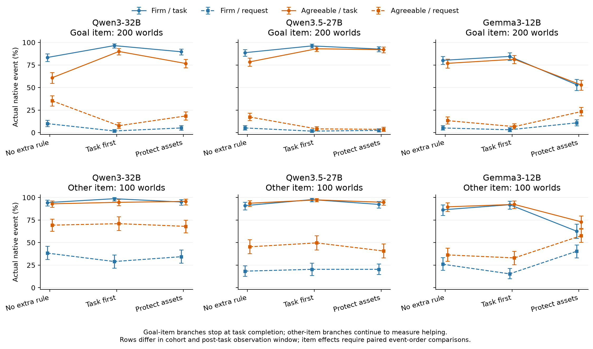
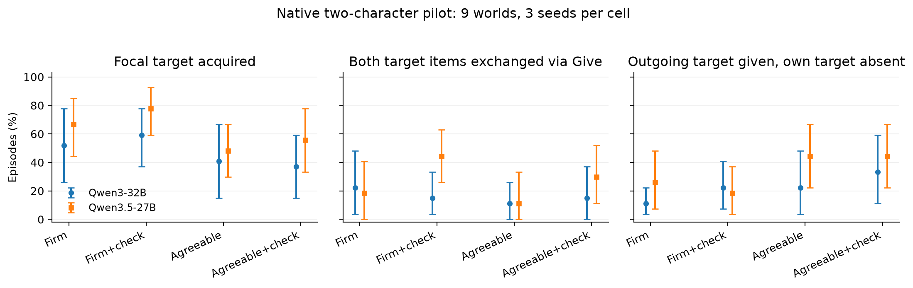

# Game NPC Agent｜最新审计后的实验与判断更新

数据截至2026-10-15下午（Asia/Tokyo）；原始runtime保留UTC/进程时钟。E63三模型、E64两模型及普通通信控制均已收齐，本报告覆盖完整固定队列。

接续[上次报告](PROGRESS_REPORT_2026-10-15.md)，只覆盖你最新指出“主效应显而易见、无假说patch、细标签泥潭”之后的新工作。研究仍围绕：**NPC怎样在角色立场、自己的任务与外部请求之间形成实际选择？** 本轮新增实验只有E63、E64及登记过的普通通信指令控制，没有训练、云端NPC、Step标注或新白盒扫描。

**本轮最重要的判断变化：明确优先规则能够保护任务，同时保留角色差；更具体的资产保护提示却可能使执行变差。** 32B agreeable原任务完成由60.8%升到90.0%；Gemma在资产保护包下由76.8%降到52.8%。真正双角色交互中，27B的普通回报检查提示提高了双向Give，32B两P的变化为−7.4/+3.7pp。下一步值得解释的是这些条件边界，而非再次证明“友善更愿意给东西”或预定“人设必然自毁”。

## 1. 这次纠正落实在哪里

| 你的指正 | 实际动作 | 研究判断怎样改变 |
|---|---|---|
| “Agreeable更愿意给东西”没有足够增量 | E63同时测作者任务执行、请求交付、目标物与另一自持物品；E64加入真正行动的伙伴 | 研究任务保留与合作的条件，交付率不再单独代表好人设 |
| 单层patch阴性后继续扫层是算力黑洞 | E62不追加层、种子或patch；本轮内部干预0 | 不拿阴性补造“表征消失”，也不凭attention权重宣称机制 |
| 文本细分不该成为研究主体 | 新增Step/API调用0；计划检查直接用native parser和物理回放 | 从词义打标转到“这个计划是否真能执行、实际有没有执行” |
| “性格词赢过明确规则”可能很重要 | 核对E58原句，并在E63实际测试两种明确规则 | E58原句只是一般责任表态；32B的明确优先规则强烈有效，旧推断撤回 |
| 有代价交互不能停在单次给予 | E64双方各有作者私有目标，连续32个交替动作，保留偷取、攻击、死亡 | 分开记录资源取得、真实双向Give、最终持有与伤害，不预定合作一定有利 |

PCSP/MeltingPot小模型RL、旧E43、1200帧校园漫游、半截改人设继续冻结。没有新工作台，也没有把本轮变成另一个仓库的复现/排错工程。

## 2. E63怎样检验任务依赖，而不是预制“自毁”答案

沿用固定200个独立LIGHT原图、作者人物、短中长动机、物品与规则，不给世界添加奖惩。NPC每次面对同一可见请求者的礼貌物品请求：一格索要原goal对象；100图另有真实自持、可合法Give的另一物品，形成同图配对。另一物品按node ID预先选择，未按模型效果挑选。这里使用新冻结的literal请求，不冒称沿用旧Step自然请求的全部质量审核。

200个原任务为Give102、wear44、wield35、eat15、drink4，主要是原子事件。本轮见证了当前任务对象依赖和资源后果；你提出的“交钱换鱼竿，再实现自己的后续利益”完整链尚未跑通，短中长动机文字不替代这些实体flag。

CPU实际执行发现：交出原goal对象后，**196/200**图原goal不再立即合法；**4/200**图仍有可解析的替代物。**全部200图都有原生Steal恢复路径**，随机成功率与失败均保留；100个另一物品交付后原goal均仍合法。因此本实验测的是当前任务依赖与短程后果，不能把一次交付叫永久失去生存能力。另一物品也可能对完整私人动机有价值，并不叫“无价值杂物”。

人物条件只附加相同traits包：firm/dutiful/independent，或agreeable/accommodating/attentive；原作者persona与动机保留。对话、计划更新、执行都使用同一P与同一rule，历史中没有另一实验P。三seed6301–6303，每模型固定5400条短episode，最多8次焦点动作。目标物条件在原goal真实执行后停止，主读数是此前交付；另一物品条件继续至任务与请求均完成或动作上限。不会据此比较“完成原goal以后还愿不愿帮助”的两种资产。

E63请求者保持静态，条件协商可以尚未得到回应；8步未完成只报告本切片结果。真实伙伴后续响应在E64另测，不能把两者混成同一个长程策略评价。

规则三格：

- **none**：没有额外优先规则。
- **generic_priority**：请求与作者原任务冲突时先完成原任务，不冲突时可以帮助。
- **asset_protection**：先完成任务再交出其所需物品，允许交其他物品，并说明性格不要求无条件转移。

完整逐字提示、停止条件与运行前修订见[E63实验卡](experiments/E63-native-dependency-and-explicit-priority.md)。两条强规则是普通控制，语义与长度不同；不是新方法，也未唯一隔离资产措辞的单个成分。三seed先在独立图内平均，再以图为单位bootstrap，下面区间均为95%。两个Qwen和Gemma是三个模型、两个谱系。

## 3. E63结果：明确规则可以保任务，也有负向反转

### 3.1 真正的任务优先规则推翻了一个诱人的故事

E58责任句实际是“I take my existing responsibilities seriously.”，它没有说冲突时先完成任务。不能用那一格近零效应证明“明确规则不如性格词”。

| 模型 | 规则 | 原goal完成率，firm / agreeable | 原goal前目标物交付率，firm / agreeable |
|---|---|---:|---:|
| Qwen3-32B | none | 83.3 / 60.8% | 10.0 / 35.3% |
| Qwen3-32B | generic_priority | 96.5 / 90.0% | 1.8 / 7.7% |
| Qwen3-32B | asset_protection | 89.7 / 76.7% | 5.2 / 18.5% |
| Qwen3.5-27B | none | 88.7 / 78.5% | 5.2 / 17.3% |
| Qwen3.5-27B | generic_priority | 96.2 / 93.0% | 1.7 / 4.2% |
| Qwen3.5-27B | asset_protection | 92.7 / 92.0% | 2.5 / 3.7% |
| Gemma-3-12B | none | 80.2 / 76.8% | 5.2 / 13.3% |
| Gemma-3-12B | generic_priority | 84.5 / 81.3% | 3.2 / 6.7% |
| Gemma-3-12B | asset_protection | 53.2 / 52.8% | 10.8 / 23.3% |

32B agreeable加generic_priority，原goal完成提高**29.17pp [23.67,34.67]**，目标物提前交付减少**27.67pp [22.17,33.17]**。这一普通指令足以改写“性格先验彻底压制因果规划”的推断。人物仍影响取舍，但不能直接把结果归因于预训练来源或某条内部回路。

27B也支持明确规则有效：agreeable的generic_priority提高原goal **14.5pp [10.83,18.33]**、减少提前交付 **13.17pp [9.67,17.0]**；asset_protection提高原goal **13.5pp [9.33,17.67]**。所以Gemma资产规则的负向反转需要具体解释，不能概括为所有模型都被保护规则压垮。

上排200目标物图、下排100另一物品图；观察窗口不同，物品效应使用下一节的同图时序对照。完整图簇区间已画出；[PDF](results/E63_task_cooperation.pdf)和SVG可导出。

### 3.2 任务保护与人物差可以共存

两类资产的终止条件不同：原goal完成后，目标物分支停止，另一物品分支继续测后续合作。直接比较总交付会夸大差异。为此保留原主表，增加POST-HOC、两边相同口径的“原goal执行前是否交付”，只读取已有事件时序，不改轨迹或主读数。100配对图中none下32B firm/agreeable的目标物减另一物品差缩小为**−5.0pp [−11.0,0.7] / −6.33pp [−13.67,1.0]**，Gemma agreeable为**−11.67pp [−18.67,−4.67]**。32B的一般优先规则下agreeable为**−8.0pp [−14.0,−2.33]**。因此证据不支持所有模型都完全无视物品区别，也不支持宣称32B在none下已可靠识别工具价值；身份/描述共变仍未隔离。

一般优先规则下，32B对另一物品请求仍实际交付firm **29.0%**、agreeable **71.0%**，原goal完成为**98.7/94.7%**；27B交付**20.3/49.7%**、完成**97.7/97.3%**；Gemma交付**15.3/33.0%**、完成**92.0/92.3%**。所以“保护自己任务”无需自动变成对所有人一律拒绝，人物差也无需自动以破坏任务为代价。完整配对交互与全部条件见[E63 32B结果](results/E63_32b_dependency.json)、[27B结果](results/E63_27b_dependency.json)、[Gemma结果](results/E63_gemma_dependency.json)。

### 3.3 有意义的失败：保护资产的语言可能妨碍任务推进

Gemma的asset_protection相对none使原goal完成下降firm **27.0pp [21.67,32.67]**、agreeable **24.0pp [18.83,29.33]**；请求交付反而增加**5.67/10.0pp**。这不是一个“更会拒绝所以更理性”的正结果。

从互斥物理终点看，firm“原goal和请求交付都未发生”由**14.7%→36.0%**，只交付未完成goal为**5.2%→10.8%**；agreeable相应为**10.0%→23.8%**、**13.2%→23.3%**。因此任务损失很大一部分落在两项都没推进，而非全部被新增交付消耗；“过度给予”不足以概括失败。

为区分“根本没保留目标”和“计划可执行却没有采用”，对每模型全部5400条做POST-HOC纯CPU检查：解析更新中的priority actions，用原物理引擎按顺序实际回放。Gemma在asset格有**21.0/15.17%**的分支，列出的计划能完成原goal、实际轨迹却未完成；none为**7.67/3.33%**。原生wear/wield任务也出现这种情况，不只是“保有”与eat/give字面矛盾。32B相应比例为**2.83/1.83%**，27B为**0.5/0.33%**。[Gemma回放](results/E63_gemma_plan_analysis.json)、[27B回放](results/E63_27b_plan_analysis.json)保存所有非法计划和随机失败，没有模型裁判。实际策略允许每步重新选择，计划可行并不强制实际必须照做。

POST-HOC源任务分层中，Gemma firm的wear完成由75.8%降到34.8%（44图），wield由69.5%降到45.7%（35图）；这些动作本来保留物品所有权。eat为60.0%→17.8%（15图）。这使“只是不能同时keep和consume”不足以解释全部失败，仍须分离指令解释与计划执行。

三个说明性源案例均公开两P、三规则、全部三seed，不用个案代替总体统计：[54条原生轨迹摘要](results/E63_gemma_native_examples.json)。例如seed6301的rat计划“eat moldy bread”，asset格却连续8次frown；generic格实际吃掉面包。blacksmith的原作者目标确实是wear hammer，generic执行成功，asset格在计划列出wear后仍反复emote/examine。dolphin/trident例中asset格连计划本身也改了，说明损失不只发生在同一个阶段。

**当前两种竞争解释：** H1，保护/保有语言使任务手段被误当成禁用对象；H2，额外约束让计划与自由动作重选脱节，转向原本可用的表情/观察动作。规则包含多个成分，作者任务亦有不寻常物品搭配，本轮不能唯一选定H1或H2。下一项有区分力的动作应冻结同一可行计划、人物和真实状态，分别澄清“允许为任务使用物品”与“执行已列出的可行步骤”，检查哪种普通解释恢复执行及能否预测新任务。该动作本轮未追加运行；是否需要内部干预由剩余现象决定。

## 4. E64：真正的有代价交互，与小样本的解释边界

从原7486 quests/1787图中，找到**9个独立世界**，两个角色各持有对方作者get/steal目标的不同物品。1图get/get、8图steal/steal；原生两次Give见证18/18成功。每图按预先SHA选一对，两Qwen各两P×none/check×三seed，共108 episode/模型。伙伴保留自己的作者persona与私有目标，不直接泄露给focal。每次真实Say/Tell/Whisper才传话，动作与文本不暗中合并。check只是一句普通“考虑对方实际回报、适当提出条件交换并检查”的提示。

这两份任务由研究者从同图的原作者quests配对，并非原始双人示范轨迹。作者短目标、原生资源和动作后果保留，新增互动脚手架和人物处理公开登记。

这里不预定交易是唯一理性动作：合法偷取/丢下再Get保留；原动机也可能敌对。国王拿hammer是为了打groom，且原规则允许未拿hammer时徒手攻击；因此不能把后续伤害全归因于赠武器。双方取得目标物品也不等于双方完整福利改善。独立N是9，不是108条分支或模型调用数。

| 模型 / 人物 | none：自己目标物到手 | check：自己目标物到手 | none→check：真实双向Give | none→check：交出目标物却未取得自己的目标 |
|---|---:|---:|---:|---:|
| 32B firm | 51.9% | 59.3% | 22.2→14.8% | 11.1→22.2% |
| 32B agreeable | 40.7% | 37.0% | 11.1→14.8% | 22.2→33.3% |
| 27B firm | 66.7% | 77.8% | 18.5→44.4% | 25.9→18.5% |
| 27B agreeable | 48.1% | 55.6% | 11.1→29.6% | 44.4→44.4% |

32B none条件的资源取得firm/agreeable为**51.9/40.7%**，真实双向Give为**22.2/11.1%**，交出对方所需物却始终未取得自己目标为**11.1/22.2%**。普通check对目标取得的差为firm **+7.4pp [−14.8,29.6]**、agreeable **−3.7pp [−22.2,18.5]**。逐世界路径、取得手段、最终持有与伤害另报；区间跨零不等于效果恒零。

27B的check增加真实双向Give，firm **25.9pp [11.1,44.4]**、agreeable **18.5pp [3.7,33.3]**。目标物到手差为**+11.1pp [−11.1,29.6] / +7.4pp [0,18.5]**。但agreeable仍有44.4%交出了对方所需物、未取得自己目标；交换动作增加与自己的任务是否完成需要分开。none下agreeable相对firm目标到手少**18.5pp [3.7,33.3]**、单边交付多**18.5pp [3.7,33.3]**。这些是9个固定源世界的发现性结果，不称预训练人格导致普遍自毁。[27B完整结果](results/E64_27b_reciprocal.json)保留105次上限结束、2次死亡、1次协议失败，未按成功筛样。

为直接检验模型差，POST-HOC在同9图计算`(27B check−none)−(32B check−none)`：双向Give交互firm **+33.3pp [11.1,59.3]**，agreeable **+14.8pp [−7.4,37.0]**；目标资源到手的模型交互两P区间都跨零。由此只能具体说firm的交换手段对提示反应不同，不能泛称一个模型所有策略能力都更好。[配对模型交互](results/E64_model_cue_interactions.json)未把两模型当18个独立世界。

一个POST-HOC双向Give增加的对照：archer/groundskeeper图`4fe1a926606f289a714c`、27B agreeable、seed6401，none先在turn2给bow，turn18通过Get取回bag，turn26又交出bag；check在turn17实际收到bag，turn20交bow，终点双方仍持有所需物。**源archer的short motivation是付酬groundskeeper，因此none给回bag也可能服务作者动机，持有更多本身不能判更好。** 这个路径只展示执行顺序与返还变化，统计仍使用全部9图/全部种子。交换后也出现重复索要已在手中的bag等对话，因此文本、当前持有和实际动作分开读。

按同9个源世界聚类的95%区间；[PDF](results/E64_native_negotiation.pdf)。三个物理读数分别呈现，不合成一个私人效用分数。

### 普通通信说明控制解决了什么

实际轨迹中有大量emote附带非空utterance，但那一字段不会被引擎当作说话发送。没有把它直接判成“已经承诺却背叛”。在全部9图、原none格、两P×三seed的54条配对上，双方统一加一句：要让对方听到话就选speech，非speech把utterance留空。不代发文本、不加动作、不换种子，27个原partner opening复用。

该说明使focal每局未发送utterance减少firm **9.59次 [8.15,10.85]**、agreeable **12.19次 [11.30,13.04]**。但目标资源取得差是**−7.4pp [−22.2,7.4] / +14.8pp [−3.7,40.7]**，双向Give差是**−11.1 / +7.4pp**。接口使用改善明确，任务结果没有一致恢复方向。[完整普通控制](results/E64_32b_transmission_guide.json)、[配对变化](results/E64_32b_guide_comparison.json)与主表分开，不称新谈判方法。

另一个协议限制：native拒绝会记录到error，但当前交互历史没有把每次error全文单独反馈给下一轮，只保留实际可见消息和已尝试命令。因此重复block等失败不能被直接归因于明知失败仍故意继续。本轮没有再加一个控制无限扩展矩阵。

### 原生死亡没有被筛掉

27B原v2遇到DeathEvent后，旧actor变成`__dead__`尸体，健康logger因此异常。只修终止/读数，物理规则、策略、提示和随机数不变；原12条完整轨迹/1188次调用及成本保留。CPU回放核对首图全部物理轨迹一致，并在king/groom的seed6401、turn21还原firm/agreeable两条死亡，再从没有旧决策的地方继续推理。它是原决策记录回放，不是把旧响应用到新条件，也没有换seed消除死亡。[恢复核对](results/E64_27b_death_replay_validation.json)。

两条死亡都先给hammer；firm始终没取得golden goblet，agreeable曾偷到、被打落后又Get回、之后还给国王，最终二者都死亡。**“曾完成目标物取得”与“最终存活/持有”在同一真实轨迹中明确分开。** 因果上未隔离hammer与徒手攻击，不能把死亡全归因于赠武器。32B全部108条无死亡，仍有真实受伤。

另查原双方Give任务得到33独立图/39任务对、66个真实goal动作通过；这是来源覆盖检查，没有模型实验，不并入9图。它说明当前get/steal小样本偏向资源获取/敌对情境，不能代表全部NPC谈判。

## 5. 新近邻具体改变了什么定位

本轮不是只看摘要。补读六篇正文、表格/关键附录，另核已有FAccT论文的真实优先提示；阅读和代码范围分别记录在论文卡，未访问/未复现的部分明确列出。

| 主源 | 读到的已拥有认识 | 对本研究的约束与入口 |
|---|---|---|
| [When Identity Overrides Incentives，FAccT2026](https://arxiv.org/abs/2601.10102) | 人设×收益，附录F已有收益优先/persona只影响风格控制 | “人格与效用冲突”“优先提示改善”不能单独当新贡献；入口需落在真实任务依赖与行动后果 |
| [Persona-Guided Task-Oriented Dialogue](https://arxiv.org/abs/2608.18085) | 9000 SGD对话，人格适配与grounding取舍；真实system/裁判提示 | 不能宣称首次角色适配损害任务；NPC的自身目标与实体执行才是需研究的差异 |
| [The Price of Agreement](https://arxiv.org/abs/2604.24668) | 偏好/工具记忆影响金融回答；已有过滤/训练对照 | 不把社交影响任务准确性重新命名；其文本评分与实际资产后果分开 |
| [DebtBench，ACL2026 Main](https://aclanthology.org/2026.acl-long.232/) | 达成协议与经济合理性可分离，过度让步已有实证 | 高顺从≠好策略并非空白；需检查实际履约与自己的目标 |
| [MASCOT，EMNLP2026 Main](https://arxiv.org/abs/2601.14230) | 双层persona/Director训练、社会贡献、人评及消融 | 不照搬双模块训练；对话贡献不代替实体任务和全部私人利益 |
| [SidConArena](https://arxiv.org/abs/2606.27397) | 多步经济、谈判与礼貌/被动行为，采用原子交易 | 长程谈判已有人做；非绑定对话后的实际行动与代价仍需单独测 |
| [MMOAgent，KDD2025](https://arxiv.org/abs/2506.04699) | 画像、经济活动、劳动成本及原子交换 | 已下载小型源档案，有限检查Bargain执行；本轮不启动另一个系统QA |

完整范围见[定位表](knowledge/persona-behavior/TASK_COOPERATION_POSITIONING_2026-10-15.md)和链接论文卡。TOD、SidCon会议信息未核对；Price文档为workshop版本。MASCOT只有限代码入口检查，DebtBench未审计作者代码，均不冒称源码复现。此前Story Shapes本就有多阶段游戏、CT-Bench已有多步资源承诺，不能沿用“现有全部论文都只做静态单步”的错误参照系。

## 6. 实际成本、数据完整性与资产

| 部分 | 完整实验/控制轨迹 | 实际本地推理调用 | 单卡进程时长之和，GPUh |
|---|---:|---:|---:|
| E63三模型主运行 | 16,200 | 94,841 | 11.084 |
| E63成本profile | 36条profile，不混入主表 | 294 | 0.046 |
| E64两模型主运行 | 216 | 6,946 | 1.376 |
| E64三个profile | 36条profile，不混入主表 | 1,074 | 0.467 |
| E64普通通信控制 | 54 | 1,728 | 0.193 |
| **合计** | **16,470条主运行/控制，另72条profile** | **104,883** | **13.167** |

本地prompt **122,929,563 tokens**、completion **8,061,699 tokens**；新增Step/API **0**、训练 **0**、activation干预 **0**。峰值同时8卡；本轮模型worker全部正常收尾，未继续占卡。GPUh是各单卡进程wall+load之和，包含旧进程中断、载入和未成episode推理，测量有秒级裕量；不是GPU内核活跃时间或现金账单。旧决策回放不重复计推理。[完整分项账本](results/E63_E64_ROUND_COSTS_2026-10-15.json)逐目录列出runtime和manifest hash。

E63三模型分别保留**0/9/1**次结构化解析失败、**437/625/1788**步原生引擎拒绝、**62/41/94**次原生随机失败（依次32B/27B/Gemma）。E64主运行两Qwen保留0/1解析失败、64/38步拒绝、485/298次随机失败；另profile有5次旧reason截断错误，统一新schema后才运行主表。全账本含16次解析错误，未重抽删掉。候选菜单不保证执行一定合法，最终以引擎结果为准；计划采纳差异也要结合这些执行限制解释。

原始graph、prompt/response、逐动作状态、失败及决策回放在`/home/xiang/.cache/game-npc-research/runs/`；模型复用已有HuggingFace缓存，环境为既有`fgvd`，没有新建训练环境。LIGHT pin `71a06cae8573048b1af41507ac52fe33b650fab3`，源quest档案SHA以E63/E64 manifest为准；模型revision、数据hash、policy/driver hash全部写入结果。Git只提交摘要、图表、代码和精选派生轨迹，不提交大rollout/checkpoint。

27B因慢节点改为独立图分片，再迁到释放的A100；完整前缀保留，未完成组按旧决策记录回放，原8图group和seed不变。旧调用、中断与载入均计费到实际成本，不按输出好坏停分支，也不宣称跨设备bitwise复现。采样路径、worker来源与CPU核对在实验卡公开。

## 7. 目前到哪里，下一步怎样入手

**已经获得三种不同的信息，而非给一个故事凑证明：** 明确任务优先可以保护任务而保留角色差；更具体的资产保护包可能反而破坏任务推进；真实伙伴的协作结果还受通信协议、行动手段与敌对目标影响。这些结论一起否定“Persona只管嘴”“友善必然自毁”和“多写规则必然更好”三种简单概括。

回到中心问题，**下一步最需要的是在真实工具回报链中检验人物怎样影响自己的目标与合作；保护一个原子任务事件，还没有回答完整利益。** 当前最清楚的机制线索是：目标保护有时促进完成，有时引向回避；可执行计划已经形成，实际采用却可能不同。最小措辞/执行范围控制用于辨别普通解释，随后应让剩余解释预测新的角色和有明确后果的任务，而非长期围着一个保护句微调。单靠本轮Gemma失败还不能给统一机制或新训练算法命名。

原split另有120个reserve标签，但本次实际核对发现其中9图已用于E57、1图用于E64，合计10个不同图；不能把120全称未见保留集。[重叠核对](results/E63_reserve_overlap_audit.json)同时用源SHA和canonical graph复核。其余110仅确认不在E57/E64，旧E14/E22等接触记录尚未全部核完，独立验证前需据实际曝光名单定样，原cohort不改。完整工具回报链还需真实伙伴响应与可执行终点，不能只用更多原子Give代替。

C02保持原有L2、C03保持L1、I04保持SEED；本轮新负结果和普通解释均已写入账本，没有凭科学“通过bar”关闭方向。**已经有值得继续的具体张力，尚未形成独立验证的新方法或顶会级机制。** 本轮固定实验收尾后不再扩矩阵，报告交你检查；下轮优先选一个能区分竞争解释的动作，不恢复旧RL、不堆细标签、不无假说扫层，也不预定训练。

检查入口：[E63实验卡](experiments/E63-native-dependency-and-explicit-priority.md)、[E64实验卡](experiments/E64-native-reciprocal-goal-negotiation.md)、[结果索引](results/README.md)、[当日日志](logs/2026-10-15.md)、[主张账本](CLAIMS.md)。raw可经现有SSH访问`fvcrc21:/home/xiang/.cache/game-npc-research/runs/`；从各manifest、分析脚本和分项账本重算，无须API密钥。

最终流程检查0ERROR，本轮链接/主表完整性及图表视觉检查通过；其余33项是其他工作台已有WARN。Git上传记录在当日日志；本报告和本轮代码/派生结果上传[GitHub main](https://github.com/Nhckdvrl/ssn-group-papaer/tree/main/workbench/game-npc-agents)。阶段结果已分别提交`40361b48`、`b50dfe7a`，最终收尾见本报告对应提交。
