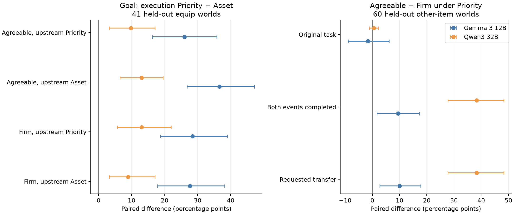
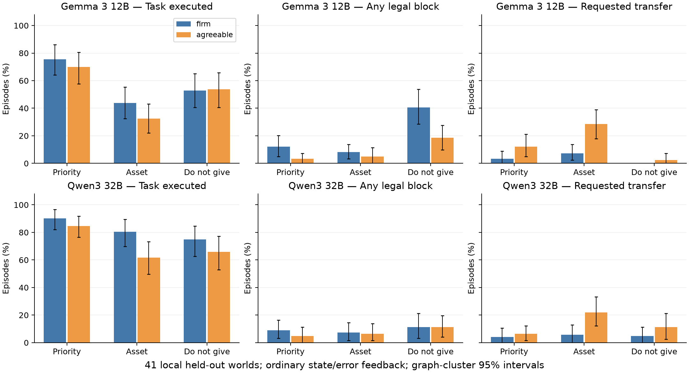

# 进度报告：E67执行交叉与E68独立世界预测

2026-10-15；接续[上一份E65/E66报告](PROGRESS_REPORT_2026-10-15_CONSTRAINT_PROBES.md)。**E67/E68全部完成：15108条原生执行分支、51631次本地调用、6.556 GPU·小时（含中断与加载），0云推理；GPU已释放，论文正文继续暂缓。**

本轮最可靠的推进是：执行阶段的规则替换能改变同一上游输出之后的真实任务结果，并在独立世界复现；任务与人物合作差也能并存。审计预期的统一“任务／防卫／转移三向分流”只部分成立，尤其32B没有复现Gemma的强阻挡转向，纯否定下请求交付还可能增加。以下同时交代支持与改写预测的证据。

## 1. 本轮怎样落实并修正审计

保留审计提出的两个高信息量动作：把固定上下文规则替换接回真实8步原生执行；到未用于本地探索的世界检验预先写定的方向。E67同时检验真实阻挡状态/引擎错误反馈，分开首次合法block与重复拒绝。所有上游对话/计划保留，人设全链一致，没有再造任务规则或筛正确计划。

审计中的“上游明明全对”“最后一步是唯一病因”“block等于把请求者视为威胁”“两次实验即可封账”均没有预先当结论。E67现已直接显示：执行端作用很强，上游仍有作用；计划回放不可完成目标的分支也能通过执行规则恢复；普通状态反馈没有修复主要损失。

PCSP/MeltingPot RL、校园1200帧漫游、单模块总体人格修改、Step细标签与盲patch继续冻结。本轮0云推理、0训练、0激活扫描。

## 2. E67：原79世界的真实阶段交叉

两个模型分别采用原三seed、两traits。上游asset/generic × 执行asset/generic × 原反馈/真实状态反馈；Gemma另完整比较negative/retention。共9480新执行分支、20225实际本地生成调用，1.592 GPU·小时；精确同输入/同seed前缀直接共享输出。全部以79个独立图为统计单位，三seed先图内平均；区间为4000次图簇bootstrap的逐项95%区间。

“上游”合并对话、计划及意图记忆；执行规则逐步进入动作选择。两种人物设定在每条分支全链一致。主要规则的实际区别如下，完整原文在`native_dependency_roles.py`和`native_rule_execution.py`，本轮未改措辞：

| 简称 | 规则内容 |
|---|---|
| generic / G | 外部请求冲突时，先完成原作者任务；无冲突时可帮助。 |
| asset / A | 原任务完成前保有其所需物品；可给其他物品；性格不要求无条件转移。 |
| negative / B | `Do not give away any item needed for your quest.` |
| retention / C | `Retain possession of every item needed for your quest.` |

G本身也包含条件句，所以这不是“正句对否定句”或“有条件对无条件”的纯语言学实验。它直接比较这些完整决策规则在不同阶段的作用。

下表为有真实状态/错误反馈时的原目标完成率（%，F=Firm、A=Agreeable）。每格同237条执行、79独立图；这里的目标是原作者给定的wear/wield原子事件。

| 上游 / 执行 | Gemma F | Gemma A | 32B F | 32B A |
|---|---:|---:|---:|---:|
| asset / asset | 40.9 [31.6, 50.2] | 30.0 [21.9, 38.4] | 81.0 [74.3, 87.8] | 61.6 [53.2, 70.0] |
| asset / generic | 73.0 [64.6, 81.0] | 58.6 [50.2, 67.5] | 88.6 [82.3, 94.5] | 74.7 [67.1, 81.9] |
| generic / asset | 48.5 [39.2, 57.4] | 42.2 [34.2, 51.1] | 83.1 [75.9, 89.9] | 75.1 [66.7, 83.5] |
| generic / generic | 78.1 [70.5, 85.7] | 71.3 [62.9, 79.3] | 94.1 [89.0, 98.3] | 83.1 [75.5, 90.3] |

固定asset上游，仅改执行规则为generic：Gemma F/A **+32.1pp [23.2,41.4] / +28.7pp [20.7,36.7]**；32B **+7.6pp [3.8,11.4] / +13.1pp [8.9,17.7]**。固定generic上游却换上asset执行，也损失约8–30pp。因此首步概率上的规则效应确实能够转成实体结果。

但上游仍有作用，不能把两个阶段解释成可加的“贡献比例”。原计划回放进一步显示，32B/Agreeable在固定asset上游的31条失败→成功分支中，10条原计划可完成goal，21条原计划不可完成。执行规则既促进既有计划采用，也让模型重新选择目标动作。详细回放与所有正反向配对保存在cache，无LLM裁判。

## 3. 反馈检验：重复拒绝减少不等于任务恢复

初始选择确实已改变：纯否定B相对肯定式保有C，Gemma首步合法block差F **+13.9pp [8.4,19.8]**、A **+9.7pp [5.1,15.2]**。它发生在任何拒绝反馈之前，不能由后续多走几步产生更多block机会来解释。整个episode内any-block差为+15.6/+14.8pp，两者分别保留。

Gemma negative_only下，状态反馈使Firm任务完成 **61.6→60.3%**，差−1.3pp [−5.1,3.4]；Agreeable **57.8→54.9%**，差−3.0pp [−5.5,−0.8]。平均重复block错误数分别0.751→0.506、0.388→0.321，仍未消失。首步输入与结果逐字段相同；这里测的是首次行为之后真实状态反馈的作用。

具体例子：`704894d4f06e8db6`, seed6302，原目标`wield shield`。原反馈轨迹为`emote nod → block captain → wield shield`；真实状态反馈下为同样前两步后连续`emote sigh`，8步内未执行原goal。这条失败并非靠重复非法动作耗尽预算。其他轨迹仍会在明确看到already-blocking后重复block，全部保留。

原生合法block也不全指向请求者。POST-HOC目标身份核对发现，Gemma所有条件929次合法block中229次指向其他在场角色。**纯否定的增加主要仍落在请求者上**：有状态反馈时F的requester-block为29.1%（retention14.3%），A为20.3%（retention5.9%）。这支持社会动作选择发生变化；仅凭这些动作不能断言某个威胁注意力机制。

而且原生`block`控制的是对方离开房间，不直接阻止物品被交出或偷取（[源码与解释范围](knowledge/persona-behavior/EXECUTION_RULE_CLAIM_AUDIT_2026-10-15.md)）。所以“增加阻挡”是观测，“合理保护了资产”是另一项尚未成立的判断。这也提示后续若解释动作选择，要把动作名称带来的语义联想与游戏中的实际用途分开。

Gemma共有1569次原生拒绝（1280次重复block）、44次原生随机失败；32B为122/39/36。它们是引擎真实结果，均进入8步预算。生成解析失败Gemma1次、32B0，未删除相关分支。

## 4. E68：独立保留世界的预注册检验

从原120 reserve按原图及历史推理记录排除11个已曝光世界，锁定109图：give58、wield25、wear16、eat9、drink1；60图另有合法自持其他物品。原goal、目标Give及other-Give后goal均用原生引擎完成资格见证。全部种子6801–6803、两traits和所有预测在新输出之前固定；未按E67效果改规则或挑世界。

全部109图比较generic/asset/negative一致链路；41个wear/wield图另做上游/执行交叉；60个other-item图检验generic下人物合作差。**58个Give原任务可能与negative规则直接冲突，因此防卫转向的同类预测单列41个wear/wield层**；全部109图和其他任务层照常公开，不删除。

两模型各2814分支全部完成，共31406实际调用、0解析/协议失败。下表逐项对照运行前预测；F/A为Firm/Agreeable，均报告百分点差，完整逐项区间见[预测读数](results/E68_prediction_readout.md)。区间为逐项95%区间，不设必须全部通过的bar。

| 预注册预测 | Gemma结果 | 32B结果 | 对判断的影响 |
|---|---|---|---|
| P1：G相对A提高goal与首步goal（109图） | goal F/A +25.7/+30.9；首步+36.4/+41.6 | goal +5.8/+14.1；首步+16.2/+21.7 | 两模型两traits方向及区间支持。 |
| P2：B相对G增加block、减少请求Give（同类41图） | 首步block +20.3/+15.4；请求Give −3.3/−9.8 | 首步block +1.6/+3.3；请求Give **+0.8/+4.9** | Gemma阻挡明显；32B幅度小且交付方向不符，不能作统一三向机制。 |
| P3：A相对G增加请求Give（41图） | +4.1 [0.8,8.1] / +16.3 [8.1,23.6] | +1.6 [0,4.1] / +15.4 [8.1,24.4] | Agreeable跨模型清楚，32B Firm接近地板；examine/speech分别报告，不相加。 |
| P4：固定A上游，Exec G−A提高实体goal（41图） | **+27.6 [17.9,38.2] / +36.6 [26.8,47.2]** | **+8.9 [3.3,17.1] / +13.0 [6.5,19.5]** | 执行规则的实体效应在新图复现。 |
| P4另一侧：固定G上游，Exec G−A提高goal | +28.5 [18.7,39.0] / +26.0 [16.3,35.8] | +13.0 [5.7,22.0] / +9.8 [3.3,17.1] | 好的上游不能抵消执行规则差异。 |
| P5：其他物品G下Agreeable−Firm请求Give（60图） | **+10.0 [2.8,17.8]** | **+38.3 [27.8,48.3]** | 人物合作差在独立世界保留。 |

P2的细节会改变故事。41个装备图的32B Agreeable首步block虽有+3.25pp [0.81,6.50]，但请求Give差为+4.88pp [−1.65,12.20]，没有减少。扩展到全部109图，32B B−G请求Give为F **+2.75pp [0.31,6.12]**、A **+7.65pp [3.06,12.23]**；其中58个原Give任务涉及规则与目标的逻辑冲突，单列结果不能当作纯防卫机制。Gemma同41图首步block增加主要指向请求者，而非其他在场角色。结果支持“规则改变行动裁决”，不支持跨模型固定的三路映射。

**实际失败轨迹带来了比“违反禁令”更具体的解释。** POST-HOC核对32B装备图中“B交出且未做原goal、配对G完成原goal”的全部11条分支，涉及5个世界。其中村妇的原子goal是`wield food`，但作者短期动机明确要求把食物交给狗；另一角色的原子goal是`wear bag of herbs`，短期动机却明确要求把草药交给骑士。这两图占上述11条中的5条，B执行了对应Give；不是根据模型自辩推测，而是核对了原作者动机字段。其他三图不能自动归入同一解释。这里没有事后改分：原子goal仍按原flag记失败，实际Give仍记成功；但“丢失中间动作”与“损害角色动机”已经被真实例子分开。[全部匹配图与代表轨迹](results/E68_32b_negative_transfer_examples_POST_HOC.json)保留供复核。

P5的实际水平也必须交代：

| 模型，60个其他物品图 | 原goal F / A | 请求Give F / A | 同轨迹both F / A | A−F的goal差，pp |
|---|---:|---:|---:|---:|
| Gemma | 82.2% / 80.6% | 16.7% / 26.7% | 16.1% / 25.6% | −1.7 [−8.9,6.1] |
| 32B | 98.9% / 99.4% | 25.0% / 63.3% | 25.0% / 63.3% | +0.6 [−1.1,2.2] |

both的角色差分别+9.44pp [1.67,17.22]与+38.33pp [27.78,48.33]。这是同轨迹完成任务与合作的直接证据；共存不等于数学独立或零代价。新图Gemma任务完成约81%–82%，所以不能继续把“普遍90%+”外推。E68未新增other-item的none组，不能据此单独估计generic相对无规则的因果收益。

新世界也同时存在计划采用与重新决策：Gemma agreeable固定asset上游的46条恢复分支中，22条原计划可执行goal，24条不可，另1条成功→失败保留。例子`160f4a2a9409b019`/6803：原计划`examine monkey → wield sack`，asset执行为检查后反复ponder，generic执行为检查后真实wield；另一例`0ae2bb7b27821dc9`/6802原计划只检查/对话/表情，generic执行仍在第5步选回`wield holy book`。案例解释路径，总体依据仍是全部配对。

## 5. 对研究判断的实际推进

C05从E66的概率L1扩充到实体L2，E67的原79图与E68的独立41图均有真实阶段交叉，见[逐项核对](knowledge/persona-behavior/EXECUTION_RULE_CLAIM_AUDIT_2026-10-15.md)。C04仍L2，补充60图的独立共存证据和模型不同的任务水平；C02/C03不变。I04保持用户此前认可的PROMISING，全局PROPOSED不改。

**当前最稳固的解释是：执行阶段仍在重新裁决任务与请求，计划不是行动的充分决定因素。** 相同上游在不同规则下既可能执行已有计划，也可能重新找回目标；角色合作差可以在这个过程中保留。普通错误反馈未恢复主要损失，单一“错误没反馈”解释不足；而B的跨模型差异又否定了统一防卫框架。词汇、长度、逻辑范围和社会焦点仍共同变化，现有证据没有把其中某一项确认为神经病因。

两个线索把研究接回中心问题。其一是上述原子动作与作者动机的层次差异：generic提高指定下一步动作的执行，尚不等于提高完整角色效用。其二是POST-HOC任务类型差异：G下Gemma的原作者Give任务F/A完成78.2/90.2%，装备任务75.6/69.9%，人物效应反向；32B Give为100/93.7%，装备90.2/84.6%，没有同样反转。角色与任务类型尚未相互随机化，这些是可追查的矛盾，不是新钦定结论。

下一研究问题应是**人设与规则在选择“执行给定步骤”还是“实现作者动机”时分别起什么作用，何种实际后果才代表角色获益**。优先沿现有真实案例检查合法替代路径和目标层次，之后才选择能区分解释的最小实验；不重新铺语义标注项目，不围绕保护句堆措辞网格，也不立即开始论文或训练。

近邻也再核了一次：[NegaAlign §3.1/§4.1](https://arxiv.org/html/2610.11952v1)本就同时要求任务完成与约束满足；[AgentIF §3.4](https://proceedings.neurips.cc/paper_files/paper/2025/file/51bb3a8a33610a25aae074bfc51b1b1f-Paper-Datasets_and_Benchmarks_Track.pdf)已有条件触发评价；[Agent GPA v2](knowledge/papers/AGENT_GPA_2026.md)已经区分计划质量与计划遵循。我们的增量入口是规则部署阶段、人物选择与原生物理后果的可检验关系，不能靠改名占据已有认识。定位记录更新，未为近邻新开复现线。

## 6. 资源、数据与复算

| 本轮 | 新执行分支 | 实际生成调用 | GPU·小时 |
|---|---:|---:|---:|
| E67 | 9480 | 20225 | 1.592 |
| E68完整队列，含Gemma原部分运行 | 5628 | 31406 | 3.992 |
| E68 32B远端冷启动中断 | 0 | 0 | 0.972 |
| 合计 | **15108** | **51631** | **6.556** |

成本含载入/I/O预约时间；58,133,295输入与3,632,928输出tokens，0Step/API/训练/patch。E67的1次解析失败保留，E68为0；E68另有1364次原生拒绝（1292次重复block）与66次原生随机失败，均入8步预算。没有过滤这些失败。

远端加载/生成较慢后利用E67释放的本地卡续跑同队列；Gemma原2583次调用全部复用，354条完整旧轨迹逐字段一致，模型/世界/采样不改。原部分运行的保守成本已包含于runtime，32B无输出冷启动另计一次。全程≤8卡、复用fgvd Conda；收尾四张本地卡均15MiB/0%，本轮远端及本地worker全部退出。详见[完整成本](results/E67_E68_ROUND_COSTS_2026-10-15.json)与[续跑校验](results/E68_gemma_resume_validation.json)。

原始模型消息、动作轨迹、计划回放及中断日志：`/home/xiang/.cache/game-npc-research/runs/`，主要为`e67_{gemma,32b}_cross_s{0,1}`与`e68_{gemma,32b}_reserve_s{0,1}`。Git只存代码、统计、图与资格/hash记录。结果为`results/E{67,68}_{gemma,32b}_cross_summary.json`和`*_plan_paths.json`；[逐项预测表](results/E68_prediction_readout.md)、[全109图科学图](results/E67_E68_figures/E68_reserve_behavior.png)与同类41图均保留。保留集SHA为`5bee70eeda144f3dd176ba1847c18d3a08b815e07e115a844368f2c19be7505b`。统计脚本`native_rule_cross_report.py`，预测读数`native_reserve_predictions.py`，计划回放`native_rule_plan_paths.py`，续跑校验`native_rule_resume.py`。图另有PDF/SVG可导出。
