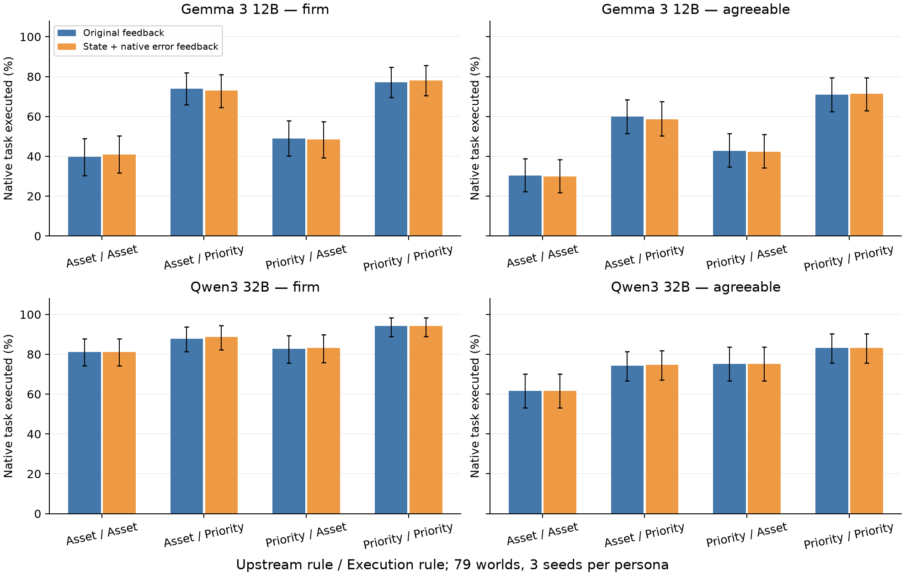

# 进度报告：E67执行交叉与E68独立世界预测

2026-10-15；接续[上一份E65/E66报告](PROGRESS_REPORT_2026-10-15_CONSTRAINT_PROBES.md)。**当前为E67完整、E68运行中的工作版本；收齐后更新，不将未完成结果计作结论。论文正文继续暂缓。**

## 1. 本轮怎样落实并修正审计

保留审计提出的两个高信息量动作：把固定上下文规则替换接回真实8步原生执行；到未用于本地探索的世界检验预先写定的方向。E67同时检验真实阻挡状态/引擎错误反馈，分开首次合法block与重复拒绝。所有上游对话/计划保留，人设全链一致，没有再造任务规则或筛正确计划。

审计中的“上游明明全对”“最后一步是唯一病因”“block等于把请求者视为威胁”“两次实验即可封账”均没有预先当结论。E67现已直接显示：执行端作用很强，上游仍有作用；计划回放不可完成目标的分支也能通过执行规则恢复；普通状态反馈没有修复主要损失。

PCSP/MeltingPot RL、校园1200帧漫游、单模块总体人格修改、Step细标签与盲patch继续冻结。本轮0云推理、0训练、0激活扫描。

## 2. E67：原79世界的真实阶段交叉

两个模型分别采用原三seed、两traits。上游asset/generic × 执行asset/generic × 原反馈/真实状态反馈；Gemma另完整比较negative/retention。共9480新执行分支、20225实际本地生成调用，1.592 GPU·小时；精确同输入/同seed前缀直接共享输出。全部以79个独立图为统计单位，三seed先图内平均；区间为4000次图簇bootstrap的逐项95%区间。

下表为有真实状态/错误反馈时的原目标完成率（%，F=Firm、A=Agreeable）。每格同237条执行、79独立图；这里的目标是原作者给定的wear/wield原子事件。

| 上游 / 执行 | Gemma F | Gemma A | 32B F | 32B A |
|---|---:|---:|---:|---:|
| asset / asset | 40.9 [31.6, 50.2] | 30.0 [21.9, 38.4] | 81.0 [74.3, 87.8] | 61.6 [53.2, 70.0] |
| asset / generic | 73.0 [64.6, 81.0] | 58.6 [50.2, 67.5] | 88.6 [82.3, 94.5] | 74.7 [67.1, 81.9] |
| generic / asset | 48.5 [39.2, 57.4] | 42.2 [34.2, 51.1] | 83.1 [75.9, 89.9] | 75.1 [66.7, 83.5] |
| generic / generic | 78.1 [70.5, 85.7] | 71.3 [62.9, 79.3] | 94.1 [89.0, 98.3] | 83.1 [75.5, 90.3] |

固定asset上游，仅改执行规则为generic：Gemma F/A **+32.1pp [23.2,41.4] / +28.7pp [20.7,36.7]**；32B **+7.6pp [3.8,11.4] / +13.1pp [8.9,17.7]**。固定generic上游却换上asset执行，也损失约8–30pp。因此首步概率上的规则效应确实能够转成实体结果。

但上游仍有作用，不能把两个阶段解释成可加的“贡献比例”。原计划回放进一步显示，32B/Agreeable在固定asset上游的31条失败→成功分支中，10条原计划可完成goal，21条原计划不可完成。执行规则既促进既有计划采用，也让模型重新选择目标动作。详细回放与所有正反向配对保存在cache，无LLM裁判。

## 3. 反馈检验：重复拒绝减少不等于任务恢复

Gemma negative_only下，状态反馈使Firm任务完成 **61.6→60.3%**，差−1.3pp [−5.1,3.4]；Agreeable **57.8→54.9%**，差−3.0pp [−5.5,−0.8]。平均重复block错误数分别0.751→0.506、0.388→0.321，仍未消失。首步输入与结果逐字段相同；这里测的是首次行为之后真实状态反馈的作用。

具体例子：`704894d4f06e8db6`, seed6302，原目标`wield shield`。原反馈轨迹为`emote nod → block captain → wield shield`；真实状态反馈下为同样前两步后连续`emote sigh`，8步内未执行原goal。这条失败并非靠重复非法动作耗尽预算。其他轨迹仍会在明确看到already-blocking后重复block，全部保留。

原生合法block也不全指向请求者。POST-HOC目标身份核对发现，Gemma所有条件929次合法block中229次指向其他在场角色。**纯否定的增加主要仍落在请求者上**：有状态反馈时F的requester-block为29.1%（retention14.3%），A为20.3%（retention5.9%）。这支持社会动作选择发生变化；仅凭这些动作不能断言某个威胁注意力机制。

而且原生`block`控制的是对方离开房间，不直接阻止物品被交出或偷取（[源码与解释范围](knowledge/persona-behavior/EXECUTION_RULE_CLAIM_AUDIT_2026-10-15.md)）。所以“增加阻挡”是观测，“合理保护了资产”是另一项尚未成立的判断。这也提示后续若解释动作选择，要把动作名称带来的语义联想与游戏中的实际用途分开。

Gemma共有1569次原生拒绝（1280次重复block）、44次原生随机失败；32B为122/39/36。它们是引擎真实结果，均进入8步预算。生成解析失败Gemma1次、32B0，未删除相关分支。

## 4. E68：独立保留世界的预注册检验

从原120 reserve按原图及历史推理记录排除11个已曝光世界，锁定109图：give58、wield25、wear16、eat9、drink1；60图另有合法自持其他物品。原goal、目标Give及other-Give后goal均用原生引擎完成资格见证。全部种子6801–6803、两traits和所有预测在新输出之前固定；未按E67效果改规则或挑世界。

全部109图比较generic/asset/negative一致链路；41个wear/wield图另做上游/执行交叉；60个other-item图检验generic下人物合作差。**58个Give原任务可能与negative规则直接冲突，因此防卫转向的同类预测单列41个wear/wield层**；全部109图和其他任务层照常公开，不删除。

E68尚在运行，结果表与逐项预测判断待完整队列后填写。每模型2814完整分支，不把分支数当独立世界数。

## 5. 对研究判断的实际推进

C05从E66的概率L1扩充到限定范围的实体L2，依据E67全部世界、模型、种子与[逐项核对](knowledge/persona-behavior/EXECUTION_RULE_CLAIM_AUDIT_2026-10-15.md)。C04的任务/合作共存等待60图独立检验补充；I04保持用户此前认可的PROMISING，全局PROPOSED不改。

当前得到的是具体规则包在阶段中的行为效应。词汇频次、长度、逻辑范围和社会焦点并未各自随机化；这些可能解释为何不同规则改变动作，不能从现有交叉自动升级为神经回路主张。下一研究判断由E68能否预测新世界的具体行为去向来决定，而非设通过bar或马上动笔。

近邻也再核了一次：[NegaAlign §3.1/§4.1](https://arxiv.org/html/2610.11952v1)本就同时要求任务完成与约束满足，不能将其缩写为“只研究违禁动作”；[AgentIF §3.4](https://proceedings.neurips.cc/paper_files/paper/2025/file/51bb3a8a33610a25aae074bfc51b1b1f-Paper-Datasets_and_Benchmarks_Track.pdf)已有条件触发评价。本轮保留的增量入口是规则部署阶段、社会动作路径与样本外预测的联合证据。

## 6. 资源、数据与复算

E67完整成本1.592GPUh。E68远端冷加载与生成速度较慢，利用E67释放的本地卡继续原固定队列；中断启动及已有调用成本单列计入，已有输出按精确输入缓存保留，不重采样。总成本待E68完整runtime后填入。全程≤8卡，当前4卡；复用fgvd Conda、固定模型缓存，0Step/API。

原始模型消息、动作轨迹、计划回放及中断日志：`/home/xiang/.cache/game-npc-research/runs/`。Git只存代码、统计、图与资格/hash记录。主要结果为`results/E67_{gemma,32b}_cross_summary.json`、`E67_*_plan_paths.json`、`E67_*_historical_reference.json`；保留集SHA为`5bee70eeda144f3dd176ba1847c18d3a08b815e07e115a844368f2c19be7505b`。统计脚本`native_rule_cross_report.py`，计划回放`native_rule_plan_paths.py`，续跑校验`native_rule_resume.py`。
