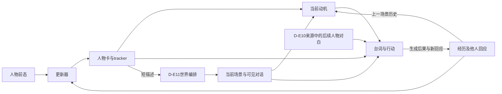

# 研究审计：人物经历、后续反应与训练的职责

**本轮注册任务及执行agent审计已完成（2026-10-24）。** D-E11/D-E12/D-E13全部终止、归档并核验，没有追加训练配方或模型实验。审计完成不等于核心科学问题已解决，也不是独立盲审或人签字的科学价值裁决。工作台仍ACTIVE-MAIN，D-I01仍SEED。[D-E11](results/D-E11-RESEARCH-REPORT.md) · [D-E12](results/D-E12-RESEARCH-REPORT.md) · [D-E13](results/D-E13-RESEARCH-REVIEW.md)

**结论：方向仍应围绕人物怎样从经历形成自己的理解，并改变或保持之后的反应规律。当前基线建设推进得比这项能力的直接测量更快，确有局部化和优先级偏移；但不能把必要基线训练一概称作无用。** 新训练的理由应来自一个可检验的人物能力或成本目标，不能由末端总分未涨自动推出下一份配方。

2026-10-23用户明确要求：当前跑完后，仔细核验方向是否围绕问题，是否经历局部优化/无效优化，不能继续无根据地运行。本文件记录执行边界；工作台仍ACTIVE-MAIN，D-I01仍SEED，B/I01仍PAUSED、A仍CLOSED，没有代替用户改研究线状态。

## 立即执行的边界

- D-E11、D-E12、D-E13已按原预算收尾，不重开；后续引用这些记录时保留所有资格与缺失。
- 不新建或启动下一项模型实验，不追加配方、seed、模型、提示版本、样本或预算；不因结果未达预期延长预算或重跑失败部分。
- D-E11的U/MT路径均已预算停止并保留；评分在原预算内结束，不重开。不得把未运行/无有效状态的部分补成成功或从全量分母中藏掉。
- 只做必要的记录/编排故障处理、来源核对、离线复算和科学阅读。发现读数实现错误时保留原始记录并明确更正，不能事后改量表去得到期望结论。
- 本次没有启动反事实经历实验或新训练；D-E13的状态配对分数仍不能直接作训练奖励。下文是问题与方法职责的判断，不是自动启动下一项模型任务的队列。

## 核心问题与核验尺度

核心问题：**一个角色如何根据已有身份、目标与关系理解自己经历的事，并在之后不同互动中形成有依据、有人物差异、可持续的变化？** 合理保持、疏远或变得不友善都可能成立；状态文字变长、模型更顺从、或更像原作都不是统一成功标准。

审计按ACL/EMNLP/NAACL主会所要求的实质贡献、原创性与证据可靠性讨论，不用个人品味自动否决方向，也不以“有人做过”关闭矿区。会议日期只作为外部窗口，不排倒计时日程。

每项实验必须回答以下问题，并引用实际输入、代码、结果及失败记录：

1. **问题对齐：** 实际干预的变量、被测变量和估计对象是什么？它测的是阶段遵循、状态拟合、上下文消费、经历的因果作用，还是角色—世界耦合系统？不能互相代称。
2. **信息通路：** 原始经历、发布后态、动机、当前场景提示和历史中的角色自身回复分别在哪里出现？所谓frozen/no-persona/positive control是否真的实现了声称的干预？
3. **测量资格：** 输出格式有效、语义合适、行为可区分和成长正确是否被混写？参考是否唯一？source/phase/角色键是否确实绑定？正控、空对照与缺失处理是否有效？
4. **训练与比较：** 样本/目标token/forward预算/监督范围/信息量是否匹配？是否完整执行预登记？是否拿受限配方或较弱系统制造算法必要性？
5. **证据强度：** 独立单位、种子、评委、CI、重复和源资格是什么？均值接近不等于无效或等价；行为不同也不自动等于合理适应。
6. **科研信息增量：** 这一项确实改变了哪个判断？负结果与未完成/无效测量分开。工程资产可以有用，但不能替代主问题的证据。
7. **局部优化：** 是否围绕身份名、手表、窗口、输出长度或某个评分器反复修补，挤走了整体人物问题？必要纠错何时应结束，哪些后续投入应停止？
8. **贡献与下一步：** 相对直接近邻的完整增量是什么？没有新算法也可以有重要发现，但必须有足够证据；不能只换干预变量的名字。审计之后的下一步须有清楚、可检验的科学理由。

## 已核实的设计事实与解释边界

- D-E10 frozen保留了47/47条原生上一场景互动，其中32条与目标经历逐字相同。冻结的是持久卡，不是经历输入；经历仍可经动机进入回复。87/87演员请求保留来源中间对白，40条含人物在新场景中的既有assistant回复；独立下一轮预测不等于自主连续成长。
- released同时使用发布后态和发布动机，frozen使用旧态和新生成动机，两者不是纯粹的状态单变量对照。其直接差为+0.101，六作品95%CI[-0.033,+0.228]；不能据此作等价结论或宣称无学习信号。
- 同一质量分数可以对应不同的合理行为。平均质量差并不是经历依赖的直接读数。
- D-E12修复首回复监督覆盖，对建立训练参照有价值；但它仍不直接干预经历。必须审查这项投入是否优先于尚未建立的主读数效度，不能自动称为围绕核心问题的增量。
- D-E11让经历实际分叉，但人物短描述又影响世界的选角和场景安排，且采样路径随生成改变。它测耦合系统，不能直接分离人物更新、演员和世界模型的作用。
- D-E13仅校准已给定状态的行为对应，不是经历干预。23/25候选有实际相应轴状态；来源缺失保留。其配对分数不应自动等同纯敏感性或成长正确率。

## 各项审计结果

| 实验 | 核验重点 | 当前可用结果 |
|---|---|---|
| D-E01/02 | 官方任务复现究竟支持哪些能力；信息量/时点/输入状态覆盖 | 已完成，作为演员与状态供给基础 |
| D-E03/07 | Monte来源错误影响哪些读数，纠源与科研贡献是否分开 | 错误旧表保留，纠源表完成 |
| D-E04/05 | 状态形成/强普通系统成功与单例残差；是否过度局部化 | 已完成，不能据残差推统一机制 |
| D-E06 | 连续更新与后续行为的联接、共享动机/上下文作用 | 已完成，未见一致递归退化 |
| D-E07/08 | 同信息整理和强教师是否提供新判断；是否应在这里停止追加 | 已完成，无明确总体轨迹增益 |
| D-E09 | 9.080 GPU小时未得到演员/评分，未回答什么；资产与成果分开 | 预算停止，不能用完成者子集替全量 |
| D-E10 | 训练目标/信息旁路/质量与因果效果、首回复MT覆盖 | 完整结果及12人物审阅已保存 |
| D-E11 | 世界运行限制、状态键覆盖、完整/部分轨迹与因果解释边界 | 已收尾：506互动、190来源合格评分中183可解析；无完整六作品质量比较 |
| D-E12 | 完整监督到底改变什么；是否仍只是配方层收益 | 训练及87后续回复完整；严格评分缺1项，原数字复核3.876，对旧MT +0.004 [-0.172,+0.194]，未见明确恢复 |
| D-E13 | 正控/空对照/证据引用/换序是否有效，工具成功的适用范围 | 231判别完成；参考88.9%，空对照46/46弃权；真实材料换序不稳，不能直接作奖励 |

**19:04生成终态补核：** D-E11正式三路径1,913生成/506互动，原预算内终止；各4/6完整轨迹，但作品集合不同，共同完整仅3作品。base另有固定输入上下文失败，U/MT在到达最后作品前预算停止；不能用各自幸存者均分比较。调用、token与路由核验通过；世界状态重写分别占72.5%/54.8%/68.4%生成耗时。启动前端到端预算/全cohort输入资格核验不足，应明确记为执行缺口。[研究报告](results/D-E11-RESEARCH-REPORT.md)与[逐书审阅](results/D-E11-CASEBOOK.md)保留具体承诺、合理保持、未定结局被状态确定化等观察，不据单例自动开始补丁实验。

D-E10另核对693条judge输入：七系统量表一致，87问题的共同经历/情境完全一致，仅候选动机/回复不同。原质量比较的这一公平性通过；D-E13的配对换序问题不能直接作废另一套D-E10量表。不同评价任务的效度分别判断。

**19:19进一步发现并止损：** D-E11官方PF/SSF/MDB把实际场末tracker标成场前态。停止错误视图的继续评分，129个原任务统一来源失效；18条已返回完整保留，2条可能在途的输出/token未知。只在原4小时预算内继续不受该字段影响的PUF/MQ/CR/PES，9条已有有效来源记录复用，不新增修正输入实验。这个问题是我们启动前核验不足的一部分，不能用“官方代码如此”免除责任，也不把修它包装成主线创新。[具体证据与处置](results/D-E11-RESEARCH-REPORT.md)

**21:43评分及归档终态：** 合格190项首轮177可解析，13次登记恢复后183；7项仍格式无效，129时间视图失效与4缺profile另列。保存212次judge回复（含9错位视图），未知在途2项不补造。全部分数/聚合/输入绑定已离线复核，201文件包逐成员SHA通过。MQ只评价入口动机，PUF/PES有各自持久化/平滑性目标，均非已识别的成长效应；有些裁判理由也误读已有前态，CASEBOOK保留正反例。本项生成与评分合计11.172 GPU进程小时，不含D-E10训练；不把稳定重评分等同构念有效。

**D-E12最终补核：** 261步/16,684序列/85.900M forward tokens全部完成。更新、动机、完整互动验证NLL分别降至1.073/1.571/2.340；47状态、47动机、87最终回复均有效。严格主评分86/87，一项Gautama五维均为1但reason的引号错误，原主表不改。POST-HOC直接读取不变的原数字后宏均3.876，旧MT3.872，差+0.004，六作品CI[-0.172,+0.194]；未解析项任取1–5时，全cohort点估计范围3.876–3.960（不是CI）。补齐监督没有在本轮恢复整体分数，但这不等于训练没有学到来源映射，更不等于经历学习不可能。全部模型/输入/缓存/原分及统计复核通过，89文件持久包已校验。[详报](results/D-E12-RESEARCH-REPORT.md)

## 已完成部分的实质判断（后续结果不能消除这些设计事实）

**方向仍对齐人物经历与后续互动；执行已经出现局部优化及优先级偏移。** 这不是“全部工作都无效”，也不能用“每项都留下资产”替投入辩护。最明显的偏移是：在主读数尚未识别经历作用时，持续投入改状态资料、加强教师、修训练监督，再期待同一质量分数出现提升。

| 工作 | 保留的科学信息 | 局部化/无效投入判断与结束边界 |
|---|---|---|
| D-E01/02官方基线 | 专用阶段训练和现成状态表示确实有用，不能从弱基线虚构困难 | 必要驻留；复现原论文增益本身不是我们的贡献，不继续围绕原指标刷分 |
| D-E03错误Summary来源 | 无有效六作品Summary结论；39条错误时点回复明确撤回 | 这是适配错误产生的无效测量。D-E07纠源必要，不能称算法改进 |
| D-E04/05主体与撤回事实 | 发现有限的归属/事实问题；一句提示及强Step能解决一部分，阻止过强困难叙事 | 首次诊断与强普通对照有信息；再围绕Johnny/Troy修名、修字段就会替代主问题，不继续 |
| D-E06连续状态 | 在原生动机/来源上下文下没有跨消费者一致退化 | 合法组件测量；不能据来源句NLL证明/否定成长或历史惯性 |
| D-E07/08同信息整理 | 强教师能修具体关系事实，但完整阶段轨迹未明确受益 | 已回答“普通整理是否明显恢复”这一问题；再增加教师或措辞版本缺少新增判断价值 |
| D-E09全前缀 | 冻结普通管线在预算内未完成，暴露执行成本 | 9.080 GPU小时、0演员/0judge，**没有回答主要角色能力问题**。完整记录值得保留，但资产不能抵消这个科学产出缺口；不补窗口追分 |
| D-E10标准训练 | 建立可训练参照，U拟合改善、质量收益未明；普通32B更好 | 不是无效训练，但将它解释为“经历对行为没有影响”无效。主问题识别应比继续配方投入更早核验 |
| D-E12完整对话监督 | 补齐目标覆盖；原数字质量与旧MT接近，中位回复仍14词 | 对监督公平性必要，但“遗漏多轮监督是原下降原因”未获确认；仍未识别经历作用，不接学习率/轮数/混合比例搜索 |
| D-E11原生生成 | 不再只预测原作下一句，可观察自己行动、他人回应与反思 | 角色—世界耦合、单seed、短轨迹、覆盖不足限制因果解释；格式/长度/未知角色键不是成长失败，不为凑整表补跑 |
| D-E13测量校准 | 暴露“正控平均可辨”与“真实回复逐对可靠”不相同 | 已完成必要校验；不能把接下来反复修judge当新的主线 |

这里的“未明确增益”不等于统计等效；“无效测量”也不等于模型能力没有。保留D-E10的C03为L0，但不增加“先验压倒经历”“状态与行为脱节”等机制主张。训练和运行成功属于执行事实，不是研究成功。

强基线训练本身是用户明确要求且必要的工作，不能因为核心问题还未被识别，就把所有训练一概判无用。优先级问题在于：状态整理/配方建设推进得更快，而针对主问题的测量资格没有同步成熟。已有记录没有超参数/幸存seed搜索；后续也不应把当前缺少区分度当成继续调配方的自动理由。

原论文训练与推理设置已再核：当前是固定预算的角色端参照，并非完整EW系统复现；差别和阅读范围见[权威论文卡](../../../library/themes/game-npc-social/papers/EVOLVING_WORLD_2026.md)。固定一个世界模型是合法的条件比较，但不能据此称完整强近邻已经失败。无需先穷尽所有系统才允许提出方法；需要的是方法动机与所声称能力匹配，不用受限基线替自己制造必要性。

## 后续研究的中心对象与训练职责

**研究单位是“人物原有的理解/关系＋一次本人可知的经历＋之后不同的互动”，目标是经历条件化的人物反应规律。** 经历可以改变归因、期待、目标或应对；也可以确认原有价值。人物不必更友好、更理性或每次都选不同动作。台词、承诺、可见行动与表达分别观察；仅说“我成熟了”不能独自认证变化。

[CAPS](../../../library/themes/game-npc-social/papers/CAPS_1995.md)为人物特有的情境—行为规律提供动机，[TESSERA](../../../library/themes/game-npc-social/papers/TESSERA_2017.md)强调经历、预期、反应与后果的递归联系，[EMA](../../../library/themes/game-npc-social/papers/EMA_2009.md)提供评价与应对的过程视角。它们帮助提出对象，不为虚构人物规定唯一心理真值，也不证明LLM具有同样的人类机制。

| 真实链条提供的入口 | 核心人物问题 | 不能偷换成什么 |
|---|---|---|
| Matt在冲突后仍关心White Fang，却可改变对Scott的施压/疏远方式；Gillingham的道德立场与帮助朋友策略不必同步 | 人物怎样根据别人的回应重新解释关系，并调整实现旧价值的方式 | 修名字、改一句讽刺话，或把更温柔规定为正确 |
| Mary保持机智/物质抱负，又出现未解决的吸引；Vasudeva可以由劝告回到等待 | 哪些经历改变具体期待/应对，哪些仍应保留；保持也可以有依据 | 以profile_updated次数或“所有特质一起变”当成长 |
| Nora和Josiah在中间记录有不足时仍能接住新情境；Jim的照料回应由当前上下文强烈支持 | 已有历史、持久态、当前情境分别怎样支持后续表现 | 由质量相同宣布经历未被使用，或删除合法线索强造更新收益 |
| Alice的状态解释、世界编排和他人反应共同推动分叉 | 人物变化何处来自经历，何处来自系统预写的情境与后果 | 把一次自由生成的故事分叉等同受控的经历效应 |

这些是同一整体问题的不同结构，不是四条新项目，也不是已验证的四个失败机制。Gautama去睡觉、姓名错配、JSON格式等可以是当前系统问题，但不能因容易定位就替代人物经历学习的主旨。

**质量和经历依赖应同时存在，不能互相替代。** 同一人物在两段不同经历后，可以产生两种都很合适的回复；二者的质量分数应同样高。因此“质量差接近零”并非经历无作用的证据。需要比较的还包括：相同前史和可比后续情境下，经历改变后，人物对人和事的反应是否有依据地改变；改变是否落在该人物合理的理解范围，是否能用于别的后续互动。

目前的标准SFT提供了真实的监督学习信号，学习发布的更新、动机和对白。**它没有直接把“保存哪些经历差异才能支持后续人物反应”作为经验证的学习目标。** 三任务分别拟合来源目标，也不自动等于端到端学会了整个适应过程。训练后的低分可能涉及演员、状态、数据/任务分布或评价，当前不能选其中一个当已证机制。现有三个适配器保留为可复用参照，不再靠增加epoch、教师或场景条件来寻找一项漂亮涨分。

下一项问题级比较应让经历成为真正可比较的输入，同时让后续情境在各经历分支都成立；不继续固定由某一分支产生的原作自述或动机。先认真看完整合法历史、普通总结、现有状态更新及角色专用模型各能做到什么。允许多个合理反应，既覆盖可能改变的关系/应对，也覆盖合理保持；不能只从模型坏例或最戏剧性的反转挑样本。同分支重复用于理解自然生成差异，不要求每一对文字完全相同；“不相关”方面也须有角色与经历依据，不能机械规定所有对照都50%。

训练可以随后承担两种有清楚动机的职责，而无需先发明损失函数：

1. **完整历史能支持合理、人物特有的经历反应，压缩/更新后丢失：** 学习保留对未来多种互动有用的经历解释与关系信息。检验对象是功能上的信息保留及成本，不只是新卡像不像teacher；普通强总结、PHASE-Tree和DualMem是正面参照。
2. **信息充分时，角色仍不能把经历转成合乎自己价值/关系的应对：** 研究角色条件化的解释与表演学习，先排清任务/信息与普通指令的作用，再考虑相应后训练。不能将一条回复不同于原作直接判能力失败。

两条职责均为条件性的开放方法空间，**当前没有数据证明其瓶颈已成立**。强普通系统若已可靠完成，应保留成功，并看是否存在值得学习的迁移或成本目标；不为保住算法叙事继续制造更难条件。反过来，也不因近邻覆盖某个组件而把整个人物问题缩小或关闭。

每次新训练前应能写清：人物层面要改善的反应性质、它与经历的关系、如何从后续行为观察、基线已有能力，以及预期方法为什么作用于这个环节。训练可从驻留阶段开始，不需要等所有方法都失败；但应服务一个可检验的目标，而不是训练结束后再为总分寻找问题叙事。

## 对Claude建议的逐项判断

**采纳问题，修正推理，暂不启动新实验。** 将经历作为干预变量确实更接近玩家能改变NPC的研究对象；但不能直接用已有结果断言所有模型只是演先验，或简单换一个50%配对仪器就已解决有效性。

1. D-E10的质量近似并不表示行为相同，且frozen没有切断经历通道，released还改变动机来源。“正确后态都无用”与“没有任何学习信号”过强。当前不把该质量分数当经历依赖的已验证奖励。
2. D-E11的经历确实会不同，但由角色、世界模型与采样共同造成，是内生分叉；不能把所有旧实验概括为“经历从未改变”，也不能把这些分叉当控制良好的经历干预。
3. ArcHint接近完整Arc是**ArcANE论文的特定模型消融**，不是我们D-E01新增对照。语义轴名和阶段标签本身携带信息；专用32B-DPO仍比完整Arc低5.1逐阶段均分。它不直接证明背原著。
4. 成对匹配混合了区分度与预期方向：系统性配反也可能有强行为差异；重复事件词也可能很好匹配，却没有人物适应。D-E13又表明长回复的判别会受交换位置影响，所以不能立刻把这一数值用于训练。
5. “无关情境应回到50%”不是普遍真值：经历可能合理影响情绪与广泛关系期待。需要先说明哪些行为方面应保持，等效也不能靠区间跨50%宣告。完全相同回复空对照不能替代这项验证。
6. 同一EW场景中的不同人物具有不同信息、关系与行动位置，不能直接当干净的“人物×经历”交互。先比较同一人物的合格经历分支，再研究异质性；不要求每个人都必须改变得不同。
7. Troy手表的另一结果需要构造并核对，是有来源的最小编辑，不是两条都已观测的自然经历。事实是否记对与人物怎样因它改变是两个层次；不能把对象占有测验重新包装为成长主问题。

## 保持完整问题，同时约束证据

当前实现的信息通路可简化为下图；箭头表示实际输入关系，不是已经识别的因果效应。D-E10比较的是更新/消费系统，D-E11让整个循环分叉，两者都没有只改变根部经历E。

这说明为什么不能把frozen简单叫“没有经历”，也说明为什么世界固定同一模型仍不等于世界内容固定。合理的研究不必每一项都证明全部因果机制；自然轨迹上的预测或质量改进仍可成立。但若核心表述是“改变来自这段经历”，对应证据必须识别这件事，不能让质量均分代替。**测量边界用于约束主张，不用于把整个问题不断缩成容易判分的小题。**

合理的研究对象仍是**人物特有的经历解释与跨互动适应**，而不是“反事实双胞胎评测”这个技术名称。若后续重新进入实验，应连成一条完整证据链：人物原有立场→本人可知的经历及后果→自己的解读/目标关系变化或合理保持→不同后续处境中的行为与延续。瞬时事实反应、单句态度或一次质量分数都不能包办整条链。

受控经历比较与自由互动各有用途：前者可检验同一人物为何不同，后者检验适应在实际循环中是否有意义。不能在比较不同经历时继续固定已经受经历影响的原作动机/人物自身对白，再把作用消掉；也不能为了放大差异删除角色本来就可获得的合法信息。对所有分支都成立的未来情境、来源与可知范围、不同合理行为的解释，属于研究对象的必要条件，而非无限增加防御性小实验的理由。

现有强普通全历史/摘要、完整多任务训练及专用模型应成为整体系统参照。只有确定可靠的行为差异在哪里丢失，才决定学习状态、学习解释过程或改善持续记忆；**不从训练配方可改、某条错误可修反推论文问题**。强系统做得好可以支持能力与代价研究，但需实质迁移/效率证据，不把普通蒸馏预期当创新。

新颖性需面对[ArcANE](../../../library/themes/game-npc-social/papers/ARCANE_2026.md)、PHASE-Tree、EvolvingWorld与DualMem的完整能力；也需承认ANIMASK已区分表演合适与输入的行为作用，Curse of Knowledge已有干预、行为后果及短延迟。区别可以在可见经历如何塑造关系/目标及跨情境持续性，但只是换干预变量不够；需要重要发现或有证据动机的方法。近邻不构成自动缩窄/关题依据。

## 结项条件与交付

上述注册任务已终止，数值、输入、模型、关键语义案例和资格均已核对。保留现成阶段表演/强普通系统的能力、三条实际SFT及全部正负结果；收紧把质量差当经历作用的解释；D-E03错误源、D-E09未完成、D-E11时点/覆盖问题与D-E12格式异常各自记账，不互相代替。C03保持L0，无新的成长机制或算法主张。

交付为本审计、D-E10/D-E12学习报告、D-E11短互动报告、D-E13校准复查、全部CASEBOOK、纯离线复算脚本与仓库外持久包。已完成执行agent核验；没有独立盲审，也未逐条语义重评全部历史调用。**审计结论支持把工作重新组织到原本的人物经历问题上，不支持再自动追加一轮配方，也不支持宣布矿区D无价值。**
