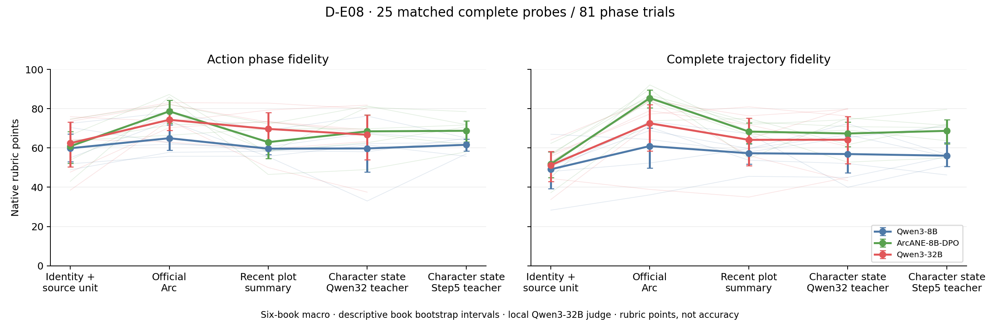

# D-E06–D-E08：连续更新、人物整理与后续表演实测

2026-10-22。所有本报告列出的模型生成与离线聚合已完成；D-E09仍是另一个在途实验，**不纳入本报告调用数或结果**。卡：[D-E06](../experiments/D-E06-closed-loop-state-enactment.md) · [D-E07](../experiments/D-E07-same-information-character-state-summary.md) · [D-E08](../experiments/D-E08-strong-character-state-compiler.md)。

## 结论及其对研究方向的作用

**连续更新没有出现跨消费者一致的退化；把同一摘要整理成人物卡，乃至换用更强教师，也没有明确改善完整阶段轨迹。** 角色专用训练和强普通模型能修复部分实际表演/事实错误，同时人物输入差异仍会改变策略。这些结果不支持把“旧记忆吞噬成长”当作已经建立的统一机制。

这组实验为底座补足了强普通参照，不是新方法或研究成功本身。依用户最新纠正，研究重心转回**角色从经历形成/修订判断并影响后续不同互动**，不继续沿字段错误、窗口长度、单例措辞增加局部实验。[整体方向判断](../POSITIONING.md)

## 1. D-E06：29角色、8作品、8步发布资料中的连续更新

**后续来源资格澄清：** 这里的连续性指固定训练文件内的状态接续，不是已认证的原著时序。不同发布文件同号场景存在差异；本轮始终在同一冻结文件内部绑定更新/互动，没有跨入另一场景文件。原数值和输入保留，不能将其直接解释成原著成长、遗忘或惯性。[来源资格](D-EW-SOURCE-QUALIFICATION-2026-10-22.md)

每角色读取八次连续出场，三条路径各232个提交态。T每步给发布前态，R使用自己的递归前态，两者同原生提示加一句主体提醒；S使用普通完整人物摘要递归更新。同一后续场景在第1/4/8步取下次出场的原生首turn，共87问题。发布当前态、冻结初态、T/R/S五条件共同保留当前世界、动机M与live cue。

三路径实际生成T245/R243/S242次（含预登记统一格式恢复），提交态各232；接纳失败后承接前态分别9/8/10步。T/R首轮29输入、首回复和实际提交态全部一致。严格四字段接纳与原生模拟器逐字段宽容不同；这些承接不能直接称心理僵化。

角色输出：通用8B435条；两个强消费者在事前每作品一角色的8角色子集，各120条。三消费者均对全部87×5=435个来源目标作NLL前向，共1,305条，另6次机械对齐检查。只有通用8B/T的一条角色输出length，其余角色输出stop；原样保留。

下表为原作首turn平均NLL（nats/token，低为更高来源概率），先人物再作品等权。**只在同一消费者内比较条件，不以模型之间绝对NLL排角色能力。原作句子不是唯一正确表演。**

| 消费者 | 发布当前态 | 冻结初态 | T | R | S |
|---|---:|---:|---:|---:|---:|
| Qwen3-8B | 6.1224 | 6.1669 | 6.1199 | 6.1113 | 6.0702 |
| ArcANE-8B-DPO | 3.5469 | 3.5626 | 3.5469 | 3.5743 | 3.5492 |
| Qwen3-32B | 3.6983 | 3.7322 | 3.7181 | 3.7306 | 3.7629 |

| 配对差（左减右） | Qwen3-8B | ArcANE-8B-DPO | Qwen3-32B |
|---|---:|---:|---:|
| 冻结−发布 | +0.0445 [-0.0036, +0.1024] | +0.0157 [-0.0091, +0.0442] | +0.0339 [+0.0107, +0.0545] |
| R−T | -0.0086 [-0.0531, +0.0345] | +0.0274 [+0.0008, +0.0553] | +0.0125 [-0.0036, +0.0287] |
| S−R | -0.0411 [-0.1248, +0.0375] | -0.0251 [-0.0640, +0.0119] | +0.0323 [-0.0042, +0.0695] |
| S−发布 | -0.0522 [-0.1376, +0.0461] | +0.0024 [-0.0226, +0.0259] | +0.0646 [+0.0262, +0.1055] |

区间是8作品重采样的描述性95%区间（20,000次，seed0），不是87独立心理实验的总体置信认证。专用8B的R相对T来源概率下降；32B的S相对发布亦下降，但通用8B没有同方向结果。不能把其中一列挑出作为所有模型长期退化的证据。

**实际行为审阅：** 通用8B的Bathsheba/Watson部分回复换成另一人物说话；ArcANE-8B-DPO与32B在这些预选末端五条件中保持目标主体。Jekyll的32B在发布/冻结/T/S写回信，R明确表示永不回应，是一次真实的状态路径—策略差异；它不证明全部递归失败。Francois五条件仍承认Buck的领导变动；Bathsheba的普通摘要保留赠表提议的情感影响，并未断言仍持有已经收回的物品。[完整案例](D-E06-CASEBOOK.md)

D-E06的M由发布资料给定，部分来源首turn还跨越多日，不能据NLL认证自主目标形成或整段互动质量。ArcANE消费者已知接触Treasure Island后训练素材，其他七作品不在已核公开/历史训练书目；预训练未知。[暴露记录](D-E06-consumer-exposure.json)

## 2. D-E07/08：同信息人物整理，三个角色消费者

25完整probe、81phase、6作品，来自原D-E03冻结嵌套样本。V/A为身份时点/官方人物弧；S为近期剧情摘要；C只把同一S整理成当前人物资料。D-E08换Step5作同提示、同输入整理教师，仅接两个8B消费者；未运行32B消费C-Step。

**源修正：** Monte的原S曾将14内部叙事单元错绑定为117文学章节，是本轮适配器错误。旧39角色回复与54评分不再进入修正S表；169片段摘要＋13单元归并重新覆盖原生来源。D-E07复用900条来源合格评分，加372新评分；D-E08再加212。旧raw及旧表不覆盖。[纠正记录](D-SOURCE-CORRECTION-2026-10-22.md)

表内为原生量表的作品宏均值，**不是动作准确率**。D-E07/08的V/A/S/C行来自相同配对人群；与D-E01全64probe主表不能直接作不同条件差。

| 角色消费者 | 条件 | APF | RPF | RAE | PTF |
|---|---|---:|---:|---:|---:|
| Qwen3-8B | V：身份/时点 | 59.85 | 62.48 | 50.18 | 49.14 |
| Qwen3-8B | A：官方Arc | 64.96 | 67.40 | 56.31 | 60.96 |
| Qwen3-8B | S：近期剧情摘要（已纠源） | 59.64 | 62.00 | 49.05 | 57.31 |
| Qwen3-8B | C：32B人物整理 | 59.76 | 63.68 | 51.83 | 56.90 |
| Qwen3-8B | C-Step：Step人物整理 | 61.61 | 64.08 | 53.54 | 56.06 |
| ArcANE-8B-DPO | V：身份/时点 | 60.87 | 62.82 | 52.35 | 51.83 |
| ArcANE-8B-DPO | A：官方Arc | 78.67 | 78.33 | 71.65 | 85.40 |
| ArcANE-8B-DPO | S：近期剧情摘要（已纠源） | 62.96 | 64.92 | 54.11 | 68.36 |
| ArcANE-8B-DPO | C：32B人物整理 | 68.47 | 69.31 | 59.93 | 67.37 |
| ArcANE-8B-DPO | C-Step：Step人物整理 | 68.75 | 69.01 | 59.52 | 68.72 |
| Qwen3-32B | V：身份/时点 | 62.44 | 64.92 | 54.88 | 51.24 |
| Qwen3-32B | A：官方Arc | 74.36 | 75.84 | 67.88 | 72.59 |
| Qwen3-32B | S：近期剧情摘要（已纠源） | 69.70 | 71.15 | 63.28 | 64.13 |
| Qwen3-32B | C：32B人物整理 | 66.72 | 69.19 | 59.54 | 64.21 |

| 配对差 | 消费者 | APF差及95%描述区间 | PTF差及95%描述区间 |
|---|---|---:|---:|
| C−S | Qwen3-8B | +0.12 [-9.23, +6.32] | -0.41 [-11.87, +8.11] |
| C−S | ArcANE-8B-DPO | +5.51 [-1.11, +13.46] | -0.99 [-9.72, +8.89] |
| C−S | Qwen3-32B | -2.98 [-7.24, +1.03] | +0.08 [-8.15, +8.36] |
| C-Step−C | Qwen3-8B | +1.84 [-6.12, +11.61] | -0.84 [-9.19, +7.22] |
| C-Step−C | ArcANE-8B-DPO | +0.28 [-5.10, +5.64] | +1.35 [-2.81, +5.81] |
| C-Step−A | Qwen3-8B | -3.36 [-10.14, +2.78] | -4.90 [-17.39, +7.75] |
| C-Step−A | ArcANE-8B-DPO | -9.92 [-18.46, -2.18] | -16.68 [-25.70, -8.11] |

六作品区间按作品等权、枚举有放回重采样；仅反映当前便利作品样本的描述性不确定性。所有单题/完整轨迹读数、人物/轴/类型切片见JSON；没有重新挑选表现好的种子或重新改读数。

**科研解释：** 专用8B在C下的动作阶段分比S高约5.51，但区间含0，完整轨迹分没有相应提升。更强Step整理相对C在两个消费者的PTF差分别−0.84和+1.35，也没有明确总体提升。官方Arc仍有明显优势，但它提供不同的信息覆盖与阶段解释，不能把这个差直接认作模型不会从事实推断心理。

**成功与失败共存：** Mary在32B整理中被写成Monica的婚姻身份，通用8B据此谈虚构的自身婚姻；Step整理恢复她的未婚身份，后续回复改为支持/倾听。Deborah早期输入资料不足，32B添了妻子和孩子，Step保留未知，两消费者不再援引孩子。Anna的“丈夫Stiva”已存在于上游剧情摘要，并非全部错误都在人物整理新生。Louis的后期材料同时含病弱求和与猜忌/不同人物视角，不应只因一个阶段标签就抹去这种张力。[案例与来源](D-E07-CASEBOOK.md)

## 3. 评分完整性与格式敏感性

本地评委固定Qwen3-32B及原生rubric。主读数只接受完整、范围合法的score JSON；允许完整首个JSON后还有额外解释/括号，不从截断数字重建分数。D-E07新372次全部可读，其中原生JSON287、完整首对象85；D-E08新212次全部可读，166/46。finish=length仍可能在完整score对象之后截断解释，原始记录和finish均保留，不能称所有评委完整自然结束。

另存严格JSON敏感性表。D-E07总1,272判断中严格仅保留989（971逐回复、18轨迹）；D-E08总1,484判断中严格仅保留1,155（1,133逐回复、22轨迹）。因此严格PTF列有严重、非均匀缺失，**不能用其剩余少数高分声称轨迹排名稳健**。APF基本相同，不替代对裁判构念的检查。首夜跨评委已显示绝对量表差大，本轮不把单个评委分数升级为客观心理真值。

## 4. 实际调用、运行与可复算资产

D-E06–08新增本地生成**2,696条**：1,119角色回复＋730状态更新＋584评委＋263摘要/人物教师。另1,305来源句前向及6机械对齐前向。进程时间合计**15.824 GPU·h**（包含加载/初始化，不是按共享batch行延迟重复相加）。D-E07源审计中断前有至多4条本地在途生成未持久化，已保存数是下界；不隐藏或猜测其tokens。

D-E08 Step5仅Token Plan：**82请求，81可用人物卡，317,848记录tokens**（输入120,085，输出197,763）；一条length按统一预算规则恢复，未按语义挑结果，无现金fallback。供应方细分reasoning用量记0，但返回非空推理字段；不据此捏造推理token拆分。[账本](D-CONTINUATION-RUN-LEDGER.json) · [Plan摘要](D-E08-compiler-summary.json)

模型/revision、推理配置、冻结messages、全部raw与token IDs位于[ASSETS](../ASSETS.md)记录的本地资产根。首夜归档保持不变；在途D-E09与完成D-E06–08分账。

离线复算入口：`scripts/summarize_closed_behavior.py --consumer ...`、`scripts/summarize_results.py`（D-E07/D-E08及`--strict-native-json`）、`scripts/collect_continuation_costs.py`。这些脚本不触发模型/API。表：[Qwen8连续](D-E06-qwen3_8b-summary.json) · [专用8B连续](D-E06-arcane_8b_dpo-summary.json) · [32B连续](D-E06-qwen3_32b-summary.json) · [D-E07](D-E07-summary.json) · [D-E08](D-E08-summary.json) · [严格D7](D-E07-summary-strict.json) · [严格D8](D-E08-summary-strict.json)。

图中32B只有前四条件，最后一列未测；误差条为作品描述区间，细线为各作品。连续更新图：[PNG](figures/D-E06-state-behavior.png) · [PDF](figures/D-E06-state-behavior.pdf)。

## 5. 主张与下一步

本报告不升级新的机制或算法主张。修复源绑定恢复可解释的S比较，但不恢复旧错误S数字。下一步以[整体研究定位](../POSITIONING.md)为准：研究人物特有的经历学习及其跨互动后果，认真处理现成训练/更新方法已经覆盖的部分。当前不新建局部补丁实验、不预设RL，也不以本报告运行完成作为科研成功。
