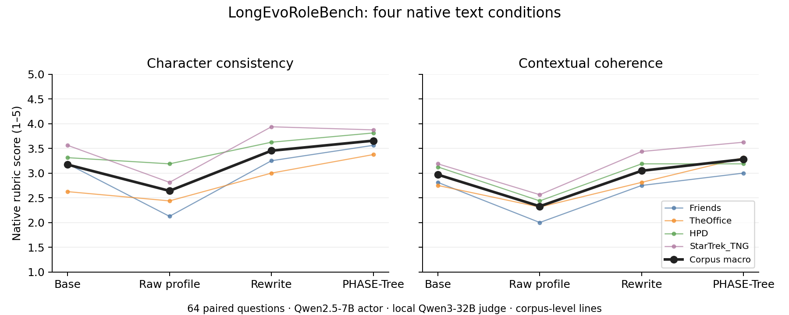

# D-E02：LongEvoRoleBench文本基线实测（2026-10-22）

**现成PHASE-Tree在本次64个配对原始问题上整体有效，普通重写也是实质强对照。** 这支持继续使用该生态研究人物状态；没有由此证明一种新的长期状态机制或算法必要性。

实际完成256条角色回复＋256条本地判分，无外部付费API。Qwen2.5-7B-Instruct为原生backbone；temperature0.3、seed42、256token上限；四语料各16问题（8 random＋8 OOD），共24角色。全部输入/参考跨方法配对相同，方法只改变原生profile条件。完整[样本清单](D-E02-selection.json)、[轻量分数](D-E02-summary.json)、[实验卡](../experiments/D-E02-longevorole-textual-residency.md)。

## 1. 读数

本地Qwen3-32B使用原官方Char/Sem提示与m6共同参考；这不是论文GPT-4.1的同评委数值复现。两分数为1–5主观量表，不能换写成准确率；未计算需要未授权OpenAI服务的官方Emb。

| 原生文本条件 | Char | Sem | 平均输入tokens |
|---|---:|---:|---:|
| Base：对话，无profile | 3.172 | 2.969 | 392.9 |
| RP：原始人物卡 | 2.641 | 2.328 | 666.1 |
| NR：普通重写卡 | 3.453 | 3.047 | 613.8 |
| PT：PHASE-Tree当前状态 | 3.656 | 3.281 | 1358.3 |

PT−NR的Sem均值为**+0.234**，四corpus描述性bootstrap95为[+0.063,+0.422]；64个逐题配对中PT胜/平/负为**21/32/11**，没有所有问题都获益。四语料、一次seed、同一非独立模型评委的有限结果不支持总体因果保证或自动L2升级。

| Sem按语料 | Base | RP | NR | PT |
|---|---:|---:|---:|---:|
| Friends | 2.813 | 2.000 | 2.750 | 3.000 |
| TheOffice | 2.750 | 2.313 | 2.813 | 3.313 |
| HPD | 3.125 | 2.438 | 3.188 | 3.188 |
| StarTrek_TNG | 3.188 | 2.563 | 3.438 | 3.625 |

PT的Sem优势没有只集中在后期OOD：对NR，random为+0.281、OOD为+0.188。长程OOD主要表示后续叙事时间，不能叫完全未见人物/作品。

## 2. 从实际回复能学到什么

以下为执行agent阅读预定每语料首例，加一对PT相对NR最大得失例的描述性审阅；后两例是明确POST-HOC解释，不用于升级主张。不是独立真人评分。

- **原始卡会使回复离题，但不等同过期状态惯性。** 两个Phoebe问题中，RP条件逐字输出了输入卡里的同一句歌曲片段；均被本地评委判低分。它是可见的输入复述，既可能涉及人物卡使用、解码或例句显著性，也受单seed采样影响；没有证据将其叫内部脚本激活或长期记忆吞噬成长。
- **当前情境供给有帮助。** 一条TNG问题中，生命体仍附在舰体上取能。Base虚构其已经脱离，PT提出隔离反应堆这一与当前情境相容的应对。它显示状态与上下文可以改善回复，却不是跨集人格成长的单独证据。
- **普通重写并非弱基线。** Hermione如何面对对Hagrid承诺的例子，NR与PT都主张守约；本地评委给NR 5/5、PT 4/4。两者都是可接受的角色解释，一分差不能当明确能力边界。
- **高相对分不保证正确抓住最新话题。** 一段多话题Friends对话末尾刚有人进场，PT比NR得分高，却仍继续较早的生日礼物话题；Base在该题还高于PT。局部话题/回复焦点和长期角色状态不是同一个变量。
- **角色分与事实精确性分开。** 购买猫的例子中，几种回复都编了不同价格，本地评委仍给很高Char/Sem，因为此rubric测角色相容及接话，不是准确复述原剧本金额。不能将这些分数误读为事实无误或真实状态已学会。

全量输入、参考、预测和判语只在本机资产中保留，避免把完整影视/小说原始对话搬入Git；ID与hash在轻量结果中可定位。读取原始文件的方法见[资产入口](../ASSETS.md)。

## 3. 科研判断

本轮重现的是原论文已报告方向：PT在整体上更好，RP可能比无卡更差，NR很有竞争力。**这不是我们的新发现，也没有验证Temporal Persona Inertia。** PT同时提供更多当前信息，平均prompt约为NR的2.2倍；分数差不能只归因于树格式或跨集更新。

重要的范围判断是：下一轮回复的Sem收益中包含普通接话、话题选择与当前情境供给。要围绕“人物成长”形成贡献，后续应将持续身份、已经改变的关系/信念与当下局部状态的作用联系到真实时间证据，而不能把每次Sem低分都命名为成长失败。

ArcANE的同probe跨phase任务仍作为主要探索载体；本任务是独立的当前状态/长期对话参照。已有PHASE-Tree的事件累计、阻力/冷却、字段修订与前缀边界必须正面对标，不重提一个新名字的人物树。

## 4. 输出资格与资源

Actor 256/256均stop；本地judge 256/256均stop，其中255为严格JSON，1条有多余闭括号。该条包含完整两个分数，按**原官方parse_judge_response**的既有fragment fallback恢复，未重跑或按分数挑选；严格诊断曾为255条，见`D-E02-summary-strict.json`。正式轻量表使用256个原生parser读数；单条恢复不改变总体方向。

角色生成193,986输入/3,864输出tokens，wall483.5秒；判分638,920输入/40,250输出tokens，wall1946.8秒；单卡进程wall合计约0.675 GPU·h，含导入/加载上界。严格无静默prompt截断，角色卡源文件、模型revision、全部配置和生成token IDs完整保存。没有训练新模型，没有调用现金API。

## 5. POST-HOC原文下一句预测（计算前已登记）

用同一Qwen2.5-7B、同一64题四种输入，计算原生参考下一句正文的条件NLL，目标token不变、prompt不计loss、无EOS。新增的是256次forward，不是256次角色生成；没有调用评委或API。原Char/Sem主读数不变。

| 条件 | 参考正文NLL（nats/token，低为好） |
|---|---:|
| Base | 4.428 |
| RP | 4.517 |
| NR | 4.537 |
| PT | 4.220 |

PT−NR为−0.318，四语料描述性bootstrap95为[−0.490,−0.145]；四个语料均值方向一致，逐题为38条降低、26条升高。Friends上Base略低于PT，PT并非处处最优。这个不依赖LLM Judge的补充读数支持“发布的PT状态有助于当前下一句预测”，但不把原句当唯一合法续写，也不证明长期更新机制、来源严格因果可知或单独树格式带来增益。NR的生成Sem略高于Base，而原句NLL更高，两种读数评价的对象不同。

实际wall155.3秒，所有token边界逐条验证，分数和配对在[D-E02-likelihood.json](D-E02-likelihood.json)。当前总进程GPU·h上界约0.718（含原actor/judge与此forward）。
