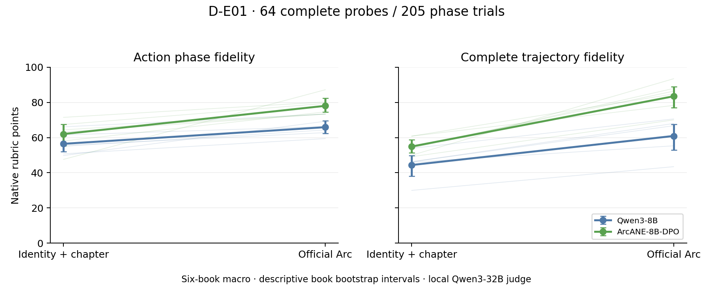

# 矿区D首夜实测：人物状态的形成、保留与表演

**后续源对齐纠正（2026-10-22）：** 本轮Monte Cristo Summary把14个原生叙事单元误换为117文学章号，影响13phase/三模型39条S输出。六作品S相关比较暂撤回；原数值/raw保留为历史。V/A和其他五作品S不受此适配错误影响。详见[纠正记录](D-SOURCE-CORRECTION-2026-10-22.md)，正在补齐正确来源并重新测量。

2026-10-22。**B/I01已经按用户决定暂停，矿区D在原工作台继续；矿区A未恢复。** 本轮完成现成生态的实际模型测量，没有手写新故事，没有训练新模型，也没有为了制造错误反复增加条件。结果支持继续深入D，但还没有足够证据宣称新算法或论文机制已经成立。

最重要的三个认识：

1. **现有人物阶段方法确实有效。** ArcANE专用8B能表现同一角色不同时期的不同反应；PHASE-Tree发布的文本状态同时提高对话评价与参考回复预测。不能把它们降格成不会成长的弱基线。
2. **给定状态后能演，与依据经历形成状态，仍需分别检验。** 当前Arc/章节摘要比较尚未等信息，不能把差距叫状态推理缺陷。直接运行现有状态更新器后，观察到人物主体、事件归属及撤销后的最终状态问题；普通指令和强模型能解决其中一部分。
3. **评价总分不足以认证事件状态正确。** 原版内容准则的本地评委也会把已撤销的送表当成真实后果；原始判语与反例均保留。这里没有证明原论文评价整体失效，也没有把一例命名为长期历史惯性。

## 真正运行了什么

所有样本在输出前冻结，完整prompt、raw、token IDs/usage、固定revision、配置和源码快照留存。每次实验卡先于相应推理，资源/格式修订明确标注时间与范围。以下“请求数”不是独立科研样本数。

| 实验 | 科研单位 | 本轮模型生成 |
|---|---|---:|
| [D-E01](D-E01-REPORT.md) ArcANE原生V/A | 6作品、25人物条目、64完整probe、205phase | Qwen3-8B/ArcANE-8B-DPO各410＝820条角色回复 |
| [D-E02](D-E02-REPORT.md) LongEvo原生四文本输入 | 4长程语料、24角色、64对话问题 | Qwen2.5-7B共256条回复；另256次原句NLL前向，无额外生成 |
| [D-E03](D-E03-REPORT.md) 原生近期章节Summary及容量 | D-E01嵌套25probe、81phase，非独立新数据 | 两8B摘要条件162条＋Qwen3-32B三条件243条；另242章教师摘要 |
| [D-E04](D-E04-REPORT.md) EvolvingWorld原生状态更新 | 8作品、61角色、64场景，发布true/false各32 | Qwen3-8B/32B各原生64＋一句指令64＝256条状态 |
| [D-E05](D-E05-REPORT.md) 同信息强普通参照 | 与D-E04同64场景 | Step5 65次实际请求，首轮63完整，1次统一技术恢复后64完整状态 |

因此角色回复共**1,481条**，本地状态更新**256条**，Step最终状态**64条（65次调用）**，教师章节摘要**242条**。评委调用另计，不混进角色请求数；总账与格式恢复数见[D-RUN-LEDGER.json](D-RUN-LEDGER.json)。原始大资产位置/校验和见[ASSETS](../ASSETS.md)。

本轮实际本地生成**4,159次**，其中2,180次评委调用包含3次格式恢复，另256次NLL前向；单卡进程运行壁钟合计**13.844 GPU·h**，不是按每行共享batch耗时重复相加，也不含API壁钟。Plan已记录413次尝试、**2,404,911tokens**，含早期评委预试/中断与Step actor；最多2个早期在途调用用量未知，不能把它们当0。没有模型训练。

所有本地模型固定完整HF revision，BF16单卡，不训练，不将4卡视作高速互联集群。Qwen3-32B用于普通容量、章节教师及本地评委，后两种角色不可忽略。Step仅授权Token Plan专用endpoint，无现金回退；权重仅是服务别名，响应版本/ID/UTC保留。它有额外推理与JSON传输预算，不宣称等算力比较。

## 1. 人物阶段表演：专用后训练有效，普通摘要有帮助但并未等信息

D-E01六作品宏平均，原生量表1–100分，**不是准确率**：

| 模型 | 身份＋章节 APF/PTF | 官方Arc APF/PTF |
|---|---:|---:|
| Qwen3-8B | 56.46 / 44.42 | 65.93 / 60.92 |
| ArcANE-8B-DPO | 62.03 / 54.93 | **78.05 / 83.48** |

同Arc下专用8B−通用8B的APF为+12.12，六作品描述95%区间[8.90,15.29]；PTF+22.56 [17.62,27.62]。它包括SFT＋DPO后训练，不能隔离成某个loss的贡献。新世界问题同样改善，低知名度作品没有崩溃；仍不能自动排除原著预训练知识。

D-E03固定同25probe/81phase，不能与上表直接混用分母：

| 模型 | 身份＋章节 APF/PTF | Arc APF/PTF | 最近5章摘要 APF/PTF |
|---|---:|---:|---:|
| Qwen3-8B | 59.85 / 49.14 | 64.96 / 60.96 | 60.09 / 59.20 |
| ArcANE-8B-DPO | 60.87 / 51.83 | 78.67 / 85.40 | 63.25 / 68.82 |
| Qwen3-32B | 62.44 / 51.24 | 74.36 / 72.59 | 67.98 / 64.78 |

普通近期剧情摘要提升完整轨迹，但8B逐回复APF的S−V区间含0。通用32B Arc显著改善，专用8B仍有轨迹优势；32B又作为评委，容量结论有自评偏好风险。**这里没有完成“同一批合法事实→强普通人物状态总结”的比较。** Arc与最近5章摘要的信息覆盖不同，摘要还含查询章及全知叙述，不能把Arc−Summary直接叫Online State Inference失败。

真实成功值得保留：Louis Trevelyan从控制式拒绝妻子探视转为脆弱接受，两模型都能变化；Duke/Duchess在新世界中的玩弄→关照、Karenin非单调的怜悯与敌意，均显示模型能利用发展弧组织行为。残差包括Dantès添加情境不存在的儿童声响，Monica把源作品具体家庭关系迁进新世界。它们是限定案例，未证明统一内部机制。[跨阶段案例册](D-E01-D-E03-CASEBOOK.md)

## 2. 长程对话状态：发布的PHASE文本输入有可重复的效用

| 原生文本条件 | Character / Semantic，1–5 | 参考回复NLL，nats/token，低更好 |
|---|---:|---:|
| Base | 3.172 / 2.969 | 4.428 |
| 原始人物卡 RP | 2.641 / 2.328 | 4.517 |
| 普通卡重写 NR | 3.453 / 3.047 | 4.537 |
| PHASE-Tree m6 | **3.656 / 3.281** | **4.220** |

PT−NR Semantic+0.234，四语料描述区间[0.063,0.422]，逐题胜/平/负21/32/11；NLL−0.318 [−0.490,−0.145]，38题下降、26题上升。原句预测与LLM评价方向相合，但PT平均prompt约1,358tokens，NR约614；有额外当前Session/Moment信息，不是纯格式效果。评价统一用m6资料参考，存在参考依赖；NLL也只检验原记录回复的预测，并非唯一可接受角色台词。

OOD主要是同作品/人物的后续时间，不是未见IP。64条persona快照的来源标签均早于目标，不能由此认证所有初始卡和当前Moment语义完全没有未来信息。NR很有竞争力，不应为了新状态树忽略它。参数适配权重只下载、未运行；不冒称PHASE完整参数路径复现。

## 3. 状态形成：不同更新门槛、普通恢复与强模型残差

D-E04来自已有公开训练记录，前态/动机teacher-forced，非官方held-out世界模拟。以下为发布监督一致，不是独一无二的心理真值：

| 模型/输入 | 原运行器兼容flag命中 | true类命中/32 | false类命中/32 | 明确换主体/64 |
|---|---:|---:|---:|---:|
| Qwen3-8B原生 | 41/64 | 29 | 12 | 7 |
| Qwen3-32B原生 | 41/64 | 13 | 28 | 4 |
| Qwen3-8B一句角色归属提示 | 39/64 | 28 | 11 | 3 |
| Qwen3-32B同一句提示 | 42/64 | 13 | 29 | 1 |
| Step5同信息＋同一句提示 | **47/64** | 15 | 32 | **0** |

明确换主体是逐条短描述的单agent事后审阅，不是所有状态内容错误率。各Qwen原生的两条历史比较/祖先资料另列；当前记录中可清楚核验的错配为8B5→2、32B2→1，原64分母不变。Step全部64短描述主体一致，并真正把Johnny恢复为逃官兵的海盗、Alan恢复为已死的忠诚水手。这些是强普通系统的实质成功；不能再把原8B/32B身份错误当普遍能力壁垒。

一句提示也修复Dogger/Joe等的部分行动归属，但Johnny在Qwen控制中名字正确、亲属/阵营仍是Jim；名字校验不等于人物状态恢复。Guest的新字迹线索可以写入tracker而不改profile，说明低flag召回不等于没有形成新状态。完整结构有效率、严格字符串轨及原运行器dict兼容轨均分列，不掩盖32B的格式失败。

| 条件 | 可执行后态/64 | PUF作品宏平均 [描述95%区间] |
|---|---:|---:|
| Qwen3-8B 原生 | 64 | 68.31 [66.66,69.53] |
| Qwen3-8B 一句指令 | 64 | 68.00 [65.97,70.00] |
| Qwen3-32B 原生 | 63 | 63.57 [61.20,66.04] |
| Qwen3-32B 一句指令 | 60 | 61.53 [59.43,63.66] |
| Step5 同一句指令 | 64 | 61.58 [58.89,64.11] |

完整内容评分没有给恢复控制整体收益：同题共同有效的PUF差，8B−0.31 [−2.94,2.17]、32B−2.00 [−3.94,−0.36]。Step改善主体归属却未获最高PUF，因此不能说强商业系统已经解决完整更新，或只挑主体这一项宣布方法成功。PUF以profile为主、tracker为辅助，本地替换评委又有同家族偏好风险；保留这些读数并核查具体事实与后续行为。315个合格候选，318次本地评分（含3统一格式恢复），最终315合法判语，5条原始后态格式失败仍单列。

最清楚的共同残差是事前指定的**Troy送表后收回**：真实感情信号可以持续，手表所有权转移却撤销了。Qwen8B、Qwen32B、Step5均把表已送出写成当前资产/记忆；两Qwen加一句归属提示仍如此。Step据此继续推导“失去仅有资产、切断贵族身份”。同一本地PUF评委给Step这条85分，还把失去金表列为＋8优点。它没有被手工扣分，这也不是证明原PUF整体失效；它提醒我们要核对**哪些后果最终仍成立**，而非只看人物变化总结是否通顺。

另一个已经核查的评价冲突是Johnny：Step正确保持海盗身份PUF44，Qwen32原生把Jim身份/经历移给Johnny却得86。评委对profile应否修改的门槛判断没有替代事实归属核对。不能据PUF均分反过来认定身份错误更多的模型状态能力更强；完整数值和原判语均保留，没有手工换成“我们认可的分数”。这些案例也要求后续状态学习先明确可核查目标，不能照着当前总分直接训练奖励。

Troy是一例跨三模型共同事实残差，不是跨场景发生率，不证明长期记忆吞噬成长。原资产含全知叙述、他人内心过滤不完全、初始卡回顾推断等限制；即使没有LOOKAHEAD字段，也不能称严格在线NPC可知输入。[状态案例册](D-E04-CASEBOOK.md)记录来源、成功、控制恢复与未核对边界。

## 4. 评价和资产边界

- ArcANE原生rubric全部完整本地评分；1,076条中250条有完整分数JSON后追加解释，233条length截断解释、未截断判分。严格轨同时提供，不猜残缺分数、不对合法结果重打。
- Step早期作为ArcANE评委的正式部分321条与本地同prompt重叠；逐回复均分Spearman0.790、PTF约0.730，却有本地高26.40/29.70点的绝对差。**83.48分不能叫83.48%准确或能力已解决。** 不同评委不拼表，资源中断子集不冒充完整独立排名。
- D-E04/05原版PUF准则已有内容依据约束，且明文以profile为主要对象、tracker为辅助，本轮采用完整前态适配及替换本地评委，不与论文联合模拟分数直接同比。条件内容均分以结构可执行者为分母，无效输出保留总体分母；配对只用共同可评价题。
- 六部ArcANE作品、四种LongEvo语料、八部更新作品均为方便样本，任务和作品还可能相交。没有独立盲评/玩家研究；作品bootstrap仅描述本轮范围，没有把数千模型调用当数千独立故事。
- 研究主线没有因强近邻自动关闭。公开训练test≠正式benchmark；原著预训练未知；代码、数据与模型许可分别核对，不用MIT覆盖影视/小说语料。权重、全原文和大raw不进Git。

## 5. 对矿区D的判断，以及接下来最值得深挖的两件事

**D已经具备比B/I01更可靠的实验入口，但尚未形成论文级新贡献。** 本轮打通的不是一个新损失，而是三层实际证据：给定状态的阶段表演、发布状态对对话的效用、场景到状态的形成质量。ArcANE已有阶段后训练，PHASE-Tree已有多时间尺度/阻力门及Stale-State，DREAM已有事件—信念—后果图，EvolvingWorld已有tracker和PUF/PES。新的动态树、简单时间加权、又一个phase DPO，都面临直接claim ownership和compression risk；这些压力要求具体增量，不构成自动关题理由。

**优先一：从角色自身可用的经历形成有据的当前状态，并认真比较普通强系统。** 使用现成连续轨迹，把“谁做/谁知道”“当前仍成立/已被撤回”“事实变化/关系与心理信号”分清；先让Step/32B普通人物总结、普通两步提取与既有更新方法获得同样合法历史。研究对象是跨作品的状态形成与角色证据利用，而不是对Johnny或手表继续加规则。需要确认重要残差及它影响的行为，再决定是否值得学习新表示或训练。

**优先二：把形成的状态接回后续角色表演，研究错误的持续、修复与身份连续性。** 本轮都是教师前态/已发布状态，尚不知道状态错误会不会积累、会不会被后续真实事件修正、是否改变人物的信任/关系/选择。利用已有连续轨迹比较teacher-forced与递归后态，独立报告事实约束、阶段/关系表现和原句预测。普通强摘要若已经可靠恢复，就接受简单方案；若仍有跨作品、影响角色行为的规律性残差，才发展方法。这不是预设旧历史有害，也不要求人物越来越善良。

还需防止另一个方向偏移：**物品归属正确本身不足以成为Role-playing成长贡献**。手表例的价值是暴露了事实后果与心理信号在持久化时被一起处理；只有进一步显示这种错误怎样改变人物的信任、目标、关系选择或身份连续性，才更接近本矿区。若最终只是普通事实抽取，或强普通管线就可靠解决，应如实调整研究判断，不把它包装成新的角色成长算法。成熟公开资产降低数据起步成本，仍未消除心理参考多解和评价构念的有效性问题。

目前不新增RL loss、不锁一个狭窄I##、不把本轮原论文效应复现包装成创新。矿区C/NCP-Bench保留备选，B资产保留暂停，后续科研方向由上述实际证据与用户判断推进。
