# Technical appendix: source-evidence formation and use

2026-10-12. This preserves the complete interfaces and functional readouts supporting the main manuscript. Primary definitions and experiment-card links remain unchanged.

## A. Complete criterion–convention functional response

### A.1 Separating criterion from private output convention

A learned association can change a classifier's confidence without specifying a complete criterion for a new input. We test this distinction with comments containing independently balanced food and service sentiment. Source A's demonstrations establish a food criterion. Source B can evaluate either food or service, under an output convention agreeing with or opposite to A's. The criteria are inferred from demonstrations rather than stated in the multi-source prompt (E117/E118).

The four B worlds are constructed by bijectively reassigning inputs to fixed demonstration positions. A's raw demonstrations, B's output stream, source names, positions, and input multiset remain unchanged. Eight novel queries cover all four sentiment combinations. Every interface is evaluated on the same queries: complete native histories, histories whose queries cannot read B positions, A-label cache interchange into one recipient, and historical B-answer messages consumed during A-label formation. Separate-output label donors test the effect of output coding during formation while restoring the shared-output recipient for querying.

Let \(f_q,s_q\in\{-1,+1\}\) be food and service polarity, oriented to A's private convention. For criterion \(t\), define \(\delta_t(q)=\frac{1}{2}[z_{t,+}(q)-z_{t,-}(q)]\), the response to changing B's convention. The context-level matrix

\[
M_c=\begin{pmatrix}
\mathbb E_q[\delta_{food}(q)f_q] & \mathbb E_q[\delta_{food}(q)s_q]\\
\mathbb E_q[\delta_{service}(q)f_q] & \mathbb E_q[\delta_{service}(q)s_q]
\end{pmatrix}
\]

separates the two criteria's effects on the two aspects. Bias and food–service interaction are also retained. These are B-relation effects while A is requested, not B's own accuracy or a gain in correctly isolating A.

### A.2 Association magnitude and criterion selectivity give different answers

Across three model families, E117 confirmation finds that changing B's pairing alters both food and service sensitivity through A-label caches. A positive service response alone therefore cannot establish transport of B's service criterion. E118 independently crosses criterion with B's convention and preserves the entire response matrix. Full native histories show more criterion selectivity than local label interchanges in several settings, with substantial family variation. The mean criterion–feature interaction is positive in all three families, but Qwen3-8B's interaction mainly reflects service selectivity; unequal gains along one common direction can also produce a positive mean interaction.

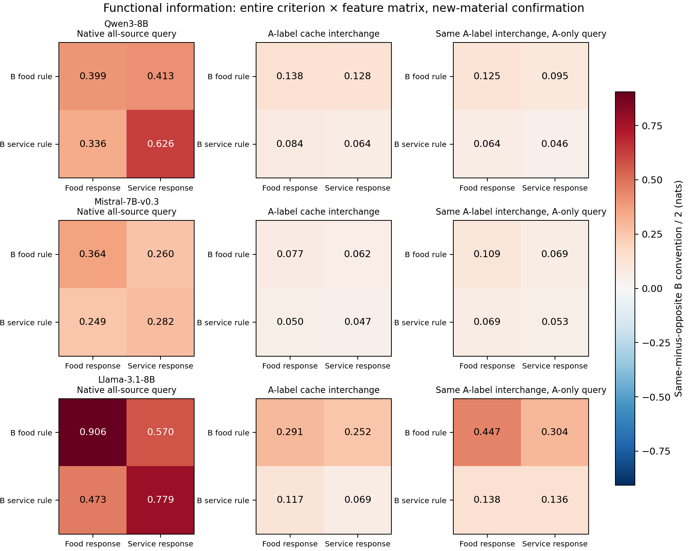

*Figure 4. New-material confirmation, 32 contexts per family. Rows vary B's inferred criterion; columns measure the induced food/service response under independent B-convention reversal. The requested source remains A. Full matrices avoid equating one positive aspect response with complete criterion transfer.*

Separating B's output namespace during formation can lower both aspect responses without appreciably changing their mean selectivity contrast. In Llama, food-criterion responses decrease by .267/.243 nats on food/service, and service-criterion responses by .110/.079; all four paired intervals are negative. Namespace effects on evidence formation thus include a change in relational influence magnitude, not only which aspect dominates.

### A.3 A prospective functional-direction test in Qwen3-14B

Before any E119 scores, we freeze an additional observer: the determinant of each context's response matrix and its normalized determinant, \(\det(M_c)/(\|M_{c,food}\|\|M_{c,service}\|)\). If the two criteria merely rescale a common functional direction, each determinant is zero. These quantities are computed within context before averaging. A row norm of at most .001 nats sets the normalized statistic to zero while retaining the context; no confirmation context meets this threshold.

Qwen3-14B confirms criterion-specific native responses: food selectivity is .282 [.199, .371] nats and service selectivity .404 [.294, .528]. Native signed determinant is .568 [.408, .751] nats² and normalized determinant .410 [.330, .493]. When every query position is prohibited from reading B, the A cache still formed from the full history yields .0289 [.0032, .0553] and .190 [.073, .310]. Thus criterion-related history can have distinct functional effects through the remaining computation.

| Qwen3-14B interface, n=32 | Mean interaction J, nats [95% CI] | Signed determinant, nats² [95% CI] | Normalized determinant [95% CI] |
|---|---:|---:|---:|
| Complete native histories | .343 [.265, .433] | .568 [.408, .751] | .410 [.330, .493] |
| Full history, A-only query | .058 [.029, .089] | .0289 [.0032, .0553] | .190 [.073, .310] |
| A-label interchange | −.0238 [−.0478, −.0025] | −.0201 [−.0374, −.0052] | .006 [−.121, .140] |
| A-label interchange, A-only query | .038 [.012, .068] | .0074 [−.0106, .0271] | .124 [.017, .242] |
| Historical answer KV at formation | .0060 [.0029, .0093] | .00068 [.00012, .00130] | .085 [−.042, .214] |
| Historical answer KV, A-only query | .0126 [.0076, .0188] | .00194 [.00031, .00474] | .072 [−.040, .190] |
| Separate-output label donor | −.0192 [−.0348, −.0060] | .00192 [−.00123, .00556] | .011 [−.145, .164] |

The local label interface does not reproduce the full native responses. Its negative signed determinant also rules out describing every formation interface as a common-direction gain; the gated label interface has a small positive normalized response. The signed and normalized statistics weight contexts differently, so both are reported. Nonzero determinants reject the restricted functional common-direction account, not every nonlinear latent representation or an alternative retrieval policy.

Historical answer KV only partially predicts the actual criterion-label counterfactuals: native/gated raw correlations are .668/.665, RMSE .646/.878, compared with zero-prediction RMSE .746/1.018. This is a functional boundary of the formation reconstruction, not a reason to discard its successful namespace prediction. Local association transfer, whole-history criterion dependence, and source-conditioned use are different causal questions.

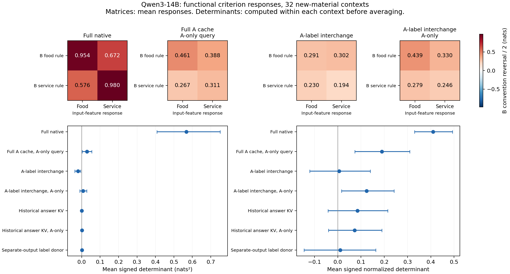

*Figure 5. Qwen3-14B confirmation. Matrix means summarize functional responses; determinant intervals use determinants computed separately within each context. All seven predefined interfaces, including reverse and weak effects, are retained. Different cache interfaces do not establish different hidden algorithms.*

## B. Exact serialization, interchanges, and audit scope

Experiments use frozen Qwen3-8B and Qwen3-14B (both post-trained hybrid models), Mistral-7B-v0.3 base, and Llama-3.1-8B base, FP32 eager attention, PyTorch 2.8.0 and Transformers 4.57.6. The controlled sentiment task contains eight demonstrations from each source and eight new queries per context. Source names, private output direction, and demonstration order vary; the two private directions are balanced in confirmation. Shared outputs are `no/yes`; separate B outputs are `pass/flag`. A's outputs remain unchanged. Models process the serialized task as a continuation, without adding a chat template or generating reasoning. Qwen3-14B is a same-family size comparison; training data and recipes are not controlled between sizes. The two-aspect templates always mention food before service, so this experiment measures functional aspect distinctions under fixed order and does not separate semantic identity from position selection.

The actual serialized token stream is part of the method. Blocks, answer words, and separators are encoded separately. For Mistral, this introduces fixed extra spaces relative to literal whole-string encoding: the first native confirmation context has 351 rather than 335 tokens. Its B answer-message region includes the answer word plus three separator tokens per demonstration, totaling 32 sender positions; Qwen uses 16. Paired token positions and boundaries remain identical across the relevant manipulations. Native controls validate the actual stream, not a claimed equivalent whole-string encoding. Source code and independent tokenizer reconstruction preserve this disclosure.

Effects use 10,000 context-bootstrap resamples, seed 910; reconstruction intervals follow the frozen E109 analysis. Queries within a context are not treated as independent observations. Raw logits, full-vocabulary argmax, binary candidate-label accuracy, all conditions, and failed controls are retained. Confirmation uses new word/template pools; discovery-to-confirmation text overlap is zero for E113 and the Qwen E114 batches, but vocabulary/templates recur across contexts within a pool.

Instruction controls differ between experiment engines. E122/E123 add one sentence to native formation. In E124–E127, the stored `instruction` condition adds that sentence while also blocking private cross-source formation; it is a composite control, and its difference from native cannot be attributed solely to prompting. E124/E125 additionally include an instruction-free independent-formation reference. The primary formation, schema, and cache-composition contrasts do not use this instruction condition.

Self interchanges produce zero error. Cached versus full-token native query scoring differs by at most 4.96e−5 in Qwen and 7.63e−6 in Mistral confirmation. Cache fingerprints, layer consumption, and matched token geometry are checked. An independent session reconstructs the token layouts and recomputes 559 numerical checks from raw records before reading author summaries, with maximum discrepancy 4.77e−15. Separate bootstrap resampling confirms the signed interactions; it is not represented as an independent GPU rerun.

The earlier E113/E114 package comprises five runs and 36,736 scores. The completed E115–E119 expansion comprises 24 discovery/confirmation runs, 576 contexts, 181,632 scores, and 2.393 recorded GPU-hours. Independent raw reviews recompute 36,750 numerical quantities (maximum discrepancy 1.13e−14), reconstruct actual token layouts, and check recorded all-layer consumption. This is independent analysis, not an independent GPU rerun. The E120/E121 native-operation and real-text additions comprise 16 runs, 384 contexts, 164,352 scores, and 2.540 recorded GPU-hours. Their independent raw audits recompute 18,064 scalars (maximum discrepancy 5.00e−15), reconstruct 2,112 actual token streams, and verify the recorded masks and reachable edges. No weights are trained. All model/seed/channel results remain available. Cards specify revisions, script hashes, and rebuilding commands; small summaries, figures, code, and audits are versioned, while raw JSONL and models remain at the [documented asset paths](README.md).

## C. All formation/query policies and functional controls

Policy results average the two source requests, four B worlds, and eight queries within each context. Candidate accuracy and full-vocabulary argmax remain separate in raw records. `normal`, `answer_cross_off`, and `all_cross_off` use no trained parameters; the generated source ownership determines the mask. Both actors consume the same prefix cache.

| Model, confirmation n=32 | Native | Answer formation | All cross formation | Query only | Answer + query | All formation + query |
|---|---:|---:|---:|---:|---:|---:|
| Qwen3-8B | 71.58 [69.43, 73.44] | 74.51 [72.66, 76.17] | 62.60 [61.62, 63.67] | 70.46 [67.87, 73.05] | 73.78 [71.58, 75.73] | 73.29 [70.80, 75.68] |
| Mistral-7B-v0.3 | 69.14 [67.63, 70.65] | 72.56 [70.31, 74.85] | 62.74 [60.99, 64.55] | 70.85 [69.14, 72.46] | 71.97 [69.87, 74.12] | 73.54 [71.04, 75.88] |
| Llama-3.1-8B | 73.83 [72.22, 75.44] | 81.20 [79.10, 83.25] | 68.55 [66.75, 70.26] | 85.89 [84.08, 87.74] | 86.77 [85.11, 88.53] | 84.18 [81.30, 86.87] |
| Qwen3-14B | 78.12 [75.68, 80.76] | 80.91 [78.86, 82.86] | 67.58 [66.02, 69.19] | 84.23 [81.64, 86.82] | 83.30 [80.81, 85.69] | 82.91 [80.22, 85.64] |

All entries are accuracy percentages with context-bootstrap95%CI. Separate A/B, agreeing/disagreeing correct labels, all four criterion/convention worlds, single functions, one-sentence instructions, Food/Service/bias/FS responses, and all signed contrasts are in `results/e122/*_confirmation/analysis.json` and the [independent raw audit](results/e122/independent_review_2026-10-12.md). The single-aspect SST ability does not establish perfect dual-aspect primitive mastery.

| Model, n=32 | Single A | Single B service/same | Single B service/opposite | Single B food/same | Single B food/opposite |
|---|---:|---:|---:|---:|---:|
| Qwen3-8B | 67.97 [64.06, 71.88] | 83.59 [79.69, 87.50] | 80.08 [76.17, 83.98] | 70.70 [67.58, 73.44] | 72.66 [69.14, 75.78] |
| Mistral-7B-v0.3 | 72.66 [69.53, 75.39] | 72.27 [68.36, 75.78] | 75.78 [72.27, 79.30] | 76.95 [73.83, 80.08] | 76.56 [73.44, 79.69] |
| Llama-3.1-8B | 79.30 [75.00, 83.59] | 87.11 [83.59, 90.62] | 86.33 [82.03, 90.62] | 82.42 [78.12, 86.72] | 81.64 [76.95, 85.94] |
| Qwen3-14B | 82.42 [78.91, 85.94] | 85.55 [81.64, 89.45] | 88.67 [84.77, 92.58] | 83.59 [80.08, 87.11] | 84.77 [80.86, 88.67] |

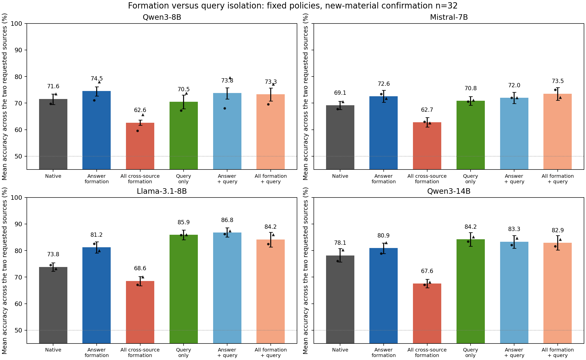

Bars show the source-average primary; black circle/triangle show A/B means. These are not joint both-correct rates. Each paired contrast uses its context-level difference, not differences between separately constructed intervals.

| Model | Selective-minus-native A, pp | B, pp | Agreeing golds, pp | Disagreeing golds, pp | Selective-minus-all formation, pp |
|---|---:|---:|---:|---:|---:|
| Qwen3-8B | 1.37 [-0.68, 3.32] | 4.49 [2.15, 6.84] | -2.34 [-4.00, -0.78] | 8.20 [5.86, 10.45] | 11.91 [10.25, 13.53] |
| Mistral-7B-v0.3 | 5.66 [2.54, 9.08] | 1.17 [-1.27, 3.52] | -1.95 [-4.98, 0.88] | 8.79 [6.15, 11.62] | 9.81 [6.74, 13.04] |
| Llama-3.1-8B | 8.01 [4.79, 11.33] | 6.74 [4.49, 8.89] | -1.86 [-4.30, 0.39] | 16.60 [13.87, 19.43] | 12.65 [10.40, 15.04] |
| Qwen3-14B | 2.83 [0.00, 5.47] | 2.73 [0.10, 5.37] | -3.61 [-5.86, -1.56] | 9.18 [6.15, 12.30] | 13.33 [11.33, 15.38] |

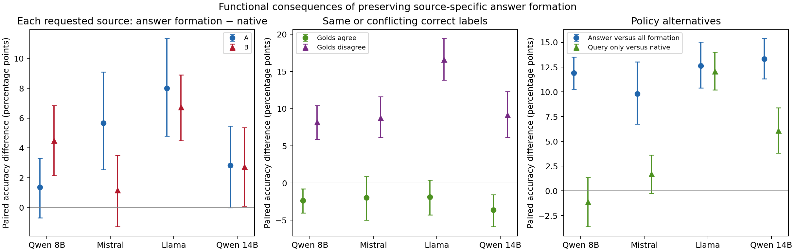

Independent confirmation: each source's accuracy change, agreement/conflict of the correct labels, and alternative policies. All combined formation/query conditions and full-vocabulary scores are reported in the appendix.

## D. Native operation and real-text completeness

| Model, n=32 | Full-source operation removal | A-only restricted restoration | Full-source restricted restoration |
|---|---:|---:|---:|
| Qwen3-8B | 1.649 [1.108, 2.250] | 1.455 [0.999, 1.945] | -0.806 [-1.365, -0.266] |
| Mistral-7B-v0.3 | 1.054 [0.886, 1.227] | 0.647 [0.463, 0.835] | 0.140 [0.053, 0.231] |
| Llama-3.1-8B | 0.808 [0.517, 1.109] | 0.958 [0.635, 1.276] | -0.233 [-0.336, -0.122] |
| Qwen3-14B | 1.329 [0.967, 1.717] | 1.120 [0.673, 1.646] | 0.039 [-0.217, 0.287] |

Paired signed B-rule-response differences in nats with95%CI. The operation acts at every prefix layer, masks strict historical senders, preserves self attention, and renormalizes the remaining attention. The restricted restoration opens only the historical answer→label edges; it does not restore original numerical messages or all native paths. E120 single within-answer-off controls, far-namespace effects, residuals, and signed/magnitude contrasts are in the card/results.

| Model, n=32 | Single-source positive / inverted accuracy, % | Native A-formation magnitude, nats [95% CI] | KV rule r / RMSE / zero RMSE |
|---|---:|---:|---:|
| Qwen3-8B | 98.4 / 88.3 | 2.151 [1.487, 2.895] | 0.931 / 1.363 / 3.658 |
| Mistral-7B-v0.3 | 99.2 / 96.9 | 1.091 [0.925, 1.258] | 0.948 / 0.336 / 1.048 |
| Llama-3.1-8B | 97.7 / 99.2 | 0.689 [0.488, 0.901] | 0.930 / 0.309 / 0.840 |
| Qwen3-14B | 99.2 / 93.8 | 1.678 [1.340, 2.052] | 0.966 / 0.519 / 1.949 |

Each SST private direction has n16contexts; natural-text pool/split/source provenance is independently audited. The word-plus-separator sender regions differ by tokenizer. Llama fixed-word association signed effects are negative; all K/KV/V raw/rule reconstructions and zero predictions remain in the summaries.

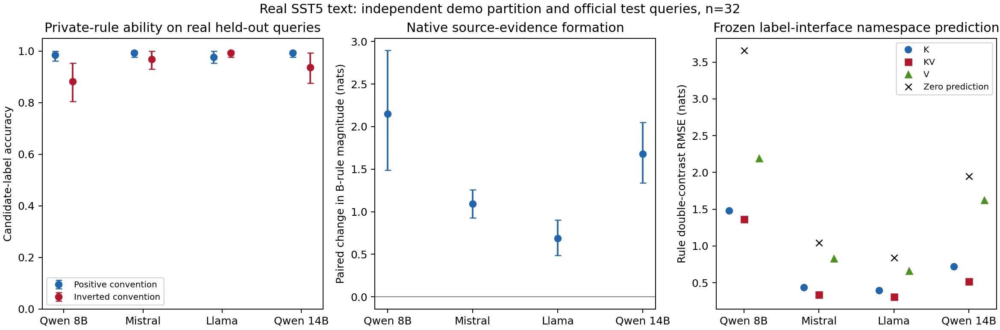

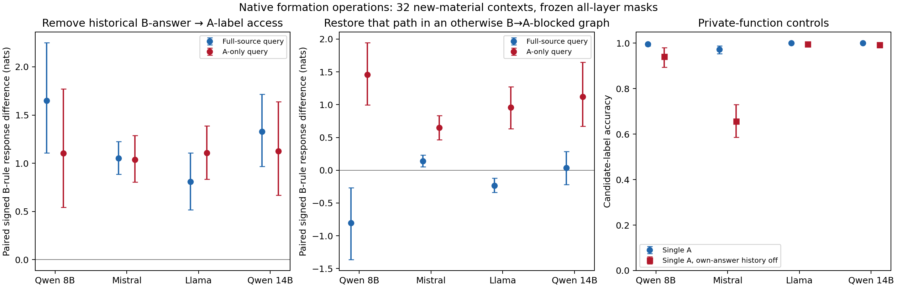

Paired signed B-rule effects after operation removal and restricted restoration. The contrast in restoration direction shows why historical sharing cannot be described as uniformly harmful.

## E. Registered evidence map

| Manuscript claim | Records |
|---|---|
| Positional access does not isolate relation dependence | [E90](experiments/E90-source-isolation-before-and-after.md), [E91](experiments/E91-label-namespace-and-inherited-rule.md) |
| Output-dependent formation reconstruction, C21 | [E109](experiments/E109-foreign-messages-at-label-formation.md), [E111](experiments/E111-polarity-relation-versus-namespace.md), [E112](experiments/E112-formation-mechanism-mistral-family.md), [first independent audit](results/e109/independent_review_2026-10-11.md) |
| Fixed-label partial association content, C22 | [E111](experiments/E111-polarity-relation-versus-namespace.md), [E113](experiments/E113-relation-content-mistral.md), [E114](experiments/E114-native-formation-reading-crossing.md) |
| Native operation contribution and restricted restoration | [E120](experiments/E120-operation-necessity.md), [independent operation audit](results/e120/independent_review_2026-10-12.md) |
| Reliable private functions and formation on natural text | [E121](experiments/E121-natural-sentiment-mechanism.md), [independent data and mechanism audit](results/e121/independent_review_2026-10-12.md) |
| Native conditional effects and interaction, C23 | [E114](experiments/E114-native-formation-reading-crossing.md), [new independent audit](results/e114/independent_review_2026-10-11.md) |
| Functional criterion response and its formation-interface boundary, C24 | [E117](experiments/E117-criterion-feature-formation.md), [E118](experiments/E118-criterion-code-feature-crossing.md), [E119](experiments/E119-stronger-model-formation-criterion.md), [E118 audit](results/e118/independent_review_2026-10-11.md), [E119 audit](results/e119/independent_review_2026-10-11.md) |
| Llama, larger checkpoint, and real-text coverage | [E115](experiments/E115-llama-frozen-native-mechanism.md), [E116](experiments/E116-native-mhs-formation-reading.md), E119; [wave audit](results/e117/independent_review_2026-10-11.md) |
| Limits and failed functional interfaces | E50–E52, E99, E107, [E110](experiments/E110-learned-relation-fixed-label-stream.md); full ledger in [CLAIMS](CLAIMS.md) |
| Joint source-function formation and query policies | [E122](experiments/E122-source-preserving-formation.md), [independent raw audit](results/e122/independent_review_2026-10-12.md) |

## F. Real-text function policies and complete output readouts

Primary accuracy averages origin/cross worlds, two requested sources, and eight queries within each context. Within-class movement is reported separately. The original primary is candidate accuracy; full-vocabulary output and word-space diagnostics are separate secondary readouts. Shared-word candidate/full-vocabulary aggregates coincide in all six confirmation policies. Private polarity is balanced across contexts; source-specific conventions are inferred from examples, not provided as explicit rules.

| Model / output words, n=32 | Native candidate / full, % | Selective candidate / full | All formation off candidate / full | Query-only candidate / full | Answer + query candidate / full | All formation + query candidate / full |
|---|---:|---:|---:|---:|---:|---:|
| Qwen3-8B / shared | 84.86 / 84.86 | 92.19 / 92.19 | 75.00 / 75.00 | 84.47 / 84.47 | 93.85 / 93.85 | 94.34 / 94.34 |
| Qwen3-8B / far | 94.24 / 92.09 | 94.34 / 92.09 | 94.34 / 51.46 | 94.34 / 94.34 | 94.63 / 94.63 | 93.16 / 93.16 |
| Mistral-7B-v0.3 / shared | 88.77 / 88.77 | 94.14 / 94.14 | 73.54 / 73.54 | 94.73 / 94.73 | 96.39 / 96.39 | 93.16 / 93.16 |
| Mistral-7B-v0.3 / far | 98.05 / 96.00 | 98.05 / 94.73 | 95.21 / 53.71 | 97.27 / 97.27 | 97.46 / 97.46 | 95.61 / 95.61 |
| Llama-3.1-8B / shared | 81.25 / 81.25 | 90.72 / 90.72 | 75.20 / 75.20 | 97.95 / 97.95 | 99.12 / 99.12 | 99.12 / 99.12 |
| Llama-3.1-8B / far | 97.95 / 95.41 | 98.54 / 95.12 | 94.82 / 53.81 | 96.58 / 96.58 | 96.97 / 96.97 | 95.31 / 95.31 |
| Qwen3-14B / shared | 89.94 / 89.94 | 97.36 / 97.36 | 75.00 / 75.00 | 93.75 / 93.75 | 97.27 / 97.27 | 98.05 / 98.05 |
| Qwen3-14B / far | 95.90 / 95.80 | 97.27 / 97.07 | 96.68 / 52.83 | 92.97 / 92.97 | 94.63 / 94.63 | 96.68 / 96.68 |

| Model | Selective shared gain A, pp | B, pp | Opposite conventions, pp | Same conventions, pp | Shared-minus-separate gain, pp |
|---|---:|---:|---:|---:|---:|
| Qwen3-8B | 4.49 [1.56, 7.03] | 10.16 [6.05, 14.26] | 15.23 [11.91, 18.75] | -0.59 [-2.15, 0.98] | 7.23 [5.08, 9.47] |
| Mistral-7B-v0.3 | 4.49 [0.98, 8.20] | 6.25 [3.32, 9.38] | 12.11 [8.20, 16.21] | -1.37 [-3.71, 0.20] | 5.37 [2.73, 7.81] |
| Llama-3.1-8B | 7.42 [4.69, 10.16] | 11.52 [8.20, 14.65] | 19.14 [15.04, 23.24] | -0.20 [-0.59, 0.00] | 8.89 [6.84, 10.94] |
| Qwen3-14B | 4.88 [2.15, 8.20] | 9.96 [6.05, 14.06] | 15.23 [11.52, 19.14] | -0.39 [-1.37, 0.59] | 6.05 [4.30, 7.91] |

These are paired context-bootstrap95%CI. The namespace contrast is not headroom matched; word meanings/priors also differ. No layer, head, intervention strength or context is selected to improve these results.

| Model | Far/all-formation-off full accuracy A, % | B, % | Other-source word output A, % | B, % |
|---|---:|---:|---:|---:|
| Qwen3-8B | 48.24 [40.43, 56.05] | 54.69 [45.70, 63.48] | 51.17 [43.36, 58.98] | 42.58 [33.40, 51.76] |
| Mistral-7B-v0.3 | 30.86 [21.68, 40.62] | 76.56 [68.75, 83.98] | 66.99 [56.84, 76.76] | 22.27 [14.84, 30.08] |
| Llama-3.1-8B | 64.65 [58.01, 71.29] | 42.97 [34.96, 50.98] | 34.96 [28.32, 41.60] | 55.27 [47.46, 63.28] |
| Qwen3-14B | 46.09 [39.65, 52.34] | 59.57 [53.52, 66.02] | 53.71 [47.46, 60.16] | 38.48 [32.03, 44.73] |

This classification uses the actual argmax token and the other source’s two word IDs. The average other-source-word rates are 44.6–46.9%, but their A/B composition differs. In the shared-word case, surface words cannot identify their source: recording zero identifiable other-space words is not evidence of provenance isolation.

| Model | Single A, % | B opposite shared | B same shared | B opposite far | B same far |
|---|---:|---:|---:|---:|---:|
| Qwen3-8B | 95.31 [92.58, 97.66] | 94.14 [90.62, 97.27] | 97.27 [94.92, 99.22] | 92.97 [88.28, 96.88] | 94.14 [90.23, 97.66] |
| Mistral-7B-v0.3 | 98.83 [97.27, 100.00] | 98.05 [94.92, 100.00] | 98.44 [96.88, 99.61] | 98.83 [97.66, 100.00] | 98.05 [96.48, 99.61] |
| Llama-3.1-8B | 98.44 [96.88, 99.61] | 99.22 [98.05, 100.00] | 99.61 [98.83, 100.00] | 94.14 [89.84, 97.66] | 89.06 [83.58, 94.14] |
| Qwen3-14B | 98.05 [96.48, 99.61] | 96.88 [93.75, 99.22] | 98.44 [96.48, 100.00] | 95.70 [93.75, 97.66] | 96.48 [92.97, 99.22] |

The private positive/inverted halves, actual full-vocabulary controls, all one-sentence instructions, complete A convention-response/signed/within movement readouts, and all 85 condition statistics remain in the experiment summaries and independent audit. Aggregate private functions are usable but not uniformly perfect; the distinct words also have asymmetric direction priors. Formation masks remove unequal sets of edges, renormalize attention, and allow states to evolve. Consequently the result identifies functional consequences of fixed policies, not isolated representation components or a tuned performance method.

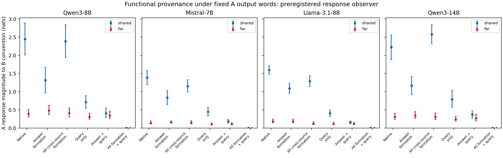

The observer is the absolute context mean of the A-gold-oriented half contrast between B conventions, computed in A’s fixed output space. It is not attention-based source ranking. Signed and matched within-class movement remain alongside it.

E123 freezes the scientific source at91374879 before the first score. Four checkpoints each execute discovery16 and confirmation32, totaling192contexts/130560scores. Scientific inputs, masks, full-output tokens, and small report data are independently checked; see [E123](experiments/E123-natural-source-function-policy.md) and its [raw audit](results/e123/independent_review_2026-10-12.md). The pinned SST downloader reproduces all three Arrow files and the Llama32 confirmation contexts byte-for-byte in the recorded environment, without modifying the frozen scientific modules.

## G. Shared identities and independent private supervision

E124 isolates both sources' private demonstration histories at every layer, retains original global positions, and places a public names-only list after the generic header but before all supervision. F controls demonstration access to the list; R controls every query position's direct access. All generic public tokens precede the list, preventing an indirect public relay when F is off. No output words, criterion or private convention are provided. True and unrelated lists have equal token length; numerical cache and full-output no-ops establish their complete invisibility under F0R0.

The primary is full-vocabulary accuracy, averaged uniformly over worlds, sources, and eight queries within each context. Identity-specific formation gain is [true F1R0−true F0R0]−[unrelated F1R0−unrelated F0R0]; reading gain substitutes F0R1. It is not a comparison to the shorter no-list prefix.

| Model, n32 | Formation identity gain, pp | Reading identity gain, pp | true F0R0 full/candidate, % | true F1R0 full/candidate, % |
|---|---:|---:|---:|---:|
| Qwen3-8B | 4.59 [2.73, 6.64] | 0.29 [-0.78, 1.46] | 52.73/93.16 | 58.98/93.65 |
| Mistral-7B-v0.3 | -1.07 [-2.05, -0.20] | 0.49 [0.10, 0.98] | 53.32/91.41 | 52.83/92.97 |
| Llama-3.1-8B | -0.68 [-1.95, 0.49] | -0.20 [-0.88, 0.39] | 53.22/93.95 | 54.59/93.95 |

Qwen's formation identity gain is positive for A and B and both private directions. Mistral's true formation-only operation has opposite effects on A and B; Llama's positive candidate identity contrast does not transfer to the full-output primary. Mistral's reading identity contrast is positive but small. All 47 conditions, instructions, single-source functions, private directions, signed/absolute B-convention responses, and F×R contrasts are retained in [the complete report](results/e124/report.md) and its summaries. There is no equivalence conclusion from a confidence interval crossing zero.

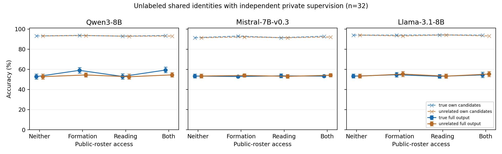

Three checkpoints each execute 16 discovery and 32 confirmation contexts, changing Alex/Sam to Robin/Jordan in confirmation. The 54,144 scores undergo [independent numerical, token and graph review](results/e124/independent_review_2026-10-12.md); 11,742 numerical comparisons match exactly. Whole-query mask consumption is checked in every layer. Independent review is not an independent GPU rerun. The names-only public context is not a full entity–attribute binding construction, and its partial/negative effects do not refute all binding mechanisms.

## H. Public output schemas and private rule composition

E125 keeps private cross-source demonstration access blocked at every layer. The public table precedes all supervision and specifies only source-to-word sets, not input–label pairs, criterion, or private polarity. F controls all demonstration access; R controls direct access by every query token. Generic HEAD tokens precede the table, preventing a later public relay. True, unrelated-name, and swapped-relation tables have matched lengths and unchanged private token positions. Query reading otherwise sees both source caches. This is explicit relational supervision, not fully unsupervised coordination.

The primary difference-in-differences compares true and unrelated formation-only or reading-only gains. All three tables share identical relevant states and full-output argmax under F0R0. Below, confidence intervals are 10,000 context-bootstrap intervals; contexts, rather than individual queries, are the sampling units.

| Model / phase | Formation true−unrelated, pp | Reading true−unrelated, pp | Formation true−swapped, pp | Swapped formation gain, pp |
|---|---:|---:|---:|---:|
| Qwen3-8B / discovery | 20.31 [16.99, 23.83] | 0.39 [-0.39, 1.17] | 10.16 [7.03, 12.89] | 9.96 [6.25, 13.87] |
| Mistral-7B-v0.3 / discovery | 10.94 [6.25, 16.60] | 0.20 [-0.98, 1.37] | 6.05 [2.34, 10.16] | 6.64 [3.71, 10.35] |
| Llama-3.1-8B / discovery | 8.98 [5.08, 12.70] | 0.00 [-0.59, 0.59] | 12.50 [8.79, 16.80] | 0.20 [-2.54, 2.54] |
| Qwen3-8B / confirmation | 26.66 [23.05, 30.47] | 0.78 [-0.29, 1.95] | 11.72 [7.91, 15.72] | 16.99 [13.77, 20.31] |
| Mistral-7B-v0.3 / confirmation | 7.71 [5.08, 10.45] | 0.10 [-0.29, 0.49] | 4.39 [2.15, 6.74] | 6.05 [4.10, 8.11] |
| Llama-3.1-8B / confirmation | 8.30 [6.05, 10.84] | 0.29 [-0.20, 0.78] | 5.47 [2.44, 8.59] | 2.64 [0.10, 5.08] |

| Model, confirmation n32 | True F0R0 full / candidates, % | True F1R0 full / candidates, % | Formation identity gain A / B, pp | Swapped other-word change, pp |
|---|---:|---:|---:|---:|
| Qwen3-8B | 51.27/95.12 | 79.98/91.31 | 29.88 [23.05, 36.72] / 23.44 [17.97, 29.69] | -18.75 [-21.78, -15.92] |
| Mistral-7B-v0.3 | 50.00/91.02 | 60.45/95.70 | 4.49 [-0.20, 9.38] / 10.94 [7.42, 14.45] | -4.79 [-6.74, -2.93] |
| Llama-3.1-8B | 53.22/94.24 | 61.33/95.12 | 0.20 [-5.27, 5.66] / 16.41 [10.35, 23.05] | -3.22 [-5.47, -0.98] |

A correct schema helps more than its swapped counterpart, but the swapped schema also improves actual full-output accuracy and reduces other-source outputs in every model. Therefore a positive true−swapped contrast does not establish active wrong-space routing. Qwen’s true formation operation costs 3.81 [1.86, 5.66] candidate-accuracy points; Mistral and Llama have uncertain A-specific identity gains. All private directions, A/B/world readouts, single functions, instructions, signed/absolute B-convention effects, and F×R interactions are retained in the [complete report](results/e125/report.md) and per-run analysis files. A shared schema is not a lossless or universally sufficient composition method.

The frozen scientific source is `75f7566582cbaf7cf80dd130b409b32436df281a262884d8db381991437612b9` (preregistered commit a0a79918). Six runs include 144 contexts and 72,576 scores, recording 0.735239 GPU hours. The [independent audit](results/e125/independent_review_2026-10-12.md) reconstructs 18,126 raw numerical entries with maximum error zero, actual tokenizer geometry, golds, 100,800 prefix and 302,400 query layer-mask calls, and 9,216 inert-table full-output comparisons. This is independent analysis rather than an independent GPU rerun. Fresh confirmation contexts and names do not constitute an entirely new benchmark.

## I. Equivalent-context cache composition

E126 changes only the order of two correct public source–word-set rows. Private examples, all public facts, source names, token lengths, and private global positions are unchanged. Private cross-source formation remains blocked at every layer, while every query position is denied direct schema access. Coherent pairs 00/11 combine whole source-owned K/V from one ordering; mixed pairs 01/10 combine one source from each ordering. Generic HEAD and unreadable schema cache states come from order0. Coherent11 is verified against the pristine order1 computation under the same query mask.

The primary is full-vocabulary accuracy, with equal weights over worlds, sources, and queries within a context. The paired coherent−mixed contrast is .5[(00+11)−(01+10)]. It cancels additive single-cache quality effects but can still reflect nonlinear output scoring, attention competition, or binding. It does not by itself identify nonlinear latent representations. Requested-source-only reading makes the balanced contrast zero by the combination design; individual function scores must be reported separately.

| Model / phase | Joint coherence, pp | Candidate coherence, pp | Joint order11−00, pp | Coherence A / B, pp |
|---|---:|---:|---:|---:|
| Qwen3-8B / discovery | 19.43 [15.82, 23.24] | 1.07 [0.00, 2.15] | 0.20 [-5.27, 5.47] | 20.12 [13.28, 27.73] / 18.75 [14.26, 23.83] |
| Mistral-7B-v0.3 / discovery | 15.33 [11.33, 19.53] | 0.29 [0.00, 0.59] | 4.88 [-2.73, 12.89] | 25.39 [18.55, 33.20] / 5.27 [2.54, 8.20] |
| Llama-3.1-8B / discovery | 7.91 [5.08, 10.84] | 0.10 [-0.49, 0.68] | -0.98 [-4.88, 2.34] | 9.18 [4.49, 14.65] / 6.64 [3.32, 10.16] |
| Qwen3-8B / confirmation | 23.49 [20.80, 26.07] | 1.12 [0.24, 2.05] | -4.10 [-7.62, -0.59] | 21.19 [17.58, 24.90] / 25.78 [21.09, 30.47] |
| Mistral-7B-v0.3 / confirmation | 10.40 [7.96, 13.04] | 0.63 [0.29, 0.98] | -5.27 [-10.25, -0.49] | 17.48 [13.18, 22.07] / 3.32 [1.46, 5.37] |
| Llama-3.1-8B / confirmation | 5.42 [4.00, 6.79] | 0.20 [-0.24, 0.63] | 1.46 [-0.98, 3.91] | 6.05 [4.20, 8.11] / 4.79 [2.73, 6.74] |

| Model, confirmation n32 | Own-only00 / 11, % | Own-only01 / 10, % | Joint other-word coherence, pp |
|---|---:|---:|---:|
| Qwen3-8B | 92.09 / 93.36 | 91.99 / 93.46 | -25.88 [-28.66, -22.90] |
| Mistral-7B-v0.3 | 96.68 / 96.78 | 96.39 / 97.07 | -10.64 [-13.33, -8.11] |
| Llama-3.1-8B | 93.16 / 92.58 | 92.77 / 92.97 | -5.76 [-7.18, -4.30] |

Both public orders have strong source-only function scores, but they are not functionally identical. Joint order11−00 is negative in Qwen and Mistral. Their primary correct-margin point estimates are also negative with intervals spanning zero; improved full-output use is not a uniform positive shift in every score. Mistral’s A-specific joint full accuracy is only 42.58% in00 and 33.40% in11, despite strong requested-source-only scores. All actor, world, private direction, margin, convention-response, single-function, and one-instruction results are retained in the [complete report](results/e126/report.md).

Six runs comprise144contexts/49536scores and0.627887GPU hours. Source `ad2c6f7af7ab81966ea1253a80e7006747f3485b182fddd1453ffbb1ceb45975` was frozen at377de6c4 before scoring. The [independent audit](results/e126/independent_review_2026-10-12.md) reconstructs12462 numerical entries with maximum error0,1584 actual token/mask layouts,49536 golds,52800 prefix and206400 query layer-mask calls,9216 mixed-own argmax controls, and4608 A own-world comparisons. No independent GPU rerun is claimed. The [portable audit](results/e126/portable_reproduction_audit.json) confirms Llama32 material bytes from the pinned public dataset.

### I.5 Post-hoc selected-output compatibility

After the complete E126 confirmation, we classify actual argmax outputs in the opposite-convention world against both sources’ private gold. The same-convention world cannot distinguish the two mappings and is excluded from this diagnostic. Every context and both requested sources remain included; the unit is still context. This is an additional observation, not a change to the frozen primary or a new model run.

| Confirmation model | Coherent-minus-mixed other-source rule-compatible outputs, pp [95% CI] | Other-source outputs matching requested canonical code, pp [95% CI] |
|---|---:|---:|
| Qwen3-8B | −23.73 [−27.44, −20.02] | −1.37 [−2.25, −0.59] |
| Mistral-7B-v0.3 | −10.06 [−12.79, −7.42] | −0.39 [−1.07, 0.20] |
| Llama-3.1-8B | −4.88 [−6.64, −3.22] | −0.59 [−1.17, −0.10] |

These categories use the task’s canonical code indices rather than the words’ natural semantic equivalence. They show compatibility of an observed output with a demonstrated mapping, without claiming to observe an internal called rule. The predominant change is in outputs compatible with the other source’s convention. Own-space wrong-code outputs also increase in Qwen by 2.54 [0.68, 4.88] points and Llama by 0.68 [0.10, 1.27], so this is not a uniform reduction of every error type. These opposite-world categories are not a mediated fraction of the both-world primary. Full pair-specific rates and discovery results are in [the post-hoc report](results/e126/posthoc_selected_code.md) and [raw recomputation](scripts/posthoc_e126_selected_code.py).

## J. Shared-output cache compatibility and source-conditioned mapping use

E127 holds the original comments, source identities, class-index conventions, and global private positions fixed across shared and separate namespaces. Two orders of the same correct public facts form whole source-owned K/V caches. Every private cross-source formation edge is blocked; every query position is denied schema access. The 00/11 pair uses one common ordering and 01/10 mixes orderings. Each cache is scored under joint and requested-source-only reading. Both private directions, sources, and all predefined worlds remain included.

The preregistered primary is **shared outputs, opposite private conventions, joint coherent-minus-mixed full-vocabulary accuracy**. Other worlds and separate word sets are secondary. Shared words cannot identify which source an answer came from: the stored `other_source_word=False` is unidentifiability, not zero leakage. Full argmax, candidate choice, and raw label logits are retained. Neither the source-average primary nor the local functions measure both answers being simultaneously correct.

| Model / phase | Primary, pp [95% CI] | Shared/all worlds, pp | Separate/all worlds, pp |
|---|---:|---:|---:|
| Qwen3-8B / discovery | 6.84 [4.10, 9.77] | 3.61 [2.25, 5.08] | 17.09 [14.26, 19.63] |
| Mistral-7B-v0.3 / discovery | 5.47 [3.71, 7.81] | 2.64 [1.76, 3.81] | 12.60 [8.50, 16.99] |
| Llama-3.1-8B / discovery | 0.78 [0.00, 1.76] | 0.39 [0.00, 0.88] | 5.47 [2.83, 8.01] |
| Qwen3-14B / discovery | 2.54 [0.98, 4.10] | 1.46 [0.59, 2.25] | 20.51 [16.89, 24.71] |
| Qwen3-8B / confirmation | 8.89 [6.64, 11.13] | 4.64 [3.52, 5.71] | 23.49 [21.29, 25.73] |
| Mistral-7B-v0.3 / confirmation | 5.86 [4.10, 7.71] | 2.98 [2.10, 3.91] | 9.13 [6.84, 11.43] |
| Llama-3.1-8B / confirmation | 0.78 [0.10, 1.56] | 0.39 [0.05, 0.78] | 6.49 [4.93, 8.06] |
| Qwen3-14B / confirmation | 9.38 [7.32, 11.52] | 4.64 [3.56, 5.76] | 21.44 [18.75, 24.02] |

### J.1 Functional request differences and common shifts

For shared outputs in the opposite-convention world, define \(S=\frac12\mathbb E_q[g_A(q)(z_A(q)-z_B(q))]\) and \(C=\frac12\mathbb E_q[g_A(q)(z_A(q)+z_B(q))]\). Absolute common magnitude averages the absolute value per query before averaging. S is also the mean correct margin over both requested sources, because their gold labels are opposite. Its change excludes a single request-independent logit offset as the complete explanation; it does not identify a hidden binding representation or a unique retrieval algorithm. Separate outputs instead use the logsumexp difference between word sets, so their functional units must not be treated as the same shared-word measure.

| Confirmation model | Shared S coherence, nats | Signed common coherence | Absolute common coherence |
|---|---:|---:|---:|
| Qwen3-8B | 0.63 [0.53, 0.74] | 0.00 [-0.06, 0.06] | -0.05 [-0.10, -0.01] |
| Mistral-7B-v0.3 | 0.13 [0.11, 0.16] | 0.04 [0.01, 0.07] | 0.00 [-0.02, 0.02] |
| Llama-3.1-8B | 0.03 [0.02, 0.03] | 0.00 [-0.00, 0.01] | 0.00 [-0.00, 0.01] |
| Qwen3-14B | 0.50 [0.44, 0.56] | -0.00 [-0.07, 0.07] | -0.02 [-0.07, 0.03] |

### J.2 Local functions and incomplete joint use

| Confirmation model | Shared/opposite joint00 / 11, % | Shared/opposite own-only00 / 11, % | Joint order11−00, pp |
|---|---:|---:|---:|
| Qwen3-8B | 63.87 / 64.84 | 90.82 / 91.41 | 0.98 [-2.34, 4.10] |
| Mistral-7B-v0.3 | 59.18 / 56.25 | 96.88 / 96.09 | -2.93 [-5.08, -0.78] |
| Llama-3.1-8B | 53.52 / 52.93 | 98.05 / 97.85 | -0.59 [-2.34, 1.17] |
| Qwen3-14B | 63.09 / 60.55 | 97.46 / 97.85 | -2.54 [-5.47, 0.20] |

Strong private functions coexist with incomplete joint selection. Llama's primary is small, its B-specific interval spans zero, and the positive effect is not uniform across private directions. Mistral's two coherent orders differ. The balanced own-only linear coherence contrast is zero by construction, whereas absolute-common observers may have nonzero contrasts because of their nonlinear definition. None of these identities demonstrates a separate latent module. All sources, worlds, private directions, single functions, native and instruction-plus-isolation controls, candidate/full scores, B-code response, and raw common shifts appear in [the complete report](results/e127/report.md).

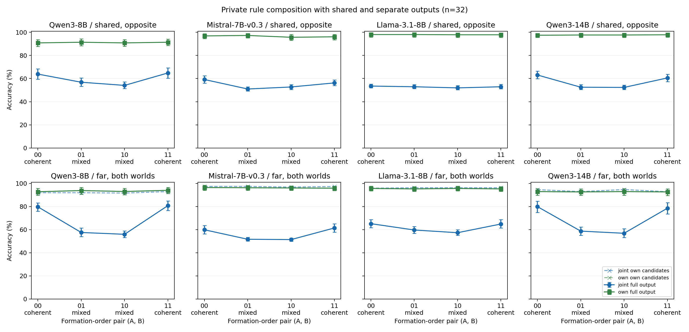

Eight fixed runs contain 192 contexts and 132,096 scientific scores. The completed-run timers total 1.950864 GPU hours; they exclude preserved partial-run computation, the zero-score load failure, startup reservations, and model transfer. Scientific source `cef7952d4ef556abad45c9c2e6d6f351e3b0a1b3fffa9232b9eb728806c943de` was frozen before scoring at commit4b8ee609. The independent CPU record covers all 192 contexts and actual tokenizer/configuration layouts; [the complete raw audit](results/e127/independent_raw_review_2026-10-12.md) reports numerical recomputation, golds, masks, and actual per-layer consumption. These are independent analyses, not independent GPU reruns.

Qwen3-14B's first confirmation load failed before any scientific score after an external job occupied its GPU. The pinned checkpoint was then verified on another empty node. The initial discovery run's ten complete contexts and raw records remain preserved separately. Identical contexts were rerun in the full fixed discovery batch, without seed or outcome selection: all 6,880 matching argmax decisions and candidate signs agree across hardware; maximum absolute logit-difference and individual label-logit deviations are .001028 and .002842. These hardware comparisons are separate from the same-run FP32 controls and are not additional samples. [Checkpoint identity](results/e127/model_identity_qwen14_nvme.json) and the operational records preserve the migration. Portable reconstruction reproduces the 32 Llama confirmation contexts byte-for-byte from the pinned public SST5 files.

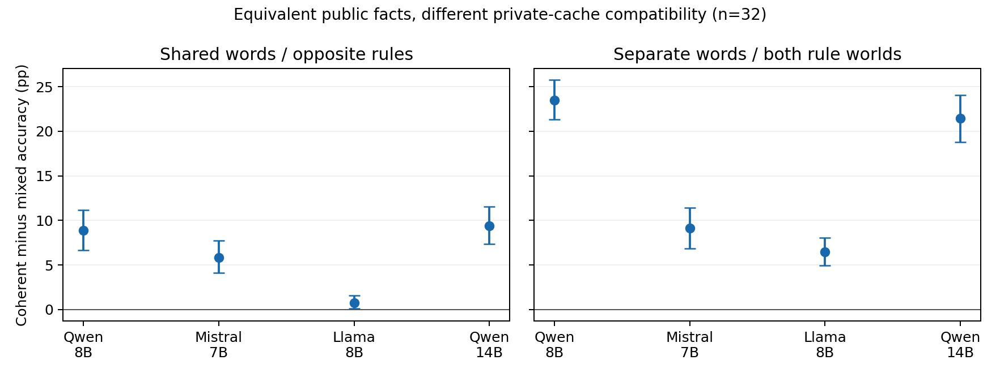

Coherent-minus-mixed cache effects on held-out contexts. Left: identical words and conflicting conventions, the frozen primary. Right: separate words and both convention worlds, a secondary reference. The panels use different world scopes.

## K. Compatibility when input criteria differ

E128 uses controlled restaurant comments with two independently varied aspects and both private code directions. A follows Food; B has four criterion×code worlds. Both sources share no/yes, public facts and private global positions match across orders, private cross-source formation is blocked, and the whole query cannot read the public table. The frozen primary is the origin world (A Food/B Service, same code), the four aspect-conflicting queries, averaged over both requested sources. This differs from E127's convention primary and does not inherit its stronger private-function scores.

| Model / phase | Primary coherence, pp [95% CI] | Criterion-oriented margin coherence T, nats [95% CI] |
|---|---:|---:|
| Qwen3-8B / discovery | 2.34 [0.39, 4.69] | 0.03660 [0.01877, 0.05657] |
| Mistral-7B-v0.3 / discovery | -0.78 [-1.95, 0.00] | 0.00853 [0.00412, 0.01442] |
| Llama-3.1-8B / discovery | 1.56 [0.00, 3.52] | 0.00767 [0.00501, 0.01085] |
| Qwen3-14B / discovery | 0.00 [-1.95, 2.34] | 0.04048 [0.02804, 0.05418] |
| Qwen3-8B / confirmation | 1.56 [-0.59, 3.52] | 0.04256 [0.03058, 0.05624] |
| Mistral-7B-v0.3 / confirmation | 0.98 [-1.37, 3.32] | 0.00502 [0.00303, 0.00714] |
| Llama-3.1-8B / confirmation | 0.78 [0.00, 1.76] | 0.00837 [0.00624, 0.01068] |
| Qwen3-14B / confirmation | 2.93 [0.59, 5.47] | 0.05037 [0.03974, 0.06198] |

For origin, let f and s denote the Food and Service signs oriented by A's private code. We report T=½ E[(zA−zB)(f−s)] over all eight balanced queries. This equals the average correct margin of the two sources on the four conflicting queries: it is an equivalent output projection, not an independent probe or evidence of input filtering. The complete Food/Service/bias/product basis and common shifts remain available.

### K.1 Actual function scores on the primary domain

| Confirmation model | Joint00 / 11, % [95% CI] | Own-only00 / 11, % [95% CI] | Single Food / Service on conflicting queries, % [95% CI] |
|---|---:|---:|---:|
| Qwen3-8B | 50.78 [48.05, 53.91] / 52.73 [49.61, 55.86] | 56.25 [51.95, 60.55] / 58.20 [53.91, 62.89] | 46.88 [40.62, 52.34] / 69.53 [62.50, 77.34] |
| Mistral-7B-v0.3 | 50.39 [48.05, 52.73] / 50.00 [48.05, 51.95] | 54.69 [51.95, 57.81] / 55.47 [51.95, 59.38] | 57.81 [53.12, 64.06] / 53.12 [49.22, 57.81] |
| Llama-3.1-8B | 51.17 [50.00, 52.73] / 51.95 [50.39, 53.52] | 70.70 [64.84, 76.95] / 70.31 [64.45, 76.56] | 67.19 [60.16, 74.22] / 71.09 [63.28, 78.91] |
| Qwen3-14B | 52.34 [48.83, 55.86] / 51.95 [49.61, 54.30] | 75.00 [71.09, 78.91] / 73.05 [69.14, 76.95] | 68.75 [61.72, 75.80] / 78.12 [70.31, 85.94] |

The single-function conflicting-query values are an explicitly **post-hoc descriptive scope audit** of already predefined controls, recorded by the independent reviewer. They neither change the primary nor add model runs. All-query controls in the full report have a different domain and cannot establish capability on the primary conflict cases. Qwen3-8B's Food is weak; Mistral's Food score is modest and its Service interval includes chance; Qwen3-14B's matched Food/Service functions are above chance. Its small positive compatibility effect therefore coexists with a substantial private-to-joint gap. This prevents interpreting the weaker effects as absence of criterion information, or the positive margin as successful criterion composition.

All 85 interfaces, four worlds, private directions, source-specific intervals, both coherent orders, native and **pure one-sentence instruction** conditions, full/candidate outputs, and fixed-word response bases are preserved in [the complete report](results/e128/report.md) and independent disclosure. Aspect order remains fixed, and whole-cache interchanges remain compatible with contextual binding, calibration, and criterion-conditioned retrieval.

Eight runs comprise192contexts/130560scores and1.237902 recorded GPU hours. Scientific source `f0a0146708e193e017eb33a1caf955d8e4d4bf22d91d73abb403b500be92265a` was frozen at5e9549ed before scoring. The [independent raw audit](results/e128/independent_raw_review_2026-10-12.md) reconstructs38760 numerical entries with maximum error0 and checks actual masks, golds, full argmax, cache origin, and the margin identity. The author report check adds38764 numerical entries and352 table rows; these comparison counts overlap the same observations and do not add experimental sample size. No independent GPU rerun is claimed.

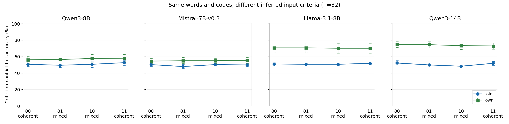

*All four cache pairs on the frozen criterion-conflict domain, confirmation n32 per checkpoint. Scores average separate source requests; they do not measure simultaneous two-source success.*

## L. Does a pre-input source block deploy a source-specific criterion?

E129 retains the controlled Food/Service material and crosses B's criterion with its private code while fixing names, B label streams, input multisets, and global positions. Private demonstration histories form independently, without a public schema. Before any test comment, the complete `Annotator: name / Comment:` block reads both private histories; the cue stage does not use an oracle source mask. We exchange only this entire multilayer cue K/V block, preserving every recipient demonstration cache. The primary body graph then reads recipient B, HEAD, and the cue; joint-body reading is secondary. Two same-code recipients, four donor worlds, and CueA/CueB controls remain fixed.

Let δt=½(zcue(t,+)−zcue(t,−)). Its projections on private-code-oriented Food and Service signs form a two-row functional matrix M. The two co-primary quantities are det(MCueB) and det(MCueB−MCueA), calculated separately for every recipient/context before averaging the two recipients and bootstrapping contexts. A positive difference determinant alone can result from subtracting two rank-one matrices, so the first co-primary and correct row selectivities cannot be omitted. These are output functions, not measured latent dimensionalities.

| Model / phase | CueB det, nats² [95% CI] | Source-specific det, nats² [95% CI] |
|---|---:|---:|
| Llama-3.1-8B / discovery | -5.914e-06 [-1.213e-05, 5.864e-07] | 6.157e-06 [2.463e-06, 1.080e-05] |
| Qwen3-14B / discovery | -9.656e-06 [-1.251e-04, 8.155e-05] | 5.551e-06 [-1.524e-05, 2.613e-05] |
| Llama-3.1-8B / confirmation | 2.492e-06 [-5.264e-06, 1.097e-05] | -1.259e-06 [-3.316e-06, 4.967e-07] |
| Qwen3-14B / confirmation | 3.740e-05 [-1.643e-05, 1.014e-04] | -1.148e-05 [-4.553e-05, 1.924e-05] |

Both confirmation co-primary intervals span zero. Llama's small positive Source-specific determinant in discovery does not confirm. Qwen3-14B retains small criterion-related responses, including a mean row-selectivity interaction of0.00160 [0.00024,0.00300]nats. This does not establish correct deployment of both criteria; it also prevents claiming that the cue contains no task information.

| Confirmation model | Single Food early / late conflict accuracy, % [95% CI] | Single Service early / late conflict accuracy, % [95% CI] | Native B early / late origin conflict accuracy, % [95% CI] |
|---|---:|---:|---:|
| Llama-3.1-8B | 68.75 [60.94, 76.56] / 69.53 [62.50, 77.34] | 71.09 [64.84, 77.34] / 74.22 [67.97, 80.47] | 60.94 [51.56, 69.53] / 63.28 [55.47, 71.09] |
| Qwen3-14B | 78.12 [70.31, 85.16] / 78.91 [71.88, 85.94] | 76.56 [68.75, 84.38] / 79.69 [71.88, 87.50] | 67.19 [60.94, 74.22] / 64.84 [56.25, 73.44] |

The matched single functions are usable, while transplantation does not establish a complete criterion×code function. Every patch reports accuracy against both recipient and donor rules, so following the donor is not mistakenly judged only by recipient accuracy. The [full report](results/e129/report.md) preserves all64 conditions, two body graphs, source cues, recipients, worlds, private directions, four response bases, normalized rotations, actual output tokens, and function controls.

Native early/late uses the same formation and reading graphs, changing only field order. Independent early prepares a cue with access to both histories and then uses an own-only body; independent late uses own-only reading throughout, so their difference also changes the graph. The pure one-sentence instruction retains native formation. In Qwen3-14B origin B it gives84.38% candidate accuracy but44.14% full accuracy, with55.08% of outputs in the label set; the actual-output cost is retained rather than described as recovery.

This is a test of cues prepared from **independently formed private histories**, not a negative result about every native task state. It remains compatible with criterion-conditioned retrieval, task information in other positions, and information becoming deployable after query input. CueA/B differs in lexical identity; donor-world subtraction cancels only additive, world-invariant name effects. General task-state transfer is already established by [Hendel et al.](https://arxiv.org/abs/2310.15916), [just-in-time task representations](https://arxiv.org/html/2509.04466v3), and [representative task-vector analysis](https://proceedings.iclr.cc/paper_files/paper/2026/file/20dcab0f14046a5c6b02b61da9f13229-Paper-Conference.pdf). This interface test neither claims a first task vector nor retracts the demonstrated historical formation mechanism.

Four runs comprise96contexts/49152scores and0.413184 recorded GPU hours. Source `a177434cf425889df1fcc8b3607e6d5057a26080ad467e7999d002e6504b00bd` was frozen at57ca241a before scoring. The [independent raw audit](results/e129/independent_raw_review_2026-10-12.md) checks20580 numerical quantities, both gold definitions, actual masks and58752 prefix/27648 cue/221184 body layer-mask calls. Across all four runs, the maximum full-token/cached difference is5.5313e−5nats; graph-zero and self-interchange checks are0. These are independent analyses, not independent GPU reruns.

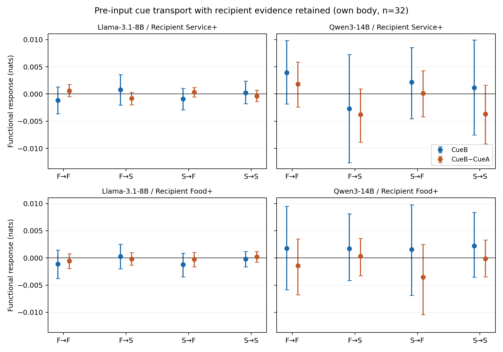

*Complete confirmation functional matrices, own-body scope. F/S denote Food/Service; arrows label the donor criterion row and query feature projection. Intervals use contexts rather than individual queries.*

### E130: Source-cue transfer under different formation policies

E130 follows the E129 cue/body/readout design and holds the recipient history fixed within each newly sampled context, while preparing donors under three historical policies: native contextualization, selective removal of foreign-answer→own-label edges, and complete private-history isolation. All donors are transplanted into the same independently formed recipient caches. The two fixed co-primary determinants use native donors; every policy contrast and actual donor/recipient function is reported.

| Confirmation model | Native CueB det, nats² [95% CI] | Native Source-specific det, nats² [95% CI] |
|---|---:|---:|
| Llama-3.1-8B | −1.751e−5 [−4.604e−5,3.566e−6] | 2.940e−6 [−2.280e−5,3.356e−5] |
| Qwen3-14B | −1.821e−4 [−6.037e−4,2.459e−4] | −3.650e−4 [−9.933e−4,2.110e−4] |

All four intervals span zero. Qwen3-14B nevertheless retains a native CueB Food row selectivity of .02144 [.00972,.03348] nats; its Service selectivity is −.01465 [−.02661,−.00353] nats. The response therefore cannot be summarized as no criterion information, or as correct transfer of both criteria. Changing formation policy did not establish the complete pre-input function at this interface. The [full report](results/e130/report.md) retains all 136 interfaces, policy contrasts, private directions and recipient/donor full-output functions. This follow-up tests the source-cue interface; the historical formation, relation-content and native-operation results remain separate evidence.

The four fixed runs contain 96 contexts and 104448 scores, with .805577 recorded single-GPU run hours. Source 7ef59b3f… was frozen at fa41da09 before scoring. The [independent audit](results/e130/independent_raw_review_2026-10-12.md) verifies 81188 raw-derived numerical quantities and all actual prefix/cue/body mask calls; full-token/cached error is at most 2.48e−5 nats. The final report check verifies 28728 displayed numbers and retains the disclosed Llama discovery stdout reading-order exception. No independent GPU rerun is claimed.

## M. Matched cross-size formation, operation, and source-function tests

E131 preserves the original E121 formation and reconstruction engine, E120 native-operation engine, and E123 real-text function-policy engine. The preregistered matrix contains Qwen3-32B and Llama-3.1-70B discovery n16→confirmation n32, and fresh same-family 8B n32 anchors for all three stages. At this snapshot, all six 8B stages, all six 32B stages, and the 70B discovery formation stage are complete and independently checked. The five remaining 70B stages are still running or pending. Confirmation statements in the main text concern the completed 32B chain.

Contexts are matched byte-for-byte **within each family and stage**. Formation and function use separately sampled SST5 contexts; native operation uses controlled restaurant contexts. Confirmation seeds are 131102/131101/131103 for these stages. Parent analyses and gold weighting remain unchanged, and comparisons do not pool different stages or treat a recipe change as an isolated capacity intervention. Each large model uses all its layers with frozen FP32 weights, eager attention, no CPU offload or quantization; Qwen3-32B uses two GPUs. Model pins, dataset revisions, actual consumed masks, and engine/parent AST checks are recorded in the E131 manifests.

| Qwen3, fresh confirmation n32 | Full-source answer removal, nats | A-only restricted restoration, nats | Full-source restricted restoration, nats |
|---|---:|---:|---:|
| 8B | 1.762 [1.264, 2.294] | 2.143 [1.426, 2.893] | −.650 [−1.269, −.080] |
| 32B | 1.972 [1.467, 2.500] | .775 [.321, 1.284] | −.544 [−.833, −.276] |

These are signed B-rule contrasts, not absolute magnitudes. The restoration direction agrees across these checkpoints while the A-only restoration magnitude differs (large−small −1.368 [−2.299, −.474] nats). The 32B formation-stage signed interaction interval contains zero (−.037 [−.525, .462]), while the absolute interaction is positive (.953 [.162, 1.749]); cancellation of signed context effects does not remove the separately measured formation contribution. All twelve channel/target/background reconstructions remain reported, including partial residuals.

The 32B real-text function primary averages both requested sources, origin/cross convention worlds, and queries at the context level. Full-vocabulary native accuracy is 87.99 [86.23, 89.75]%, selective formation 95.70 [93.55, 97.36]%, and complete cross-source formation removal 75.29 [74.12, 76.27]%. The selective-minus-native gain is 7.71 [5.76, 9.57] points; A gains 7.42 and B 8.01 points. Opposite-convention gains are 15.82 points, whereas the same-convention contrast is −.39 with an interval containing zero. Selective mean accuracy is not joint correctness: the latter is 92.19%. Query-only isolation improves the mean by 5.86 [4.20, 7.52] points.

Separate-word complete isolation retains 95.31% candidate accuracy but has 52.64% full-output accuracy and 9.96% joint correctness. Thus larger size does not make within-word-space accuracy a sufficient measure of using both source functions. All directions, private controls, instructions, other-source outputs, discovery results, and 36 fresh paired contrasts are linked in the [complete E131 report](results/e131/report.md), [raw-first audit](results/e131/independent_raw_review_2026-10-12.md), and each stage's analysis/full-output summary. No coefficients or conditions are chosen from the cross-size results.

The 70B discovery formation batch (n16) retains 100% A single-source full-output accuracy in both private directions while exhibiting a signed formation effect of .993 [.612, 1.373] nats. Its label-interface KV reconstruction has raw r=.542 with shared-word B-position caches and .854 with separate-word B-position caches; both permit full-source query reading. Raw RMSEs are .632/.825 versus zero-prediction RMSEs .705/1.472. All K/KV/V targets remain reported: V has lower RMSE than KV in the first background, and K slightly exceeds the zero baseline there. Fixed-word answer relational influence has excess magnitude .237 [.116, .368] nats and a negative signed contrast −.229 [−.382, −.085]. This discovery result identifies contributions under the fixed interfaces; the complete cross-size conclusion awaits the unchanged confirmation tests.

A first TF32-accelerated implementation failed the existing cached/full .001-nat tolerance before any scientific row; those empty failed attempts and their resource use remain archived. Restoring full FP32 GEMM preserved all materials, operators, and analyses. Valid completed stages have errors at most 6.68e−5 nats with self/graph checks zero. Independent analysis reproduces the original raw readouts and actual graph/gold layouts; it is not a second GPU execution.
