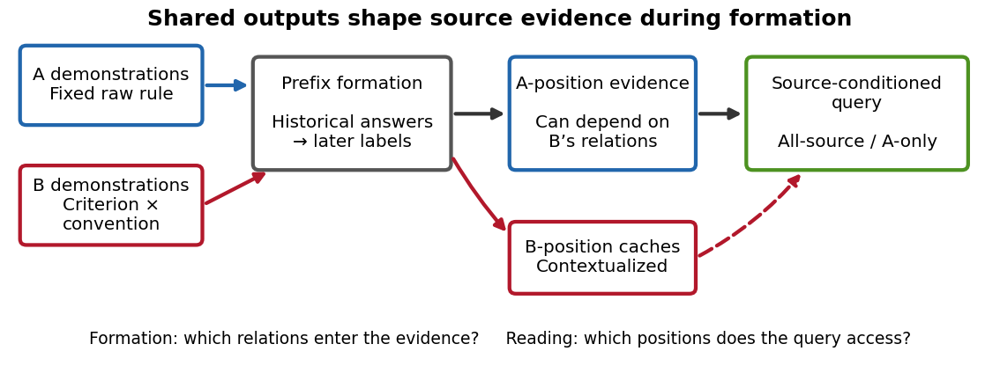
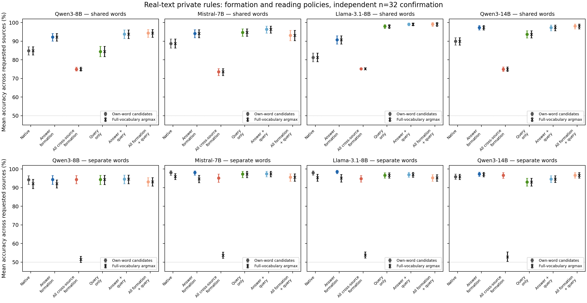
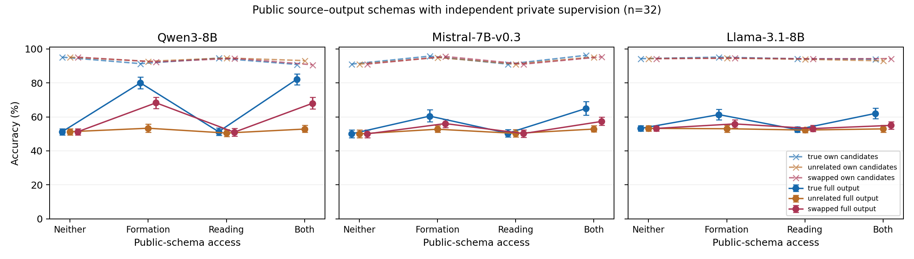
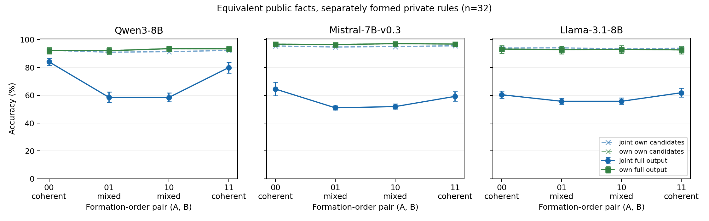

# How Shared Outputs Shape Source-Specific Evidence in In-Context Learning

Manuscript draft, 2026-10-12. The linked appendix and experiment records contain complete conditions, controls, and reconstruction targets. This is a research manuscript; formal candidate status remains unchanged.

## Abstract

When several sources demonstrate different rules using the same output vocabulary, how does a language model form and use evidence for the requested source? We distinguish the source positions accessed by a query from the origin of the learned relations influencing its answer. Earlier demonstrations can alter another source's evidence before the query is processed. Causal message interchanges identify an output-dependent pathway from historical answers to later label states, and a frozen reconstruction predicts namespace counterfactuals in new contexts. Removing the corresponding native operation reduces cross-source relational influence across model families. With output words fixed, the messages also transfer part of a learned input–label association. This formation account predicts a constructive distinction: selectively limiting cross-source answer formation can improve source-conditioned judgments while retaining other contextual access paths, whereas isolating all cross-source formation can worsen them. Query-stage isolation has different effects across models. On real sentiment text, the same formation mechanism holds with reliable private-rule controls, and selective formation improves shared-word judgments by 5.4–9.5 percentage points; criterion–convention counterfactuals further distinguish association transfer from full criterion-related responses. The results connect evidence provenance, historical formation, and source-conditioned use, explaining why attention to the requested source alone is an incomplete account of evidence selection.

## 1. Introduction

A context can contain several legitimate rules. Two annotators may assign different labels to the same kind of comment, or judge different aspects of it, while sharing the words `yes` and `no`. A new query specifies whose demonstrations should govern its answer. The model must infer and use the relevant input–output relation, while retaining useful information from the surrounding context. This is a computational question both when its answer is correct and when the conventions interfere.

Mechanistic studies have established input encoding, merging at label positions, retrieval, and aggregation in ICL. Cross-demonstration contextualization is also important: examples can acquire task information from earlier examples before a query uses them. What remains to establish in the multi-source setting is how this process organizes **the provenance of learned relations**. Source A's token positions belong to A, but their contextualized representations may have been shaped by B's rule. The output vocabulary can influence that formation process, as well as the final answer.

This changes the object of explanation. A model attending to the requested source has selected positions, not necessarily isolated that source's supervision. Conversely, cross-source information is not uniformly harmful: removing it can discard information that helps the model use either rule. A computational account must explain which relations enter the available evidence and how the reading process uses that evidence.

We develop this account through three connected findings:

1. **Output coding affects evidence formation before retrieval.** Source-position access and relational provenance can be causally separated. A fixed historical answer-to-label intervention predicts output-namespace counterfactuals, and native operation removal establishes a functional contribution.
2. **The historical messages carry learned associations.** Counterfactuals preserving label words, positions, and input multisets distinguish relational content from a static output signal. These effects remain under full-source reading and on real sentiment text.
3. **Formation and reading impose different functional constraints.** A prospective comparison of selective formation, complete source separation, and query-only isolation produces different outcomes for two source-specific rules. Public source–output relations can also improve their joint use through formation while private histories remain isolated; direct query access gives different results. Criterion–convention counterfactuals show why association transfer does not by itself specify a full criterion program.

Our contribution builds on existing contextualization mechanisms. The increment is a tested account of output-dependent relational provenance and its consequences for source-conditioned evidence use. It does not rely on future models continuing to fail the task.

*Figure 1. Historical formation creates contextualized evidence for both sources. Changing B can affect evidence at A positions, while full-source reading can also access B-position caches. Arrows denote tested causal interfaces and information access.*

## 2. Measuring which source's relations influence a prediction

### 2.1 Sources, rules, and materials

The current sentiment and dual-aspect experiments contain eight demonstrations from each source and eight novel queries. In shared-word conditions both sources use `no/yes`, with private label polarity balanced across contexts; separate-word conditions keep A’s words and give B `pass/flag`; earlier Measuring Hate Speech experiments use `safe/toxic`. A's raw examples and labels are held fixed; paired counterfactuals change B. A single-aspect sentiment task separates association from output naming. A dual-aspect task independently varies food and service sentiment, B's inferred criterion, and its private output convention. Original SST5 reviews supply a natural-text test with independently sampled demonstrations and official held-out queries.

All models are frozen: Qwen3-8B and Qwen3-14B post-trained hybrid checkpoints, Mistral-7B-v0.3 base, and Llama-3.1-8B base. We score the serialized task as a continuation using FP32 eager attention. Confirmation uses new materials after discovery, without selecting models, contexts, or seeds by correctness. Model revisions, actual token streams, and complete split rules are recorded in the [appendix](PAPER_APPENDIX.md).

### 2.2 Positional access and functional provenance

Write the contextualized source caches and prediction as

\[
H_A=F_A(D_A,D_B),\qquad H_B=F_B(D_A,D_B),\qquad z=R(q,H_A,H_B).
\]

Here \(z\) is the difference between the two output-label logits (`yes` minus `no` in the current sentiment experiments). The notation describes intervenable quantities rather than separate neural modules. To measure B-relation dependence, we change B's input–label pairing while fixing A and the query. We also prevent **every query position** from accessing B positions. Any remaining B-rule effect must reach the prediction through the remaining contextualized graph.

Under this restriction, changing B's rule changes 17.6% [12.1, 23.8] of A's answers in 32 independent Qwen3-8B Measuring Hate Speech contexts (E90). Separating B's output vocabulary reduces the inherited effect even though A's raw demonstrations and labels are unchanged. Source identity also has native causal effects in earlier interventions. Thus the result concerns the provenance of contextualized evidence, rather than a model completely ignoring source names.

## 3. How output identities shape historical evidence

### 3.1 A frozen formation-path prediction

We compare shared-output and separate-output prefixes, keeping A's examples and output words identical. Counterfactual donor states replace historical B-answer-region K, V, or KV **only in messages consumed at A's label positions** during prefix processing. Subsequent states evolve normally. Interchanging the resulting A-label caches into one otherwise pristine recipient tests the specified formation interface.

The prediction has coefficient one: the message-intervention effect predicts the actual namespace counterfactual at that interface. No head, layer, strength, or regression coefficient is selected. We report raw effects and rule double contrasts, which subtract the namespace effect between two B-association worlds. This separates relation-dependent naming effects from a common output shift.

In new contexts, K reconstruction gives rule-double-contrast correlations .969 and .966 for Qwen3-8B and Mistral on the controlled Measuring Hate Speech task; KV gives .985 and .977. The same frozen mechanism remains predictive on controlled sentiment and real SST5 text. These are actual-donor causal reconstructions: their target is a specified interface effect, and residuals are measured against the coefficient-one identity prediction.

### 3.2 Testing the native operation

Reconstruction alone does not establish native contribution. We therefore block historical B-answer access at A-label receivers during ordinary prefix processing, using the same fixed mask at every layer. There is no donor activation. A complementary test blocks all B-to-A prefix access, then reopens only the historical answer-to-label path. Within-A answer removal and single-source private functions control for disturbance to general historical learning.

| Model, n=32 | Full-source operation removal | A-only restricted restoration | Full-source restricted restoration |
|---|---:|---:|---:|
| Qwen3-8B | 1.649 [1.108, 2.250] | 1.455 [0.999, 1.945] | -0.806 [-1.365, -0.266] |
| Mistral-7B-v0.3 | 1.054 [0.886, 1.227] | 0.647 [0.463, 0.835] | 0.140 [0.053, 0.231] |
| Llama-3.1-8B | 0.808 [0.517, 1.109] | 0.958 [0.635, 1.276] | -0.233 [-0.336, -0.122] |
| Qwen3-14B | 1.329 [0.967, 1.717] | 1.120 [0.673, 1.646] | 0.039 [-0.217, 0.287] |

For each context, the signed B-rule response is the query mean of A-correct-label-oriented margins, D = mean[g_A(q)(z_cross(q) − z_origin(q))]. Removal reports D_native − D_blocked; restricted restoration reports D_restore − D_all-B-off. The targeted native removal reduces B-rule influence in every checkpoint. Reopening the path in the restricted graph increases influence under A-only reading, but has negative, positive, or uncertain effects under full-source reading. Thus its function depends on the subsequent evidence environment. Masks renormalize attention and later states remain live; the experiment identifies the operation's conditional contribution rather than a fixed additive message fraction. In Mistral, removing its own answer history also impairs its private function, and Qwen's cross-versus-within specificity interval includes zero. Complete controls remain in the appendix.

*Figure 2. Paired signed B-rule effects after operation removal and restricted restoration. The contrast in restoration direction shows why historical sharing cannot be described as uniformly harmful.*

## 4. The messages transmit relationships, not only label identity

Namespace changes might alter output-related signals without changing learned relational content. We therefore hold B's label stream, source names, positions, and input multiset fixed, and reassign comments across opposite sentiment classes. A matched within-class reassignment moves the same number of inputs without reversing the association. A's raw evidence and novel queries stay fixed; paired token geometry is matched before model scoring.

For each world, we measure the correct-label-oriented query effect, then compare its magnitude between cross-class and within-class reassignment. Historical answer KV has an excess effect of .618 [.446, .813] nats in Qwen and .404 [.313, .499] in Mistral under A-only reading. V carries substantial content, while the namespace reconstruction is more accurately reproduced through K/KV. This dissociates the intervention's relation content from its output-identity effect without assuming independent internal components.

The relation effect also holds when queries can read both sources. Moreover, crossing A-position caches formed under shared/separate namespaces with B-position caches from the same backgrounds changes native B-rule dependence. The signed interaction is positive in the three smaller checkpoints and negative in Qwen3-14B (−.686 [−1.133, −.237] nats). The model therefore consumes jointly formed evidence; its source caches are not independent stores whose effects can be assumed additive.

The answer-region pathway reproduces part of the relation effect. Full label interchanges have additional effects, and the signed relation contrasts vary by model. These distinctions motivate measuring complete functional behavior in the next experiment, rather than equating a message effect with a fully transferred rule.

## 5. A constructive test: preserve relations while retaining context

### 5.1 Competing formation and reading policies

The formation account raises an operational prediction. If other sources' answer messages couple private mappings, restricting those messages may help preserve the requested relation. Removing all cross-source contextualization could also remove useful information. Query-only isolation acts later, after the evidence has already formed. These policies need not produce the same behavior.

We preregister three prefix policies: native formation; symmetric removal of historical other-source answers at each source's label receivers; and removal of all historical cross-source prefix access. Each prefix is processed once and used for both A and B queries, under either full-source or requested-source-only query access. All layers use the same policy, with no fitted parameters. B's inferred criterion (food/service) and private convention (same/opposite) vary independently across four matched worlds.

The primary measure averages two-candidate label accuracy over both requested sources and all worlds within each context. We also report each source separately, and split cases by whether A's and B's correct labels agree. This is not the probability of both answers being simultaneously correct. Each individual source function and a one-sentence instruction are evaluated as controls.

### 5.2 Independent functional confirmation

| Model, n=32 | Native accuracy, % | Selective answer formation, % | All cross-source formation off, % | Query-only isolation, % |
|---|---:|---:|---:|---:|
| Qwen3-8B | 71.6 | 74.5 | 62.6 | 70.5 |
| Mistral-7B-v0.3 | 69.1 | 72.6 | 62.7 | 70.8 |
| Llama-3.1-8B | 73.8 | 81.2 | 68.6 | 85.9 |
| Qwen3-14B | 78.1 | 80.9 | 67.6 | 84.2 |

The selective formation policy improves the mean judgment accuracy by 2.93 [1.42, 4.35], 3.42 [1.17, 5.76], 7.37 [5.37, 9.43], 2.78 [0.49, 4.79] percentage points for Qwen3-8B, Mistral, Llama, and Qwen3-14B, respectively. It outperforms complete cross-source formation removal in every checkpoint. Gains are concentrated in cases where the two sources require different correct labels. They are not cost-free: Qwen3-8B loses 2.34 [0.78, 4.00] points and Qwen3-14B loses 3.61 [1.56, 5.86] points on agreeing-label cases, and individual-source gains are not uniformly significant. Query-only isolation has little average effect in Qwen3-8B, but gives larger gains in Llama and Qwen3-14B. The result supports different functional consequences of selective formation and reading policies, rather than one universally optimal isolation rule.

The selective operation lowers the mean food/service response coefficients measuring A's dependence on B's private convention while leaving substantial residual dependence. Complete source-separated formation can increase unwanted native convention influence when the query still reads both sources; combining it with source-only query access gives zero B-world effect on A, as required by the graph. Formation-stage separation and reading-stage separation therefore control different routes through the computation.

Single-source performance on the dual-aspect task is above chance but lower than on single-aspect SST5. The experiment measures the functional consequences of formation policies, rather than assuming perfect atomic criterion mastery. The masks use source ownership from the generated task. They provide a constructive mechanism test. The selective and complete masks remove different numbers of edges and do not match attention mass, so their comparison identifies policy-level functional consequences rather than an equal-strength pure-content intervention.

*Figure 3. Independent confirmation: each source's accuracy change, agreement/conflict of the correct labels, and alternative policies. All combined formation/query conditions and full-vocabulary scores are reported in the appendix.*

### 5.3 Association influence and criterion-related function

Source-conditioned use also depends on what a learned association does to a new input. To test this, we independently reverse B's private convention under food and service criteria, holding A fixed. Responses are projected onto food, service, bias, and their interaction. The resulting two-by-two criterion–feature matrix distinguishes changing the amount of influence from changing its functional direction.

In Qwen3-14B, native food and service selectivity are .282 [.199, .371] and .404 [.294, .528] nats. A prospective within-context normalized determinant is .410 [.330, .493], rejecting a restricted account in which both criteria only rescale one common functional direction. With the query prohibited from reading B, it is still .190 [.073, .310]. Local label and answer-message interfaces yield different responses. Historical answer KV only partially reconstructs the **actual label-interface** criterion counterfactual (r=.668, RMSE=.646, zero RMSE=.746).

Thus association transfer, full-history criterion dependence, and correct source-conditioned use are distinct measurable properties. The complete response matrices and negative effects are retained in the appendix; a positive aspect response alone is not sufficient evidence for a complete abstract criterion program.

## 6. Natural-text formation with usable private rules

### 6.1 Mechanistic replication with reliable private conventions

We apply the same frozen 43-condition formation and reading engine to original extreme-polarity SST5 reviews. Demonstration pools are disjoint text-hash partitions of the official training split; discovery and confirmation queries use the official validation and test splits. Construction uses gold sentiment and token geometry, without screening model outputs. Each context has a fresh positive or inverted private `no/yes` convention.

| Model, n=32 | Single-source positive / inverted accuracy, % | Native A-formation magnitude, nats [95% CI] | KV rule r / RMSE / zero RMSE |
|---|---:|---:|---:|
| Qwen3-8B | 98.4 / 88.3 | 2.151 [1.487, 2.895] | 0.931 / 1.363 / 3.658 |
| Mistral-7B-v0.3 | 99.2 / 96.9 | 1.091 [0.925, 1.258] | 0.948 / 0.336 / 1.048 |
| Llama-3.1-8B | 97.7 / 99.2 | 0.689 [0.488, 0.901] | 0.930 / 0.309 / 0.840 |
| Qwen3-14B | 99.2 / 93.8 | 1.678 [1.340, 2.052] | 0.966 / 0.519 / 1.949 |

Both private directions have clear single-source ability. Qwen3-8B is weaker under inversion (.883 [.805, .953]) than under the positive convention (.984 [.961, 1.000]); these are reported separately. The formation reconstruction generalizes without refitting, and fixed-output association messages have positive excess magnitudes in every family. Llama's corresponding signed contrast is negative (−.109 [−.194, −.024] nats), so magnitude is not interpreted as uniformly repairing the requested rule.

Earlier real Measuring Hate Speech texts also show local formation effects, but their single-source private functions remain weak. SST5 supplies a separate functionally usable natural-text test. Both use constructed private conventions, not recovered individual human preferences, and SST5 sentiment itself may have appeared in pretraining.

### 6.2 A prospective test of real-text source-function use

We next test the functional policy prediction on new SST5 contexts. A and B infer the same sentiment criterion but can adopt opposite private conventions. Origin and cross-convention worlds receive equal primary weight; a within-class movement remains a separate control. The same three formation policies and two query scopes are evaluated for both sources from each common prefix. A keeps `no/yes`; B uses either those shared words or `pass/flag`. Single functions and one-sentence source instructions are retained in all 85 conditions.

| Model, confirmation n=32 | Shared native accuracy, % | Selective formation, % | Selective-minus-native, pp [95% CI] | Query-only-minus-native, pp [95% CI] |
|---|---:|---:|---:|---:|
| Qwen3-8B | 84.86 | 92.19 | 7.32 [5.37, 9.28] | -0.39 [-3.12, 2.44] |
| Mistral-7B-v0.3 | 88.77 | 94.14 | 5.37 [2.93, 7.71] | 5.96 [3.22, 8.59] |
| Llama-3.1-8B | 81.25 | 90.72 | 9.47 [7.52, 11.52] | 16.70 [14.36, 19.04] |
| Qwen3-14B | 89.94 | 97.36 | 7.42 [5.57, 9.38] | 3.81 [1.27, 6.25] |

Selective formation improves the shared-word primary in all four checkpoints; both A and B have positive independently confirmed gains. Candidate-space and full-vocabulary primary scores coincide here. Gains are concentrated in opposite-convention worlds, while same-convention effects are small and uncertain. Query-only isolation remains model dependent: its mean gain is larger in Llama and Mistral, but smaller in the two Qwen checkpoints. Mistral’s point-estimate ordering is uncertain; it does not establish query-only superiority. The predefined B-convention response observer also decreases under selective formation with A’s output words fixed: native-to-selective magnitudes are 2.449→1.319, 1.390→0.841, 1.595→1.093, and 2.230→1.167 nats in table order.

Separate output words change the functional comparison. Native candidate accuracies are already 94–98%, and selective gains are smaller. This shared-versus-separate contrast is consistent with output-dependent formation, but different headroom and word priors prevent treating it as a pure identity-specificity test. Complete cross-source formation removal exposes a further functional distinction: own-word candidate accuracy remains about 94–97%, while full-vocabulary accuracy falls to about 51–54%. The model frequently outputs the other source’s word. These errors are asymmetric across sources; they do not identify a new binding component. They show why convention learning within a specified label space and using that space in a joint context require separate measurements.

Mistral also loses 1.27 [0.20, 2.44] full-vocabulary points under selective formation with separate words, despite unchanged candidate accuracy; Qwen3-14B gains 1.27 [0.29, 2.25]. All directions, single private controls, and instructions remain in the appendix. The result extends the formation account to real-text functional consequences without making selective isolation a universal repair.

*Figure 4. All formation/query policies on independently confirmed real-text private functions. Colored circles score within the requested source’s two words; black crosses score the actual full-vocabulary output. The separate-word condition reveals failures hidden by candidate restriction.*

### 6.3 Sharing identities while keeping supervision private

The complete-separation result raises a constructive question: what information can be shared without exchanging either source's private supervision? We first supply an unlabeled list of the two source names before the demonstrations. Cross-source demonstration access remains blocked. Independently, we allow the list to be read during demonstration formation (F), directly by every query position (R), both, or neither. An equally long unrelated-name list controls general text exposure. Confirmation changes both the contexts and source aliases.

For Qwen3-8B, the true-minus-unrelated formation-only gain in full-vocabulary accuracy is 4.59 [2.73, 6.64] points; the corresponding candidate-space contrast is 0.10 [−1.27, 1.37]. Both requested sources benefit, although full accuracy only rises from 52.73% to 58.98%. The reading-only identity contrast is uncertain. Mistral's formation contrast is negative (−1.07 [−2.05, −0.20]), and Llama's interval includes zero (−0.68 [−1.95, 0.49]). Thus shared identity text can affect source-specific output use through formed demonstration states, without private cross-source supervision, but the effect is partial and model dependent. This names-only intervention neither identifies nor rules out a general binding mechanism. Complete readouts are in Appendix G.

### 6.4 Sharing an output schema before private rule learning

A name list does not specify how sources relate to the common output structure. We therefore share only a source-to-word-set table, for example `Alex: no, yes; Sam: pass, flag`, before independent demonstration formation. The table supplies relational supervision about output spaces, but no review–label pairs or private polarity. An unrelated-name table contains the same words and row structure; a swapped table retains the actual names and word multiset but reverses their assignment. Formation and whole-query access are crossed as before, with all private cross-source formation blocked.

On new confirmation contexts, true-minus-unrelated formation-only gains in full-vocabulary accuracy are 26.66 [23.05, 30.47], 7.71 [5.08, 10.45], and 8.30 [6.05, 10.84] points for Qwen3-8B, Mistral, and Llama. True-table formation-only accuracy rises from 51.27→79.98%, 50.00→60.45%, and 53.22→61.33%, respectively. All three checkpoint-mean reading-only identity contrasts include zero. The public relation can thus affect joint use of private functions through formed demonstration states, even when every query token is denied direct table access. Mistral also has a positive formation-by-reading interaction, so this does not make subsequent access irrelevant.

The table's literal assignment is insufficient to explain the effect. Correct-table formation outperforms swapped-table formation by 11.72 [7.91, 15.72], 4.39 [2.15, 6.74], and 5.47 [2.44, 8.59] points. Yet swapped-table formation itself improves full accuracy and produces a net reduction in other-source outputs in every checkpoint. Following the table alone cannot explain these results; public source–output structure affects private evidence formation through additional computation. They leave open how this structure makes separately formed memories compatible at reading time.

These improvements have costs and asymmetries. Qwen's true-table candidate accuracy decreases from 95.12% to 91.31%; both sources benefit in its primary contrast, while Mistral and Llama's A-specific intervals include zero. Neither strong single-source private-function performance nor a shared schema guarantees lossless composition. Appendix H reports both phases, all tables, sources, private directions, and output readouts.

*Figure 5. Public source–word-set access with private historical supervision isolated. Solid curves score the actual full-vocabulary output; dashed curves score within the requested source's candidates. Correct and swapped relations both help through formation, but their magnitudes differ.*

### 6.5 Equivalent public facts do not make source caches interchangeable

We next keep every public relation and private demonstration fixed, reversing only the two rows of the correct schema. Private cross-source formation remains blocked, and no query position can read the table. Each ordering therefore supplies the same facts but produces its own pair of source caches. We compose A and B caches formed under a common ordering (00 or 11), or under different orderings (01 or 10), by interchanging all private K/V states at unchanged global positions.

| Model, confirmation n32 | Joint 00 / 11 full accuracy, % | Joint 01 / 10, % | Coherent-minus-mixed, pp [95% CI] |
|---|---:|---:|---:|
| Qwen3-8B | 83.98 / 79.88 | 58.50 / 58.40 | 23.49 [20.80, 26.07] |
| Mistral-7B-v0.3 | 64.45 / 59.18 | 50.98 / 51.86 | 10.40 [7.96, 13.04] |
| Llama-3.1-8B | 60.35 / 61.82 | 55.66 / 55.66 | 5.42 [4.00, 6.79] |

The paired contrast averages 00 and 11 against 01 and 10, cancelling additive differences in individual-cache quality. Both sources and private directions have positive gains in all three checkpoints. The same caches retain strong source-only performance, although their order-specific scores differ. Their balanced source-only contrast is zero by construction, and serves as an implementation control. Candidate-space gains are much smaller: 1.12, 0.63, and 0.20 points. Thus the principal effect concerns using the requested output space in joint reading, rather than relearning sentiment polarity.

A post-hoc diagnosis restricted to opposite private conventions shows that most wrong-source words agree with that other source’s demonstrated rule. Coherent composition reduces these outputs by 23.73 [20.02, 27.44], 10.06 [7.42, 12.79], and 4.88 [3.22, 6.64] points, respectively. Compatibility with an observed rule does not identify the internal computation, but the errors are poorly described as the requested code merely rendered in another word set.

Shared semantic facts are insufficient to ensure interchangeable source caches at this interface. This is consistent with context-dependent binding and competitive reading; it does not identify binding IDs or nonadditive latent representations. Coherent caches remain imperfect, and ordering 11 performs worse than 00 in Qwen and Mistral. Appendix I reports all orders and controls. Whether the same dependence governs private-rule choice when both sources use identical output words is a separate question.

*Figure 6. Source caches formed under the same public ordering versus a mixture of equivalent orderings. The full-output joint effect greatly exceeds the corresponding candidate-space effect. Source-only curves report actual function performance; their balanced coherence contrast is a design identity.*

## 7. Related work and positioning

[Cho's ICL circuit](https://arxiv.org/html/2410.04468v3) connects input encoding, merging at labels, retrieval, and bypasses; [task-oriented information removal](https://arxiv.org/abs/2509.21012) establishes a complementary information-selection mechanism. [Contextualize-then-Aggregate](https://arxiv.org/html/2504.00132v2) shows the causal role of cross-demonstration contextualization. [How Few-Shot Examples Add Up](https://arxiv.org/html/2605.16591v2) relates contextualized QK routing and V updates to function-vector composition. We add a source-provenance measurement, output-dependent formation prediction, and prospective functional policies within these frameworks.

[Local task vectors](https://aclanthology.org/2026.findings-acl.314/) and [just-in-time task representations](https://arxiv.org/html/2509.04466v3) establish heterogeneous and temporally localized task information. [Feng and Steinhardt](https://arxiv.org/html/2310.17191v2) identify factorizable binding IDs; [Mixing Mechanisms](https://arxiv.org/html/2510.06182v2) shows coexisting binding/retrieval mechanisms. [Test, then Route](https://arxiv.org/html/2608.04183v1) separates predicate testing from token-dependent routing in explicit rules. Our object is the formation and provenance of relationships inferred from several legitimate sources, rather than a first separation of representations or routing operations.

[Parallel Context Windows](https://aclanthology.org/2023.acl-long.352/) already separates prefix computation and joins its reading, and [CacheBlend](https://arxiv.org/abs/2405.16444) establishes general context dependence of reusable KV states. Section 6.5 instead holds public facts and private global positions fixed, blocks private cross-source formation in every condition, and tests whether source functions formed under equivalent public orderings remain compatible during joint use. This counterfactual does not establish a new binding component or the first failure of independent-cache composition.

[Task recognition/learning analysis](https://arxiv.org/html/2509.24164v2) distinguishes label-space alignment from mappings within it. [Demonstration Conflict](https://arxiv.org/html/2603.04464v1) studies minority corruption; [Jurisdiction](https://arxiv.org/html/2609.27603v1) studies whether contextual rules should override reality-grounded knowledge. Here both source rules are legitimate and share an output space. The distinction in task setup motivates, but does not by itself establish, the causal increment.

[Yu and Ananiadou](https://aclanthology.org/2024.emnlp-main.192/) analyze QK/OV contributions; [Crosbie and Shutova](https://aclanthology.org/2025.findings-naacl.283/) distinguish a participating head from a specific operation. [Racing Thoughts](https://aclanthology.org/2025.naacl-long.155/) tests dependencies between contextualization and downstream use. [Lepori et al.](https://aclanthology.org/2026.acl-long.676/) and [CoSToM](https://aclanthology.org/2026.acl-long.421/) connect internal information to deployment. These motivate operation and function tests; our models remain frozen throughout.

## 8. Reproducibility

Effects and policy contrasts use 10,000 context-bootstrap samples; queries within a context are not independent units. We retain all predefined conditions, models, private directions, negative results, and reconstruction channels. Token geometry, full-token/cached scoring, self interventions, mask consumption, graph-zero controls, and pristine caches are checked. The appendix discloses tokenizer-specific serialization and the exact donor/recipient interfaces.

Independent sessions recompute raw numerical quantities and reconstruct token/mask layouts before reading author summaries. These are independent analyses, not independent GPU reruns. Experiment cards, script hashes, model/data revisions, run metadata, small summaries, figures, and audits are versioned; raw JSONL and model assets remain at the [documented paths](README.md). No model weights are trained.

## 9. Discussion and scope

Source-conditioned ICL operates on evidence whose relations were formed across a contextual history. Shared output identities help determine which other-source associations enter that evidence. The same historical operation can transmit relations and have different consequences when the query reads one source or several. A useful account therefore combines relational provenance with positional access, rather than treating either as a complete measure of evidence selection.

Controlled and real-text constructive tests sharpen this account: preserving other contextual access paths while limiting answer-level cross-source formation can improve the use of private rules, with model- and agreement-dependent tradeoffs. Public source–output structure can help even when private demonstration formation is isolated, and the query cannot directly read that public information. Its effect therefore concerns how usable evidence is formed, as well as what facts a query can retrieve. Complete source separation and query-only restriction answer different computational questions. Real-text output-space failures further show why a correct within-vocabulary judgment can conceal an error in using the source’s convention. This explains behavior beyond persistent failure rates and gives a way to test source-conditioned computation in stronger models.

The experiments cover three families and a larger same-family checkpoint. Dual-aspect templates use a fixed food-before-service order; functional differences do not establish a position-independent abstract program. Cache interchanges and renormalized masks change specified interfaces and retain unmodeled paths. The reconstructions use actual donor activations, and intervals are not corrected for all comparisons. Earlier practical evaluations found limited accuracy consequences of source mixing. These findings delimit the account while preserving the demonstrated formation, relation-content, and functional-use results.

See the [technical appendix and evidence map](PAPER_APPENDIX.md) for complete results and the [claim ledger](CLAIMS.md) for registered scope.
