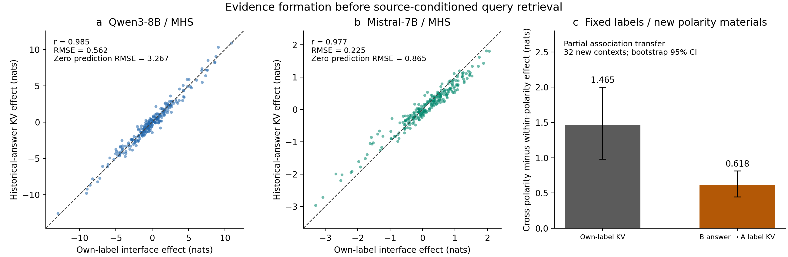
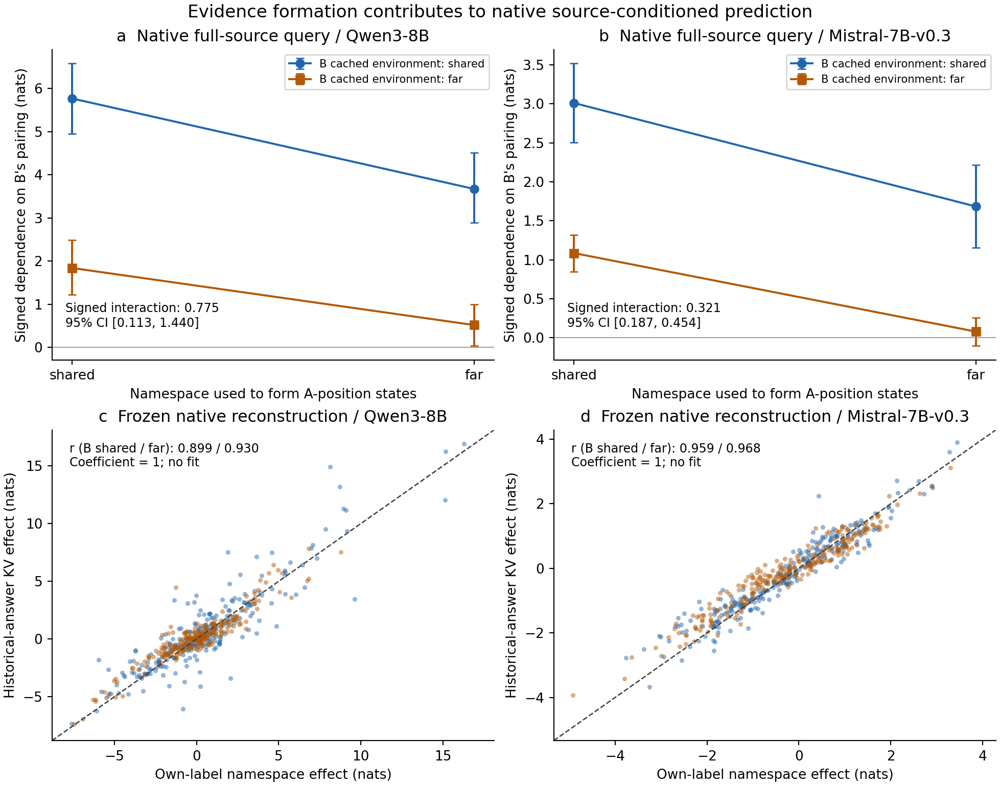
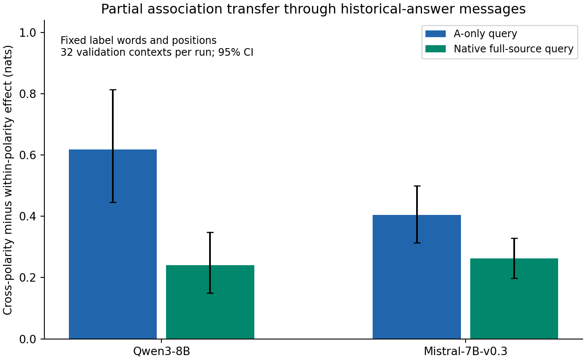

# How Shared Outputs Shape Source-Specific Evidence in In-Context Learning

Provisional manuscript draft, 2026-10-12. This version incorporates completed E115–E119 confirmation, including Llama, real-text formation tests, criterion–convention counterfactuals, and Qwen3-14B. Experiment IDs link to reproducible records. The title remains provisional; formal candidate status has not changed.

## Abstract

When several sources provide demonstrations using the same output vocabulary, how does a language model form and use evidence specific to the requested source? We distinguish the source positions accessed by a query from the functional origin of the relations used in its prediction. Restricting a query to one source's positions does not ensure that its predictions depend only on that source's associations: earlier demonstrations can already have altered the evidence stored at those positions. Causal interventions identify an output-dependent formation pathway from historical answer regions to the requested source's label states. A frozen, coefficient-one reconstruction predicts namespace counterfactuals in new contexts, multiple model families, and a larger same-family model. Counterfactuals preserving output words and positions show that historical messages also transfer part of a learned input–label association. Full-source prediction remains sensitive to this formation history, with interactions between the two sources' contextualized caches. Finally, crossing another source's inferred criterion with its private output convention reveals that association transfer and criterion-related functional responses require different measurements: the label-formation pathway only partially reconstructs the latter. These results explain how shared outputs couple the formation of source-specific evidence and clarify the functional information that its subsequent use can expose.

## 1. Introduction

In-context learning often combines demonstrations from different annotators, users, or task conventions. Two annotators can use the same words while assigning them differently: one may label favorable restaurant comments `yes`, while another uses the inverse convention. A new query names the annotator whose examples should constrain its answer. Understanding this computation matters both when the model succeeds and when it confuses the conventions.

Existing mechanistic accounts identify label positions as carriers of input information, retrieval pathways that aggregate demonstrations, and contextualization between demonstrations. These accounts make it plausible that source-conditioned retrieval acts on contextualized evidence. They do not, by themselves, establish how shared output identities shape the functional provenance of evidence assigned to an individual source, or how that formation process contributes to subsequent source-conditioned prediction.

Our starting observation is that sharing output words can reduce the distinction between different annotators' judgments. However, this internal distinction need not produce a large accuracy loss in practical prediction settings. We therefore study the computation that organizes source-specific evidence, rather than defining the project around a persistent inability to answer correctly.

The key distinction is between **where evidence is read** and **which relations influenced its formation**. An attention mask selecting source A's positions controls the first quantity. It does not retroactively remove information from B that entered those positions while the prefix was processed. We first establish this distinction through functional counterfactuals, then intervene on the historical messages forming A's labels. We test both changes in output namespace and changes in association with output words fixed. We reconnect these interventions to full-source prediction, then ask what functional information the transferred associations provide when the two sources evaluate different aspects of the same input.

The resulting contribution is a causal account of output-dependent, cross-source evidence formation and a functional test of its content. Existing contextualization theories provide the foundation; the measured object is which source's learned relations enter the requested source's evidence and how those relations affect new inputs. This question remains meaningful when the model can answer correctly.

## 2. Distinguishing positional selection from functional provenance

Let \(D_A,D_B\) denote the two sources' raw demonstrations and \(H_A,H_B\) their contextualized prefix states. A useful description is

\[
H_A=F_A(D_A,D_B),\qquad z=R(q,H_A,H_B).
\]

These symbols summarize interventions, not independent neural modules. In particular, \(H_B\) can also contain information from A.

We change B's input–label association while holding A's raw demonstrations and labels fixed. A query-time mask prevents every query position from attending to B's prefix positions. If the query's answer still changes, the association has a functional effect through the remaining computational graph. This does not establish that all such sharing is undesirable, or that the states encode an abstract rule in isolation.

In independent contexts, changing B's rule alters 17.6% [12.1, 23.8] of A's answers even under this restriction (E90). Separating B's output vocabulary also reduces this inherited dependence (E91). Thus neither the source of the attended token nor successful source selection alone identifies the source of the relational information being used. Earlier native source interventions remain relevant: source identity does influence the model, so these results do not imply that the model ignores source names.

## 3. An output-dependent pathway during evidence formation

### 3.1 Intervention and frozen effect prediction

We compare prefixes in which A's demonstrations and output words remain identical, while B either shares A's output vocabulary or uses a separate vocabulary. We extract donor K/V states from the counterfactual prefix. During recipient prefix processing, we replace B's answer-region K, V, or both **only in the attention messages received at A's label positions**. All layers participate; no head, layer, strength, or coefficient is selected using the outcomes. The query then consumes the resulting A-label cache interchange in an otherwise pristine prefix cache.

The prediction uses coefficient one: the intervention's logit change predicts the actual counterfactual change at the specified interface. We report raw effects and rule double contrasts. The latter compare the namespace effect between the original and changed B-association worlds, helping distinguish relation-dependent effects from a shared output bias. The predictor uses actual donor activations; it is a causal reconstruction, not a donor-free algorithm for unseen behavior.

### 3.2 Confirmation across contexts, model families, and materials

In 32 new contexts for each of Qwen3-8B and Mistral-7B-v0.3, answer-key interchange approximately reconstructs the namespace effect on the specified A-label interface. The same frozen namespace intervention remains predictive in a separate controlled sentiment task for Qwen (E109/E111/E112).

| Frozen rule-double-contrast reconstruction | Qwen / MHS | Mistral / MHS | Qwen / sentiment |
|---|---:|---:|---:|
| Answer K: correlation / RMSE | .969 / .810 | .966 / .265 | .907 / 1.599 |
| Answer KV: correlation / RMSE | .985 / .562 | .977 / .225 | .958 / 1.097 |
| Answer V: correlation / RMSE | .642 / 2.527 | .508 / .754 | .707 / 2.645 |
| Zero-prediction RMSE | 3.267 | .865 | 3.731 |

The observed combinations are three model–task pairs, rather than a full factorial grid. MHS contexts are independently sampled but can reuse comments. All predefined predictors, including weak controls, remain in the results. K-only interchange does not directly replace V on the intervened edge; subsequent recipient states still evolve. Approximate reconstruction establishes a sufficient partial pathway for the measured effect, not its unique or necessary mediator.

*Figure 1. Completed confirmation results for output-dependent evidence formation. Prediction uses the frozen causal intervention, without a fitted regression line. The accompanying data and scripts retain all channels and controls.*

## 4. Does the pathway carry associations when output identities stay fixed?

A namespace manipulation alone could reflect output identity without identifying learned relational content. We therefore retain B's label words, source names, token positions, and input multiset, and swap comments across opposite sentiment classes. A control swaps comments within the same sentiment class, changing the same number of positions. A's demonstrations and new queries remain fixed. Token geometry and boundaries are matched before running the models.

This creates competing explanations for the answer-region messages. If their effect is only a static label signal, the fixed-word association manipulation should not produce an additional relation-dependent effect. If the contextualized messages carry association information, changing the pairing can affect A's evidence even when the eventual query cannot read B directly. Within-class swaps control for part of the disturbance caused by moving inputs; they do not make every semantic property invariant.

For each intervention world \(w\), we first compute the context-level signed effect \(E_c(w)=\operatorname{mean}_q g_q(z_w-z_{origin})\). The reported excess effect is \(\operatorname{mean}_c[|E_c(cross)|-|E_c(within)|]\). Signed effects and per-query changes are also retained; this magnitude contrast is not a claim that every query changes in the same direction.

Confirmation uses new sentiment words and sentence templates. Historical answer KV produces a cross-minus-within effect of .618 [.446, .813] nats in Qwen and .404 [.313, .499] in Mistral (E111/E113). V interventions are substantially stronger than K for this contrast. The complete A-label interchange has a larger effect, so the answer-region pathway carries part of the relation rather than reproducing all of it.

An earlier long-comment version did not adequately distinguish relation change from within-class movement (E110). Its result is retained as a limit on that design; the simpler sentiment experiment answers a narrower, identifiable question. Neither experiment proves a transferable abstract criterion or a complete source-specific program.

## 5. Connecting formation to full-source prediction

### 5.1 Crossing cached formation states and reading environments

The preceding restriction isolates inherited information. It does not establish that the same pathway matters when the query can read all sources. We therefore cross the namespace history of A's complete prefix cache with that of B's complete prefix cache, while allowing normal attention to every prefix position (E114).

Let \(f\) select A-position caches formed in shared or separate-output prefixes, and \(r\) select B-position caches from those prefixes. Both caches are contextualized; \(r\) is not a fixed reader, and changing it can affect later query states and attention. The 00 and 11 corners correspond to coherent full-source endpoints. Mixed corners are diagnostic cache interchanges.

For each context, define the signed rule response

\[
D_{fr}=\operatorname{mean}_q g_q\big(z_{fr}^{cross}(q)-z_{fr}^{origin}(q)\big),
\]

where \(z\) is the `yes` minus `no` logit margin and \(g_q\) is the sign of A's correct private label. We report both signed and absolute conditional effects. Nonadditivity is tested using the signed interaction \(D_{11}-D_{10}-D_{01}+D_{00}\), rather than inferred solely from nonlinear absolute-value summaries.

### 5.2 Native conditional effects and frozen predictions

Independent confirmation includes 32 new contexts for Qwen3-8B, Mistral-7B-v0.3, Llama-3.1-8B, and Qwen3-14B (E114/E115/E119). Changing A's formation history has a clear effect in both B-cache environments. The signed interaction depends on the model: it is positive in the three smaller checkpoints and negative in Qwen3-14B.

| Model | A formation, B shared: magnitude decrease [95% CI] | A formation, B separate | Signed interaction |
|---|---:|---:|---:|
| Qwen3-8B | 2.098 [1.344, 2.892] | .759 [.269, 1.269] | .775 [.113, 1.440] |
| Mistral-7B-v0.3 | 1.238 [1.037, 1.464] | .684 [.461, .896] | .321 [.187, .454] |
| Llama-3.1-8B | .947 [.740, 1.158] | .337 [.088, .592] | .221 [.026, .417] |
| Qwen3-14B | 3.059 [2.557, 3.571] | 2.497 [1.828, 3.158] | −.686 [−1.133, −.237] |

The historical answer KV intervention also predicts native A-label namespace effects: rule-double-contrast correlations are .899/.930 for Qwen and .959/.968 for Mistral under the two B environments. Corresponding RMSEs are 1.560/.868 and .388/.396, below zero-prediction RMSEs of 3.388/2.316 and 1.360/1.324. Effects on the full A cache and every predefined channel are reported separately.

The fixed-label relation contrast persists under full-source reading, at .241 [.149, .348] and .263 [.198, .329] nats for Qwen3-8B and Mistral. Llama confirmation gives .157 [.103, .215] nats and Qwen3-14B .318 [.226, .421]. These are excess effect magnitudes; Llama's corresponding signed contrast includes zero, while Qwen3-14B's signed contrast is positive (.249 [.115, .390]). V and KV are not interchangeable: native Mistral shows a larger V effect, and Qwen also has a signed channel difference. Results from independently sampled gated and native runs are not treated as a matched causal estimate of removing the gate.

*Figure 2. Top: signed rule responses across A/B cache backgrounds and confirmed interaction. Bottom: actual-donor, coefficient-one answer-KV predictions of the native A-label interface under both B backgrounds. Identity lines indicate exact reconstruction; residuals are retained.*

*Figure 3. Partial fixed-label association transfer in both families, under gated and full-source query interfaces. These bars summarize independently sampled runs and do not isolate the gate as a single changed variable.*

## 6. What functional information is transferred?

### 6.1 Separating criterion from private output convention

A learned association can change a classifier's confidence without specifying a complete criterion for a new input. We test this distinction with comments containing independently balanced food and service sentiment. Source A's demonstrations establish a food criterion. Source B can evaluate either food or service, under an output convention agreeing with or opposite to A's. The criteria are inferred from demonstrations rather than stated in the multi-source prompt (E117/E118).

The four B worlds are constructed by bijectively reassigning inputs to fixed demonstration positions. A's raw demonstrations, B's output stream, source names, positions, and input multiset remain unchanged. Eight novel queries cover all four sentiment combinations. Every interface is evaluated on the same queries: complete native histories, histories whose queries cannot read B positions, A-label cache interchange into one recipient, and historical B-answer messages consumed during A-label formation. Separate-output label donors test the effect of output coding during formation while restoring the shared-output recipient for querying.

Let \(f_q,s_q\in\{-1,+1\}\) be food and service polarity, oriented to A's private convention. For criterion \(t\), define \(\delta_t(q)=\frac{1}{2}[z_{t,+}(q)-z_{t,-}(q)]\), the response to changing B's convention. The context-level matrix

\[
M_c=\begin{pmatrix}
\mathbb E_q[\delta_{food}(q)f_q] & \mathbb E_q[\delta_{food}(q)s_q]\\
\mathbb E_q[\delta_{service}(q)f_q] & \mathbb E_q[\delta_{service}(q)s_q]
\end{pmatrix}
\]

separates the two criteria's effects on the two aspects. Bias and food–service interaction are also retained. These are B-relation effects while A is requested, not B's own accuracy or a gain in correctly isolating A.

### 6.2 Association magnitude and criterion selectivity give different answers

Across three model families, E117 confirmation finds that changing B's pairing alters both food and service sensitivity through A-label caches. A positive service response alone therefore cannot establish transport of B's service criterion. E118 independently crosses criterion with B's convention and preserves the entire response matrix. Full native histories show more criterion selectivity than local label interchanges in several settings, with substantial family variation. The mean criterion–feature interaction is positive in all three families, but Qwen3-8B's interaction mainly reflects service selectivity; unequal gains along one common direction can also produce a positive mean interaction.

*Figure 4. New-material confirmation, 32 contexts per family. Rows vary B's inferred criterion; columns measure the induced food/service response under independent B-convention reversal. The requested source remains A. Full matrices avoid equating one positive aspect response with complete criterion transfer.*

Separating B's output namespace during formation can lower both aspect responses without appreciably changing their mean selectivity contrast. In Llama, food-criterion responses decrease by .267/.243 nats on food/service, and service-criterion responses by .110/.079; all four paired intervals are negative. Namespace effects on evidence formation thus include a change in relational influence magnitude, not only which aspect dominates.

### 6.3 A prospective functional-direction test in Qwen3-14B

Before any E119 scores, we freeze an additional observer: the determinant of each context's response matrix and its normalized determinant, \(\det(M_c)/(\|M_{c,food}\|\|M_{c,service}\|)\). If the two criteria merely rescale a common functional direction, each determinant is zero. These quantities are computed within context before averaging. A row norm of at most .001 nats sets the normalized statistic to zero while retaining the context; no confirmation context meets this threshold.

Qwen3-14B confirms criterion-specific native responses: food selectivity is .282 [.199, .371] nats and service selectivity .404 [.294, .528]. Native signed determinant is .568 [.408, .751] nats² and normalized determinant .410 [.330, .493]. When every query position is prohibited from reading B, the A cache still formed from the full history yields .0289 [.0032, .0553] and .190 [.073, .310]. Thus criterion-related history can have distinct functional effects through the remaining computation.

| Qwen3-14B interface, n=32 | Mean interaction J, nats [95% CI] | Signed determinant, nats² [95% CI] | Normalized determinant [95% CI] |
|---|---:|---:|---:|
| Complete native histories | .343 [.265, .433] | .568 [.408, .751] | .410 [.330, .493] |
| Full history, A-only query | .058 [.029, .089] | .0289 [.0032, .0553] | .190 [.073, .310] |
| A-label interchange | −.0238 [−.0478, −.0025] | −.0201 [−.0374, −.0052] | .006 [−.121, .140] |
| A-label interchange, A-only query | .038 [.012, .068] | .0074 [−.0106, .0271] | .124 [.017, .242] |
| Historical answer KV at formation | .0060 [.0029, .0093] | .00068 [.00012, .00130] | .085 [−.042, .214] |
| Historical answer KV, A-only query | .0126 [.0076, .0188] | .00194 [.00031, .00474] | .072 [−.040, .190] |
| Separate-output label donor | −.0192 [−.0348, −.0060] | .00192 [−.00123, .00556] | .011 [−.145, .164] |

The local label interface does not reproduce the full native responses. Its negative signed determinant also rules out describing every formation interface as a common-direction gain; the gated label interface has a small positive normalized response. The signed and normalized statistics weight contexts differently, so both are reported. Nonzero determinants reject the restricted functional common-direction account, not every nonlinear latent representation or an alternative retrieval policy.

Historical answer KV only partially predicts the actual criterion-label counterfactuals: native/gated raw correlations are .668/.665, RMSE .646/.878, compared with zero-prediction RMSE .746/1.018. This is a functional boundary of the formation reconstruction, not a reason to discard its successful namespace prediction. Local association transfer, whole-history criterion dependence, and source-conditioned use are different causal questions.

*Figure 5. Qwen3-14B confirmation. Matrix means summarize functional responses; determinant intervals use determinants computed separately within each context. All seven predefined interfaces, including reverse and weak effects, are retained. Different cache interfaces do not establish different hidden algorithms.*

## 7. Relation to existing explanations

[Cho's ICL circuit account](https://arxiv.org/html/2410.04468v3) connects input encoding, merging at labels, retrieval, and bypasses. [Task-oriented information removal](https://arxiv.org/abs/2509.21012) supplies an additional view of how demonstrations select useful information. We use these as existing accounts of label formation and information selection; our contribution is not that labels contain input information.

[Contextualize-then-Aggregate](https://arxiv.org/html/2504.00132v2) causally establishes cross-demonstration contextualization, including functional effects of changed mappings. Our results are compatible with that framework. The specific addition is a source-provenance measurement and an explanation of how output coding changes cross-source relation dependence during formation and subsequent native prediction.

[How Few-Shot Examples Add Up](https://arxiv.org/html/2605.16591v2) distinguishes contextualized QK routing and V effects on function-vector aggregation. Its factorial design motivates retaining conditional effects under both backgrounds. We do not claim QK/V separation or nonadditivity as a new general principle; our interventions target historical formation of source-specific labels and the full-source predictions that consume them.

[Label Words as Local Task Vectors](https://aclanthology.org/2026.findings-acl.314/) already establishes that answer positions can carry heterogeneous local task information; [Just-in-time and Distributed Task Representations](https://arxiv.org/html/2509.04466v3) distinguishes decodable task identity from functionally transferable task states. [Mixing Mechanisms](https://arxiv.org/html/2510.06182v2) shows that positional, lexical, and reflexive retrieval can coexist. Our cache interchanges neither replace these accounts nor establish that a single source field carries a complete abstract program.

[Test, then Route](https://arxiv.org/html/2608.04183v1) separates predicate testing from answer routing for explicitly provided conditional rules, including output-token dependence. ICES instead measures the historical formation of source-specific evidence from demonstrations. This is a difference in the functional object being measured, not an automatic novelty verdict: the precise increment is whether output coding changes which source's learned associations enter that evidence and predicts the corresponding causal effects.

[Yu and Ananiadou](https://aclanthology.org/2024.emnlp-main.192/) connect demonstration features to QK similarity and label words to OV output contributions. [Crosbie and Shutova](https://aclanthology.org/2025.findings-naacl.283/) distinguish induction-head participation from specific pattern-matching operations. These motivate testing a formation operation and its functional content, rather than renaming a participating head. [Lepori et al.](https://aclanthology.org/2026.acl-long.676/) separate in-context representation formation from subsequent deployment; our interventions address native historical evidence formation, not the first observation that readable information may be hard to use.

[CoSToM](https://aclanthology.org/2026.acl-long.421/) connects an internal activation interface to downstream use after supervised steering. It provides a research-design example of moving from internal information to functional deployment. Here the models remain frozen, and the functional connection is tested through cache/message interchanges rather than a trained repair. Entity-binding and task-representation accounts also remain relevant alternatives for other portions of source-conditioned computation.

## 8. Methods and reproducibility

Experiments use frozen Qwen3-8B and Qwen3-14B (both post-trained hybrid models), Mistral-7B-v0.3 base, and Llama-3.1-8B base, FP32 eager attention, PyTorch 2.8.0 and Transformers 4.57.6. The controlled sentiment task contains eight demonstrations from each source and eight new queries per context. Source names, private output direction, and demonstration order vary; the two private directions are balanced in confirmation. Shared outputs are `no/yes`; separate B outputs are `pass/flag`. A's outputs remain unchanged. Models process the serialized task as a continuation, without adding a chat template or generating reasoning. Qwen3-14B is a same-family size comparison; training data and recipes are not controlled between sizes. The two-aspect templates always mention food before service, so this experiment measures functional aspect distinctions under fixed order and does not separate semantic identity from position selection.

The actual serialized token stream is part of the method. Blocks, answer words, and separators are encoded separately. For Mistral, this introduces fixed extra spaces relative to literal whole-string encoding: the first native confirmation context has 351 rather than 335 tokens. Its B answer-message region includes the answer word plus three separator tokens per demonstration, totaling 32 sender positions; Qwen uses 16. Paired token positions and boundaries remain identical across the relevant manipulations. Native controls validate the actual stream, not a claimed equivalent whole-string encoding. Source code and independent tokenizer reconstruction preserve this disclosure.

Effects use 10,000 context-bootstrap resamples, seed 910; reconstruction intervals follow the frozen E109 analysis. Queries within a context are not treated as independent observations. Raw logits, full-vocabulary argmax, binary candidate-label accuracy, all conditions, and failed controls are retained. Confirmation uses new word/template pools; discovery-to-confirmation text overlap is zero for E113 and the Qwen E114 batches, but vocabulary/templates recur across contexts within a pool.

Self interchanges produce zero error. Cached versus full-token native query scoring differs by at most 4.96e−5 in Qwen and 7.63e−6 in Mistral confirmation. Cache fingerprints, layer consumption, and matched token geometry are checked. An independent session reconstructs the token layouts and recomputes 559 numerical checks from raw records before reading author summaries, with maximum discrepancy 4.77e−15. Separate bootstrap resampling confirms the signed interactions; it is not represented as an independent GPU rerun.

The earlier E113/E114 package comprises five runs and 36,736 scores. The completed E115–E119 expansion comprises 24 discovery/confirmation runs, 576 contexts, 181,632 scores, and 2.393 recorded GPU-hours. Independent raw reviews recompute 36,750 numerical quantities (maximum discrepancy 1.13e−14), reconstruct actual token layouts, and check recorded all-layer consumption. This is independent analysis, not an independent GPU rerun. No weights are trained. All model/seed/channel results remain available. Cards specify revisions, script hashes, and rebuilding commands; small summaries, figures, code, and audits are versioned, while raw JSONL and models remain at the [documented asset paths](README.md).

## 9. Scope and implications

The source-evidence formation and native sentiment tests cover three families and a larger Qwen checkpoint. Real MHS texts also show local native formation effects (E116): shared-background magnitudes are .344 [.179, .525], .0645 [.0357, .0928], and .112 [.075, .155] nats for Qwen, Mistral, and Llama. Their single-source controlled private rules remain weak (roughly 52–63%), and the rules are constructed rather than recovered from real individual annotators. This extends the causal-margin measurement to real text, not reliable deployment of human-specific criteria.

The functional criterion analysis uses controlled dual-aspect comments and fixed aspect order. Native histories, label interchanges, and message interchanges change different cache interfaces; their functional differences do not establish independent hidden modules, a unique pathway, or a complete abstract program. The coefficient-one predictions use actual donor activations. They explain selected causal counterfactuals and retain residuals rather than constitute a donor-free behavioral algorithm. Per-interface intervals are not corrected for multiple comparisons.

Historical dependence also need not be a computational error. Sharing information can be useful, and earlier practical evaluations did not show uniformly large accuracy costs. Stronger models can perform related tasks successfully. Our explanation concerns the causal organization of evidence, rather than a limitation that all future models must retain.

The practical scientific implication is a change in measurement: evaluating source-conditioned computation requires asking which source's associations influenced the available evidence, alongside which positions the query reads. In these settings, output coding changes that formation process, and formation history interacts with the cached evidence available during native reading. Criterion–convention counterfactuals further distinguish the strength of inherited associations from their aspect-related functional structure. Together these measurements connect historical evidence formation to source-conditioned use within existing contextualization theories.

## Evidence map

| Manuscript claim | Records |
|---|---|
| Positional access does not isolate relation dependence | [E90](experiments/E90-source-isolation-before-and-after.md), [E91](experiments/E91-label-namespace-and-inherited-rule.md) |
| Output-dependent formation reconstruction, C21 | [E109](experiments/E109-foreign-messages-at-label-formation.md), [E111](experiments/E111-polarity-relation-versus-namespace.md), [E112](experiments/E112-formation-mechanism-mistral-family.md), [first independent audit](results/e109/independent_review_2026-10-11.md) |
| Fixed-label partial association content, C22 | [E111](experiments/E111-polarity-relation-versus-namespace.md), [E113](experiments/E113-relation-content-mistral.md), [E114](experiments/E114-native-formation-reading-crossing.md) |
| Native conditional effects and interaction, C23 | [E114](experiments/E114-native-formation-reading-crossing.md), [new independent audit](results/e114/independent_review_2026-10-11.md) |
| Functional criterion response and its formation-interface boundary, C24 | [E117](experiments/E117-criterion-feature-formation.md), [E118](experiments/E118-criterion-code-feature-crossing.md), [E119](experiments/E119-stronger-model-formation-criterion.md), [E118 audit](results/e118/independent_review_2026-10-11.md), [E119 audit](results/e119/independent_review_2026-10-11.md) |
| Llama, larger checkpoint, and real-text coverage | [E115](experiments/E115-llama-frozen-native-mechanism.md), [E116](experiments/E116-native-mhs-formation-reading.md), E119; [wave audit](results/e117/independent_review_2026-10-11.md) |
| Limits and failed functional interfaces | E50–E52, E99, E107, [E110](experiments/E110-learned-relation-fixed-label-stream.md); full ledger in [CLAIMS](CLAIMS.md) |
