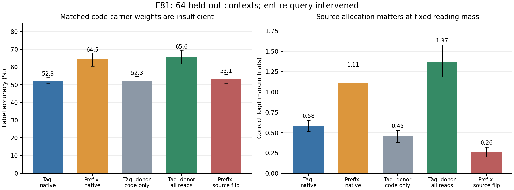
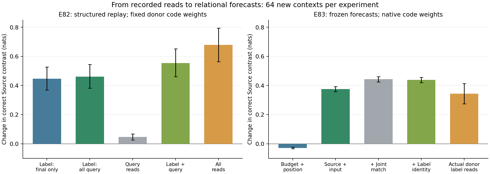
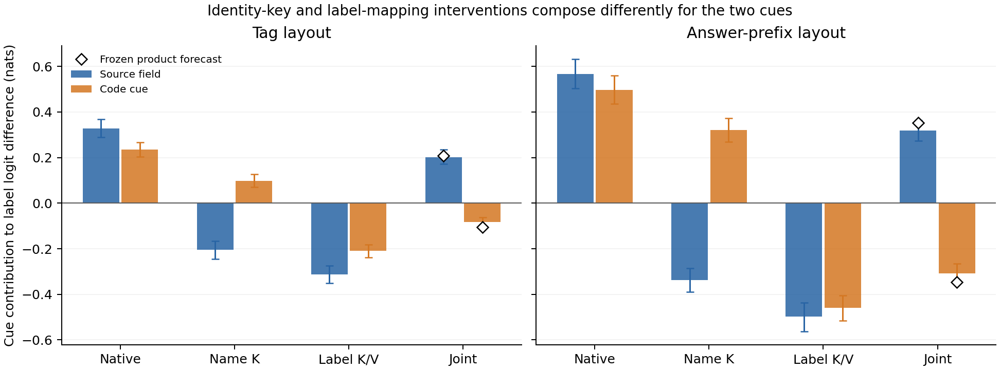
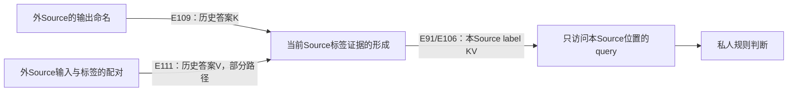

# ICES 当前进展与下一步：从证据混合到来源条件化的计算（2026-10-10）

**当前问题（2026-10-12）：多个来源共享输出空间时，来源特定证据怎样形成并被用于新输入？** 来源身份不只是query的检索条件；query读到的本来源证据已经由完整历史形成。这项形成过程允许哪些关系共享，又怎样影响私人判断，是当前解释对象。

**已完成的机制链：** 历史B答案K→A label的形成反事实近似重建输出命名作用；固定输出词时，历史答案V/KV传递部分输入—答案关联；这些作用进入正常全Source计算，并受读取缓存环境调节。E115补Llama，E116补真实MHS文本的局部形成作用，E117–E118把关联幅度与具体判断方面拆开，E119在14B原样确认。E115–E119共24批/576contexts/181632评分，原始数值与实际token几何独立审计完成；没有把独立复算称GPU复跑。

**新的功能认识：** 请求A且A raw固定时，B的criterion×私人约定对新评论的Food/Service响应可被分别测量。14B完整native下两标准的匹配方面选择性均正，signed rotation .410[.330,.493]；整个query禁读B位置、A仍由完整历史形成时 .190[.073,.310]。A-label交换与答案形成子图产生不同的响应结构，后者仅部分重建actual label反事实；不能将关联传入直接等同于完整criterion程序，也不能说形成端全部只是共同gain。详见§34–35、[完整方向图](results/figs/fig_stronger_model_functional_responses.png)。

**定位与主张：** Cho/CTA/AddUp拥有宽label/上下文化/信息选择解释。具体增量是将Source位置访问与历史关系的功能来源分开，解释输出命名怎样改变来源证据形成，并以冻结形成子图预测原生反事实、检验其具体功能分辨率。C21有界L3；C22/C23在E121的第二benchmark/独立raw审计后达到有界L3，C24有界L2，I04/ACTIVE状态未改。C24明确限定缓存接口而非不同隐藏程序。最强已有解释及compression risk公开列出，不靠“完全空白”或持续弱模型失败定位。

**最新证据与当前工作：** E120原生operation与E121可靠private真实SST文本共16批384contexts/164352评分完成，18,064项raw独立复算和图/实际token校验通过。四checkpoint原生targeted阻断减少B-rule，有限图恢复方向依读取环境；自然namespace KV r .931/.948/.930/.966。由此在5b166d73首评分前冻结E122对称形成政策与query隔离，两Actor/四criterion×code整体预测已完成四checkpoint确认：均值+2.93/+3.42/+7.37/+2.78pp，同时保留成本；其自然文本/namespace预测E123正在执行。上轮Llama/真实MHS/双方面机制/14B确认也均完成。[英文草稿](PAPER_DRAFT.md)、[论文形态](PAPER_SHAPE.md)、[数据覆盖](DATA_PLAN.md)同步到这些结果。探索的正负、部分重建、真实预测后果有限、固定方面顺序、强模型成功仍保留。原MHS任务的single能力弱，不能把它冒称真实个人标准部署。没有因残差自动追加头/层/字段关卡，也没有宣布投稿就绪。

§1–8保留截至E79的初次综合；§9–37保留后续转折与验证。当前结论以前言与§34–37为准；[实验索引](experiments/INDEX.md)、[主张账本](CLAIMS.md)、独立审计[E117](results/e117/independent_review_2026-10-11.md)/[E118](results/e118/independent_review_2026-10-11.md)/[E119](results/e119/independent_review_2026-10-11.md)均可复核。区间为context-bootstrap 95% CI，探索/确认明确分开。

## 1. 我之前哪里做偏了

最初的担心有必要：不能把“模型犯错”“信息可解码”“小模块修好了”直接等同于重要机制发现。但随后我把局部探索的有效性控制，逐渐变成整条研究必须跨过的新门槛：来源 probe → native 路径 → query 接力 → 函数状态 → 缺失类别 → 函数识别 → 数字执行 → 共享词典。每次发现混杂就再换一个任务，结果越来越关注新任务能否跑通，反而没有充分消化 E59–E71 已经给出的计算认识。

纠正这些误读是进步，却不意味着每纠正一次，ICES 的论文标准就必须再升一次。E76 的中点捷径限制 E76 的函数解释；E78 的顺序效应限制那组函数偏好解释；E79 的执行阳性失败限制共享词典的机制归因。它们都不取消原来的证据混合现象，也不取消已经测出的来源因果路径、query 内部计算或载体位置效应。

同样，跑前 MIE 是判断该次实验能否支持预定解释的工具，不是科学价值的自动开关。E71 冻结偏移迁移恢复 **35.0% [23.1, 47.7]**、准确率 **+3.1 点 [0.8, 5.5]**，没有达到原设 50% / 5 点，但它仍然是正的部分迁移证据，不能被概括成“没有可迁移结构”。

## 2. 全部实验积累，实际让什么变得更清楚

| 阶段 | 主要结果 | 留下的认识与边界 |
|---|---|---|
| E00–E11 | 条件映射的噪声检验与标签流、输出格式出现解离；跨模型结果更接近集合式汇总，而非指定变化点 oracle | 输出变化与输入—输出关系变化不等价。exact Bayesian oracle 对指定生成模型精确，不是所有 prompt 唯一合理的规范参照 |
| E12–E19 | toy 训练、LoRA、任务与规模控制 | 提供训练统计的线索，没有建立默认行为的完整训练成因；早期 thinking 失败也不能推广到所有 reasoning models |
| E20–E29 | 最近邻与最近期分开；同一答案中格式可变而映射不重置；不均衡任务中条件成分仍错向 | 原现象不是一个笼统的“不会追踪上下文”。不同输出成分使用时间信息的方式不同 |
| E30–E35 | 输出词表分开时泄漏接近 0；输入域分隔约 0.36–0.49、上下文标签约 0.51–0.91；换词使 11/12 漂移条件改善；标签相似度相关 ρ=0.75–0.96 | 输出身份是重要的组织变量。相关涉及约 13–14 套词表，不能独立证明语义相似度是唯一因果变量；换词也改变答案结构与任务标识 |
| E36–E39 | 标签读取的分解与因果交换；逐头重建 r=0.9997；消融正常映射与泄漏一起下降 | 通用 ICL 检索通路参与泄漏，尚不能说找到了独立的“错误模块” |
| E40–E45 | 顺序、格式相关探索及控制 | 按当时记录保留为诊断材料，不重新赋予中心地位 |
| E46–E49 | 2 个真实多人标注数据集、8 模型、4 家族：混合保留个人倾向约 35–58%，交互约 27–48%；匹配词表基准后，分开输出词多能恢复到约 0.80–1.27 | 受控现象能延伸到真实标注分歧，不只是玩具漂移；也不是所有模型、所有换词条件都完全恢复 |
| E50–E54 | 三个实际预测设置没有同样明显的准确率损失；更复杂语义的来源区分约 0.31–0.52 | 内部区分损失不自动意味着应用损失。不能写“多人 ICL 无法工作”，也不能把更多真实数据当成唯一意义来源 |
| E55–E56c | 来源 probe 可读；冻结主模型的 query LoRA 准确率约 0.54→0.91，超过单来源参照；联合换任务/标签后的迁移有限 | 表示可读、native 使用、额外训练后可部署是三件事。rank 8 是约 20 层各自的秩，共 1,310,720 个训练参数；不是免费打开一个八维开关 |
| E58–E66 | 可跨标签的来源差分；来源名字 K 的 native 中介；whole-query label 消息；query 接力与缓存状态的负结果 | “默认完全不用来源”被撤回。来源条件化分布在 query 内，末位标签读取不足以代表整个程序；没有证明完整函数状态可独立移植 |
| E67–E71 | 来源码位置效应、label-blind 历史、公共 prefix-key 偏移、关系码×位置独立确认 | 同样存在的身份信息，进入不同结构角色会改变效果；载体可见性、来源选择与预测恢复可以分离。是目前最值得集中解释的链条 |
| E72–E75 | 原生推理、预算与解析校对；较新 27B 普通多来源 pilot 全对；8B 来源内双射补全全对 | 强模型和有效 reasoning 能解部分任务。原始候选评分或截断失败不证明能力缺失；还没有独立前沿模型的全面结论 |
| E76–E79 | 中点/加性捷径、单来源函数失败、定义顺序效应、共享词典执行阳性失败 | 新任务帮助约束解释，尚未带来新的通用组合规律。不把它们的全部有效性控制变成 ICES 主线的必要条件 |

这里的积累有两种价值：一是现象覆盖已相当扎实；二是后续反例逼我们拆开了原本混在一起的机制判断。后者不只是坏消息，但纠正自己的误读也不会自动变成领域贡献。

## 3. 目前最强的认识链条是 E59–E71

### 3.1 来源信息确实进入默认计算，但不能只看答案末位

[E59](experiments/E59-source-mediation-sites.md) 中，来源交换的影响主要经来源名字 K 中介；[E61](experiments/E61-crossed-routing-payload.md) 中，它与标签 K/V 的作用存在非加性交互。这比 probe 更接近实际计算，但 hybrid 中介比例依赖具体反事实，不代表找到完整且唯一的串行电路。

[E64](experiments/E64-whole-query-message-mediation.md) 的更强结果，是改变测量范围后因果结论明显改变：Qwen 独立合成确认中，冻结答案末位 label 消息仍剩 **0.471 [0.438, 0.508]** 的来源效应；冻结整个 query 后只剩 **0.061 [0.027, 0.094]**。独立真实评论池的受控来源规则任务为 **0.527 [0.476, 0.581]→0.054 [0.001, 0.102]**。Mistral 末位冻结已经只剩约 0.127，全 query 为 0.078，显示读取时序有模型差异。

这些比例是指定干预下的 logit 效应剩余，不是准确率，也不是互斥可加的机制份额。真实评论池使用人为规定的 race/gender 映射，不等于自然标注者规则。但结果已经足以改变我们自己的测量方式：在这类来源条件化任务中，只审视最后一个答案位置，可能把此前发生的条件计算误看成“来源没有被用”。

### 3.2 关系信息的结构角色影响行为，单纯扩展答案空间不足以解释

[E67](experiments/E67-source-code-at-answer-prefix.md) 把相同来源码从 Tag 字段移到答案 prefix，保持最终分类词不变。Qwen 独立确认准确率 **+7.4 点 [4.7, 10.5]**，来源排序 **+10.9 点 [5.5, 17.2]**。完整输出语法仍改变，且 prefix 是 teacher-forced，不能当成纯位置因果效应或端到端生成能力；Mistral 的准确率收益 CI 跨 0。

[E71](experiments/E71-relational-code-versus-carrier-access.md) 进一步保持 namespace、token 频率与布局相同，操纵码词是否与来源一一对应。新材料中，**关系码×位置的准确率交互 +10.9 点 [7.0, 15.2]**，margin 交互 +0.514 [0.427, 0.597]；来源排序交互 CI 跨 0。Source 字段本身仍充分给出身份，因此“只是新答案词更多”不足以解释该收益。当前只能说关系与结构角色共同影响这一分类程序，不能直接宣布新的 binding 构件。

### 3.3 预测变好，可以主要来自载体组更可见

[E68](experiments/E68-prefix-history-versus-local-address.md) 与 [E69](experiments/E69-label-blind-contextualization.md) 说明 prefix K 的历史上下文化重要，但在禁读历史 label 的条件下仍可保留作用；这不证明整个模型无须 label，也不证明 K 存着完整任务判决。

[E70](experiments/E70-common-frame-versus-example-specific-keys.md) 则构造了一个可解释的干预：给**所有 demo prefix-code token 这个载体组**添加相同 key 偏移。它不是给 Source A/B 各加一个不同偏移。固定 query 时，组内相对 logits 几乎不变（spread <4e−6），改变的是 prefix 组相对于其它 token 的可见性。

来自其它发现 context 的冻结偏移，在独立词库/标签确认中恢复 margin 损失的 **52.7% [27.4, 76.0]**，准确率 **0.543→0.602**，接近 native 0.605；但来源排序仍为 **0.828**，低于 native **0.938**。因此，这次预测修复不能完全读成来源绑定修复。E71 换名字/码词/词库/标签后仍有上述 35% 的正向部分迁移，作用有边界而非完全消失。

这个干预遍及 36 层、8 个 KV head、128 维，共 36,864 个浮点数，保留其它 native 缓存；不是一个全局标量，也不是独立足够的任务状态。它给出的有用认识是具体的：**某种看似来源条件化的性能恢复，可以由载体组可见性的改变介导，而组内来源选择仍未恢复到同样程度。**

## 4. 从更高一点的观点组织它，但不追求统一解释全部 ICL

当前可工作的中心问题是：

> **来源身份在什么条件下成为有效的证据选择坐标？它怎样进入 query 的计算，而信息载体更可见与来源选择更准确又分别改变了什么？**

一个候选解释是：来源条件化通过 query 内部的证据读取逐步形成；来源码所承担的结构角色会改变这个过程；提高承载关系信息的 token 组可见性可以改善预测，却不保证组内按来源选择正确。这是对一组来源条件化分类实验的有界解释，不是所有 ICL 的统一理论，也尚未证明三个环节在所有模型里构成同一条因果链。

它比“来源完全不用”“所有信息都按输出存放”更符合现在的结果，也不要求先解决任意函数推断、任意词典组合或所有 reasoning 模型。I04 的现象基础保留；原来的单一路径解释收窄。论文标题暂不锁定，先把这条已有链条讲准确。

同行可能因此改变的是具体的研究选择：考察 whole query 而非只考察末位；在干预后分别测预测与来源选择；对于位置/码词带来的恢复，检验它改变的是载体访问还是关系选择。这些原则的一般版本并非我们首创；潜在贡献在于**用同一来源条件化任务中的可辨别干预，把它们落实成可预测的计算解释**。是否已经足够独特、有力，仍须结合现有证据与近邻判断，不能只靠这段表述。

## 5. 已有文献给出的尺度与边界

我们已经持续读了这些主线，而非只按标题查重。详细阅读范围见[论文笔记](../../library/themes/in-context-evidence-structure/KEY_PAPERS.md)与独立论文卡。

| 近邻 | 已有认识 | ICES 应抓住的具体距离 |
|---|---|---|
| [Wang，label anchors](https://arxiv.org/html/2305.14160v3)；[Cho，ICL inference circuit](https://arxiv.org/html/2410.04468v3) | 标签锚点、输入编码/合并/检索复制、shortcut 与 forerunner | 不能把标签参与检索当新发现；研究来源条件如何进入这条程序及它的边界 |
| [Feng & Steinhardt，binding IDs](https://proceedings.iclr.cc/paper_files/paper/2024/hash/9d1b7fc578c0d2d6431fc26d736ecaf3-Abstract-Conference.html)；[Gur-Arieh，Mixing Mechanisms](https://arxiv.org/html/2510.06182v2) | 模型有绑定能力，检索可混用位置、词汇、reflexive 机制 | 不能以“多键绑定”新名称立贡献；需说明既有机制在来源条件化中的具体使用方式 |
| [Cho，information removal](https://arxiv.org/html/2509.21012v3) | ICL 可选择性移除已有表示中的无关信息；用 unseen-label 与构造性干预区分解释 | 学习其让解释产生分歧预测的实验动作，不要求我们也解释全部信息移除 |
| [Few-Shot Examples Add Up](https://arxiv.org/html/2605.16591v2)；[Contextualize-then-Aggregate](https://arxiv.org/html/2504.00132v2) | QK/V 与 alignment、上下文化内容与历史依赖已有解释 | 公共 key 偏移或历史必要性本身不新；价值在具体来源关系、载体与选择效应的分解 |
| [Lepori，表示与部署](https://aclanthology.org/2026.acl-long.676/)；[Li，Just-in-time task representations](https://arxiv.org/html/2509.04466v3) | 可读出的表示与后续部署、token 局部任务状态有区别 | 不把“有但不用”或“更早就有计算”当中心 novelty；转向实际 source-conditioned 路径 |
| [Liu，Incomplete Loop](https://arxiv.org/html/2404.03028v3)；[Khandelwal & Pavlick，function composition](https://arxiv.org/html/2510.01685v2) | 推断/预测/执行及原子能力/组合行为已有分离研究 | E77–E79 不能简单换名为新的组合缺陷；也不必为了超越它们，把 ICES 主线迁移到函数任务 |

从 Cho 学到的应是实验如何使认识变得更深，而非无止境增加复杂度。这里最好的已有转折是 E64 改变观察范围、E70 构造组内相对匹配不变的干预、E71 让相同 namespace 下的关系信息竞争。它们都有明确的解释收益，应先组织好。

## 6. E72–E79 要怎样保留

E72/E73 揭示了预算、截断和解析的影响：27B thinking 在 8 个 context 的普通多来源、linked-prefix、entity、single 条件全对；8B 同轨迹延长预算使 orthogonal 准确率 0.1875→0.8125，48 次实际前缀核对一致。部分 Markdown 漏判校正属于 POST-HOC，原严格评分保留。这支持“能力可能恢复，需要区分能力与默认程序”，但不等于所有强模型都解决或机制相同。

E74 即时缺失类别准确率约 32–36%，关键方向 CI 跨 0；E75 原生双射补全 full/held 各 **36/36** 正确，独立函数空间 **24/36** 正确、**12/36** 截断。保留它们作为来源约束可被推理利用的证据，不能从前者低分宣布普遍能力缺失。

E76 的 Source 响应 **3.648 [3.403, 3.883]** 可以复现，但 query 恒为示例中点，均值足以答对，加性任务也不要求完整组合。E77 排除这个捷径后，direct 规则执行全对，mixed 推断较弱；single identity 也弱，不能归因于独有的多来源瓶颈。

E78 只交换函数定义块，mixed subtract 插值 **96.1%→25.0%**，说明之前的函数不对称依赖定义顺序。模型自选 rule code 相对空字段仍带来 **+18.9 点 [10.2, 26.4] / +24.4 点 [16.8, 31.3]** 的插值/外推收益，但不足以证明可靠识别而不部署；一般中间指令反馈已有直接近邻。

最新 [E79](experiments/E79-parameter-evidence-versus-codebook-evidence.md) 试图区分私人规则参数与共享输出词典。16 个新 context、全部两个定义顺序保留；词典 lookup 约 **95–99%**、seen 几乎全对，但给出真实规则后，subtract 插值仍只有 **21.9% [6.3, 38.9]**、外推 **15.6% [6.7, 26.4]**。没有同 context 数值原子执行的阳性，不能说“两种原子都能做却不能组合”，也不能继续做 provenance 的机制归因。事后错误中经常输出 g(x)，只支持跳过变换的行为签名，不证明内部计算顺序。

**这些实验的作用是界定错误解释、提供未来工具，不是继续追加主线成立条件。** E79 原卡保留“若继续该分支应先检验原生/原子有效性”的建议；本次综合排序不优先执行它。没有正在运行的后续 GPU 分支。

## 7. 下一步只集中推进一个解释问题

先用 E59–E71 的现有数据，组织“query 内部来源条件化—载体访问—组内来源选择”的小范围解释，明确哪些比较已支持它、哪些仍是候选预测。优先处理已有结果之间的关系，不先重写论文、不扫模型、不增加函数与词典任务。

下一次新增实验只围绕一个区别：**Tag 与答案 prefix 的差异，主要来自承载关系信息的 token 组更可见，还是来自组内更好的来源/样例匹配及上下文化内容？** 一个可行 pilot 是在 E67/E71 分类任务上，对照控制载体组获得的总 attention mass，并保留组内相对权重；同时报告 margin、准确率和来源排序，使用未参与挑选的 context/码词。精确操作范围还需在实验卡中确定；改变早层消息会改变后续 query，因此不会把这种干预说成全网完全隔离。

| 结果 | 真正改变的判断 |
|---|---|
| 匹配载体组可见性后，Tag/prefix 预测差明显缩小，而来源排序差仍在 | 更支持可见性与来源选择的分离；可解释部分格式收益，不称 binding 全修复 |
| 预测和来源排序差都主要保留 | 公共可见性不足以解释位置收益；集中到组内匹配/上下文化内容，不先扩大任务范围 |
| 干预阳性或质量控制无效 | 该 pilot 不可解释；只修具体干预问题，不因此撤回 E59–E71，也不另开一串能力门槛 |

这是一项聚焦的候选实验，不是承诺完整统一理论。读数与原先已有结果允许解释失败；失败只收窄该解释。后续动作由它实际留下的不确定性决定，不在结果回来前铺所有分支。

## 8. 当前四层判断与交付

| 层次 | 当前判断 |
|---|---|
| 空间 | 重要问题是身份信息如何进入 ICL 的证据选择程序；既有检索和绑定研究提供强参照，仍有具体成立边界可研究 |
| 线索 | 强。原现象稳定，E59–E71 已有 native 因果、观察范围、信息位置、可见性干预与独立关系确认 |
| 主张 | 输出身份影响汇总、来源会参与 native 计算、whole-query 范围重要、关系×位置影响预测、可见性恢复与来源选择恢复可分离。一般统一算法与新构件尚未证明 |
| 贡献 | 有值得进一步组织和验证的知识增量；关键是能否把这组结果变成有界且有预测力的解释。没有必要要求覆盖所有 ICL，也不能仅把已知区分的又一个例子包装成新理论 |

目前不建议放弃，也不建议仅凭实验数量宣布强论文。应当把 ICES 当作已有实质进展、需要一次认真综合的研究，而不是不断向外扩张才有资格被肯定的项目。最终论文形态与 scientific-yield 判断由人决定。

本次上传包含已有 E58–E79 的代码、实验卡、主张记录、小结果与论文笔记，以及本总结；checkpoint、原始 JSONL / 数组、模型权重保留在 README 所列本地路径。E79 分析脚本的 bool 相减修正不改科学评分、样本或门槛。流程检查仍是 0 ERROR / 64 个已有 WARN；本次不提升主张等级、不改变项目状态。

## 9. 对后续人审计的独立核对（2026-10-10追加）

我支持将自然问题表述为“多套规则共存时，模型怎样决定当前query应由哪些示例约束”。Tag/prefix是实验变量，不是中心问题。这个问题不依赖弱模型永远失败，但自然性本身也不证明novelty；已有框架不能直接预测一个效果量，不等于它们在机制上已经被排除。

重读Cho/QK近邻、读CoSToM§3–4及附录E/F，并补读新近邻[Selection–Realization](https://arxiv.org/html/2608.13385v1)§2–5后，需保留三个修正：

1. **source ranking是输出对来源的区分，不是直接的内部证据选择。** E70的预测与该输出指标分离很有价值，但尚不能单独宣布因果“访问/选择”双模块。原数字和证据等级不变。
2. **公共偏移并非必然增加载体读取。** 旧结果POST-HOC核对：E70确认prefix总mass由isolated **2.675%[2.619,2.735]**降至shared **1.488%[1.463,1.515]**；E71 own common **2.841%→1.873%**。同时预测改善。全层/全query平均不定位关键head，但已阻止“多关注所以修好”的单调解释；应说预算配置变化。证据`results/e70_e71_attention_audit_posthoc.json`。
3. **旧E71的D0 prefix是Mark。** 真码位于Tag，旧保存统计没有该组，不能直接把旧prefix质量当两种码载体的等价比较。这是测量对象纠正，不是取消位置收益。

| 已有操作 | 确实改变什么 | 保留什么／不能推出什么 |
|---|---|---|
| E59 source-name K交换 | 原生来源身份反事实的检索key | 其它cache基本保留；中介结果依赖反事实，非完整Source算法 |
| E61 label K/V与name K交叉 | 来源读取和映射消息的指定接口 | 非加性不自动识别独立模块或串行顺序 |
| E64全query label-message冻结 | query接收label消息的范围 | 原生源效应不能只用末位概括；尚未定位全部路径 |
| E68/E69历史mask与carrier K移植 | prefix上下文化信息与特定K | 其它native缓存/V保留，不能推出整个ICL无label历史 |
| E70公共prefix K偏移 | 固定Q下carrier组相对外部logit预算 | 组内相对logits局部不变；完整程序的后续Q/V可变，非全路径隔离 |
| E71关系×码位置 | 同namespace下冗余来源关系与结构角色 | 原生V/其它路径及输出语法同时作用，不是完整选择机制 |

因此继续的是一个具体机制解释，而非“已有framework都完全不够”的宽泛宣言。[E81](experiments/E81-carrier-mass-versus-source-allocation.md)按真实码载体对齐，整query固定m/pi目标、保持kind边缘翻转Source分配，观察最终判断能否因果分离；其它权重与V保留活反馈。竞争解释若被支持就据此收窄，不追数字变大，不加新的函数能力关卡。CoSToM给我们的尺度是问题与证据链，其额外监督/decoder验证不要求ICES也做同样方法。

## 10. E81已经完成：位置收益不是码carrier读取统计的直接复用

一个聚焦pilot（32新context）与同源码的独立确认（64新context）得到一致结果，科学GPU墙时合计0.0602小时。所有材料/错误donor保留，无筛样本；self及mask/目标权重控制通过。详细数值与操作见[E81](experiments/E81-carrier-mass-versus-source-allocation.md)。

| 确认条件 | accuracy | 它检验什么 |
|---|---|---|
| Tag native | 52.3% | 来源字段与码都在，但默认读取效果有限 |
| Prefix native | 64.5% | 相同Source/最终label，结构角色改变 |
| Tag仅接受Prefix码carrier的m/pi | 52.3% | 码carrier的读取统计未转移收益 |
| Tag接受角色对齐的whole-query attention | 65.6% | 更广读取分布可以转移收益，未从donor移植V |
| Prefix固定m/kind，翻转Source分配 | 53.1% | 组内Source分配具有独立的因果作用 |

**同Tag recipient、同码carrier m/pi下，whole-query比carrier-only增加13.3点[9.4,17.2]、margin+.918[.735,1.111]。** 不同的是对其它token的读取条件分布；demo cache/V保留，query内V/MLP活反馈。Source flip使Prefix margin−.849[−1.003,−.712]、accuracy−11.3点[−15.2,−7.8]，同时保持每层/head/query的码carrier总量及kind边缘。

这比“prefix多被看了一点”更具体：其Source分配有作用，但码carrier本身的选择不是位置收益的充分接口。native真实码的平均mass Tag 2.191%、Prefix 2.101%，requested-source份额60.9%/60.0%，也不支持简单的单调可见性解释。平均attention仍非完整机制；指定干预才提供这里的因果证据。

审计中的另一座推断桥也要收窄。输出ranking只测Source contrast方向，不测其强度或共同label偏置。记s为正确方向的Source分数差的一半、b为两Source共同分数；ranking检验s>0，两人都答对还需s>|b|。POST-HOC精确重建显示Tag whole-query移植主要提高s（.583→1.371），平均|b|并未下降（2.020→2.093）；bias差CI跨0，不作等效零结论。**accuracy/ranking的分离，不能单独证明“访问修复、绑定未修复”的两个模块。** bias/读出的一般解释已有[Cho Hidden Calibration](https://arxiv.org/html/2406.16535v3)等强近邻，不能把这个代数当新理论。

当前更合适的候选认识是：**Source cue通过query的读取程序改变相关证据的作用强度；实际cue载体的分配与其它证据的读取需要协调，不能只用“关注cue多少/关注谁”概括。** 这里的“需要协调”是上述受控接口的解释，尚不是完整新电路或跨任务抽象策略；whole-query donor可能已经带有答案相关选择。

这支持继续深入自然的证据选择问题，也明确了novelty应落在哪里：具体Source条件怎样改变读取程序及其反事实后果，而非一般QK/V不同、信息可读却不用或新的token名称。C20记L1；不立即再扫配置，下一步用已有因果区别构建能预测Source对比的有限解释，与已有框架实际比较。完整预测模型仍未完成，不能宣布强机制论文已定型。

## 11. E82–E84：开始预测读取变化，也找到预测器的具体解释边界

### E82：原生影响在哪里形成，与从哪里移植收益是两个问题

64新contexts确认：固定相同来源码读取后，替换demo Label读取提高accuracy **7.8点[3.9,11.7]**、Source contrast **.461[.381,.544]nats**；仅替换query内部读取提高.8点CI跨0、contrast .047[.026,.068]。Label在全query替换与只在末位替换，contrast差只有.014[.007,.023]nats。完整读取仍有其它效应，不把Label称唯一原因。

这收窄了原先期待的复杂接力故事。C16整query原生中介仍成立，E82末位收益也成立：前者干预原生Source身份影响，后者移植另一布局的读取政策。两者不是同一反事实。不能为追求完整叙事要求每个收益都必须重建整个原生程序；一般定位与可干预位置的区别已有文献，这里只是具体多来源ICL的证据。

### E83：不再用完整donor代替解释

只在E82 discovery的native注意力上拟合固定模型，不用gold输出调分。每层/head预测末位Label条件log权重变化，比较预算/位置B、Source/input匹配R、加联合项RJ、加Label身份RY。最大单模型9216系数，kind使用合成语义元数据，不能称一个无代价小开关或部署方法。

64全新contexts中，B没有提高Source contrast，R提高 **.376[.358,.393]nats**；R−B .405[.385,.424]。联合项额外.067nats；Label身份项虽提高统计拟合，没有额外行为收益。Source匹配翻号损害margin，说明关系项的作用不是只靠预算。这个预测在平均作用上有信息，但逐context的作用相关仅 **.252、RMSE .273nats**；不是完整原生算法。

### E84：同一个“Source-match”变量可以代表不同计算关系

自然query中Source字段与冗余code指向同一人，因此R的成功不能判断它跟随的是哪一项。冻结相同系数，在Source字段×query-code交叉的独立材料上，让两个预测器给出不同预测。32-context pilot与64新context确认一致：code-match比Source-field-match的加权allocation MSE低 **1.539[1.504,1.571]**，对实际Label重放的输出作用MSE低 **.165[.071,.275]**。

但native同时使用两类身份：Tag的field/code输出分量.360/.258，Prefix .594/.583，**code没有取代Source字段**。code预测器的平均两分量接近实际Label重放，逐query效应却仍未完整恢复（conflict RMSE .620，简单B为.527）；不能把战胜另一身份解释当作完整预测成功。冲突且teacher-forced的prefix改变输出条件语义，不能当能力失败测试。

**当前认识更新：** 来源条件化不是“来源信息完全不用”；位置收益也不只是carrier读取总量或其Source偏好。具体code关系引起的Label读取变化有可预测平均作用，而原生名字路径仍参与。下一步[E85](experiments/E85-cue-specific-source-paths.md)回到已定位的NameK×LabelKV，检验两种身份影响是否依赖同一名字key通路。它不要求完美分离或覆盖全部ICL；即使选择性成立也不证明两个独立抽象Source ID。

自然科学问题仍是**多套规则共存时，哪些context变量实际约束证据使用，以及它们如何进入读取过程**。新的切入点是将原本重合的身份线索拆开，再用原生因果路径检验依赖。统计模型、反事实效果和路径解释互相约束，避免拿完整donor、漂亮拟合或实验数量代替认识。C20仍L1；有新的可检验解释与负预测，novelty尚未宣称闭环。

## 12. E85：两种身份线索的依赖不同，联合干预已有有限预测

把原本一致的Source字段与code交叉后，再回已定位的NameK与LabelKV接口。32-context探索→64全新context确认，Prefix的field/code分量分别为：

| 操作 | field | code |
|---|---:|---:|
| 原生 | .566 [.503,.632] | .496 [.437,.559] |
| 交换名字K | −.337 [−.390,−.285] | .321 [.270,.373] |
| 交换Label K/V映射 | −.497 [−.562,−.436] | −.460 [−.516,−.406] |
| 两者同时 | .319 [.274,.365] | −.309 [−.352,−.265] |

Tag布局也重现同样符号。名字K改变不只是让Source信息消失：field的作用反转，而code仍沿原规则作用；但code也减弱，所以不是两个完美独立模块。两类影响都随Label映射翻转。这比“probe读得出Source”进一步说明**何种来源线索依赖何种原生读取操作，以及它怎样与映射内容组合**。

看到探索结果后明确POST-HOC提出均值组合`joint=n*m/b`，先commit冻结、再做确认，不用确认数据重新估计。四项联合均值的绝对预测误差.007–.036nats；固定预测MSE .0232 [.0190,.0280]nats²，简单相加模型1.2189。Tag code有+.022 [.002,.041]的系统残差。模型只是四项平均作用的解释，不是逐query下一token分布模型；相加模型field符号错误使比较较容易，不能用此胜出宣称完整算法或新乘法原则。

**当前有分量的进展：** 由“同标签下的混合”推进到具体身份线索的原生依赖，再对未用于挑选的联合干预给出数值预测。**尚未完成的贡献：** 没有证明唯一的Source地址、独立子程序数目或跨任务统一机制。相关工作已有多机制检索、标签锚点、适用性判断；新的[demonstration conflict](../../library/themes/in-context-evidence-structure/jiao2026-demonstration-conflict.md)和[jurisdiction](../../library/themes/in-context-evidence-structure/li2026-jurisdiction.md)也明确限制宽泛novelty。它们并未自动覆盖本接口的具体预测，不能据此桌面判死。

下一步的选择原则是先找**当前native计算与替代读取解释在何种条件下给不同预测**，不要求先完善所有边界，不用更多同分布正结果替代辨别。用户提供“Beyond Owls”的逆向实验设计材料，是要求把方法用于ICES，并非另做蒸馏练习题。E86只保存同Source等价码的候选分歧，尚未执行；用户又要求先完成具体文献调查再考虑方向，现据此核对任务、干预和可推导预测，见复盘§16。不以检索到相近术语降级主张。E85结果完整保存，C20仍L1，I04/ACTIVE及最终科研收益决策权限不变。

## 13. E86 pilot与最新纠偏：控制不能自行成为研究问题

**已完成的事实。** [E86](experiments/E86-source-equivalent-code-aliases.md)16新context，把同一Source的两个等价码分别与不同类别示例关联后，未知Item的matched/crossed margin差增量：Tag **14.463 [13.055,15.826]**、Prefix **15.892 [14.548,17.156]nats**。冻结E85外推只有.395/.928，**两个模型的量级预测都失败**。segregated的matched/crossed accuracy为98.4%/1.6%、100%/0%；平均50%会掩盖这个变化。旧规则的输出响应仍为正；不能据此说规则信息消失。布局交互CI跨0，不宣称Prefix作用更强。原始结果、小JSON与图全部保留，64-context确认没有启动。

**这次控制的用途与偏移。** 原本想区分“名字/码先指向共同规则”与“字面码直接决定标签支持”。它确实暴露了冻结解释的失败，却也把任务变成码与class强相关的环境；一般特征捷径、上下文任务重新划分和label continuation仍是解释。再拆几项K/V可以定位作用，但未必让重要问题更清楚。效应很大不是自动追加实验的理由；人这次指出控制越来越细，是对研究优先级的纠偏，不是要求丢掉结果。C20和E85原有确认不降级，I04/ACTIVE不改。

**这次真正读到的研究动作。** 复读Cho2025主文§3–5：主电路消融后剩余能力推动旁路解释；随后读Cho2026信息移除的主文、核对camera-ready v4，关键是用unseen label迫使单纯复制解释失效，再连接构造、原生观测和消融。其[公开答辩修改记录](https://www.hakaze-c.com/phd_defense)也把主贡献、结论依赖关系和次要细节分开；不是完整发现时间线。新读的contextualization预印本先问总体信息传递，再连接具体通道，提供组织研究的参考，不成为新的ICES技术要求。分别见[信息移除卡](../../library/themes/in-context-evidence-structure/cho2026-information-removal.md)与[contextualization卡](../../library/themes/in-context-evidence-structure/cho2026-contextualization-channels.md)。

[Beyond Owls](../../library/themes/in-context-evidence-structure/beyond-owls-capabilities-backdoors.md)的要点是让相同ID分数的两种解释在有意义的新条件下分化，而非控制越细越好；[CoSToM](../../library/themes/in-context-evidence-structure/li2026-costom.md)则直接测试内部构造是否影响它关心的行为。两者不必给出完美机制。这里重建的是论文的论证逻辑，不冒充作者真实探索顺序。

**回到自然问题。** 保留“多套规则共存时，模型怎样确定当前应使用的规则”。更有用途的切入点是：Source切换时，模型是在改变**对输入哪些信息的使用**，还是在共同输入表示上改变**读取哪套输出映射**？这两种计算可以并存。它解释正确回答如何形成，强模型会做也仍可研究；名字、code位置和attention接口只是观测把手。

自然例子是同一条评论“电影很精彩，但工作人员很无礼”，两位评判者分别评价电影与服务，都用positive/negative。模型需要根据评判者选择同一输入中相关的信息。它与职业/交通工具的反向标签映射不同：后者可以始终利用同一语义特征，仅切换输出映射。**当前E58–E86没有证明上述输入选择机制**，不能直接重命名成新解释；这只是I04内的候选切入点，不另开workbench或宣称空白。

**已调查的具体距离。** [TR/TL全文](../../library/themes/in-context-evidence-structure/yang2026-task-recognition-learning.md)主文§3–4与H.3/H.4把TR操作化为label-space recognition；共用同一答案集合时，这项读数不能单独区别哪套规则被选。它还研究了capital+antonym的两输出阶段，不能说没有组合任务；也不能把它宽泛的功能分解当成本任务的完整预测。Xiong正式ICML2025正文§7、附录D用task-vector混合解释未指定任务的混合答案分布，作者保留量级/无关输出失配；不是共享标签空间中的Source条件化完整算法。上述距离只给定位，不作已有框架失效、novelty已成立或研究trivial的判断。

**下一动作。** 先围绕这个自然例子整理任务解释、相关输入与输出映射的竞争计算，把已有E64/E82/E85放在同一问题下；看正常、正确的回答以及Source切换时的状态，不依赖制造错误。接着选择能让这些计算产生不同预测的一个实验，并先写卡。当前不自动运行E86确认、不扩alias/Code K/V矩阵、不再增加整线资格门槛；也不把阅读变成无限推迟实验的理由。

## 14. 最新人审计后的科学问题重构：先明确变量，再决定实验

**本轮实际范围。** 人先要求继续执行，随后明确下一项投入应是以论文为中心的设计重构，暂不扩实验矩阵。前一指令下new.py生成了[E87候选骨架](experiments/E87-source-conditioned-aspect-state.md)，没有科学脚本、模型加载或评分；最新指令后不实施。该卡记录原拟整段来源/评论缓存交换的歧义，而非新增已执行证据。I04/ACTIVE与C16/C20等级不变。

**对审计的独立判断。** 方向上的批评成立：从已定位的接口继续拆细，不能自动产生解释增量。但不接受“均值预测本身太浅”或“必须得到完整算法才有价值”作为新门槛。[Mixing Mechanisms §4](https://arxiv.org/html/2510.06182v2)同样先对每组反事实index条件的150次干预取平均概率，学习并检验条件分布；其价值在明确机制变量、让它们给不同预测并覆盖大量未用于拟合的条件。E85四项均值是有效的有界预测，差距在解释的功能范围及变量含义，而非平均本身。也不把“旧框架允许解释”与“旧论文已实测完整覆盖ICES”混为一谈。

### 14.1 当前提出的三个故事，尚不是三个可辨别的机制

“输入侧过滤”“输出侧路由”“示例检索”可以是同一计算的不同描述。在一个线性示意中，固定读出w接Source条件投影P_s，与Source条件读出w_s接共同表示h，输出满足wᵀP_s h = (P_sᵀw)ᵀh。仅观察答案变化不能分开它们；这不是关于完整Transformer的等价定理，也不是新的ICES贡献。

更具体地，设评论有食物/服务两项情绪u=(a,b)，示例覆盖四个组合v∈{−1,+1}²；每Source按自己的criterion c(s)标注y=v_c(s)。一个**保留全部输入特征**、只按Source选择示例、权重正比exp(βuᵀv)的检索器，其加权标签均值为：

\[
\frac{\sum_v e^{\beta u^\top v}v_{c(s)}}{\sum_v e^{\beta u^\top v}}=\tanh(\beta u_{c(s)}).
\]

它的答案对另一项情绪完全不敏感，但未执行输入过滤。这个静态反例不是LLM实验或对LLM的拟合，作用是明确：**自然评论上“换Source后只跟相关方面走”，仍不足以识别过滤机制。** 同理，评论位置的缓存可以已经含有label检索形成的判断；移植后答案跟donor，只证明该位置承载有作用的信息，不证明信息的功能类型。

### 14.2 先把已有证据放回这一区别

| 已有结果 | 确实排除了什么 | 尚兼容的强解释 |
|---|---|---|
| E46–E52：多人区分受损，实际预测损失有限 | 用显著logit差直接推出普遍应用灾难 | 条件信号弱但足以越过边界；语义先验与多种路由共同支持答案 |
| E59/E61：名字K与label K/V有交互；E64：whole-query与末位冻结不同 | 完全Source盲的模型、只看末位就解释原生来源作用 | Source条件化的query检索、提前取得label证据、criterion重编码均可能 |
| E66：输入前缓存single/mixed均失败；看过input后logit接力较好 | 该缓存接口已部署完整来源规则的强解释 | 临时任务状态、分布式计算、对原示例的持续依赖；不证明抽象规则不存在 |
| E81：固定码读取，whole-query重放仍+13.3点；E82：Label读取+7.8点 | 码载体预算/分配足以解释全部布局收益 | 更广的任务/示例检索；不同反事实可由不同位置转移作用 |
| E83/E84：冻结关系reader有作用，code预测优于field | 将共线的Source-match参数直接解读成抽象Source寻址 | 字面cue参与上下文相关权重；没有锁定所携带的规则含义 |
| E85：两Cue原生依赖不同，联合均值独立可预测 | 在本接口中两Cue只有完全相同依赖的强版本 | 同一任务状态的多条输入路线、contextualized anchors与映射读取 |
| E86：alias关联产生14–16nats，旧固定增益外推失败 | 该冻结量级外推、强alias等价不变性 | 已有框架中的上下文重权重或捷径；不是所有检索/绑定解释失效 |

因此，已有数据支持具体因果依赖，却**尚未在这个自然问题上把最强替代解释的具体预测拉开，并说明哪种解释更充分**。这是当前拟做机制贡献的缺口；增量可以是新的因果关系、成立条件或更好的预测，不要求发明新组件/功能变量，不等于现象无意义，也不等于已有理论已定量完整覆盖所有条件。

### 14.3 论文是怎样把“位置”推进为“功能”的

[CTA §3.2–3.3](https://arxiv.org/html/2504.00132v2)在识别图后，另改token身份、功能关系和输入/输出类型；歧义样例实验区分了“模糊例子被修正”与“明确例子获得压过模糊例子的信号”。[How Few-Shot Examples Add Up §5–6](https://arxiv.org/html/2605.16591v2)从QK/V转向信号来源，保留capitalization中query角色反转的例外。它们不是通用QK/V词汇表，也不假设检索与任务向量互斥。

Mixing Mechanisms先让位置、词汇、指针解释在同一反事实给不同答案；§3.4又用donor答案不在recipient上下文中的条件分开指针与答案，并用下一层移植检查答案缺失抑制。对ICES应迁移的是**让承载信息的功能含义给不同预测**，而不是照抄三种head名称或消融矩阵。

[Just-in-time主文](../../library/themes/in-context-evidence-structure/li2025-just-in-time-task-representations.md)已比较可解码身份、可迁移状态与语义范围，输入前token也被测试；[Lepori主文](../../library/themes/in-context-evidence-structure/lepori2026-representation-deployment.md)直接让诱导出的环境表示承担新规则操作。不能把一次Source-state迁移或一个失败再次包装成这两篇宽泛认识的首次发现。

### 14.4 保留自然问题，改变候选辨别对象

Research Question仍是：**共用答案空间时，来源怎样使从示例推断的判断标准约束当前输入？** 它覆盖正确行为，不依赖弱模型继续失败。

候选Scientific Gap是：Source条件信号主要指向**本context的证据地址**，携带**可跨新输入使用的criterion含义**，还是二者混合？这是把binding与任务表示的已有工具接到特定问题，不是声称无人研究过，也不是现在确认的主线贡献。

一项待核对的反事实可以保持来源名字、位置、评论、标签空间相同，改变从demo可推断的criterion：recipient的Alice评食物，donor的Alice评服务。不要交换已经看到测试评论的状态；用同一个候选状态面对两条新的、情绪相反的评论。recipient地址解释预测食物的(+,-)，donor criterion解释预测服务的(-,+)，单个标签偏置不能给两种相反响应。recipient原始demo保留时，地址仍有可读取对象；这不同于E66把demo全部屏蔽的接口。

这只是**概念设计**。跟donor criterion走也可能是指向语义特征/证据的可迁移选择信号，不等于无须检索的完整程序；跟recipient走或无效也不能证明没有criterion表示。应以这些功能变量能否预测反事实响应来判断收益，不以准确率越高或更多位置有作用来判断。当前不冻结层、seed、模型表或确认矩阵，不立即运行。

### 14.5 这次回看实际改变的取舍

E85保留为可组织的依赖证据，E86保留为冻结解释失败的诊断；不把它们默认设成最终中心。E87原整段交换不直接执行，因为即使正结果也未必区分三种故事。下一设计优先区分信号的功能含义，允许结果支持既有机制的具体复用、支持新的有界组合解释，或者显示该切口收益不足而提议换问题。最终方向/关闭由人决定；本次不靠文献相似性作自动否决，也不追加完美覆盖要求。

## 15. 最新审计后的实际推进：来源条件状态究竟携带什么？

本次没有把审计直接当结论，也没有继续alias/Tag位置矩阵。回到“多个合法标准共享标签时，Source怎样约束从demo得到的判断标准”，补读JIT最新v3、Local Task Vectors官方主文、CC-ICL v2主文，随后实际完成[E88](experiments/E88-preinput-criterion-transfer.md)的24-context pilot与32-context新措辞确认。E87整段评论交换仍未运行。

### 15.1 先让受限解释给出不同预测

recipient与donor使用同姓名、相同demo评论/顺序/标签词表，仅交换各Source按食物或服务判断所产生的标签；每Source正负标签完全平衡。候选状态是**没见测试评论的query来源字段逐层K/V**。移植时recipient的全部示例保持可读，同一个状态面对四种情绪组合、两套新措辞。

固定姓名地址、从recipient对应来源示例重新取得标准的受限解释预测保留recipient标准；携带或调节criterion的状态允许朝donor标准双向变化。criterion-conditioned retrieval也是强候选，第一次阳性不证明完整program。这个反事实与E66删除demo的接口不同，也不是“来源字段在哪儿更重要”。

### 15.2 新材料上的结果，及其真正限制

| 操作 | 24-context pilot的donor方向效应T | 32-context确认T，nats [95% CI] |
|---|---:|---:|
| 同姓名、隐式标准状态移植 | .00883 | −.00084 [−.01307,.01154] |
| recipient中换另一人的来源字段 | .30106 | .17472 [.02833,.32209] |
| 整个native context换隐式标准 | .36674 | .26421 [.21986,.31144] |
| 同姓名、显式标准状态移植 | .31405 | .18225 [.14904,.21662] |
| 整个native context换显式标准 | 1.25562 | .90162 [.81844,.98987] |

确认时显式−隐式迁移=.18309 [.15328,.21541]；各自相对native的均值比差=.20531 [.15679,.26142]。新对比在pilot后提出、确认前冻结（6fba42e2），不是把发现集当独立证据。源码两次均为`522515d8…`，最大数值误差约1.34e−5，56contexts合计896queries/.11821 GPU·时。完整读数与原生argmax格式检查见`results/e88/qwen3_confirmation/{analysis,availability_comparison,run}.json`。

这说明**同一前置来源字段接口，对显式标准与demo推断标准有不同功能范围**。但显式干预也改变同向评论logits，不称纯标准开关。更关键的是，raw默认在相反情绪评论上只有50.78% [48.44,53.12]准确率；单句指令52.34% [48.44,56.64]；显式说明标准53.52% [50.39,56.64]。可靠的native logit方向不等于可靠执行规则。因此，不能从迁移为零推出“完整规则已经形成、只存为地址”，也不能宣布抽象规则缺失。

explicit patch后的selectivity仍为recipient方向+.04938[−.01601,.11380]，base为+.14050[.07642,.20488]。正的T也可来自Source效应减弱，不要求执行donor标准；双向T排除了常数label bias，没有排除一般来源cue扰动。因此本轮确认的是**有界输出效应及条件差异**，不是标准program迁移。这个区别由原定读数可见，不再为它扩GPU控制。

### 15.3 回到最强解释，避免把这项分离直接当novelty

| 最强参照 | 已有认识 | E88尚不能超过它的地方 |
|---|---|---|
| [JIT v3](../../library/themes/in-context-evidence-structure/li2025-just-in-time-task-representations.md) | Qwen也有时间局部性；输入前状态能部分迁移，身份/功能非严格二分 | 前置状态失败兼容JIT，不能当首次发现 |
| [Local Task Vectors](../../library/themes/in-context-evidence-structure/zheng2026-local-task-vectors.md) | 从demo推断的分类规则可以保留在异质答案状态 | 单个来源字段未汇聚规则不否定分布式实现 |
| [CC-ICL](../../library/themes/in-context-evidence-structure/yang2026-criterion-conditional-icl.md) | 已有标准敏感/不变案例配对 | 相反/同向评论的测量本身不是新的构念 |
| Test, then Route / explicit-instruction task vectors | 显式条件与答案路由可分，指令可以形成可迁移状态 | 显式标准阳性只是诊断，不能用它替代多来源demo规则推断的中心 |

**E88不是新的完整机制理论。** 它使候选解释有了实际结果约束，阻止我们把一个受限状态接口直接叫作criterion program；它也没有撤回E85的有效预测，或证明ICES本质trivial。没有把所有已有框架加在一起当成对具体结果的定量覆盖。

### 15.4 接下来的实际动作：识别标准与使用标准的自然对照

[E89](experiments/E89-native-criterion-recognition-and-use.md)在原生chat、明确推断/使用Source的指令下，用同context分别询问判断标准与判断新评论。16新contexts，不训练、不扫位置、不进行新patch；词池与E88确认共享，明确只是pilot。它回答E88当前真实的解释歧义，不把新能力control升级为整个研究的资格要求。

优先投资仍是**来源规则怎样与可用示例结合**。若原生接口已能正确执行，就在这个正确行为上设计下一因果竞争；若标准识别与执行分开，就先明确这个分离的计算来源；若都弱，承认还不能研究“完整规则已经形成但使用失败”。暂不扩隐式capsule/证据竞争、label词表或head矩阵。I04、C16/C20与正式ACTIVE状态保持；科学收益还须由具体的新预测决定。

### 15.5 E89实际结果与这次应该结束的局部问题

初版system同时定义评论/标准两种回答，user评论请求只写Label:；explicit条件256条评论请求中181个argmax为food/service变体。这是实验接口歧义，不能包装成标准使用缺陷。明确每次请求后，32-token又截断部分普通文本分析；全部178截断回答续到512，178/178旧文本前缀保持，仍余2条未完成。

原全回答parser也把正常分析中列举两类标签当unknown；另作POST-HOC最终内容审计，逐条查看138项改变的最后一行，原统计保留。base在相反情绪评论上56.25% [52.34,60.94]，explicit52.34% [48.44,56.25]；相应标准识别50.0%/53.12%。原explicit96.9%识别没有跨请求保持。**本轮没有证实“标准已可靠形成，只是部署失败”，更没有证明所有reasoning模型的能力缺失。** 结果见`results/e89/qwen3_completed_answers/{analysis,final_answer_audit_posthoc,run}.json`，卡记录完整版本/预算/局限；结束本轮格式与Source-field诊断，后续不按它铺矩阵。

同时核对E56源代码：adapter仅修改答案最后位置的Q，prefill关掉adapter，baseline示例缓存保持不变。因此E56确实提供冻结证据表示的构造性可用性；不能假设它通过重新编码示例才成功。额外训练可学习任务计算、rank是20层各自的秩等限制仍成立，不等于无代价开关或默认程序已完整存在。没有为弱化旧证据而新增一个未经代码支持的解释。

### 15.6 更自然的候选切口：规则形成中的信息共享与来源约束

E88尚不能证明前置名字状态携带完整criterion；JIT/LTV已经预期一些标准信息保留在分布式或临时状态。下一步的收益不应靠继续换取样token提高迁移率。更值得认真评估的具体问题是：**当当前Source的标准需要从其它Source的示例推断时，相关信息会先进入当前Source的示例表示，还是直到query时才被直接读取？** 这仍属于多规则证据选择，不改I04/正式排程；以下是未执行候选，不是新发现。

自然示意：每个评判者固定使用食物/服务之一的极性（须明确规则family，不能把研究者的生成假设默认为唯一合理先验）。A只有食物/服务同向的已标注评论，其本地事实不区分两标准；B有相反情绪评论，可推断B标准。给出A/B使用相同标准或不同方面的关系，A标准即可识别。两个同向query下关系改变不应翻情绪；两个相反query下会改变答案，故单纯反转B标签不是完整解释。

这样另一Source的信息既可以是独立条件下应忽略的证据，也可以是关系条件下推断当前规则必需的信息。科学目标不依赖模型犯错，也不把“只读取自己Source”作为通用的正确程序。候选竞争解释是**先通过上下文化传播标准相关信息**与**在query阶段按关系咨询另一组证据**；可以让A的本地姓名、输入、标签全不变，只改B可推断标准，再考察A的状态能否在recipient B证据反向时转移对新输入的作用。地址、已解析标准、携带的样例信息仍需区分，不能一次阳性就称完整抽象program。

这不是跨任务共享的首次提出：[Multi-Task Bayesian ICL](../../library/themes/in-context-evidence-structure/zhu2026-multi-task-bayesian-icl.md)已通过pool-MCMC对照区分其它数据作为prior信息与直接target证据；[Strategies Emerge Rationally](https://arxiv.org/html/2506.17859v2)也已给出多预测器的定量解释。CTA/Local Task Vectors拥有上下文化与局部任务状态的宽认识，Binding/Mixing Mechanisms拥有引用/值区分。这里可争取的具体增量是**Source关系怎样改变从demo形成的规则信息，以及哪种功能状态能预测反事实**，不是换一个Source任务名。

候选还须把足够明确的规则family和原生可执行接口落实到一个有限pilot；不先把全部关系、词表、模型与干预展开。本轮没有另开该实验，没有宣布novelty成立或由agent关线。E85保留，E88/E89使下一项投入更明确：回到标准的形成和使用，不继续细磨来源字段接口。

## 16. E90：来源位置、规则信息的来源与正确答案是不同对象

这次回到E48/E56的强材料，没有继续Source-field capsule或新算术任务。先补读InvICL和ICL Atlas的具体实验，与CTA/How Few-Shot Examples Add Up对齐，再用真实评论完成[E90](experiments/E90-source-isolation-before-and-after.md)。

### 16.1 哪个问题被实际检验了

**只允许模型读当前来源的示例，是否已经足以正确使用该来源的规则？** 保持A的所有demo/名字/位置/标签不变，只翻B的rule；形成阶段与整个query读取阶段分别按Source隔离，现有E56模块始终不在prefill工作。后者有强阳性，不以另造弱任务的失败推动主线。

24pilot→48新contexts：native54.2%，query隔离55.5%，两阶段隔离59.9%，同一query模块91.1%。不能说early isolation修好问题，不能说Source位置选择足以解释学习模块。

### 16.2 原预测没有确认，而新的观测对象得到新材料支持

原signed B效应在48contexts为+.157[−.146,.450]nats，pilot的统一正方向未确认。看逐context后发现大量正负抵消，**绝对幅度读数是此后提出**；在运行前另冻结seed290001的32新contexts，不替换原读数。

新批query只读A时，B改rule仍改变A的17.6%[12.1,23.8]答案；rule contrast幅度.734[.474,1.083]nats，16正/16负。两阶段隔离为数学预期零；它不是科学发现，只是完整阻断数值对照。额外训练后的94.1%准确率也可与非零B依赖并存（答案改变7.4%[3.1,12.5]），因此不是只研究一个低准确率模型的缺陷。

另一个真正明确的功能结论：根本没有B的单Source context中，E56模块仍在48新contexts把61.7%→89.3%，+27.6[21.4,33.9]点。它执行了Source排除之外的读出计算；这是对原构造性证据的解释，而非撤回它的价值。

### 16.3 研究意义与novelty判断

自然问题仍是**多套规则共存时，模型怎样形成并使用当前来源的判断标准**。E90说明按来源选位置、使规则信息对其它来源独立、取得正确输出，不能互相替代；它也给出超越平均signed leakage的可重复反事实读数。这是实际认识更新。

但“上下文化存在”“Source attention不能覆盖全部计算”不是新原则。CTA已用edge干预传递task关系，Atlas已区分词复制与全路径归因，InvICL已讨论隔离损失上下文化。E90的新范围是**共享输出下、从demo推断的Source特定规则的功能依赖**，不是首次提出这些宽概念，更不是一个完整新算法。已有框架能解释这种现象的可能性，但其具体方向/幅度/行为依赖还需计算模型，不用抽象相似性自动判trivial。

接下来的科学取舍：结束这组mask测量；回到信息内容，区分跨Source共享的输入特征/criterion与各Source自己的输出映射。分标签修复究竟仅改变词的实现，还是也改变rule信息的形成，是一个可直接连接旧I04的竞争解释；另一候选是用能使criterion选择与全局输出反转预测不同的新Input组合。它们要先对齐原论文和明确预测，再择一个实施，不能两线铺开。不会为了确认所有情况而再拆一圈层/头，也不预先宣布上述候选有novelty。

C16/C20仍L1，E85有效预测保留。原signed forecast未确认与新幅度验证的区别明确；位置干预不证明完整criterion表示、跨Source影响也未自动被定义为不合理。图见`results/figs/e90_source_exclusion_and_rule_sensitivity.{png,pdf}`。

## 17. E91：输出标签参与来源内证据的形成，而非仅最终读出

### 自然问题与这次的具体缺口

研究中心仍是**不同来源提供不同规则时，模型怎样形成并使用当前来源的规则**。E48测到far词的直接foreign DLA下降、attention大致保持；E90则说明在整个query仅可读A时，B映射仍能改变A行为。接下来的高信息量问题因而是：**标签分开的作用是否还发生在A自身证据的形成中？** 而不是增加一个头或换一个排名读数。

[E91](experiments/E91-label-namespace-and-inherited-rule.md)固定A所有输入/名字/位置/label和当前输出词表，只改变B的safe/toxic为pass/flag；再只读A，并分别交换A的Key或Value。24新contexts发现→冻结脚本及原读数→48新contexts确认。评论来自MHS test池，Source规则人为定义；新contexts不是新语料。补读Yu & Ananiadou（EMNLP2024）及Bertsch等长context研究，并复读Cho/Yang的TR/TL F/H.3/H.4；一般QK/V、上下文化、输出子空间均有明确已有所有权。

### 已确认的认识

| 全query只能读A | B规则影响的幅度（nats，95% CI） |
|---|---|
| 共用标签的A缓存 | .683 [.532,.844] |
| 仅A Key来自far，Value保持shared | .456 [.320,.615] |
| 仅A Value来自far，Key保持shared | .436 [.334,.544] |
| A缓存来自far | .193 [.157,.232] |

**分开B标签的配对下降为.491 [.341,.645]nats。** Key-only下降.228 [.095,.361]，Value-only下降.248 [.100,.406]；两者单独仍不能复现far。Key下降在24发现时不确定，48用原已登记对比得到正效应；没有补挑层或改读数。

这建立了更具体的计算链：**B的输出编码 → A的历史状态K/V → query对A的读取 → A规则的使用**。它补充E48直接foreign读出路径；并未取消E48/E85事实。A原始证据不变、B位置从query全部不可见、cached A Value固定的Key-only反事实，排除了“只改变直接foreign词的答案方向”对完整效果的充分解释。也排除了“只要选对Source位置就已使规则独立”的推断。

A-only下B规则翻转引发的答案改变率22.4%[16.9,28.1]→7.3%[4.2,10.7]，但accuracy59.1%→60.4%，差CI跨0；不能用“更独立”自动包装成应用准确率损失或修复。native二选一accuracy则54.4%→63.3%，far有5.7%全词表非目标label，argmax正确60.7%，两种口径均保留。

### 与最强解释相比，增量在哪里

| 解释 | E91实际判别 |
|---|---|
| 分标签只让直接读取B的Value退出当前输出方向 | 作为完整解释不足：query禁读B后namespace作用仍在，而且固定cached Value只换A Key也有效 |
| B标签词内容通过历史传播到A Value，最终仍属读出作用 | 能解释部分结果；V-only有作用，但保持V改K也改变功能依赖，因此不能成为唯一解释 |
| 上下文化改变多套规则的可供检索状态 | 与结果兼容；E91具体化了输出编码对来源规则边界的作用，不宣称推翻CTA/Cho或首次提出上下文化 |

可组织成论文的具体认识是：**来源条件化需要同时考虑示例形成时吸收了谁的监督，以及query时读了谁；输出标签在前一个阶段也有作用。** 这是一个模型正确作答时依然成立的计算问题，不能只按弱模型错误率评估。

这次没有识别独立完整criterion程序，也没证明Key作用只发生在组内选择；Key可改变access和后续query状态。两阶段干预不分摊native效应的百分比。只到一个family/词表/任务，C16/C20仍L1；定位为具体机制扩展，不能把所有宽概念重新命名成首次发现，也不因现有框架允许这种可能性就宣布trivial。

### 下一步取舍

结束本组namespace/K/V矩阵。优先将已有证据组织成**规则信息形成与条件读取的计算解释**，让它预测跨来源共享何时帮助当前规则、何时把私有映射混入。已有E90准确率阳性与E91因果区别足以作为出发点，不再要求一连串新任务先跑通。若新例子中所有已列机制都预测相同，应更换反事实，而非继续磨头/token。本轮资源.116 GPU·时，无新训练；源码、冻结外推、结果和图完整保留，正式I04/ACTIVE状态不变。

## 18. E92：合法的信息共享可以成功，下一步辨别共享哪部分规则

[E92](experiments/E92-relational-evidence-transfer.md)让A的示例不能区分food/service，而B及来源关系足以识别。8B主pilot的oracle与B自己也弱，不能把其same正/different负响应直接叫“有标准但不组合”。固定前4context的Qwen3.5-27B原生thinking完成全部请求与截断续写：native63/64合规正确，余1内容正确但格式未解析；oracle32/32、B32/32。Direct native48/64，mixed评论约44–56%。这是一项小样本的接口/正确行为阳性，不是整个ICES现象的强模型压力测试结论，不能据此撤回E48/E90/E91。

关键设计修正是：E92所有人都喜欢good，A自己的偏好信息没有独立功能。[E93](experiments/E93-selective-rule-sharing.md)把共同关注属性与私人偏好分开：A的同向属性例只决定偏好，B四格例决定关注属性，来源关系连接两者；两人的偏好可以相反。四donor中joint同时改变B属性和偏好，保持B对mixed输入的答案，却要求A换答案。这使直接借用标签与借用标准可区分，并赋予A自己的证据不可替代的功能。

**提前保留最强反例。** B-verdict加私人偏好换算、criterion程序、criterion-conditioned metric都可在新四格上100%正确，静态枚举已验证；不能只凭全对声称独立criterion。下一因果对象应是新输入到来之前的任务信息，比较recipient自己的偏好与可访问证据，而非继续细拆Source码/末位attention。这个设计来自Test-then-Route的正交donor与Mixing的指针/内容区分动作；已有有用跨任务信息、task vector、信息过滤不重复命名。当前候选贡献仍是多来源从示例推断的规则信息怎样成分特定地共享与保留；需要实际因果结果决定，不声称已经对齐顶会。正式状态不变。

### 18.1 E93第一阶段：私人映射有影响，完整criterion尚未可归因

8B全部8context/1344请求完成。mixed native准确率48.4%[43.8,53.1]/50.0%[46.9,53.1]；当前来源私人偏好有正响应，但B仅改变私人偏好仍使A19.5%[12.5,25.8]/15.6%[9.4,21.9]答案改变。B自身77%、oracle67%，不能宣布已可靠推断标准后组合失败。原读数完整保留；完整p_B平均导致D_c=D_cp，是分析冗余，不是第二独立科学确认。

按原决策做一次冻结同材料的强模型direct/thinking诊断，而非继续8B状态位置控制。Source位置定位、任意logit变化、成功借用规则参数、完整可部署程序是不同问题；下一因果实验应围绕正确策略如何保留本地偏好，且必须使受限地址/完整A规则/criterion-conditioned检索给不同预测。这个问题仍自然；目前没有新机制或顶会级novelty判定。

### 18.2 强模型返回后的科学区别与因果切入点

E93 strong direct4context：B自身98.4%、明确A criterion oracle100%，A mixed却50.0%/48.4%，而B私人偏好flip只改变A约5–6%答案。Thinking完整前2context使同n2 native75%→93.75%（120/128），仍有8个same关系mixed错误及3个B-probe错误，原记录全部保留。小pilot不能宣称所有强模型已解决/未解决；也不能把B自己正确直接叫完整criterion已形成，因为exemplar lookup同样可能。

当前最有意义的区别是：**来源间私人映射混入可以减少，但这不自动带来有效的标准共享。** 同一批例子中的信息有不同的功能权限：A提供私人偏好，B提供潜在标准。合法共享与避免私有判断污染，应在计算模型中分别预测，而非由统一的来源gating指标代替。现有多任务Bayes已有这个统计思想；ICES需要的是原生LLM如何实现该区别的功能与因果解释。

[E94](experiments/E94-criterion-coordinate-transfer.md)用input前B Goal字段的criterion变化，在B私人assignment两方向上作不变/变号分解，比较直接运输与按A私人坐标校准后的运输。同一operator必须对四个新输入、两个A偏好给完整profile；没有未来Input或答案进入donor。它使用额外gold坐标校准，成功也不证明原生已经执行了这个组合。固定三个band的完整结果见下节：整体来源状态能切换判断，这两种criterion运输没有改变答案，按原决策结束这个局部矩阵。

### 18.3 E94完成：整体来源状态能切换函数，不等于它携带可复用标准

全部4新context/1216行，float32、双卡同节点，self-copy/非Goal修改均0。16层把B的input前Reviewer字段放入A，可使预测符合B私人函数的比例28.1%→98.4%；32层62.5%，48层弱。这个阳性有实际功能范围，却不能区分选择B证据地址与搬入Source-bound程序。

相同接口上的assignment-invariant与recipient-calibrated signed criterion分量，384条**0个答案改变**，最大T仅约.0024/.0030nats。部分晚层差分norm大，也没有成为可靠标准运输；小CI不跨0不等于功能标准已迁移。原读数不改、不放大alpha、不补层，不对全模型下不存在criterion或仅有lookup作过强判断。

这轮实验保留的认识是：当前可直接控制的是**从哪位Source取得完整判断**，而不是已获得**可供其它Source使用的标准**。B自身函数表现很好、来源状态可切换函数，都不能单独跨过“完整函数→可共享criterion”这座推理桥。下一投资应研究这座桥，重新理解label-conditional表示、规则识别和证据选择的关系；结束当前Goal-field局部矩阵，不再把它打磨成完整解释。未升级主张或正式状态，也未以局部negative否定整个ICES。

## 19. E95：保留来源分组，才能保留哪部分规则信息？

这次回到自然的多任务推断问题：三人关注同一属性，私人偏好可以相反，如何从他人的判断提取共同标准，同时保留自己偏好？[E95](experiments/E95-source-grouping-and-common-criterion.md)保持匿名的完整input-label序列和各Source的输入/标签边缘不变，只重分foreign样例的来源；两个世界分别唯一可识别，A自己的原始例子只确定偏好。统计上的task-conditioned子空间、均值抵消和层次共享均已有理论，运行前已对照Cho、MT-Bayes、Tang2026等正文，不能重命名成ICES首创。增量仍要落到原生模型怎样形成和部署这部分信息。

强模型direct4context/544请求完整：B新输入98.4%[96.9,100]，给定A**完整规则（含偏好）**100%，A mixed仅51.6%[50.0,54.7]，一句指令同51.6%。共同标准food/service直接识别62.5%[50.0,87.5]，四context为50/50/50/100%，并不稳定。A答案受foreign私人偏好翻转仅约1.6%，但标准世界成对同时正确约3.1%。这把“私人映射污染减少”和“有用标准共享”再次分开；同时也阻止宣称默认已经可靠提取标准，只在部署处失败。

**POST-HOC完整profile校对：** 尝试把错误解释成“各Source各自选了合法规则，但共同约束失效”。对全部32世界而非挑选错误，各自四输入函数都符合本地单属性例子的仅31.3%[0,65.6]，局部合法但联合不合法仅12.5%[0,28.1]。不能把这个模型当主要解释；部分thinking文字有该错误，只能作为线索。新增readout标post-hoc，原准确率与logit读数保留。

完整thinking固定前2context/144请求按原1024+2048协议完成，全部688冻结请求保留：criterion16/16、A mixed19/32、A整体51/64，B60/64（2错、2个到预算仍未解析）。65个初始截断全部续写；n2区间不是广泛能力结论。Criterion在p_A/p_B全部方向不变，未知新Review尚未出现时可从Source分组推断；A判断并未同步恢复。matched direct A49/64→thinking51/64，提升有限，不能泛称reasoning已经解决。三分片正常结束，总GPU用量保守上界.699小时。

这给出了下一步所需的功能阳性：**在明确询问共同标准的Goal下可推断它，和在私人判断Goal下稳定利用它，不是同一个问题。** 不能直接叫默认预测已有标准表示却没用；两个Goal调用了不同计算。下一步有限检验等价的Source范围标准问题，以及把自推断criterion（不提供私人偏好）传到新判断、甚至移除其它Source的接收情境。该接口若成立，再研究信息运输的内部过程。当前没有完成新原生机制解释；不续扫Reviewer字段，不因已有统计/Task-state理论而撤回E91具体因果事实。C16/C20 L1和正式状态不变。

## 20. E96：仅传标准可以保留私人映射；Source范围并非充分解释

两个完整阶段304行，0未解析，.213 GPU·时。A、B与所有人的标准询问各16/16；A提醒句反降13/16。共同标准信息在Source特定的property Goal下也可推断，所以不能把原私人判断失败仅归于“提到A便只看A”。

把模型自己在E95推断的criterion放到demos之后、未来review之前，不给p_A，Full同材料mixed53.1%→93.75%[87.5,100]，配对+40.6[31.3,50.0]点。物理删除B/C后，Own+self与inverse对各自合法cue函数都87.5% mixed、93.75%整体，concordant私人偏好全部正确。Teacher的地址和当前query答案不存在，未来review也未用于标准提取；这是仅criterion内容能约束私人判断的功能接口，未证明默认latent已形成/已部署，也不是新text方法。

现在更清楚的问题是：**模型能对同一来源推断评判标准，也能在标准明确时用自己的例子决定私人映射，为什么原判断Goal没有稳定把它们结合？** 新结果保留Goal/输入/输出格式三个候选因素，下一次以等价标准问题的格式和是否出现review来分叉；不是再扩大Scope提示或label/head矩阵。近邻已有representation/deployment和Goal范围的宽认识，具体增量还需落在这两个计算过程如何不同、如何组合的因果解释上。

## 21. E97后：标准推断的功能阳性完整，转向内部可组合内容

160/160标准问题正确，review有无、food/service命名或yes/no predicate均成功，私人偏好flip不改变回答；121初始截断全部续完，0未知，.778 GPU·时。按预先分支停止这些格式控制。这里只是原2ctx探索，不能用[100,100] bootstrap当总体能力界，也不把私人Goal称为默认已形成criterion却不用。

现在有清楚的最小功能链：Source分组提供共同标准 → 模型可主动推断标准 → 标准文字可约束只有A自己的示例的新判断。E90/E91仍解释Source位置与历史信息来源为何不能混同；E95–E97将合法共享与私人映射区分开。下一项应检验内部运输究竟带来接收者偏好×donor标准、donor整套私人函数，还是上一答偏置。接收者必须从Own原文重算；Qwen3.5的linear recurrent/conv cache也含历史，不能仅删除attention KV便说teacher缺席。

这不是把宽泛任务向量/表示部署重新命名成novelty。Hong的type-corrected interchange、JIT的跨位置迁移和Mixing的删解引用对象是已知方法依据；具体待解释对象是从私人示例推断的共同标准能否与另一套私人映射组合。先固定一个完整载体接口并做功能阳性，不挑最佳层/alpha；构造性成功之后才追原生形成与调用。

## 22. E98–E99：功能链确认，但原生计算比旧探索更强

E98原定单位置全层轨迹未通过显式标准阳性：相反私人偏好mixed8/16，文字14/16，c翻转0；不运行384项主运输，不扩接口搜索。它没有证明标准不存在，也未给出中心机制的正解释。

E99全8个新context、576请求与39次原前缀续写完成，0未知。criterion64/64；Own+self256/256（128 unique）；native mixed107/128＝83.59% [68.75,96.09]、concordant128/128、整体235/256。native c两世界均正确45/64，p_B变化使7/128对答案翻转。独立逐行校验parent/gold/hash/完整分母通过。经验全成功CI退化不能当总体能力界。

这改变了研究判断：标准推断及与私人偏好的文字组合是可重复的；原生Goal也能相当可靠地完成组合，不能继续维持“普遍无法部署共同标准”的解释。21个错误都在A-last材料，但位置与模板关联，不能当因果顺序律。Native thinking和Own direct同时改变提示、证据范围与计算，不把差值当单cue机制效应。

下一项E100把问题落在合法共享本身：同一组来源、同一A目标和共同标准，只翻C私人偏好，使foreign匿名关系从无法暴露标准变为能够暴露。若A仅在与B同偏好时改善、相反时恶化，更支持私人映射渗入；若两种关系都改善，则简单复制不够，匿名标准提取仍是强解释；若两Goal都稳定，则这一抵消假设被削弱，不追更多配置。Tang的条件矩、CTA上下文化、CrossICL干扰和Multi-Task Bayesian ICL层次迁移是已知参照，增量须落在原生Goal对来源关系的使用，而非重新命名这些原则。

## 23. 回到原生机制：E100未运行，E101观察规则形成的内部更新

用户指出E99确认后继续E100仍偏行为。这个批评成立：E99稳定了功能对象，但再增加行为分叉不能替代原生机制。E100设计/CPU实现保留，未启动；正式I04/ACTIVE状态不变。

E101固定E99开发context0/1、p_B=+1全部32轨迹，标注首次局部规则断言，既有正确也有错误轨迹。原始30 event/2 uncertain完整保留；root按只看前缀的肯定总结准则统一8处，不以未来修正决定前一句是否算断言。首次局部criterion与世界标准只在20/32一致（ctx0 11/16、ctx1 9/16）；它不是已经完成的全局任务状态，后续纠正是研究对象的一部分。

只在此事件的固定四个层切口交换mixer或residual，并自由完成推理。对相反donor/recipient偏好、独立donor输入、四个recipient输入比较完整功能profile，区分criterion、私人函数、已选属性、答案与原生零效应。这里的干预对象是正在发生的内部更新，尚未得到机制结果；不把可见CoT当忠实电路，也不只凭下一词变化宣布抽象标准运输。

## 24. E101：即时规则词可交换，后续判断不随之运输

512/512原生内部交换全部完成、0未知、1.016 GPU·时，self-copy0；重放32唯一轨迹完全复现原答案。七个组件最终答案64/64不变，residual L63为63/64不变。按donor局部criterion的78.125%匹配是baseline已有结果，不是运输增益；唯一翻转产生新错误，没有新增完整反事实profile。

POST-HOC residual L63首token64/64跟随donor，43例首词改变、20例aspect类别改变，却仅1例最终判断改变。操作有效，但局部肯定总结不是已验证的功能任务状态。许多续写会再核对证据；这些文字线索不等于内部纠正机制。按跑前条件不追加词语clamp或层/事件搜索。

**回到问题：** 我们仍在问来源身份怎样和示例推断的规则结合，不能把一次措辞更新失败当作答案，也不应转回更多行为条件。E94的完整来源字段交换有98.4%的私人函数切换阳性，但同context的B示例仍在，地址与程序两解释未区分。下一步在这个冻结接口让donor私人函数与recipient同名B的函数不同，给出完整四输入预测；先检验内容，不先训练出符合想法的读出。DAS/Boundless DAS提示可以用因果目标找分布式对齐，但成功仍须防止只是词身份数据结构或新计算，不能凭方法名称升级贡献。

E91的历史表示形成因果结果、E85的独立均值预测与E99的成功功能链保留；这次接口阴性不撤回它们。C16/C20仍L1，正式状态不变。

## 25. E102：有效来源字段主要是证据地址，内容问题仍需研究

448/448、0未解析、.268 GPU·时，主分叉recipient B63/64[95.31,100]、15/16完整四输入profile；donor函数51.56%、0/16完整，criterion×recipient p48.44%、0/16完整。四个donor c/p世界对相同64receiver没有一次改变最终答案。margin仍有.0017/.0032nats的微小变化，不能叫严格零信息；全成功/零flip经验CI不代表总体确定。

数值修正保留失败运行：原prefix/full几何不一致在48baseline、0interchange处停止；同layout masked-future方法对同parent字段差/self-copy/字段外差均0，活跃ID严格为原prefix，未来词不进入embedding，长度布局信息保留为方法限制。旧E94同世界argmax64/64复现，margin微差完整报告。

**这个结果改变了什么：** E94的98.4%私人函数切换，现在更明确是切换recipient的来源证据，不能把整个Source-field阳性称为学到的规则运输。E101局部词改动和E102Source地址阳性都不能代替规则内容机制；该字段矩阵结束，不追加控制。近邻拥有router/slot、pointer/answer与JIT宽认识，本pilot只澄清多来源ICL中的实际功能对象，不单独成为最终novelty。

我们没有失去研究问题：E91证明历史来源会改变自己证据的可访问表示，E99证明共同标准和私人映射可以组合。接下来应该研究这些内容怎样通过原生记忆参与新输入的判断；strong hybrid模型提供attention KV与recurrent/conv状态的实际分叉，可以让两个记忆来自不同函数world，预先区分保留recipient、执行donor、仅换criterion、仅换私人映射。还未运行或取得分工结论，必须有完整cache运输/原生续写阳性、缓存数值与future-input排除后才解释。

## 26. E103：从示例推断的函数主要经KV使用，不支持预设C/P记忆分工

新4context全部256记录/128 unique、0未知；native B98.44%，全donor/self-copy/repeat路径logits差0，48linear层恢复state实际消费通过。整函数跟KV的反事实模型95.31%[90.63,100]，两个C/P互补模型没有完整四输入profile。当前不能说criterion取某通道、私人p取另一个，Rec也不是严格无作用。split与unsplit max词表差.01332/label margin.00111、argmax0分歧完整报告。

这是高信息量的机制选择结果，但所支持的宽模式符合已有hybrid memory/ICL检索解释。既不贬低这个定位，也不把它当最终new theory；先不追加层分解。

**回到问题：** 规则来自KV这件事，仍未回答从多人样例推断的共同criterion怎样成为可与另一套私人证据组合的计算条件。E99给出文字链可靠，E101/E102说明局部规则词/Source字段不是功能状态的充分代理。下一步应问主动标准推断前/后是否改变这项信息的可用形态，先有真实内部运输阳性再作before/after比较，而不是继续扩模型或只复述可报告≠可部署的宽认识。这个候选尚未证明；近邻DAS/JIT/TaskVectors/Hybrid memory的既有所有权明确保留。

## 27. E104：出现部分criterion控制，尚不能据此展开Goal-state大矩阵

完整指令Caller/Owner分别93.75/96.88%，只换recurrence并保留Owner KV后84.38%。真正需要不同criterion的opposite private p、mixed inputs中65.63%对baseline50%，+15.63[6.25,25]pp；同向输入的Owner私人映射32/32保持，完整四输入criterion只有6/16组。操作与实际state消费均验证通过。

这支持可与Owner私人证据组合的有限criterion信息，但没有稳定完成内部接口，更不能证明标准Goal原生已经制造了可复用程序。因此条件性的source标准推断前/后和report/commit矩阵没有启动。不把84%总体准确率遮住baseline75%，不按零/满成功经验CI外推。

**阶段性认识：** E102排除了Source-field阳性等于donor程序运输；E103不支持示例c/p天然分属两个memory、整函数主要KV；E104显示显式criterion确可部分通过recurrence约束另一Actor私人KV。这些都是机制层证据，仍未说明source-derived criterion怎样形成和被使用。现有ICL检索/Task representation/Hybrid memory框架已解释其宽结构，不能仅将组合结果命名成新理论。下一项应从E91的内容形成链及这些功能约束出发，提出具体竞争预测；不继续Source字段或cache层的局部矩阵。

## 28. E105–E107：回到信息的形成与使用，不再把接口阳性当规则本体

**新确认的结论：** query全程不读B时，自己的A标签仍含显著的B规则依赖。E106在16探索→32新context确认中，仅将far namespace下的A label K/V移入shared，B-rule幅度从.606降到.177，减少.429[.250,.632]nats；完整A缓存重建为.132。把far世界的A评论内容层轨迹移入shared、仅将重算后的A label消息送给query，减少仅.0059[−.0251,.0447]；mirror亦接近零。它明确区分了一个功能形成路径，而非多画attention图。

但不要超过证据：Comment之后的Annotator/forerunner还可能形成输入—来源联合信息；评论内容中介弱不是所有输入端计算无效。正/负B作用都保留、primary是预先定义的context rule幅度；不是“B一律拉向错误函数”，也不是应用涨分。E91源信息历史继承、E85有限均值预测、E99强模型功能链均保留，不以新实验重新贬低它们。

**内部共同标准目前仍有限：** E105完整4新context、16原生标准推断16/16，608机制输入全保留。after的opposite-p mixed56.25%（before37.5%，+18.75[3.125,40.625]点）有定向margin+.442[.402,.482]nats，但after13/128、explicit25/128直接EOS。平衡有效Own baseline是50%，不得将低before作唯一参照而宣布稳定程序。完整Owner cue100%只说明全内容消费成功，未证明Rec transport完整。

这促成一个有限的方法更新：E107保持同prefix、同Rec/conv交换、同teacher轨迹和Own KV，只移除人为关闭thinking/Answer注入，让模型自由完成原生推理。4固定context分片/288请求全部opposite p，全部截断按实际混合cache续写，不能从纯Owner raw历史重放而抹掉干预。它是内部干预后的算法观察，不是换prompt找更高分，也不是要求强模型继续错。现正运行，未有最终结论。

### 主问题与现有解释的关系

自然问题仍是：**多来源示例如何形成、选择并约束当前来源的判断？其中哪些信息可以共享，哪些必须保留私人映射？** 它在强模型答对后仍成立。不要把它缩成“某一Rec/字段能否搬运一个词”，也不预设一个无检索的abstract program。

| 已有认识 / ownership | ICES已确定的具体增量与未决点 |
|---|---|
| Wang/Cho：input-label merge、label anchors、语义去噪 | E91/E106检验的是其它Source学习到的规则怎样改变A自己可被读取的证据，A原文/输出词不变、B query访问为0；不是首次发现label存输入信息 |
| CTA / How Few-Shot Examples Add Up：历史上下文化、QK/V分工、context权重 | Broad framework可容纳继承，但不能仅凭它说source条件化后的Task状态只代表本Source；我们确认并定位了output namespace对历史rule依赖的作用，尚未得到更完整的prototype/关系编码算法 |
| Feng / Mixing / mental spaces：binding ID、地址/指针/答案、router/slot | E102确立的Source-field阳性主要是recipient地址；从此接口不能推出新规则可复用。来源识别与规则内容的来源仍是两个对象 |
| JIT / Lepori / DAS：可报告、可读出与功能任务状态不同 | E105/E107不是首次区分这些概念；其具体对象是从相反私人label的来源分组推断共同criterion，与新Actor Own-p的组合，成功仍可能是criterion-conditioned retrieval或带私人函数的校准 |
| Afendulev：hybrid fact/control memory、state-swap | 方法和宽分工已被占据；E103没有c/p分通道，E105不能称首次发现Rec程序。是否主动推断改变任务信息的可用角色仍待E107及新材料回答 |
| Yang/Cho LTV：label-space依赖、任务向量组合与OV消费者 | 不能把E56c词表失败或一次完整函数切换称新理论；当前要检验的是原生来自demonstrations的共享信息及其实际消费，不训练出新任务后反称模型原本完整会做 |

**当前的计算解释骨架（有界）：** Source身份可以改变原生检索地址，但该地址访问的是已经由整个上下文形成的Task证据。输出编码改变的不只是直接复制哪个词，还改变自己标签处继承多少其它Source规则。与此同时，共同标准与私人映射的合法组合不能从Source地址或可报告criterion直接推出，必须用新Input、独立私人p与内部反事实测它实际约束了什么。

这比旧“所有证据按输出存放/默认完全不用Source”更准确，有独立因果增量；尚不是一个能逐项预测新规则、布局与模型的最终计算理论。Novelty应落在**形成与来源条件化如何协作、有效共享的功能内容**，而不是重新命名已有组件。E107回来后先把这两个过程综合，决定最小的新预测；不要默认继续字段或memory scope搜索。

## 29. E107完成：保留私人映射，未获得稳定标准控制；运输接口不再扩展

480主要请求＋4额外校对全部完成、0未知，4.485 GPU·时。固定teacher Rec的192对Owned-private-p比较逐字节相同，Own KV变化，三类同向输入都64/64私人映射正确；私人证据真实参与，不是单独复制teacher C。但mixed before51.56%、after56.25%、explicit60.94%，after−before仅+4.69[0,9.375]pp；完整criterion profile14/32→15/32，不能叫稳定标准程序。补full p交叉解决了原opposite-only与Teacher C函数共线的问题，原288结果保留。

**这轮认识的更新：** E105 EOS不是最终能力证据，E107原生自由续写解除了它，却没有出现期待的功能跃迁。于是“主动推断标准→Rec形成可靠独立controller”的当前解释没有得到支持。这个接口只能说明有限影响，不能把transport阴性扩展成整个模型无criterion，也不撤回E99的可靠文字组合或native强表现。按冻结分支结束这条consumer扩展，不再加Goal/site/layer。

**回到更有证据的机制：** E91/E106已确认自己的标签证据具有历史外来源依赖，Source字段实际可做地址（E102）、完整函数主要经KV使用（E103）。当前值得深化的是：A label处究竟继承了哪种学习到的信息？它改变了自身输入—标签关联，还是改变了该关联被检索/读出的坐标？与Cho的label语义合并/去噪、CTA的功能关系传递以及How Few-Shot Examples Add Up的上下文化权重解释逐项竞争，而不是继续问一个新字段能否搬运整套规则。

一个具体候选是学习到的label先验：其它Source改变某label在context中的含义，再影响本Source同label的表示。它能连接output namespace、E33 label几何、E91历史依赖与Source-aware query仍受影响，但**尚未证明**，不能先作为新title/强机制结论。E106只覆盖评论内容，Source/forerunner在其后；下一设计应以已知input encoding→label merge两个阶段的计算预测为单位，避免把未覆盖的位置变成无穷控制列表。核心解释/novelty仍未闭环，已确认因果增量保留，正式状态不改。

## 30. E108–E111：从来源地址推进到证据如何形成，已有两个可检验的机制认识

本节记录E112与独立校对完成前的综合；当前等级、跨模型范围及校对后的措辞见§31。

**本轮最可靠的增量：** 输出命名不只影响query寻找哪条示例，也会改变**自己的示例状态怎样形成**。在Qwen3-8B、真实MHS评论的受控私人规则中，E109仅在A label作为attention receiver时移植先前B答案的K，就近似重建了B namespace对A自身label证据的作用；query全程完全禁读B。32新contexts，B-rule幅度减弱.561[.360,.772]nats，完整label接口为.553[.353,.761]。冻结系数1的逐query rule双差分预测r=.969[.955,.979]、RMSE.810，零预测3.267。它已经是具体的功能解释与反事实预测，不能再只称“还发现了一个重要token”。C21记L2，审计齐全；没有外部独立校对，不自动升L3/4。

E108先检验了完整pre-label packet（包括Source/forerunner），而非只看评论内容。32确认中，packet中介.040[−.126,.199]、mirror−.025[−.113,.044]，没有完整label接口的恢复。E109进一步让过去B答案载体与其完整prelabel消息竞争：后者仅.0097[−.0086,.0338]，前者KV .544[.340,.754]，K单独近似保持。这样排除了一种具体的输入编码解释；不宣称整个pre-label计算没有作用，也不把轨迹比例算成独立模块份额。

**但命名机制不等于所有规则内容。** E110保持B label词/Source/位置及输入多重集，跨类别换配对却没有明确超过同类文本置换；答案形成边重建完整label作用r=.323。这里的长评论包含很多非目标语义，阴性对照本身已很大。结果完整保留，未通过扩大n或拆更多latent挽救。

E111依照CTA的关系反事实思路，改用明确情绪的短餐厅评论，在**同一个context**比较输出namespace与输入配对。32新形容词/新句式、与探索评论交集0，两种私人yes/no约定single A均100%；A-only仍有外Source关联作用。跨情绪置换相对同情绪置换，对A label接口多影响1.465[.982,2.000]nats；过去B答案消息在A label形成边可转移.618[.446,.813]，主要由该边的V复现，V与KV差−.0247[−.0907,.0381]。B答案第0层K/V完全相同，静态输出词/位置也相同，因而不能仅靠答案word先验解释。C22记有界L2。

同任务里，namespace的系数1 rule双差分预测K r=.907、KV r=.958，V r=.707；而固定输出身份的关联变化在答案边主要通过V起作用。**这不是首次发现QK与V不同**，而是把它们放入来源特定证据的形成过程，区分命名改变访问与配对改变所传信息。关联的完整label作用仍有其它路径，接受这是一套部分而明确的计算结构；不要求逆向工程全部残差后才承认它，也不把残差自动变成字段/头矩阵。

### 现在回答的自然问题

当多个来源共享输出空间时，模型怎样决定哪些关系信息能进入当前来源的证据，并在query中被使用？已有E59/E64证明Source参与原生读取；E102说明有效字段可作为地址；E90/E91说明Source正确位置选择不保证关系信息的来源独立。E108–E111现在给出具体形成路径：**过去答案的检索选择影响本Source label的形成，其中传递的关联又能影响本Source新输入的判断。** 当前解释连接了这些事实，不依赖“模型永远失败”，也不是把每个局部结果重命名。

图表示经干预检验的阶段关系，不是完整原生head电路。尚有其它形成路径；Source原生query作用见C16，不在这张干预图里假设Source没用。

### 与好工作的尺度对齐

| 最近邻已有的解释 | ICES当前具体增量与边界 |
|---|---|
| Wang/Cho：label anchors、输入编码、语义合并、denoising | 不争锚点所有权；解释合法多Source共享输出时，外Source如何改变当前Source原文/标签固定的证据。完整prelabel与过去答案消息产生不同功能预测 |
| CTA：跨示例上下文化、功能关系可经K/V边传递 | 不争y_i→y_j；新增Source位置与关系信息来源的区别、namespace对形成路径的选择及定量反事实重建 |
| How Few-Shot Examples Add Up：contextualization常通过QK改变FV读取 | 不争QK/V；这里检验label**形成时**的跨Source查找与关系内容，而且固定最终query的Source访问范围 |
| Binding / Test then Route / JIT | 已有身份绑定、地址/输出路由、可读/可用任务状态；本项具体对象是从其它Source demonstrations形成的关联如何进入本Source证据，不称首次发现抽象控制状态 |
| CoSToM：定位→构造性干预→实际功能，保持自然问题与接口 | 学证据链和尺度：形成消息的干预改变私人规则判断。不硬仿训练涨分，也不要求将每个微观方向分到唯一模块 |

宽泛“contextualization存在”仍会被近邻吸收；当前知识增量是**具体哪类关系怎样跨来源形成可读证据，以及输出身份为何会改变这一过程**。这比旧“Source完全不用/只按输出存储”更完整，也保留了旧现象链的意义。论文可以围绕此自然问题组织；最终贡献强度仍需看跨架构和独立科研校对，不通过桌面定位判死或自动定型。

**当前投入边界：** E90已做early/late Source隔离，不重开这一矩阵；E107 memory consumer不扩展。E112在Mistral base上检验已冻结的形成子图，与E64的query时序差异连接。此后优先综合规律与可预测范围，不再向token/head细节扩张。正式I04/ACTIVE状态不改。

## 31. E112与独立校对完成：当前解释的尺度与论文增量

**现在已经得到一套部分但可预测的机制解释。** 研究对象回到自然问题：多个来源共享输出空间时，来源特定证据怎样形成并被用于新输入？不是“某个token有什么怪性质”，也不依赖模型持续答错。最可靠的认识是：**来源条件化读取所使用的证据，在形成时可能已经含入另一来源的关联；输出命名会改变这项历史形成过程。** 来源身份确实参与原生计算，和证据形成时存在跨来源功能依赖，可以同时成立。

### 第二个模型家族保持冻结解释

E112在Mistral-7B-v0.3 base同一接口完成16探索→32新context/6144评分。query所有位置禁读B，A原文和输出词不变；far namespace使A label接口的B-rule幅度减少.061882[.033341,.094670]nats。只在A label形成时交换历史B答案K，减少.061117[.028437,.098590]，B prelabel KV仅.000154[−.001259,.001612]。

| 独立确认，固定系数1的rule双差分预测 | Qwen3-8B / MHS | Mistral-7B-v0.3 / MHS | Qwen3-8B / 新情绪材料 |
|---|---:|---:|---:|
| 历史答案K：r / RMSE | .969 / .810 | .966 / .265 | .907 / 1.599 |
| 历史答案KV：r / RMSE | .985 / .562 | .977 / .225 | .958 / 1.097 |
| 历史答案V：r / RMSE | .642 / 2.527 | .508 / .754 | .707 / 2.645 |
| 零预测RMSE | 3.267 | .865 | 3.731 |

全部五个预定预测器保存，图中显示joint KV，不择优删掉K/V/prelabel/all-B结果。[核心图](results/figs/fig_evidence_formation.png)及[可导出PDF](results/figs/fig_evidence_formation.pdf)是已完成记录的展示，不另行拟合或添加新科学读数。这是actual donor激活的因果子图效果预测，既不是无donor的新输入行为模型，也不是靠相关系数宣布全路径百分比。

另一个会话先从原始记录、采样和干预代码复算，再读作者汇总：318项关键数字最大差7.22e−15，完整性、Source gating、缓存/真实消费及现有数值控制通过；Qwen token几何独立重验。审计保留MHS评论重叠、Mistral tokenizer/远程权重未由校对者重新验证等范围，不假称所有环节盲测。见[独立校对](results/e109/independent_review_2026-10-11.md)及机器可读复算。

C21据实际三个model/task组合与§4/5校对记**有界L3**，没有完整2×2。C22的固定label关联V仍为Qwen情绪任务L2；完整label关系作用明显大于该形成边，逐query KV r=.783、RMSE2.407、零预测3.299。独立校对后没有撤回这项关联作用，也没有把它包装成完整标准程序。

### 计算解释怎样连接现有结果

可写为两个阶段的函数关系（不是宣称模型里有两个独立模块）：

\[
H_A=F_A(D_A,D_B),\qquad z_A=R_A(q,H_A).
\]

限制query只访问A的位置，改变的是读取允许集合；并不将历史形成的\(H_A\)改成只依赖\(D_A\)。E90/E91建立后者的反事实依赖，E109/E112解释输出命名怎样经历史答案K交换近似复现它；E111用固定label配对证明上下文化答案载体还能传递部分关联内容。E59/E64原生Source检索独立引用，不能用这里强制gating替代。这样的解释不要求先逆向工程全部网络，也不会将每个剩余差值变成新关卡。

有价值的预测是具体的：当最终query无法访问foreign位置、A原始证据相同，改变foreign的输出编码仍会改变A可读证据；把更改限制到形成时的历史答案边，能够近似重建其功能效果。保持输出编码却改变关联，则不能凭namespace的成功预计完整同样重建；E111实测就是部分路径。这个反例也是解释的一部分。

### Novelty定位与CoSToM的研究尺度

重读CoSToM正文§3–4/A2：它保持自然问题与activation接口，再从心理状态重建推进到实际对话功能，而非将所有组件拆到最细。这给本项的尺度是：**形成过程的解释必须约束私人规则判断，而不需要证明唯一head或完整网络。** 本轮已经满足内部消息干预→新输入功能变化→新材料/另一架构→独立预测校对这条有限证据链，不能再只用“仍未完美闭环”评价全部进展。[CoSToM官方正文](https://aclanthology.org/2026.acl-long.421.pdf)

| 最强近邻 | 已覆盖 / compression risk | 当前具体距离 |
|---|---|---|
| [Cho2025](https://arxiv.org/html/2410.04468v3)、Wang label anchors | label合并、上下文增强、语义去噪；宽泛“label承载历史信息”没有新所有权 | 合法多Source私人约定中，输出命名怎样影响target label形成时的foreign关系依赖，量化新的反事实 |
| [CTA](https://arxiv.org/html/2504.00132v2) §3.1–3.3 | y→y contextualization与functional mapping donor；不能称首次功能关系传递 | Source位置限制与关联的功能来源分别测量，同任务namespace/配对反事实，并跨家族固定系数重建 |
| [How Few-Shot Examples Add Up](https://arxiv.org/html/2605.16591v2) §5/E.3 | contextualization改变QK/V与FV贡献，宽分工已覆盖 | 当前target是来源特定label的**形成阶段**，保持整个query的Source范围，而不是只改最终FV聚合器消费的K/V |
| [Racing Thoughts](https://arxiv.org/html/2410.02102v2) §4 | 生产者上下文化与消费者读取的依赖、critical window已覆盖 | 不争形成/读取两阶段原则；本项检验共享输出对跨Source关联形成的选择，无新critical-window或race-condition主张 |
| Mechanistic Analysis of Demonstration Conflicts（OpenReview iB6ACmX3tM） | corpus及检索摘要：corrupted demo、两阶段规则/置信与head消融；全文网页验证阻塞，未假称读完 | 合法不同Source规则不同于单噪声样例；这是摘要层距离，完整范围不确定，不据此判决novelty |

2026-10-11新定位扫描执行venue corpus nearest与近期arXiv/web queries，直接近邻再次包括How Few-Shot Examples Add Up。未搜到完全相同项不是“首次”的证明。当前解释与CTA可相容；我们不需要为了原创性声称推翻它。应争取的知识增量是**在其宽框架内解释输出身份为何会改变来源特定证据，以及怎样测量这项功能来源依赖**，而非仅把“上下文化存在”再做一遍。

**研究判断：** 当前题目、形成解释和关键证据已明显更对齐，足以组织有界机制论文的主线候选；这不是投稿就绪或顶会接受承诺。应用损失有限、强模型已有成功、E110控制不足与E111部分关系结构都保留，不因它们贬低已确认的形成解释。C16/C20/I04正式状态不改；下一科研选择围绕这套解释能否帮助理解合法共享与私人关联的使用，不再默认增开字段/头/Goal接口控制。

## 32. E113/E114完成：从形成子图到正常多来源判断

**本轮补齐的是功能联系，而非再定位一个局部组件。** 多个来源共享输出空间时，本来源可读的关系证据会受到历史其它来源的影响；输出命名改变这种形成过程，而原生判断继续受到形成后的本来源缓存和其它来源缓存共同约束。已有C21形成解释现在接回全Source读取，不只停在A-only受控接口。两因子的signed交互得到独立确认，不用简单相加模型勉强覆盖。

### 先明确实验为何需要

上一轮已经定位历史答案K的namespace作用，并用固定标签的配对反事实测到关联内容。但仍有两项真正影响论证的未知：关联传递是否只在Qwen成立？受控A-only形成路径是否也参与正常多来源预测？E113与E114分别回答它们，运行前冻结卡/引擎/条件/决策表。没有用模型清单或更多字段控制代替这两项功能问题。

### 关联内容：另一家族和原生接口都保持部分作用

E113在Mistral16旧材料探索→32新词/句式确认，保持B输出词、Source、token位置和评论多重集，只改变情绪与输出的配对；同类置换改变相同位置，作为竞争对照。single A两个私人方向98.44%/95.31%（候选标签margin准确率）。32context中，完整A-label的cross−within作用.981[.771,1.199]nats，历史答案KV形成边.404[.313,.499]；KV−K .363[.278,.454]，KV−V −.012[−.044,.018]。完整关系作用更大，支持部分关联传递，不是完整标准程序或通道等价。

| 答案KV的cross−within超额作用（nats） | Qwen3-8B | Mistral-7B-v0.3 |
|---|---:|---:|
| A-only query：E111 / E113新材料 | .618[.446,.813] | .404[.313,.499] |
| 全Source query：E114新材料 | .241[.149,.348] | .263[.198,.329] |

两行是独立运行，数值差异不是只改变gating的配对因果效应。[关联图](results/figs/fig_relation_transfer_interfaces.png)同时注明这一点。原生Mistral中KV−V幅度−.0336的CI低于零，Qwen signed差亦为负；新数据明确不能用旧“KV/V无显著差”笼统描述。保留这些结果并不撤回跨家族部分关联作用。C22现在为两家族/同一明确情绪任务L2。

### 原生判断：形成条件作用与读取背景交互

E114交叉A全部prefix缓存的形成历史与B全部prefix缓存的namespace环境，两者来自shared/far真实前缀。HEAD相同，query正常读取全部prefix；00/11是真实两端native，混合corners为诊断交换。B缓存也已上下文化并可能携带A信息，因此F/R是**位置缓存因子**，不是纯A/B语义、固定全reader或两个独立模块。

每个context的rule读数为 \(D_c=\operatorname{mean}_q g_q(z_{cross}-z_{origin})\)，\(z\)是yes−no logit margin。以下条件作用为改变一个缓存因子后\(|D_c|\)的平均差；非加性另用未经absolute处理的signed交互检验。

| 32新词/句式contexts / 条件作用（nats） | Qwen3-8B | Mistral-7B-v0.3 |
|---|---:|---:|
| 改A形成历史，B缓存shared | 2.098[1.344,2.892] | 1.238[1.037,1.464] |
| 改A形成历史，B缓存far | .759[.269,1.269] | .684[.461,.896] |
| 改B读取背景，A缓存shared | 3.757[2.645,4.840] | 1.902[1.246,2.534] |
| 改B读取背景，A缓存far | 2.418[1.596,3.308] | 1.348[.815,1.871] |
| signed交互 \(D_{11}-D_{10}-D_{01}+D_{00}\) | .775[.113,1.440] | .321[.187,.454] |

形成效应在两个读取背景均确认，说明先前受控路径不是gating创造的全部作用。改变B缓存会调节形成效应，但query和attention仍自然演化，不能称固定reader下两个模块的份额。single A候选标签准确率99.61%/98.83%；原生/instruction、全词表argmax和所有43条件完整保存，不用局部涨分包装修复。

### 形成子图能预测原生反事实多少？

用同一个冻结系数1子图，把far donor的历史答案K/KV/V仅在A label形成时送入，继续让query读取全部Source。在两个B缓存背景分别与真实far A-label接口效果对比；所有K/KV/V、raw与rule双差分、全A与label两个target保存，不挑最大r。

| 原生A-label接口的rule双差分 / B shared→far背景 | Qwen3-8B | Mistral-7B-v0.3 |
|---|---:|---:|
| 答案K：r | .865 / .896 | .918 / .907 |
| 答案KV：r | .899 / .930 | .959 / .968 |
| 答案KV：RMSE | 1.560 / .868 | .388 / .396 |
| 零预测RMSE | 3.388 / 2.316 | 1.360 / 1.324 |

[原生计算图](results/figs/fig_native_evidence_use.png)同时展示signed交互与逐query冻结预测。对全部A缓存的效果，KV r为Qwen .808/.854、Mistral .966/.965；实际数值残差都保留。这是actual donor激活的部分因果效果重建，不是无donor行为算法、唯一必要路径或完整规则语义。原受控接口的高精度不能直接外推到完整模型；E114直接测了新的对象。

### 独立校对与效率

五批完成36,736评分：E113探索3072/确认6144，E114探索5504/Qwen确认11008/Mistral确认11008。总记录.352975 GPU·时；三个独立单卡任务并行，未因12卡额度扩大设计。探索与validation评论交集0；同一套确认模板/词仍被多个context复用，按contextbootstrap，不称每个query独立。

另一会话从原始代码、run与JSONL先复算，再看作者analysis。559项一致，最大差4.77e−15；独立20000次context-bootstrap确认signed交互；Qwen/Mistral每批192个world/namespace前缀CPU重建通过。[审计全文](results/e114/independent_review_2026-10-11.md)。self0，full/split最大差Qwen4.96e−5、Mistral7.63e−6；缓存指纹与全部层真实消费通过。

独立审计发现并公开实际序列化范围：Mistral采用分块SentencePiece拼接，含固定额外空格，第一context351token而字面整串为335；B答案区域含word＋3个实际分隔token，共32senders，Qwen为16。配对条件的边界/位置严格相同，native/split控制对应实际token流，故不需作废；不能称普通整串tokenization或格式无关结果。远端权重身份沿用E112审计，本次不假称独立GPU重跑。

### 回到主问题与novelty：这里改变了什么理解？

本轮主线现在有连续的解释对象：**输出身份影响历史关联怎样进入当前来源的证据；当前来源的位置读取只能选择已经形成的证据，不能保证其关系信息的独立；这种形成历史又与原生读取环境共同决定新输入的判断。** 这使“多人混合导致区分减少”从行为现象进入可检验的形成过程解释，也连接模型能正确回答时的计算。

最强已有框架CTA/AddUp可容纳上下文化、QK/V与非加性；本项不把这些一般操作重新命名成novelty。具体距离是output×source条件下的功能来源测量、冻结形成边反事实预测，以及同一解释接回正常Source-conditioned判断。本次再次检索venue corpus nearest与arXiv；宽关键词准确返回AddUp，特定新主旨的词法检索较弱，不能凭未搜到精确同题判“首次”。直接近邻原文§3/§5/E.3已核对，定位见§31和library论文卡。

CoSToM启发的有限证据链已经完成：自然问题→同一内部接口→功能使用→新材料/第二家族→独立校对。当前可以组织有界机制论文完整主线，不再把每个残差变成自动必需实验。[论文形态](PAPER_SHAPE.md)的跑前有限矩阵全部完成，[英文草稿](PAPER_DRAFT.md)写结果/方法/相关工作。C21保留有界L3，C22扩至两家族L2，C23新增L2；C16/C20/I04/ACTIVE均不改。

研究结论有分量但不无限：原生阶段验证目前只有一个受控情绪任务、两家族；共享输出的历史依赖并不自动是错误或应用损失，E50–E52后果有限、E99强模型成功仍成立。E110关系控制不足和其它内部program接口负结果保留。是否正式转candidate及最终中心是否满足人的科学品味，由人判断；已授权的核心实验、复算、图表与论证整理不等待这个判断才完成。

## 33. E115–E117：扩大机制范围，同时让解释对象更清楚

**已完成14批独立探索/确认、114432评分与第三轮独立复算。** 新进展不只是模型数：Llama确认了原生形成/关联路径，真实MHS文本确认了局部形成效应；双方面任务则将“关联内容存在”与“它具体规定哪个输入方面”分开。当前自然问题仍是：多个来源共享输出时，各自的关系证据怎样形成并用于新输入。

### 已有形成解释更稳，并未因新功能问题而撤回

[E115](experiments/E115-llama-frozen-native-mechanism.md)用原冻结科学引擎在Llama-3.1-8B base 16→32新词句确认。两方向single100%；native形成作用(B shared/far).947[.740,1.158]/.337[.088,.592]nats，signed缓存交互.221[.026,.417]；固定label答案KV关联绝对超额.157[.103,.215]。冻结KV对原生label效果的rule预测r .838/.881、RMSE .559/.720（zero1.015/1.411），不是另找最佳head。现有C22/C23明确情绪范围扩到第三家族；Llama精度/通道差异如实保留。

[E116](experiments/E116-native-mhs-formation-reading.md)把同一接口接回MHS真实文本：Qwen/Mistral/Llama各16→32新context，shared背景形成幅度作用.344[.179,.525]/.0645[.0357,.0928]/.112[.075,.155]。single私人规则能力约52–63%/55%/55–59%，因此实测说明真实文本中有局部原生因果margin作用，不能说可靠部署真实人的判断标准。这里的弱能力不抹掉干预的因果事实，也不作为再改格式的理由。评论探索/确认交集124，Source规则是受控构造。

### E117真正改变了什么问题？

[E117](experiments/E117-criterion-feature-formation.md)使用Food×Service全四组合，A从demos推food标准、B推service；A/raw/labels固定，B输入配对变化而输出stream与评论多重集不变。新query不复用任何demo。完整Food/Service/bias/交互响应使两种解释不再都被accuracy覆盖。

| n32新材料 / native cross−within（nats） | Qwen | Mistral | Llama |
|---|---:|---:|---:|
| A-label缓存：Food | .041[.010,.072] | .037[.012,.062] | .135[.086,.186] |
| A-label缓存：Service | .061[.025,.096] | .040[.014,.067] | .153[.107,.201] |
| 历史B答案KV形成边：Food | .0014[−.0067,.0098] | .0117[.0023,.0213] | .0338[.0194,.0479] |
| 历史B答案KV形成边：Service | .0048[−.0035,.0137] | .0072[−.0032,.0179] | .0214[.0086,.0336] |

三家族label缓存确有功能变化，Llama答案边也有部分内容作用。**但Food和Service同增，不能把一个正Service数直接称为另一来源标准迁入。** single A本就有Service响应；Qwen完整native反事实则Food增.112、Service减.179，和局部label双增不同。缓存的历史关系作用与最终选择方面需要分别解释，而非把两者混成“修好了source”。这比继续画token importance更靠近计算问题。

E117只同时翻转A/B全局p，没有独立B私人方向；不是错误，但限制了它区分“共同情绪增益”与“具体方面→答案关系”的能力。下一步[E118](experiments/E118-criterion-code-feature-crossing.md)保持自然任务与相同形成接口，正交B criterion(food/service)×B私人code(same/opposite A)，固定标签stream、多重集与A；主量是代码反转的功能作用是否跟随指定方面。它由结果和AddUp Appendix K的semantic-manifold替代解释共同逼出，不是追一个未显著数字。运行前冻结33条件和全响应，包含阴性，未加层/头/格式搜索。

### 对齐最近邻：明确已有所有权与本轮具体增量

| 强已有解释 | 已拥有的认识 | 本项检验的距离 / compression risk |
|---|---|---|
| Cho 2025/2026 | label形成/读取、旁路、task-oriented信息选择 | Source位置与历史关系来源分离，输出命名如何改变形成；一般label/feature选择不命名为新组件 |
| Contextualize-then-Aggregate / AddUp | 历史上下文化、QK/V、上下文权重与语义对齐 | 固定Source/输出stream的关系内容、冻结历史消息预测与native作用；若仅普通QK再权重则可被吸收，具体功能结果需比对 |
| Local Task Vectors / Just-in-time | 局部task信息、可读出与可部署、语义范围 | 不把label敏感性当完整rule；当前测试多来源criterion/private关系如何进入已形成证据 |
| Mixing Mechanisms / Test then Route | 多检索机制、给定规则的predicate/答案路由、词表依赖 | ICES从多来源demos推断关系并测试形成；这一区别必须有实测功能预测，不能仅靠更换任务名称判novelty |
| Yu/Ananiadou、Crosbie/Shutova、Lepori、CoSToM | QK/OV、组件/operation、表示/部署、训练接口下游使用 | 当前冻结native形成操作与新输入功能联系；不冒充首次QK/V区分、完整latent程序或监督修复 |

原文与全文指定阅读范围已写入library卡及英文related work，引用直接近邻不回避。研究创新候选是“来源归属与关系信息的功能来源如何因共享输出分离，并在正常判断中重新结合”的可测解释；不要求发明新头类型，亦不靠把每条未知变成论文资格门槛。是否达到人的最终科研尺度待整体证据判断，ACTIVE/I04不改。

### 独立可信性与资产

[第三轮审计](results/e117/independent_review_2026-10-11.md)从raw先复算：336contexts、114432评分、1728条独立实际token流、28608个world×layer先后计数核对；25356个标量最大差1.13e−14，完整四点observer全部一致。recorded1.204401GPU时，模型下载不占GPU。Llama权重4SHA与官方metadata一致，自复制0、实际消费/配对几何通过；不是独立GPU重跑。历史批与本轮材料角色见DATA_PLAN，图见[功能形成图](results/figs/fig_criterion_feature_formation.png)。

## 34. E118：让共同语义增益与方面关系产生不同预测

E117已经确认关联内容影响新输入，却出现Food与Service同增。增加情绪词或继续测accuracy不能区分共同class gain与标准特定关系。于是E118只改变一个科学结构：把B criterion（Food/Service）与B私人代码（同A/反A）正交。A原文、B输出stream、所有位置与输入多重集不变；不同函数通过B输入配对实现。完整四点bias/F/S/FS响应、所有形成/读取接口跑前冻结，而非看到结果后挑一个方面。

Qwen/Mistral/Llama三家族各16→32新材料确认。完整native平均criterion×feature交互J分别.137[.103,.173]/.068[.044,.095]/.321[.274,.373]nats；但两task不同幅度的共同方向也能产生J，不能由这一个数宣称criterion选择。完整响应矩阵揭示：Qwen主要为Service选择性，Mistral/Llama native两个方面均有选择性；A-label交換则更偏共同两方面影响，Llama的Food选择性正、Service负。

[三家族完整功能图](results/figs/fig_criterion_code_responses.png)同时展示两个任务、两个方面、native/label/gated label。历史答案KV对actual A-label raw反事实仅部分重建：Qwen/Mistral/Llama native r .596/.704/.594，RMSE .369/.199/.510，zero .449/.255/.620。此前namespace高精度不能替代这个新功能对象的实际验证。

分开输出形成时，两个方面的代码响应可能同时下降，而J变化很小。例如Llama Food-rule的Food/Service far−shared为−.267/−.243nats，Service-rule为−.110/−.079，四项CI均负。因此“J近零”不等于输出身份不影响形成，也不能仅凭J将内容宣布共同gain。所有profile与区间在[实验卡](experiments/E118-criterion-code-feature-crossing.md)和raw独立审计。

Mistral原验证词池在实际token长度约束下没有八条unique可行组合；这个CPU执行失败不能当科学阴性。有限穷举后仅加入新负词nasty，完整几何通过才评分；未评分候选与Llama外部占卡OOM保留。6批144contexts/38016评分/.442GPU·时，5838项独立复算通过；没有删不支持解释的条件。

这一步没有取消形成解释，而是明确其内容尺度：**某条关联改变本来源证据的强度，并不充分证明形成后的标签接口携带可独立复用的完整判断标准。** 这项区别回到源规则如何形成和使用的自然问题，而不是新的码词控制课题。

## 35. E119：更强模型保留形成过程，也显露不同的功能使用结构

同一冻结引擎移到Qwen3-14B；两个科学块独立seed并行，各16→32新材料。官方Qwen3-8B/14B均post-trained hybrid模型，plain continuation未生成thinking；旧“Base”称呼为metadata不准确，本轮已纠正，不把规模对照冒称完整reasoning测试。40层干预全部消费，无头/层/强度选择。

### 输出命名与关联形成不会因14B自动消失

single明确情绪两方向100%，但A形成历史仍影响完整原生rule响应：B shared/far背景的幅度作用3.059[2.557,3.571]/2.497[1.828,3.158]nats。固定系数1答案KV预测native label namespace反事实r .934/.927，RMSE1.047/1.818（zero2.610/3.949）；固定输出词的关系超额abs .318[.226,.421]、signed .249[.115,.390]。这支持已有形成路径的能力范围，不要求14B继续答错才有研究对象。

signed缓存交互−.686[−1.133,−.237]，与三个8B级家族的正交互不同。核心可保留的是背景依赖与实测路径，不能把“正向非加性放大”当统一规律；同族大小与训练配方并未完全解耦，不将差别仅归因于参数数。

### 两个方面的功能方向比一个平均交互更有区分力

E118审计说明J不足；E119首个评分前已冻结每context的2×2代码响应矩阵、det及normalized rotation。若两个B标准只改变同一个A功能方向的幅度，矩阵应rank1/det0；矩阵行先在每context内计算，再bootstrap，不能用平均矩阵的det替代。全部contexts保留，弱行处理规则预先固定。

14B完整native下Food/Service匹配方面相对另一面的选择性为.282[.199,.371]/.404[.294,.528]，signed det .568[.408,.751]nats²、normalized rotation .410[.330,.493]。整个query禁止访问B位置但A证据由完整历史形成时，两值仍为.0289[.0032,.0553]/.190[.073,.310]。这反驳当前功能空间的受限共同方向解释，并说明相关历史结构可经过剩余缓存计算图作用于新评论；不是成功隔离A或独立latent criterion证明。

A-label interchange的J−.0238[−.0478,−.0025]、det−.0201[−.0374,−.0052]，normalized rotationCI跨0；label_gate rotation .124[.017,.242]而detCI跨0。历史答案edge det很小但正，normalized rotationCI跨0。**不能将这些形成接口全部说成没有task差异，也不能仅凭一个小正数宣称完整标准运输。** 接口改变了可用缓存与活query演化；它们的功能差异不自动证明不同隐藏算法。

答案形成子图对actual label反事实native/gated r .668/.665，RMSE .646/.878（zero .746/1.018），只解释部分。这里最有分量的认识是：输出依赖的历史形成解释可以相当精确，同时它能传递什么功能信息、以及完整模型怎样使用该信息，必须用不同的反事实检验。它不是因查到近邻就收缩旧claim，而是用新测量回答旧解释没有直接决定的问题。

### 回到总体问题，避免再被局部残差牵走

现在可以组织的论文链为：共享输出改变历史检索→本来源证据含其它来源学到的关联→来源位置访问无法确定关系来源→形成历史进入原生判断、受读取环境调节→具体方面的功能结构不由标签形成的单项高r决定。它与Cho/CTA/AddUp/JIT相容，具体新增对象是来源关系的形成预测与功能分辨率，不另造新模块名称。

本轮24批576contexts/181632评分，36,750项独立数值复算及实际token流校对完成，最大差1.13e−14；E1194批记录.746GPU·时。所有阴性与方向变化已写入账本与草稿。固定模板Food先于Service、真实MHS单规则能力弱、未完整reasoning压力测试是范围说明，不自动生成必须完美解决的实验门槛。

下一研究决策围绕同一个科学问题：稿件中的哪项具体解释还缺决定性证据？只有能改变形成/功能使用解释的实验才继续，不把剩余误差、某个CI跨0或所有空GPU当成新配置的理由。当前已完成跑前这一轮整体实验与论文证据整理；是否转candidate仍由人判断，ACTIVE/I04未改。

## 36. 原生形成操作与功能阳性的自然文本（E120/E121，2026-10-12）

**结论先行：** donor反事实重建已接到实际原生计算。阻断历史B答案→A label访问，在四个checkpoint均减弱原生B规则作用；只恢复该通路，其功能取决于后续读取环境。真实SST5文本中两私人规则方向也有明确能力，同一形成预测与关联作用保持，不能再仅依赖MHS弱能力的局部margin。

### 36.1 原生操作不是“能patch所以本来必须”

E120固定全层mask直接改变原生prefix图，无donor、无拟合；与同Source答案阻断、全B→A阻断、答案路径有限恢复竞争，后继缓存/读取活演化。shared输出下，以下为有符号B-rule响应的成对差，nats/context-bootstrap95%CI。

| 模型，确认n32 | full-source阻断 | A-only阻断 | full-source有限图恢复 | A-only有限图恢复 |
|---|---:|---:|---:|---:|
| Qwen3-8B | 1.649 [1.108, 2.250] | 1.104 [0.543, 1.770] | -0.806 [-1.365, -0.266] | 1.455 [0.999, 1.945] |
| Mistral-7B-v0.3 | 1.054 [0.886, 1.227] | 1.039 [0.804, 1.289] | 0.140 [0.053, 0.231] | 0.647 [0.463, 0.835] |
| Llama-3.1-8B | 0.808 [0.517, 1.109] | 1.108 [0.834, 1.386] | -0.233 [-0.336, -0.122] | 0.958 [0.635, 1.276] |
| Qwen3-14B | 1.329 [0.967, 1.717] | 1.126 [0.669, 1.637] | 0.039 [-0.217, 0.287] | 1.120 [0.673, 1.646] |

阻断支持原生操作的条件必要贡献，有限图恢复支持其中的功能作用。完整query可直接读B且其缓存也随A改变，Qwen/Llama的native负恢复与gated正恢复形成真正不同预测，不应藏掉或调层追正。Mistral自己历史被阻断会明显伤private能力，Qwen阻断cross-vs-within的确认区间跨零；范围因此是这项计算政策而非纯来源错误模块。与已有CTA的上下文化必要性相容，增量是输出共享下Source关系的具体形成与使用。

### 36.2 真实文本必须有可用私人函数

E121保留原43条件形成、K/KV/V和正常读取引擎，仅替换真实SST5极端情绪文本。官方train划分独立demo池，validation用于发现query、test用于确认query；各世界的原Source/位置/labelstream/multiset严格匹配。

| 模型，确认n32 | single正约定（n16） | single反约定（n16） | native形成幅度nats | KV label rule r / RMSE / zero | 固定词关联KV abs超额nats |
|---|---:|---:|---:|---:|---:|---:|
| Qwen3-8B | 98.4% [96.1, 100.0] | 88.3% [80.5, 95.3] | 2.151 [1.487, 2.895] | 0.931 / 1.363 / 3.658 | 0.493 [0.280, 0.764] |
| Mistral-7B-v0.3 | 99.2% [97.7, 100.0] | 96.9% [93.0, 100.0] | 1.091 [0.925, 1.258] | 0.948 / 0.336 / 1.048 | 0.128 [0.056, 0.213] |
| Llama-3.1-8B | 97.7% [95.3, 100.0] | 99.2% [97.7, 100.0] | 0.689 [0.488, 0.901] | 0.930 / 0.309 / 0.840 | 0.183 [0.135, 0.239] |
| Qwen3-14B | 99.2% [97.7, 100.0] | 93.8% [87.5, 99.2] | 1.678 [1.340, 2.052] | 0.966 / 0.519 / 1.949 | 0.211 [0.120, 0.311] |

所有模型对私有正/反映射具有明确single阳性，原生形成效应并非建立在猜测水平的任务上；SST语义可能预训练见过，但fresh private conventions与配对不可由原gold记忆直接回答。Llama natural signed关联超额为负，保留abs内容作用而不称统一改善；Qwen反向较正向弱，两者明报。这是受控私人关系的自然语言材料，不冒充真实人类个人规则。

### 36.3 回到整个研究问题，而不是再分一个token

历史共享不是全坏。E120受限恢复方向随读取条件变化，单A靶向阻断不能自动推出共同支持两人。由此在看E122评分之前写卡并freeze5b166d73：对称阻断历史跨Source答案→label，保留一般input/name访问，与全cross前缀阻断和query-only Source隔离竞争，两个Actor共用同一prefix，B criterion×私人代码四world、single每函数和instruction齐。它检验形成解释能否提出一个整体使用预测，而非继续追head/层/修补分数。四模型16→32全部执行，不按结果挑正模型；当前正在运行，尚不把该预测记作成果。

E120/E121共384contexts/164352评分/2.540记录GPU·时。E120/E121全部独立封版，合计18,064项raw数值max5.00e−15、2112实际token流、mask和可达边已核，非独立GPU重跑。实际评分/旧阳性全保留，不由新实验计划提前升级C21–24。整篇对齐见[PAPER_ALIGNMENT](PAPER_ALIGNMENT_2026-10-12.md)。

## 37. 从历史形成预测到两个Source的整体使用（E122，2026-10-12）

**新认识：** 选择性保护输出关联的形成与切断所有上下文化、仅在query按Source隔离，具有不同的功能作用。四checkpoint新材料平均收益确认，不能因此宣布“跨Source历史全是坏”：一致gold有成本、部分Actor不显著，query-only在Llama/14B更强。

| 模型，确认n32 | targeted−native平均pp | A | B | 两gold一致 | 两gold冲突 | targeted−all-cross pp |
|---|---:|---:|---:|---:|---:|---:|
| Qwen3-8B | 2.93 [1.42, 4.35] | 1.37 [-0.68, 3.32] | 4.49 [2.15, 6.84] | -2.34 [-4.00, -0.78] | 8.20 [5.86, 10.45] | 11.91 [10.25, 13.53] |
| Mistral-7B-v0.3 | 3.42 [1.17, 5.76] | 5.66 [2.54, 9.08] | 1.17 [-1.27, 3.52] | -1.95 [-4.98, 0.88] | 8.79 [6.15, 11.62] | 9.81 [6.74, 13.04] |
| Llama-3.1-8B | 7.37 [5.37, 9.43] | 8.01 [4.79, 11.33] | 6.74 [4.49, 8.89] | -1.86 [-4.30, 0.39] | 16.60 [13.87, 19.43] | 12.65 [10.40, 15.04] |
| Qwen3-14B | 2.78 [0.49, 4.79] | 2.83 [0.00, 5.47] | 2.73 [0.10, 5.37] | -3.61 [-5.86, -1.56] | 9.18 [6.15, 12.30] | 13.33 [11.33, 15.38] |

这把MC1输出相关形成、MC2所传关联、MC3原生使用接成整体预测；研究对象没有缩成又一个token/head。保留其它访问路径不等于数学固定其它激活；target/all-cross所移边数与mass不同，结论为政策/图功能差异，不是等强度纯信息选择。single双方面67.97–88.67%等实际值在卡与附录，不用SST强single代替。严格图隔离后B-world对A为0是工具/图控制，不当作新科学发现。

独立9960项raw复算/实际token和mask通过；主文284数字与旧E90点检通过，[主文](PAPER_DRAFT.md)重组为约3200词三认识，细节移[技术附录](PAPER_APPENDIX.md)，不隐藏近邻CTA/Cho/AddUp/Jurisdiction/Conflict/TRTL。当前已补齐上一整篇审计的native必要贡献和自然功能阳性缺环，不为残差再增head/layer矩阵。

C22/C23经另一会话按§3/4/5核两个材料benchmark与至少两家族后记有界L3（不是模型数自动上升）；C21L3/C24L2保留。E123则明确扩大整体功能预测：真实SST两Source共同使用/strong private controls、shared/far namespace竞争，在91374879首评分前冻结85条件、四模型16→32。它不是承认E122的必过新门槛，真实结果可以使功能范围不同；正在八空卡执行。
