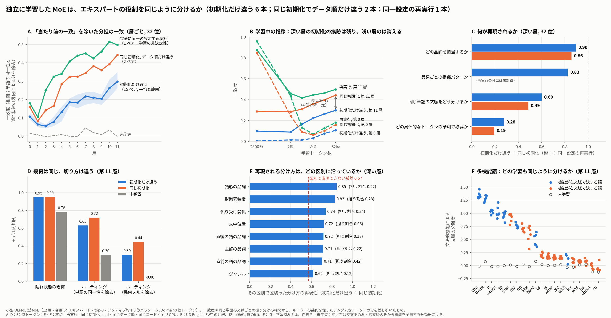

# 分别训练的 MoE，会不会自发分出同一套专家分工？——问题、调研、实验与结论（2026-11-04）

> 本文是 division 线的唯一总结文档，取代此前的 PRELIM_FINDINGS、REVIEW、HANDOFF 与 Slack 草稿（已删除，git 历史可查）。数字以实验卡（`experiments/E167`–`E171`）和 `results/` 下的 JSON 为准；每个数字后都注明出处。总图：`results/e167/prelim_figure_v4.png`（日文 `prelim_figure_v4_ja.png`）。给导师的日文版在附录 A。

## 0. 三句话

1. **导师问的是：** 分别训练的 MoE，专家之间的角色分工会不会自发地一致？"学到同样的词汇知识"是自然的，不算；"角色分工一样"才不自明。
2. **我们的回答：** 会，但只在"语法这一层"，而且要先说清上限。扣掉"没学习也会有的自然一致"之后，深层专家对同一个词的不同用法的分法，在不同初始化之间一致 .28；而**完全相同配置重跑一遍也只一致 .50**，训练本身就只能重现一半。重现的那部分沿词类、依存关系、前后词的词类组织；具体由哪个专家实现、在哪些 token 上起作用，连重跑都不重现。
3. **对领域的意义：** 两篇 2026 年预印本一篇说"专家分工跨 seed 收敛"（Equifinality），一篇说"路由只是隐状态几何的反映、没有真正的专精"（Myth）。我们的测量说两边各对一半：粗的语法分工收敛，具体实现不收敛；几何几乎完全相同（.95）的两个模型，切法只部分相同，路由器也不对准几何的自然簇。

---

## 1. 导师的问题（原始记录）

导师：笹野さん。原始材料：`../moe/notes/MEETING_10-22_JA.md`（10-22 会议录日语全文）、`../moe/notes/ADVISOR_2026-10-23.md`（10-16 面谈转述）。

**10-16（关于注意力头）**
- 他关心的不是"初始化决定哪个编号的头做什么"，而是**独立训练后，即使编号变了，是否仍会形成相似的功能分工**：「番号は変わるにしろ、同じようなヘッドが出来上がりますよっていうのは、そこまで当たり前じゃない」。
- 他区分两件事：学到相似的**知识**是自然的；形成相似的**角色分工**不是自明的。
- 书面意见：**"一致到什么程度才有意义，可能很难主张"**（基线问题）。

**10-22（转向 MoE）**
- 「単語の意味について、どの言語モデルでも似たものが出てくるのは自然です。一方、ヘッドごとに担当している役割が異なり、学習をやり直しても、その役割が同じように分かれるのであれば面白い」
- 「MoE では…役割分担が自動的に学習されます。別々に学習したモデルでも同じようなエキスパートが対応しているのであれば、単語知識の一致よりも、本来は一致するとは限らないものが強く一致していることになり、一定の意味があると思います」
- 「まずエキスパートで調べ、その後ヘッドでも調べて…学習間でかなり一致すると示せれば、面白い研究になるかもしれません」
- 另外强调：可预料的一致只会得到「そうだよね」；「どの程度一致するか…その数値にどのような意味があるのか」；要留在语言研究里；先查已有工作。

**由此定下的检查标准**（复盘 `../moe/notes/RETROSPECTIVE_2026-10-31.md` §2）：
(a) 对象是跨独立训练的分工；(b) 有"本来不一定一致"的先验，并扣掉自然一致；(c) 数字有地板和天花板；(d) 和语言有关；(e) 一句话讲给导师，他不会说「そうだよね」。

**为什么要自己训模型。** 公开模型里没有"只换初始化的多个 MoE"。此前一个月里我们试过冻结骨干只插一层 MoE（E120–E134：平台里本来就没有分工，专家换成平均只升 .003 NLL）、蒸馏学生（E135–E142）、公开 checkpoint 的专家移植（E144–E166：没有独立训练），每个替代平台都悄悄把问题换掉了。10-31 决定回到原问题：自训多 seed 小模型，这正是我们"多卡、弱互联"的资源最适合的形态。

---

## 2. 相关工作调研（R6 定位；venue corpus + arXiv，2026-11-03 核对）

**已接收论文里没有一篇做"语言 MoE 专家分工跨独立 seed 是否重现"。** 切片地图：MoE 专精是热题（ICML 2026 接收 33 篇，几乎全是改路由的方法文）；"seed 间普遍性 / 收敛"是分析类小切片（各会 1–6 篇），接收率与基线持平。

| 近邻 | 怎么做 | 说了什么 | 我们的增量 | 撞车风险 |
|---|---|---|---|---|
| **Equifinality in MoE**（Ternovtsii & Bilak, arXiv 2604.14419） | 自造余弦路由 MoE（每层 1024 个秩 1 专家），WikiText-103，**只比 2 个 seed**；最佳匹配权重余弦 .107（随机 .116）；top-20 词表投影 Jaccard .13–.15，"随机" .0003 | "不同 seed 收敛到功能重叠的专家角色，参数完全不同" | 标准 OLMoE 结构；6+2+1 个 run；置换不变读数；扣词身份与几何；重跑上限；形成过程；分辨率层次；语言内容 | **高。**口号"分工跨 seed 重现"已被占，我们不能以它为标题级主张。他们的 500 倍是对错误基线算的（随机词集），没有扣"同一个词去同一个专家" |
| **The Myth of Expert Specialization**（arXiv 2604.09780） | 命题：线性路由器 ⇒ 隐状态相似则路由相似；5 个公开 MoE；**不同模型**同题专家重叠 60% | 专精是表示几何的涌现性质 | 用同配置不同 seed 直接检验：几何 .95 相同，切法只 .28–.50 相同；k-means 簇零假设量化"几何能解释多少" | 中。要顶住必须有簇零假设（E169 已做） |
| **Routers Learn the Geometry of Their Experts**（NeurIPS 2026） | 1B SMoE 从头训；路由向量与专家权重共同累积 token 历史（正反馈） | 历史依赖机制 | 我们测到它预测的"锁定"（深层初始化印记不消失），也测到它没预测的"共同部分持续增长" | 低，互补 |
| **Quantifying LLM Attention-Head Stability**（Bali et al., ICML 2026） | 26 种架构多 seed；头的注意力矩阵最佳匹配；中层最不稳 | 头的跨 seed 稳定性地图 | 头的部分我们是其子集；且我们的头读数基线不对等，已撤回 | 高（仅头） |
| **Convergence and Divergence under Different Random Seeds**（EMNLP 2025） | 多 seed，逐 token KL；功能词先收敛 | 输出分布层面的收敛 | 我们是内部分工层面；"可重现专家偏功能词"与之一致 | 中（仅该子发现） |
| Universal Neurons（TMLR 2024）；SAE seeds（ICLR 2026）；Cross-seed SAE（arXiv 2607.08499） | 神经元 1–5% 通用；SAE 特征约 30% 共享 | 隐式单元的跨 seed 普遍性 | 显式模块（专家）的对应程度与这些数并列 | 低 |
| Illusion of Specialization（ACL 2026） | 专家组的核心—外围结构 | 专精不如想象普遍 | 可检验"可重现的是否就是常设委员会" | 中 |
| Expert Strikes Back（ICML 2026）；Multilingual Routing（ICLR 2026） | 单次训练上的专家级解释 | 专家是可解释单元 | **谁依赖我们：**专家级解释能否跨训练复用——词类级可以，具体计算级不行 | 低 |
| On LMC of MoE（NeurIPS 2025）；PRISM（ICML 2026，视觉） | 置换对称性理论；视觉 MoE 跨 seed 亲和结构定性重现 | 权重层面 / 定性 | 语言、定量、有基线 | 低 |

**缺口判断：** 语言 MoE 上、多个独立 seed、扣词身份与几何、有重跑上限地测专家分工重现，并说出重现的是什么语言内容——没有直接做的工作。能占的位置是：**重现的是什么（语法层 vs 具体实现）、上限是什么（重跑只有一半）、以及"同几何不同切法"对几何决定论的否定。**

---

## 3. 我们做了什么

### 3.1 模型与训练（E167、E171；`scripts/moe_model.py`、`train_moe.py`）
- OLMoE 结构缩小版：12 层，d=768，每层 64 个 SwiGLU 专家（ffn 384）、每个 token 选 8 个，无共享专家；总参数约 7.5 亿、激活约 1.5 亿。AdamW，lr 6e-4，负载均衡 .01 + router z-loss + DeepSeek-V3 式选择偏置平衡（不加时深层会塌成单专家）。
- 数据：Dolma v1.7 按官方配比取约 60 亿 token，OLMo 分词器；`data_seed` 只决定窗口顺序。
- **9 个 run：**
  - I0D0 … I5D0：6 个独立初始化，同一数据顺序 → 15 个"只换初始化"的对；
  - I0D1、I1D1：同初始化只换数据顺序 → 2 个"只换顺序"的对；
  - **I4D0R：与 I4D0 完全相同（同 init seed、同数据顺序、同代码、同型号 A100）再训一遍 → 1 个"重跑"对**（E171，11-04）。第 0 步 123 个张量逐位相同；差异来源只有 bf16 原子加与 cuBLAS 的非确定性。
  - I0D0–I3D0、I0D1、I1D1 训到 40 亿 token，I4D0、I5D0、I4D0R 训到 32 亿；跨 run 的比较统一在 32 亿处做，终点（40 亿）另报。checkpoint 在 0、2500 万、5000 万、1 亿、2 亿、4 亿、8 亿、16 亿、32 亿、终点。
- 前置检查（R0）：2 亿 token 起，每层把所有专家输出换成均值的留出 ΔNLL .04–.07，与原生 OLMoE 第 9 层的 .064 同量级（此前冻结骨干的平台只有 .003）。**这个规模的模型有真分工。**

### 3.2 怎么量"分工一不一样"（所有读数对专家编号置换不变）
- **文本：** UD English EWT（人工标注词类、形态、依存关系、中心词等），每个词取最后一个 token。
- **T_lex（词汇层一致，"自然的一致"）：** 每个词形的平均路由向量，跨模型相关。
- **T_ctx（上下文划分一致）：** 只比较**同一个词形**的不同出现之间"是否被路到同一批专家"（路由核 K = 共选专家数 / 8），在词形内中心化后跨模型相关。"同一个词去同一个专家"被精确扣掉。
- **T_D（扣掉几何之后的划分一致，主读数）：** 零假设 N1 = 保留路由器读出子空间与奇异值、在子空间内随机旋转并重拟合偏置以匹配负载的随机路由器（32 次）。D = K − E_null[K]，同样跨模型相关。含义：**"如果隐状态几何相同、随便怎么切都会有的一致"被扣掉。**未训练模型之间 T_D ≈ 0。
- **T_h：** 隐状态中心化余弦核的同样统计（"表示本身多相似"）。
- **R4 功能指纹：** 每个专家 = 在留出文本上禁用它（改走第 9 名）后按词类 × 位置分组的 ΔNLL 向量（drop 指纹），以及它服务的词类分布（route 指纹）。校准半集上 Hungarian 对齐，留出半集上算对齐后的相关。
- **逐 token 因果角色（E168 v3）：** 两个模型读同一段文本，禁用专家 e 后**每个 token** 的 ΔNLL 向量；按一半 token 对齐、另一半算相关。这是最细粒度的"是否在做同一个计算"。
- **参照：** 地板 = 未训练模型对；天花板 = 只换顺序对；**真正的上限 = 完全相同配置重跑对**。
- **语言分解（E170）：** 把同词形的词对按 UD 变量（词类、形态、依存关系、中心词词类、前后词词类、句中位置、体裁）分格，看格均值的跨模型相关与格内残差；对 83 个多功能词形看每个 run 是否按语法功能分开（分离度）；用岭回归探针比较"该位置的隐状态里能否线性读出功能"与"路由里能否读出功能"。

### 3.3 实验一览

| 卡 | 做了什么 | 回答的问题 |
|---|---|---|
| E167 | 8 个 run 训练；T_lex / T_ctx / T_D / T_h / R4 在每个 checkpoint 上 | 分工是否跨初始化重现；何时定下 |
| E168 | v2 线性拼接移植（阴性，止损）；v3 逐 token 因果角色 | 对上的专家是不是在做同一个计算 |
| E169 | k-means 簇零假设 vs N1；N1 蒙特卡洛信度 | "扣掉几何"扣得对不对；路由器是不是几何的自然聚类 |
| E170 | UD 变量分解；83 个多功能词；探针 vs 路由 | 重现的分工是什么语言内容 |
| E171 | 完全相同配置重跑 I4D0 | "只换顺序 .44"的含义；一切跨 seed 读数的真正上限 |

---

## 4. 结论（每条附数字与出处）

### 4.1 自然一致很大，必须扣掉（E167）
两个未训练的不同初始化模型，原始路由一致 T_ctx 第 0 层 .68、深层约 .32；扣 N1 后 T_D ≈ 0（−.004 到 .05）。不扣就会把"当然会相似"当成发现——导师 10-16 担心的基线问题是真的，而且很大。

### 4.2 扣掉之后，深层分工跨初始化重现；但"可重现"的上限本身只有一半（E167 + E171）
32 亿 token 处，T_D（`results/e167/routing_3200000000.json`、`results/e171/routing.json`）：

| 对 | 浅层均值 L0–5 | 深层均值 L6–11 | 第 11 层 |
|---|---|---|---|
| **完全相同配置重跑**（1 对） | .27 | **.47** | **.50** |
| 只换数据顺序（2 对） | .19 / .20 | .37 / .38 | .45 / .44 |
| 只换初始化（15 对；seed 刀切 ±.04） | .10 | .23（= 顺序对的 .61） | .30（各对 .26–.35） |
| 未训练 | ≈0 | ≈0 | ≈0 |

- 重跑对从第 0 步逐位相同出发，2500 万 token 时第 11 层已只剩 .88，5000 万 .46，之后在 .42–.50 徘徊；曲线形状与只换顺序的对完全相同（浅层先掉到接近 0 再略回升，深层单调上升）。**训练的非确定性自己就丢掉一半。**
- 数据顺序在此之上只多丢 .05–.10；初始化再多丢 .17。
- 所以"换初始化保留多少"有三个分母：相对重跑上限 **约一半**（L11 .28/.50 = .56；深层 .22/.47 = .48）；相对只换顺序约 2/3（.67）；绝对值 .28。**任何跨 seed 一致读数的分母都应是重跑对**——这是对 Equifinality 等工作的方法论意见。
- 重跑模型 I4D0R 与其他初始化比，各层与原 I4D0 相差 ≤ .01：重跑模型在跨初始化比较中与原模型等价。RTX 与 A100 之间没有硬件效应。

### 4.3 初始化的印记：浅层消失，深层持久（E167）
第 0 层"只换顺序 − 只换初始化"从 .85（2500 万 token）降到 .05（32 亿）；第 8 / 11 层的差从 4 亿 token 起恒为 .13–.17 / .12–.15，到终点不变。深层分工 = 一块被初始化锁定、不再变化的部分 + 一块由数据决定、持续增长的部分（只换初始化的一致从 0 持续升到 .30，在 16 亿后走平）。重跑对与只换顺序对的差则随训练从 .10（4 亿）缩到 .05（32 亿）：数据顺序留下的印记在慢慢被冲掉，初始化留下的不会。

### 4.4 几何相同，切法不同；路由器不是几何的自然聚类（E169）
- 不同初始化模型的隐状态几何一致 T_h .95（同初始化 .95–.96，未训练 .78），但切法 T_D 只 .28 / .45 / .50。
- 把隐状态做 k-means（K=64，取最近 8 簇当"路由"）：k-means 自己跨 seed 一致 .79（同模型换 k-means 种子 .86），但**路由器与自己模型的 k-means 只有 .49**：路由器并没有对准自然簇。
- 以 k-means 期望为零假设的残差跨初始化 .56、同初始化 .64；以 N1 为零假设 .33 / .45。N1 的地板各层 ≈ 0，k-means 零假设在第 2–5 层地板 .22–.30、不归零，所以 N1 是校准更好、也更保守的那个。N1 的蒙特卡洛信度 .97，抽样加倍后 T_D 变化 < .01。
- **对 Myth 的回答：**"路由只是几何的反映"的强形式不成立——同样的几何允许多种切法，各次训练选的切法只部分重合。

### 4.5 重现的是粗粒度的"划分"，不是具体的"实现"（E167 R4、E168、E171）
深层（L6–11）各读数的绝对值与比值（32 亿；`results/e171/*.json`）：

| 读数 | 重跑 | 只换顺序 | 只换初始化 | 初始化 ÷ 重跑 | 初始化 ÷ 顺序 |
|---|---|---|---|---|---|
| 专家服务哪些词类（route 指纹） | .95 | .90 | .81 | .86 | .90 |
| 禁用后按词类的损伤（drop 指纹；终点，只换顺序为分母） | 未算\* | — | — | 未算\* | .83 |
| 同一个词的上下文怎么分（T_D） | .47 | .37 | .22 | .48 | .60 |
| 具体哪些 token 的预测需要它（逐 token 因果角色） | .33 | .23 | .06 | .19 | .28 |

- \* 重跑对的 drop 指纹：I4D0R 的已算完，I4D0 在 32 亿处的 R4 还没算（需 1 张卡约 50 分钟；11-04 16:45 起 fvcrc10 GPU0 被 cvis 线占位，其余可用主机的卡都在被他人使用）。算完后只需补这一行和图 C 的一条橙柱，不影响其他结论。
- 层级清楚：越细越不重现。最细的一层**连重跑都只有 .33**，跨初始化 .06：具体由哪个专家在哪些 token 上起作用，是每次训练各自决定的。
- 不是匹配伪影：换成粗粒度匹配去评逐 token 对应，比例不升反降（.13–.33）。跨初始化时"按词类对上的专家"和"按逐 token 损伤对上的专家"**不是同一个专家**（两种匹配的一致率 .09–.31；同初始化 .66–.91）。逐 token 能对上的专家每层只有 10–14 / 64（同初始化 47–55），偏功能词 / 标点。
- E168 v2 的线性拼接移植（把 B 的整层 MoE 经仿射映射接进 A）连同初始化的对都接不上（拼接 ΔNLL .050 vs 整层置零 .096），按止损放弃；作为阴性观察记录。

### 4.6 可重现的分工沿语言区分组织（E170 阶段 1）
把同词形的词对按 UD 变量分格，格均值的跨模型相关（只换初始化 / 只换顺序 = 比值）与格内残差（深层均值，终点；32 亿、15 对复核逐项差 ≤ .01）：

| 变量 | 格层面比值 | 承载的跨初始化协方差（置换零） | 格内残差比值 |
|---|---|---|---|
| 词形的词类 | .85 | .22 (.02) | .56 |
| 形态特征 | .83 | .23 (.03) | .56 |
| 依存关系 | .74 | .34 (.11) | .55 |
| 直后词的词类 | .72 | .38 (.15) | .55 |
| 中心词词类 | .71 | .22 (.09) | .58 |
| 直前词的词类 | .71 | .42 (.15) | .55 |
| 句中位置 | .72 | .07 (.02) | .60 |
| 体裁 | .62 | .12 (.07) | .60 |

按语言变量切出来的分法跨初始化重现为同初始化的 7–8 成，语言标签之外的残差只有 5 成多；体裁、文档几乎不贡献。初始化留下的差异集中在这些区分**之外**的残差里。

### 4.7 多功能词：哪些词被分、分多少，各次训练一致；分的是左文脉已决定的语法功能（E170 阶段 1b、2）
- 83 个多功能词形（功能 = 词类:依存关系），各 run 的"分离度"剖面跨初始化相关 .85–.92（同初始化 .91–.96）。
- 所有 run 都在深层强分：代词的句法角色（it / you / me / which 的主语 / 宾语 / 斜格 / 虚词，分离度 1.0–1.35；未训练 0）、to 的不定式标记 vs 介词 .95、that 的补语化成分 / 关系代词 / 限定词 .92、there 的虚词 vs 副词 1.3。所有 run 都几乎不分：was / be 的系词 vs 助动词、for / with / about 的介词 vs 从属连词、so（is / are 弱分）。
- 分离度与"功能能否由左文脉预测"的秩相关 .67（L5）/ .55（L11），与右文脉 −.03 / .32。
- 探针（逻辑回归，5 折）：从该位置 768 维隐状态解码功能的可解码度（第 11 层中位 .36，未训练 .07）与从 64 维路由解码的可解码度（.25，未训练 .03）跨词形秩相关 .80–.89；路由平均暴露隐状态可解码量的四分之三；"表示里有、分工不用"的词只有 up / go / get。路由不分的词（was / be / been / were / with / about）表示里也没有（≤ .2）。is / are 的系词 vs 助动词能从路由解出（.36 / .30），只是不以整组专家切换的方式分。"哪些词的功能被路由暴露"的剖面跨初始化 .85、同初始化 .86：**在词级描述上，只换初始化与只换顺序没有差别。**
- 深层路由在预判语法角色：表示的可解码度各层都跟左文脉走（.80–.90）、与右文脉无关；路由的可解码度在浅中层跟左文脉（.81–.85），到深层越来越跟右文脉（第 11 层 .42），路由超出表示线性可解部分的残差与右文脉可预测性相关 .56。即深层路由器按"要靠后文才能确认的功能"分同一个词的上下文，而且这个组织跨初始化相同。
- **读法：分工跟着表示里线性可读的语法信息走，而表示是各次训练共享的；可重现的"划分"由此而来。**不被分的区分是因为该位置的表示里本来就没有它。

### 4.8 撤回的说法
- **"头与专家的深度规律相反"（11-01 版）撤回。**不减地板时头的各层比值平在 .82–.92；"深层低"完全由减去一对未训练模型的地板产生，且头与专家的基线不对等。E171 的重跑对头指纹 .96，只换顺序 .83–.85，只换初始化 .67–.70（单对），记录不入正文。头留待重新设计读数。
- **"换初始化保留约 2/3"降为"相对重跑上限约一半"**（4.2）。
- **"具体实现不重现"改为"具体实现连重跑之间也大部分不重现"**（4.5）。

---

## 5. 按导师的标准自评，以及"他会不会说そうだよね"

| 标准 | 现状 |
|---|---|
| (a) 跨独立训练的分工 | 满足：6+2+1 个自训 run，置换不变读数 |
| (b) 扣掉自然一致 | 满足：词身份精确扣除；几何用 N1 与 k-means 两种零假设扣，N1 更保守 |
| (c) 数字有参照 | 满足：地板（未训练 ≈ 0）、只换顺序、**重跑上限 .50** 三个参照都有 |
| (d) 和语言有关 | 满足：重现的是词类 / 依存 / 前后词类 / 代词句法角色；不重现的是语言标签之外的残差 |
| (e) 不会被说「そうだよね」 | 看讲哪一层（下） |

- 他会说当然的：每个模型都长出按词类组织的专家所以能配上（.90 / .86）；越细越不重现；可重现的逐 token 专家是功能词专家。
- 他不太会说当然的：
  1. **完全相同配置重跑，深层分工也只一致一半**——这个数字此前没人测过，直接回答他"一致到什么程度才有意义"的问题：有意义的分母是重跑对，不是随机配对。
  2. 几何几乎相同（.95）而切法只部分相同，路由器不对准自然簇——分工不是几何的函数。
  3. 深层初始化印记不消失而浅层消失——分层对的两种理论各对一半。
  4. 哪些语法区分被所有训练用来分工、哪些不被用，有清楚的规律（左文脉已决定的功能被分；要靠右文脉的不被分，因为表示里没有）。

**面谈一句话：** 「文法的な区別に沿った分担はどの学習でも同じ、残りの半分は同一設定の再実行の間でも変わる。」

---

## 6. 局限与未解决
- 一个规模（1.5 亿激活）、一种配置（64 专家 top-8、无共享专家、辅助损失 + 选择偏置平衡）。
- 重跑只有 1 对（I4D0 vs I4D0R）；另一个重跑 I0D0R 在 4 亿 token 处停下（让卡），到那里的数字一致（4 亿档第 11 层：重跑 .47 vs .42，只换顺序 .32 / .30）。
- 15 对共享 6 个 seed；seed 层面的不确定性用刀切给出。
- 语言变量只覆盖 UD 标注能表达的区分；"左文脉可判定"的解释只做了一项检验（事后提出）。
- 头的读数没有与专家对等的零假设，暂不比较。
- R4 drop 指纹的重跑分母差 I4D0 一侧（见 4.5 脚注）。

## 7. 接下来可以走的两条路（由人与导师决定）
- **(a) 查不一致的那一半是什么。**深层里被初始化（和早期非确定性）锁定、落在语言标签之外的分工：是词汇 / 语义的聚类，还是训练历史的痕迹？可做：对残差做无监督聚类看跨 run 是否有任何对应；按训练早期（≤ 4 亿）的路由差异预测终点差异。
- **(b) 用同一把尺子量头。**导师原话"先专家、后头"。前提是先给头一个与专家对等的零假设（E171 的重跑对正好提供上限）。

**需要人决定：** 是否把附录 A 的日文版发给导师；面谈主推哪一句；(a) 还是 (b) 先做。本线未登记任何正式主张 C##（按 R2，登记与下一步由人决定）。

---

## 附录 A. 给导师的日文版（Slack 用；是否发由人决定；附图 `results/e167/prelim_figure_v4_ja.png`）

笹野さん

お疲れさまです。10 月のミーティングでいただいた「MoE のエキスパートの役割分担は、別々に学習しても自発的に一致するのか」という問いについて、予備的な結果がまとまりましたので共有させてください。図を 1 枚添付します。

結論を先に書くと：完全に同一の設定で学習をやり直しても、深い層の分担の一致は .5 程度にしかなりません（学習の非決定性）。この上限に対して、初期化を変えた場合は「同じ単語の文脈をどのエキスパートに分けるか」という分担の約半分（同じ初期化でデータ順だけ変えた場合を基準にすると約 2/3）が再現されます。再現される部分は品詞・係り受け関係・前後の語の品詞といった文法的な区別に沿っており、「その位置の表現から線形に読める文法的機能」をどの学習も同じように使って分担しています。一方、初期化に由来する部分は浅い層では消えますが、深い層では学習の最後まで残ります。

*1. 設定*
• OLMoE と同じ構成の小型 MoE を自分で学習しました（12 層、各層 64 エキスパート、各トークンが 8 つを選択、アクティブ約 1.5 億パラメータ、Dolma 40 億トークン）。公開モデルには「初期化だけを変えた複数の MoE」がないためです。
  ◦ 初期化だけが違うモデル 6 本（データとその順番は完全に同じ）
  ◦ 初期化は同じでデータ順だけ違うモデル 2 本（比較の基準）
  ◦ 1 本を完全に同一の設定（同じ初期化 seed・同じデータ順・同じコード・同型 GPU）で再実行（再現性の上限）
• エキスパート番号に依存しない量で比較しました。「同じ単語が文脈によってどのエキスパートに振り分けられるか（分け方）」と、「エキスパートを 1 つ無効にしたとき、どの予測が悪くなるか（働き）」です。
• 「当たり前の一致」を 2 段階で差し引きました。同じ単語は同じエキスパートに行く（単語知識の一致）→ 同じ単語の異なる文脈の分け方だけを比較。隠れ状態が似ていれば、どう切っても分け方は似る → ルーターの幾何を保ったままランダムに切り直したルーターを基準として差し引き（未学習のモデル同士はこの基準でほぼ 0）。
• 言語的な区別は UD English EWT の人手注釈（品詞、形態、係り受け、主辞、前後の語、文中位置、ジャンル）を使いました。

*2. 結果*
① *生の一致の大半は自然なものでした。* 未学習モデル同士でも、ルーティングの一致は第 0 層で .68、深い層で約 .32 あります。生の一致だけを見ると「当たり前の一致」を発見と取り違えることになり、ご指摘の基準問題は実際に大きいと思います。
② *差し引いた後でも、深い層では分担が再現されました。ただし再現性の上限自体が .5 です。* 最終層（32 億トークン時点）で、完全に同一の設定で再実行したペアの一致は .50、同じ初期化でデータ順だけ違うペアは .45 / .44、初期化だけ違うペアは .28（15 ペアすべてが .26〜.35；seed 単位のジャックナイフで ±.04）でした（図 A）。
  ◦ 再実行ペアは 0 ステップ目の重みがビット単位で同一ですが、2500 万トークンで最終層の一致は .88、5000 万で .46 に落ち、その後は .42〜.50 にとどまります。つまり学習の非決定性だけで分担の半分が変わります。データ順を変えるとそこからさらに .05〜.10、初期化を変えるとさらに .17 下がります。seed 間の一致を測る分母は「同じ初期化のペア」ではなく「再実行ペア」にすべきだと考えています。測定ノイズではありません（基準の乱数を変えても差し引き後の値の信頼性は .97）。
③ *初期化の痕跡は、浅い層では消え、深い層では残ります。* 浅い層では、学習開始直後は同じ初期化なら分担がほぼ同じ（.85）ですが、学習が進むと消えます。深い層では「同じ初期化のペアが初期化だけ違うペアより一致する分」が 4 億トークン以降、終点まで .12〜.17 で変わりません（図 B）。深い層の分担には初期化で決まった部分が残り続け、その上にデータで決まる部分が積み上がる、という形です。
④ *再現されるのは粗い「分け方」で、具体的な「働き方」ではありません。* 深い層の比（初期化だけ違う ÷ 同じ初期化）は、どの品詞を担当するか .90、品詞ごとの損傷パターン .83、同じ単語の文脈をどう分けるか .60、どの具体的なトークンの予測で必要とされるか .28 でした。分母を再実行ペアにしても順序は同じで、.86、（損傷パターンは未計算）、.48、.19 です（図 C）。どの具体的なトークンの予測で必要とされるかは、再実行ペアの間でも .33 しか一致しません。初期化が違うモデル間では「同じ品詞を担当する相手」と「同じトークンの予測で必要とされる相手」が別のエキスパートになります（対応の一致率 .1〜.3；同じ初期化なら .7〜.9）。同じ分け方を、違うエキスパートの組み合わせで実装していると読んでいます。
⑤ *幾何は同じでも、切り方は同じではなく、自然なクラスタでもありません。* 初期化が違うモデル同士でも隠れ状態の幾何の一致は .95 で、同じ初期化のペアと変わりませんが、分け方の一致は .30 と .44 です（図 D）。隠れ状態を k-means でクラスタリングしただけの切り方は seed 間で .79 一致しますが、ルーターの切り方はそのクラスタと .49 しか一致しません。「ルーティングは隠れ状態の幾何を反映しているだけ」という最近の主張（*The Myth of Expert Specialization*, 2026）の強い形は成り立たないようです。
⑥ *再現される分け方は、文法的な区別に沿っています。* 同じ単語の文脈の分け方を、品詞・形態・係り受け関係・主辞や前後の語の品詞・文中位置・ジャンルで区切って分解すると、これらの区別で区切った分け方は初期化を変えても同じ初期化の 7〜8 割が再現されるのに対し、区別で説明できない残りは 5 割強でした（図 E）。ジャンルや文書の違いはほとんど寄与しません。初期化に由来する差はこれらの区別の外側（残差）に集中しています。
  個々の多機能語（83 語）で見ると、「どの語をどの程度分けるか」は初期化が違う学習の間で .85〜.92 一致します（同じ初期化で .91〜.96）。代名詞の文法役割（it / you / me / which の主語・目的語・斜格・虚辞）、to の不定詞標識と前置詞、that の補文標識・関係代名詞・限定詞、there の虚辞と副詞は、どの学習でも深い層で強く分けられます。一方、was / be の繋辞と助動詞、for / with / about の前置詞と従属接続詞は、どの学習でもほとんど分けられません（is / are は弱く分けられる程度です；図 F）。この違いは「その位置の隠れ状態から機能が線形に読めるか」とほぼ一対一に対応しています（語ごとの隠れ状態からの解読しやすさとルーティングからの解読しやすさの順位相関 .80〜.86；「表現にはあるのにルーティングが使わない」語はほぼありません）。読めるのは主に左文脈で機能が決まる区別で、右文脈を見ないと決まらない区別はその位置の表現にも乏しく、ルーティングもそれを使いません。

*3. 関連研究*
• *Equifinality in MoE*（2026, arXiv）：seed だけ変えた MoE（2 seed）で、最もよく対応づけたエキスパート同士の語彙射影の類似度がランダムな対応づけの約 500 倍と報告し、「seed が違っても機能的に重なる役割に収束する」と主張しています。基準はランダム対応づけだけで、学習しなくても一致する分（①）は差し引かれておらず、上限の目安もありません。
• *The Myth of Expert Specialization*（2026）：ルーティングは隠れ状態の幾何を反映しているだけ、という立場（⑤）。
• 他の単位では、ニューロンは seed 間で共通するものが 1〜5%（Gurnee et al., TMLR 2024）、SAE の特徴は約 30%（Paulo & Belrose, ICLR 2026）、出力分布は機能語から先に seed 間で収束する（Fehlauer et al., EMNLP 2025）。ヘッドの seed 間安定性は中間層で最も低いという報告があります（Bali et al., ICML 2026）。
• 言語 MoE で、複数の独立 seed を使い、単語知識と幾何を差し引いた上で分担の再現性とその言語的な中身を測った研究は、調べた範囲では見つかりませんでした。

*4. 限界*
• 規模と設定は 1 つだけです（共有エキスパートなし、負荷分散あり）。
• 完全に同一の設定の再実行は 1 ペアだけです（別の 1 本は途中 4 億トークンで止めましたが、そこまでの数字は一致していました）。
• ヘッドは、品詞ごとの注意パターンで測ると未学習モデル同士でも高く一致してしまい、今の測り方では seed 間の比較に使えないと判断しました。測り方を直してから改めて見ます。

*5. ご相談*
この方向で続ける価値があるか、ご意見をいただけますと幸いです。続ける場合、二つの進め方を考えています。
(a) 「共有されない部分」の中身を特定する。深い層で初期化に固定され、文法的な区別の外側にある分担（語彙的・意味的なまとまりなのか、学習順序の痕跡なのか）が何なのかを調べる。
(b) 同じ物差しでヘッドに進む（「まずエキスパート、その後ヘッド」）。
どちらを先にすべきか、また「分担のうち文法的な区別に沿う部分はどの学習でも同じで、残りの半分は同一設定の再実行の間でも変わる」という結果が十分に面白いかどうか、コメントをいただけると助かります。
どうぞよろしくお願いいたします。

---

## 附录 B. 文件与资产
- 实验卡：`experiments/E167-multiseed-moe-division.md`、`E168-matched-expert-transplant.md`、`E169-cluster-null-for-routing-agreement.md`、`E170-linguistic-decomposition-of-reproducible-division.md`、`E171-exact-config-rerun.md`。
- 结果：`results/e167/`（路由各 checkpoint、R4、总图 v4）、`results/e168/`（逐 token）、`results/e169/`（簇零假设、N1 信度）、`results/e170/`（分解、多功能词、可预测性、探针）、`results/e171/`（重跑对全部读数、流水线日志）。
- 代码：`scripts/moe_model.py`、`train_moe.py`、`prepare_data.py`、`capture_routing.py`、`analyze_routing.py`、`functional_probe.py`、`analyze_functional.py`、`token_roles.py`、`e169_cluster_null.py`、`e170_*.py`、`e171_pipeline.sh`、`e171_compare.py`、`prelim_figure_v4.py`。
- 大文件（不进 git）：训练数据 `~/mechpop_cache/e167_dolma_6b/`；checkpoint `~/mechpop_cache/e167_runs/<run>/ckpt_<tokens>.pt`；分析缓存 `~/mechpop_cache/e167_analysis/`；UD 标注 `results/e167/ud_annotations.json`（39 MB，本地）。
- 日志：`../logs/2026-11-01.md`、`2026-11-03.md`、`2026-11-04.md`。
