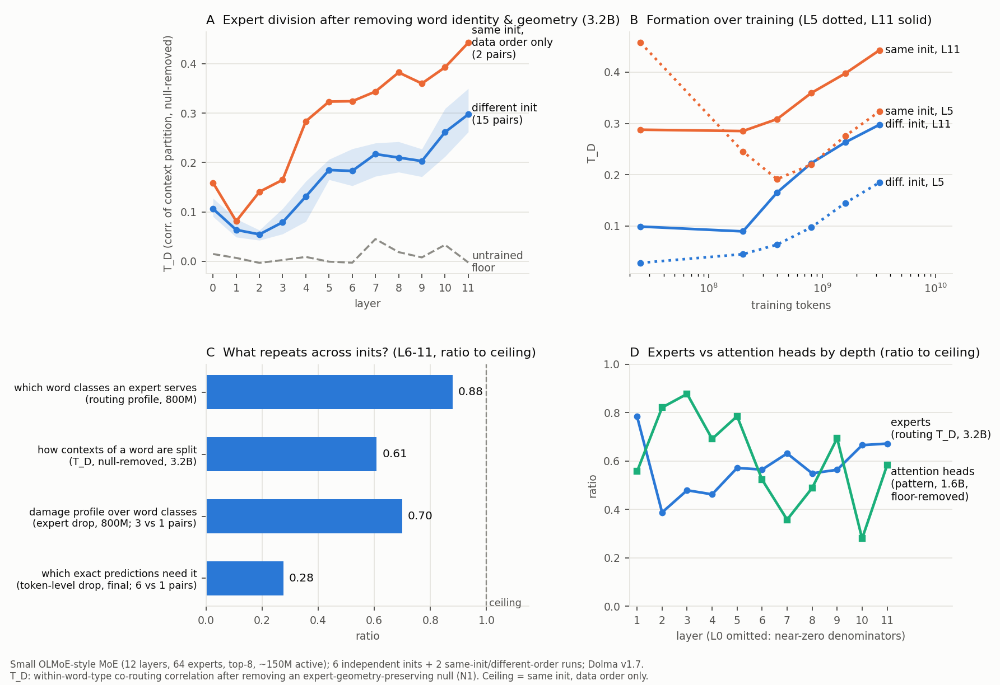

# 初步结果：分别训练的 MoE，会不会自发分出同一套专家分工？（2026-11-01）

> 依据：E167（8 个自训 MoE 的分工读数）与 E168 v3（逐 token 因果角色）。数字都来自 `division/results/`，实验卡里有全部过程、对照与更正。这是初步结果，不是完整研究；局限见最后。

## 一句话
**会，但要看“分工”指什么。** 扣掉“没学习也会有的自然一致”之后，独立初始化的模型在深层重现了约 2/3 的分工（以同初始化、只换数据顺序为天花板）；重现的是“哪类输入归哪个专家”，而不是“专家具体在哪些预测上被需要”。注意力头的深度规律和专家正好相反。

## 怎么做的
- 自训 8 个 OLMoE 结构的小模型（12 层，每层 64 个专家、每个 token 选 8 个，约 1.5 亿激活参数，Dolma v1.7）：6 个**只换初始化**（数据和顺序完全相同），2 个**同初始化、只换数据顺序**（天花板参照）。
- 比较的是与专家编号无关的东西：同一个词在不同上下文里被怎样分到专家（路由划分），以及禁用某个专家后哪些预测变差（功能）。
- 关键是先扣掉两种“自然的一致”：
  1. 同一个词总去同样的专家（≈ 词知识一致）——只比较同一个词的不同上下文；
  2. 隐状态本来就相似，怎么切都会相似——用保留路由几何的随机路由器作零假设（N1）扣掉。

## 结果
1. **自然的一致确实很大，必须扣掉。** 两个**完全没训练**的不同初始化模型，原始路由一致在第 0 层就有 .68、深层约 .32；扣掉 N1 之后约为 0。只看原始一致，会把“当然会相似”误当成发现。（图 A 虚线）
2. **扣掉之后，分工仍跨初始化重现，集中在深层。** 训练到 32 亿 token，第 11 层：不同初始化 .298（15 对全部在 .26–.35，置信区间下界都 ≥ .24），同初始化只换顺序 .443，比例 .67；中层（第 4–9 层）.46–.63，浅层（第 2–3 层）约 .4–.5。（图 A）
3. **初始化只在早期决定分工，之后被数据冲淡。** 训练 0.6% 时，同初始化的两个模型第 0 层分工几乎一样（.85），之后降到约 .1；不同初始化之间的一致则从接近 0 持续上升，相对天花板的比例 4 亿 → 8 亿 → 16 亿 → 32 亿 token 为 .54 → .62 → .66 → .67，已走平。（图 B）
4. **重现的是“划分”，不是“实现”。** 深层（第 6–11 层），不同初始化相对天花板的比例（图 C）：
   - 专家服务哪些词类 .88
   - 同一个词的不同上下文怎么分（扣几何）.61
   - 禁用专家后按词类的损伤 .70
   - **禁用专家后具体哪些 token 的预测变差 .28**（绝对相关只有 .01–.12，但仍是随机配对上限的约 2–6 倍，且越深越高）

   另外，用线性映射把一个模型的整层专家接进另一个模型（模型拼接），连同初始化的模型都接不上——分工的“划分”可以对应，内部表示和计算实现并不相同。
5. **专家和头的深度规律相反。** 头（按词类的注意力模式，扣掉未训练地板）在第 2–5 层最可重现（.7–.9），induction 头所在的第 6–7 层和最深层较弱；专家则越深越可重现。（图 D）

## 为什么值得研究（对照“结果是不是理所当然”）
- 不是“当然一致”：原始一致里的大部分是自然的（第 1 条），扣掉之后仍然剩下的那部分才是学习选出来的分工；而且在不同分辨率上答案截然不同（第 4 条），头和专家方向相反（第 5 条）——这些都不是事先能猜到的。
- 回答了“一致到什么程度才有意义”：给出了地板（未训练模型 + 几何零假设）和天花板（同初始化只换顺序），数字的意义就是落在两者之间的位置。
- 和领域现有结论的关系：
  - *Equifinality in MoE*（2026）报告不同 seed 的最佳匹配专家词表投影相似度是随机的约 500 倍，据此认为 seed 收敛到功能重叠的角色；但基线是随机配对，没有扣掉自然一致，也没有天花板。我们的第 1 条说明这类倍数会严重高估，第 4 条说明“重叠”主要在粗粒度。
  - *The Myth of Expert Specialization*（2026）认为路由只是隐状态几何的反映。我们扣掉几何之后仍有可观的跨初始化一致，说明不全是几何。
  - 神经元层面只有 1–5% 跨 seed 通用（Gurnee et al., TMLR 2024），SAE 特征只有约 30% 跨 seed 共享（Paulo & Belrose, ICLR 2026）；头的跨 seed 稳定性在中层最差（Bali et al., 2026）。我们给出 MoE 专家这一显式模块的对应程度，并和头直接对比。
  - *The Expert Strikes Back*（2026）主张专家是可解释单元；我们的第 4 条提示：专家的“类别”解释可以跨训练迁移，“具体计算”的解释不一定能。

## 局限（如实）
- 只有一个规模（约 1.5 亿激活参数）和一种配置（64 专家、top-8、无共享专家、带负载平衡偏置）。
- 天花板只有 2 对；逐 token 的天花板目前只有 1 对（第二对 I1D1 在补）。
- 两个 A100 上的 run 为释放资源停在约 35 亿 token，它们到 32 亿 token 的读数完整。
- 头的读数是注意力模式，不是因果读数（逐头消融的指纹信度太低，已记录为 P35）。
- 图 C 的四个读数来自不同 checkpoint（8 亿 / 32 亿 / 终点），已在图中标注。

## 如果值得继续，最有信息量的下一步
1. **条件地图**：加共享专家、改专家粒度、换负载平衡方式，看“深层可重现、细粒度不可重现”的规律是否改变。
2. **换一个规模**，确认比例是否随规模变化。
3. **头的因果读数**，把“专家深、头浅”的对比做实。

---
**日本語要約（先生向け）**：独立に初期化した MoE を 6 本（＋同じ初期化でデータ順だけ変えた 2 本）学習しました。生のルーティング一致は未学習モデル同士でも大きく（「自然な一致」）、それを幾何ヌルで差し引いた後でも、深い層では「データ順だけ違う」場合の約 2/3 の分担が独立学習間で再現されました。ただし再現するのは「どの種類の入力をどのエキスパートが担当するか」であり、「どの具体的な予測で必要とされるか」は 3 割程度しか一致しません。またヘッドは浅い層ほど、エキスパートは深い層ほど再現性が高く、逆の傾向でした。
