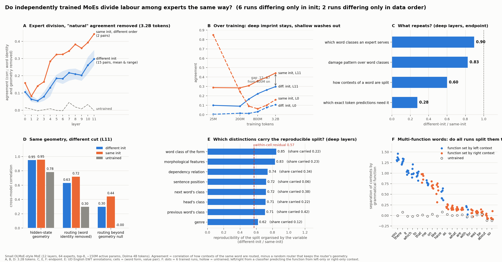

# 初步结果 v2：分别训练的 MoE，会不会自发分出同一套专家分工？（2026-11-03）

> 依据：E167、E168（11-01 版的数字全部保留）、E169（簇零假设）、E170（语言学分解、多功能词、线性探针），以及审阅 [REVIEW_2026-11-03](REVIEW_2026-11-03.md)。相对 [11-01 版](PRELIM_FINDINGS.md)：数字不变，解释改了三处（天花板的含义、几何零假设扣的是什么、头的结论撤回），并加入分工的语言学内容。图：`results/e167/prelim_figure_v3.png`（日文 `prelim_figure_v3_ja.png`）。

## 一句话
**会，但分两部分。** 扣掉“没学习也会有的自然一致”之后，独立初始化的模型在深层重现了约 2/3 的分工（以同初始化、只换数据顺序为参照），重现的那部分是**沿语言区分组织的**：同一个词的不同上下文按词类、形态、依存关系、前后词类被分给不同专家，这种分法跨初始化重现为同初始化的 71–85%，而这些区分之外的残差只有 55%。初始化留下的印记在浅层被冲掉，在深层从 4 亿 token 起恒为 .12–.17，直到终点。

## 怎么做的
- 自训 8 个 OLMoE 结构的小模型（12 层，每层 64 个专家、每个 token 选 8 个，约 1.5 亿激活参数，Dolma 40 亿 token）：6 个只换初始化（数据和顺序完全相同），2 个同初始化只换数据顺序。
- 读数都与专家编号无关：同一个词在不同上下文里怎样被分到专家（路由划分），以及禁用某个专家后哪些预测变差（功能）。
- 扣两种自然一致：同一个词去同一个专家（只比较同一词形的不同上下文）；隐状态几何相似所以怎么切都相似（以保留路由器读出子空间的随机路由器为零假设，记 N1）。
- 语言变量来自 UD English EWT 人工标注（词类、形态特征、依存关系、中心词词类、前后词类、句中位置、体裁）。

## 结果
1. **自然一致很大，必须扣。** 两个未训练的不同初始化模型，原始路由一致第 0 层 .68、深层约 .32；扣 N1 后 ≈ 0。
2. **扣掉随机切之后，深层分工跨初始化重现约 2/3。** 32 亿 token、15 对，第 11 层只换初始化 .30（.26–.35），只换顺序 .44，比值 .67；深层（L6–11）均值 .61。按 seed 的刀切标准误：L11 .67 ± .04，深层 .61 ± .01。两对天花板分别给 .67 和 .68。
   - **.44 的含义还没定，但不是测量噪声。** N1 残差的蒙特卡洛信度 .97，抽样加倍后 T_D 变化 < .01（E169 附录）。“初始化和顺序都换”的对（.30）几乎等于“只换初始化”，所以数据顺序贡献很小；同初始化的两次训练为什么只一致 .44（训练非确定性，还是顺序只在同初始化时才起作用）由完全相同配置的重跑 E171 回答（11-03 16:30 起在 fvcrc20 GPU1 训练，预计 11-04 中午到终点，各档 checkpoint 随训练产生）。
3. **初始化印记：浅层消失，深层持久。** L0 的“只换顺序 − 只换初始化”从 .85（2500 万 token）降到 .05；L8 / L11 的差从 4 亿 token 起恒为 .13–.17 / .12–.15，到终点不变。深层分工 = 一块被初始化锁定、不再变化的部分 + 一块由数据决定、持续增长的部分。
4. **几何相同，切法不同；路由器不是几何的自然聚类（E169）。** 不同初始化模型的隐状态几何一致 .95（同初始化 .96），切法只一致 .30 / .44。k-means 聚类跨 seed 一致 .79（同模型换 k-means 种子 .86），但路由器与自己模型的 k-means 只有 .49：路由器并没有对准自然簇。以 k-means 期望为零假设的残差跨初始化 .56、同初始化 .64；以 N1 为零假设 .33 / .45。N1 的地板各层 ≈ 0，k-means 零假设在中浅层地板 .22–.30、不归零，所以 N1 是校准得更好、也更保守的那个。
5. **重现的是“划分”，不是“实现”。** 深层、终点、相对同初始化的比例：专家服务哪些词类 .90；禁用后按词类的损伤 .83；同一个词的上下文怎么分（扣几何）.60；具体哪些 token 的预测需要它 .28。两点补充：(i) 换成粗粒度匹配去评逐 token 对应，比例不升反降（.13–.33），所以 .28 不是匹配失败的伪影；(ii) 跨初始化时，“按词类对上的专家”和“按逐 token 损伤对上的专家”不是同一个（匹配一致率 .09–.31；同初始化 .66–.91）。逐 token 能对上的专家每层 10–14 / 64（同初始化 47–55），偏闭类词 / 标点 / 功能词。
6. **可重现的分工沿语言区分组织（E170 阶段 1）。** 把同词形的词对按语言变量分格，格均值的跨模型相关（只换初始化 / 只换顺序 = 比值）与格内残差：

   | 变量 | 格层面 | 承载的跨初始化协方差（置换零） | 格内残差 |
   |---|---|---|---|
   | 词形的词类 | .69 / .82 = .85 | .22 (.02) | .20 / .35 = .56 |
   | 形态特征 | .65 / .78 = .83 | .23 (.03) | .56 |
   | 依存关系 | .46 / .61 = .74 | .34 (.11) | .55 |
   | 直后词的词类 | .43 / .59 = .72 | .38 (.15) | .55 |
   | 中心词词类 | .42 / .58 = .71 | .22 (.09) | .58 |
   | 直前词的词类 | .41 / .58 = .71 | .42 (.15) | .55 |
   | 句中位置 | .72 | .07 (.02) | .60 |
   | 体裁 | .33 / .53 = .62 | .12 (.07) | .60 |

   每个变量只换初始化时承载的比例都高于只换顺序：初始化印记落在语言标签之外的残差里。词类 + 直前词类合计承载 .47（置换零 .17）；这些变量合起来最多解释约一半的跨初始化可重现分工。32 亿 token、15 对上复核，比值逐项相差 ≤ .01。
7. **多功能词：哪些词被分、分多少，各次训练一致（E170 阶段 1b，83 个词形，功能 = 词类:依存关系）。** 各 run 的“分离度”剖面跨初始化相关 .85–.92（同初始化 .91–.96）。所有 run 都强分：代词的句法角色（it / you / me / which 的主语 / 宾语 / 斜格 / 虚词，分离度 1.0–1.35，未训练 0）、to 的不定式标记 vs 介词 .95、that 的补语化成分 / 关系代词 / 限定词 .92、there 的虚词 vs 副词 1.3；没有任何 run 分：is / are / was / be 的系词 vs 助动词（≤ .2）、for / with / about 的介词 vs 从属连词（≈ 0）、so。分离度与“功能能否由左文脉预测”的秩相关 L5 .67、L11 .55，与右文脉 −.03 / .32：**分工沿左文脉已决定的语法功能切分，且所有 run 相同**（解释事后提出，仅此一项检验；that、with 是例外）。
8. **表示里有没有 vs 分工用不用（E170 阶段 2，岭分类器探针，`results/e170/probe_vs_routing_3999793152.json`）。** 对同一批 83 个多功能词形，从该位置的 768 维隐状态解码功能标签（“表示里有没有”）和从 64 维路由选择解码（“分工用不用”），平衡准确率减去机会水平。L11：隐状态可解码度中位 .36（未训练 .07），路由 .25（未训练 .03）；两者跨词形的秩相关 .80（L5 .86），路由平均用到隐状态可解码量的 78%。没有“表示里有、分工不用”的词：隐状态可解码 > .3 而路由 < .1 的只有 want / get（L11）。系词 vs 助动词（is / are）在隐状态和路由里都能部分解码（.34 / .36、.37 / .30），be / was / for / with / about 在两边都接近 0——不被分的区分，是因为该位置的表示里本来就没有它（要靠右文脉）。各 run 的路由可解码度剖面跨初始化相关 .81–.84（同初始化 .83–.87）。**读法：** 在语法功能这一层，分工跟着表示里线性可读的信息走，而表示是各次训练共享的；可重现的“划分”由此而来。不可重现的部分（哪个专家拿哪一块、语言标签之外的残差）在这一层之下。
9. **头：撤回“与专家方向相反”。** 不减地板时头的各层比值 L2–11 平在 .82–.92；“深层低”完全由减去一对未训练模型的地板产生，且头与专家的基线不对等。头留待重新设计读数。

## 对照“是不是理所当然”
- 会被说成当然的：每个模型都长出按词类组织的专家所以能配上（.90）；越细越不重现；可重现的逐 token 专家是功能词专家。
- 不那么当然的：几何几乎相同（.95）而切法只部分相同，且路由器不是几何的自然聚类（第 4 条）；深层初始化印记不消失而浅层消失（第 3 条）；粗孪生 ≠ 细孪生（第 5 条）；**哪些语法区分被所有训练用来分工、哪些不被用，有清楚的语言学规律**（第 6、7 条）。
- 对领域：Equifinality（2026）用 2 个 seed 和随机配对基线说“分工跨 seed 重现”，我们给出扣掉自然一致后的量、什么重现什么不重现、何时锁定；Myth（2026）说“路由 = 几何”，我们给出几何相同切法不同、路由器不对准自然簇。

## 局限
- 一个规模、一种配置（64 专家 top-8、无共享专家、辅助损失 + 选择偏置平衡）。
- 同初始化只换顺序的参照只有 2 对，其含义待同配置重跑。
- 15 对共享 6 个 seed；seed 层面的不确定性用刀切给出。
- 语言变量只覆盖 UD 标注能表达的区分；“左文脉可判定”的解释只做了一项检验。

## 下一步（由人决定）
1. 完全相同配置重跑一次（决定 .44 的含义）。
2. E170 阶段 2 的后续：按“左文脉可判定性”做独立标注并检验；对被分 / 不被分的区分做跨 seed 的专家级功能对应。
3. 头：换一个与专家对等的零假设和更大的评估文本后再比。
4. 条件地图（负载平衡方式优先）放在上面之后。
