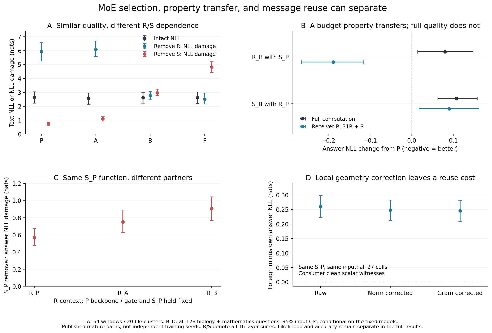

# MoE：学习历史怎样选择专家分担与可重用计算

> 母问题：相近任务为什么可以由不同的专家职责与协作实现？哪些关系由任务约束，哪些由学习历史选择；这些关系怎样影响预测和组件重用？

**截至2026-10-29：E144–E163已完成，当前1卡（fvcrc21/0）、总并发上限4卡，成熟资产阶段0新训练。** 三条核心论证已有直接干预；C14维持本设定内L2。本轮目录整理已完成；现依据新增全文核对推进[E164](experiments/E164-runtime-routing-property-transport.md)的完整路由交叉运行；真实P预检/选择器和旧128题精确guard均已通过，正在新55学科主面板，数值源43aee97a/plan43877611…048a7冻结，尚无完整新结果。头线仍CLOSED，正式ACTIVE登记不变。

## 当前最值得讲清的发现

| 结论 | 决定性证据 | 为什么重要 |
|---|---|---|
| **相近成功容纳不同分担** | B/F完整文本NLL=2.6218/2.6212，任务raw均39.06%；F选择部署更稳，去S的文本损伤却比B额外增加1.8509 [1.3311,2.3010] | 更易裁剪/选择与更依赖伙伴可以同时出现；部署可选择性没有唯一规定职责实现。见[E162](experiments/E162-full-course-native-division.md) |
| **性质载体与必要伙伴可以分离** | 共同P骨干/gate中，R_B单独使低预算答案NLL改善.1882 [.1155,.2641]，但完整NLL恶化.0802 [.0144,.1473]；S_B单独没有携带同样性质 | 原生删除最重要的组件，未必承载希望迁移的性质；性质迁移与完整能力重用需要分别验证。见[E156](experiments/E156-native-common-parent-function-cross.md) |
| **同函数消息仍需合适的使用背景** | 固定S_P换R_B，其移除代价增加.3386 [.2354,.4439]；实际消息跨背景重用有.2605 NLL代价，norm/残差投影校正后仍为.2459 [.2096,.2819] | 函数身份、产生的消息及其使用关系是不同对象；所测局部几何校准只解除小部分配套代价。见[E159](experiments/E159-unchanged-function-partner-role.md)、[E160](experiments/E160-fixed-shared-signal-context-cross.md)、[E163](experiments/E163-native-message-geometry-and-reuse.md) |

**论证中心：** 训练形成的不只是一张可选函数表，还包括这些函数如何产生消息、其他计算如何使用消息。可选择性、性质可迁移性和实际计算可重用性可以分离；研究要解释这份分离怎样形成、在什么条件下重复。



图中所有估计和原95%输入CI的[逐项来源](results/e163/research_spine.json)可复核；它是已有结果的组织，不是新检验。

## 模型和符号

R指每层被路由专家的加权输出，S指始终激活的共享专家输出；这里的R/S干预均覆盖16层函数套件。D是骨干与其余稠密计算，G是gate参数；固定G仍允许实际路由随hidden state改变。

| 端点 | 公开训练路径 |
|---|---|
| P | 标准预训练1T，退火前父状态 |
| A | 标准1T后，标准退火50B |
| B | 标准1T后，引入EMO约束退火50B |
| F | 全程EMO预训练1T，再退火50B |

四者同架构/tokenizer/active k；公开pin和权重SHA见[ASSETS](ASSETS.md)。这些是成熟公开路径，不是已核实的独立初始化总体或单变量时机实验。LM为64窗口/20文件簇，任务为生物/数学各64题；区间条件于模型和输入范围。

## 怎样读现有证据

| 需要了解 | 入口 |
|---|---|
| 科学问题、竞争解释与边界 | [RESEARCH_DIRECTION](RESEARCH_DIRECTION.md) |
| 领域位置、论文主旨与下一研究决定 | [PAPER_SHAPE](PAPER_SHAPE.md) |
| 主张、等级、撤回和逐次更新 | [CLAIMS](../CLAIMS.md)；[PAIN_LOG](../PAIN_LOG.md) |
| 全部协议、结果和未取得项 | [实验索引](experiments/INDEX.md)；每张原卡链接自己的raw/manifest/审计 |
| 权重、原始数据、精确源码包和恢复 | [ASSETS](ASSETS.md) |
| 复算与代码使用 | [scripts/README](scripts/README.md)；执行前读[AGENTS](../AGENTS.md) |

E120–E142是受控可重复分解的起点，摘要见[历史受控窗口](notes/CONTROLLED_E120_E142.md)。E144–E147建立小而真实的预测配套及gate-only强对照；E148/E149短历史有预测响应、未检出强配套障碍。E158/E161保留内容组合的实测边界。它们是支持与边界，原数字、阴性和失败均保留，不强拼成同一机制。

## 最新完成块与复现

E163全部4×16 native条件和27格实际消息交叉完成；29650项数值/1376项元数据独立公式复算最大差1.42e−14。Gram仅改善NLL代价.0146 [.0050,.0250]，生物有改善、数学基本不变，正确率改善未区分。全部方向、来源、分科和预锁成功次集在[完整结果](results/e163/summary.json)。

含失败共2.109199 GPU·时，逐单卡执行、峰值79.319GB、各组末次退出0；原worker未取得的终态核对与fresh重放范围见[原卡](experiments/E163-native-message-geometry-and-reuse.md)。[封存凭证](results/e163/artifact_seal.json)对应结果提交44b9e1ed，包内209个实文件逐项核对，不重复大权重。CPU复现：

```bash
~/.venvs/mechpop/bin/python -B moe/scripts/reproduce.py E163 all
```

这只重算统计、校验和绘图。E143未运行；E158原逐层扫描未取得，完整路径结果不冒充逐层数据。过程与费用在[日志](../logs/2026-10-29.md)，后续实验须先说明它会改变哪种科学解释。
