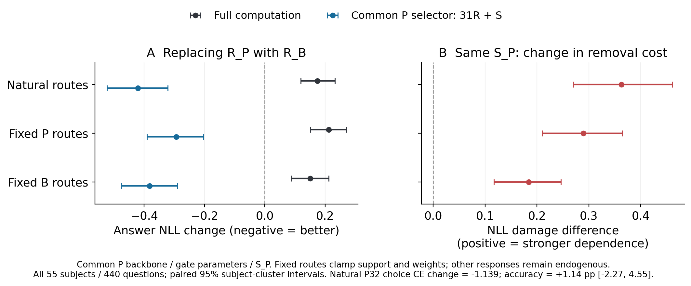
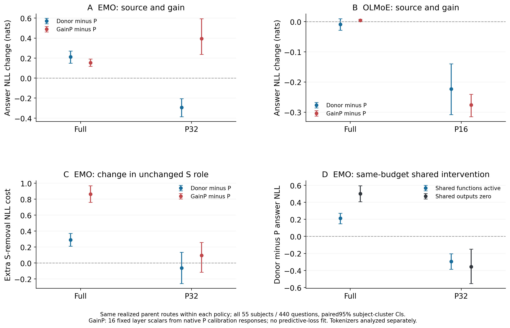

# MoE 线总档：学习历史怎样组织专家分工（E120–E166，10-23 → 10-31）

> **2026-10-31 已结项（人决定）：** 本线摒弃，不投稿、不追加实验，全部结果保留为存档。原因见[复盘](notes/RETROSPECTIVE_2026-10-31.md)；之后的工作在 [division](../division/README.md)。
> 本页由原 README、RESEARCH_DIRECTION、PAPER_SHAPE、ASSETS 和 notes/CONTROLLED_E120_E142 在 11-24 合并而成；文中的“当前”“下一步”都指 10-29 当时。

> 母问题：相近任务为什么可以由不同的专家职责与协作实现？哪些关系由任务约束，哪些由学习历史选择；这些关系怎样影响预测和组件重用？

## 文件地图

| 需要了解 | 入口 |
|---|---|
| 为什么摒弃、从头线到 MoE 的迁移史 | [复盘](notes/RETROSPECTIVE_2026-10-31.md) |
| 独立审计（10-25、10-26） | [AUDITS](notes/AUDITS.md) |
| 导师原话（10-16 口述、10-22 会议录） | [../ADVISOR.md](../ADVISOR.md) |
| 全部协议、结果和未取得项 | [实验索引](experiments/INDEX.md)、[结果导航](results/README.md) |
| 主张、等级、撤回；关键失败 | [../CLAIMS.md](../CLAIMS.md)、[../PAIN_LOG.md](../PAIN_LOG.md) |
| 英文论证稿与五幅关键图 | [paper/main.pdf](paper/main.pdf)、[paper/figures/](paper/figures/) |
| 复算与代码 | [scripts/README](scripts/README.md) |
| 阅读凭证 | `notes/PRIMARY_READING*.json`；全文卡在 `library/themes/moe-routing/` |

## 母问题与演进

### 研究起点：导师关心的是什么

原始材料：[meeting-10.22 日语会议录全文](../ADVISOR.md#10-22-会议录)。这是用户提供的校订稿，独立保留，不用后来的论文叙事改写。更早10-16口述意见的转述保留在[早期记录](../ADVISOR.md#10-16-口述)，两种来源分开标明。

导师提出的有意思的问题是：**模块的角色没有被逐一指定时，独立学习为何仍可能形成相似的分工？哪些本来不保证相同的职责或协作，会跨训练重复？** 他建议先研究MoE专家，再考虑attention heads。这里的对象是学出来的角色分担；专家编号、共同词义或输出相似不能代替它。

会议中推动这条线的几个关节点：

| 原始时间 | 导师提出的判断 | 对本研究的持续要求 |
|---|---|---|
| 04:01–04:44 | 单词意义相似很自然；重新学习后角色仍相似地分开，可能更有意思 | 解释实际分工，区分知识一致与角色组织 |
| 04:48–06:39 | MoE中没有逐项指定专家职责；若分别训练后专家角色仍对应，会有意义 | 从职责与合作的可操作定义出发比较训练结果 |
| 06:40–07:10 | 题目在连续讨论中形成，频繁换全新主题难以推进 | 根据证据深化同一问题，不用不断换题替代认识积累 |
| 08:08–09:14 | 保持语言研究关联，并调查相关工作 | 用真实语言预测/任务后果检验角色，全文定位后发展自己的论证 |
| 00:01–03:43、10:27–11:40 | 自然会出现的一致和孤立数值不足以构成研究意义 | 给出竞争解释、非平凡预测及科学含义，说明领域会多知道什么 |

**原始动机不是要求预先证明一致。** 如果相近任务确实容纳不同分工，找到差异的实现方式、哪些关系仍能迁移，以及任务计算需要共同保留什么，同样在推进这个问题。这是我们的研究判断；导师原文仍以上述会议录为准。

### 一直保留的母问题

> 相同或相近任务为什么可以由不同的专家职责与协作实现？哪些关系由任务约束，哪些取决于初始化、路由和学习历史？这些关系怎样影响实际预测、跨训练对应与组件重用？

当前主线是：**学习历史组织着可选择的函数、响应接口和协作使用关系。** 通过比较成功任务、替换函数来源、固定实际路由以及交叉真实消息，识别分工的实现与重用边界。

独立训练的角色重复性仍是长期问题。当前成熟公开谱系并不等于独立初始化总体；受控学生的重复前向和输入bootstrap也不能替代它。已有进展在于识别“什么才值得比较为一种角色/分工”，并给出同任务成功下的替代组织及其预测后果，为后续形成与重复性研究提供直接对象。

### 从原问到当前题目：关键转折

#### 1. E120–E134：先让“角色”成为可检验对象

最初沿导师问题寻找专家跨训练的对应：测路由、共同输入输出、专家替换后果，再建设固定骨干、单层MoE学生的受控窗口。E130保留五初始化及重跑等全部条件；相近完整质量下，所测功能指纹跨学生对应较弱。

随后E134发现关键平台差别：受控学生用专家均匀分量替换的NLL损伤约.0025–.0032，原生OLMoE同类干预约.064。仅靠学生指纹是否一致，不能决定原生非平凡分工是否重现。**研究从寻找对应分数，推进为先验证被比较的分量在预测中承担什么。** E135/E136的特异残差仍有真实预测作用，也避免把小损伤误读成信息消失。

证据及全部限定见[受控阶段综述](README.md#受控窗口)、[C06–C09及P30](../CLAIMS.md)和原实验卡。固定骨干/单层是窗口，没有成为母问题本身。

#### 2. E135–E147：总计算相近时，组件为何不能任意重组

E138–E142显示组件变异与求和后输出变异分离，路由起点会影响终点组织。这提供了“任务约束总计算、历史选择其分解”的研究线索。没有中间快照，不能把端点变异当成已经恢复完整形成动力学。

于是E144/E145从相似度转向实际重组：哪些函数/路由来源可以组合，组合是否改变真实预测。E144的重组NLL损伤虽小但真实；E145显示历史相关的bank/gate兼容性。E146的分组收益未胜过E147强gate-only对照，因此没有认领超出路由的天然专家联盟。

**这一阶段确定了研究动作：通过来源与配套干预研究实际计算，数学抵消和聚类本身不能代替预测后果。** 具体数字和校对见[实验索引](experiments/INDEX.md)，不是按相似度最大的一组重新选择证据。

#### 3. E148/E149：从插层窗口走向原生网络的历史

为接近真实形成过程，我们在原生OLMoE短历史窗口做同父、同batch集合的次序pulse与共同后缀，并保留同流repeat。全模型继续学习可行，也出现高于重复地板的预测响应；完整网络来源交叉的配套代价为−.000061 [−.000503,.000242]，未检出强配套障碍。

这没有否定母问题，也没有要求增加剂量救出结果。它明确了短暂受控扰动与成熟组织是不同窗口。我们转而利用公开成熟训练端点，直接研究已经形成、真正参与预测的职责和合作，优先复用资产而非自行从头训练多seed。

[E148](experiments/E148-native-checkpoint-order-forks.md)、[E149](experiments/E149-native-system-source-cube.md)保留协议、失败与全部读数；若文件命名变化，以[索引](experiments/INDEX.md)为准。

#### 4. E150–E162：成熟历史中，同样成功可以有不同分担

在公开EMO路径P/A/B/F中，我们分别研究标准退火、后期EMO约束和全程EMO路径。B/F完整LM NLL为2.6218/2.6212、旧任务raw均39.06%；F的前缀选择损伤比B低.1489 [.0858,.2033]，共享分支移除损伤却额外高1.8509 [1.3311,2.3010]。四模型共同答对的40题中，R/S共同必要计数为8/10/20/24；该次集与全样本并列，计数没有补造CI。

进一步来源交叉给出两条联系：R_B单独移入共同父背景携带低预算NLL优势，S_B单独未带走同样性质；同时保留S_P函数、只换R来源，其预测作用仍会改变。固定实际S消息后再换接收背景，也出现明确的原配收益。

**研究由“专家对应多少”深化为“哪些性质由哪份函数携带，以及这些函数通过什么合作实现预测”。** 可选择性、必要伙伴和实际计算重用不是同一个关系。这给出了母问题所需的替代分工实现，而不是把任务质量相近直接当作同算法。

关键证据：[E156来源](results/e156/transfer_contrasts.json)、[E159同函数伙伴](results/e159/summary.json)、[E160实际消息](results/e160/retry_1/summary.json)、[E162成熟历史](results/e162/summary.json)。内容组合的E158/E161保留实测边界，未用它们推断纯关系模块。

#### 5. E163/E164：把组织差异推进到实际实现通路

E163在同函数、同输入的真实消息交叉中，保持消费者clean norm和残差投影后，原配NLL代价仍为.2459 [.2096,.2819]，raw为.2605；几何校正只恢复一小部分。它把研究推进到消息和接收背景的配合。

E164再区分固定gate参数与固定实际路由。新55学科440题中，固定P/B的真实支持与门值后，R_B低预算NLL优势仍为.2937/.3824；未改S_P的full移除代价仍增加.2891/.1840。路由也有额外交互，但不能单独解释这两份分离。

**到这里，性质来源、运行路由、消息生产与使用成为连接起来的干预对象。** 不再以一个相似性指标或模型内重要性列表代表全部职责。参考[E163](experiments/E163-native-message-geometry-and-reuse.md)、[E164](experiments/E164-runtime-routing-property-transport.md)。

#### 6. E165/E166：跨谱系重复，并建设性地分开性质与依赖

E165选择OLMoE的明确成熟父→普通100B退火谱系，架构没有常驻shared。Native预算NLL损伤增加.105 [.002,.206]，而专家单独移入共同P、固定P实际路由却改善.223 [.146,.302]；骨干来源变化抵消改善。**整机曲线可能掩盖组件性质**，将来源—背景关系扩展到另一成熟谱系。

E166据此选择一个能改变整篇解释的竞争模型，而非更多局部mask扫描：只用预定cal同输入响应闭式匹配16个逐层R增益，并在EMO同P32条件关闭共享输出。

- EMO gain使full共享移除代价额外增加.8628 [.7596,.9696]，P32却恶化.3943 [.2375,.5941]；真实R_B改善.2937 [.2043,.3849]，关闭在线S输出后仍改善.3557 [.1480,.5531]（共同P路由）。
- OLMoE gain则产生P16 NLL收益.2760 [.2407,.3147]，完整NLL仅增加.0042。相同预算性质可以由不同函数变化实现。

**当前论文因而获得建设性干预：共享依赖可以增强而预算性质变差，函数性质的相对优势也可以在在线共享通路移除后保留。** 响应接口、性质载体与合作使用关系可以分开识别。这使“学习历史塑造计算组织”成为连接全部核心证据的正面论证。

所有正确率/CE/KL和完整来源网格仍分别报告；OLMoE P16 raw约22%，其结果用于识别概率质量性质。两个谱系并未复制全部同一种机制。详见[E165](experiments/E165-mature-olmoe-selection-transport.md)、[E166](experiments/E166-gain-matched-property-transport.md)及[五幅关键图](README.md#论文主旨与领域位置)。

### 当前题目与导师原问的关系

我们保留的是同一核心：**在任务约束下，哪些分工可能由学习自发选择，并在什么条件下重复？** 现在进一步识别出比较分工必须区分的对象：函数、实际消息、使用背景、可迁移性质和合作依赖。不同历史下的替代实现及来源干预，给“本来不保证一致”提供了真实预测层面的内容。

已有证据支持一篇关于成熟MoE计算组织及重用边界的机制论文。独立初始化总体中的角色重复率、职责形成的完整动力学、最小可重用专家组仍是后续形成问题；没有把已有端点干预追认为这些数据。它们应沿当前发现继续深化，而不是每次换一条全新题目，也不以相邻工作存在为由不断削减贡献。

## 关键结果

**截至2026-10-29：E144–E166已完成，当前0卡，总并发上限4卡，成熟阶段0新训练。** 三条结果、实际路由交叉、另一成熟谱系和增益/同预算伙伴干预已形成完整论证。C14保持L2；英文论文与五幅关键图可审阅，全部完整矩阵及独立复算可追溯。本批GPU实验收束，自动队列为空；下一工作集中在论文论证、复现和研究判断。头线CLOSED、正式ACTIVE登记不变。

### 当前最值得讲清的发现

| 结论 | 决定性证据 | 为什么重要 |
|---|---|---|
| **相近成功容纳不同分担** | B/F完整文本NLL=2.6218/2.6212，任务raw均39.06%；F选择部署更稳，去S的文本损伤却比B额外增加1.8509 [1.3311,2.3010] | 更易裁剪/选择与更依赖伙伴可以同时出现；部署可选择性没有唯一规定职责实现。见[E162](experiments/E162-full-course-native-division.md) |
| **性质载体与必要伙伴可以分离** | 共同P骨干/gate中，R_B单独使低预算答案NLL改善.1882 [.1155,.2641]，但完整NLL恶化.0802 [.0144,.1473]；S_B单独没有携带同样性质 | 原生删除最重要的组件，未必承载希望迁移的性质；性质迁移与完整能力重用需要分别验证。见[E156](experiments/E156-native-common-parent-function-cross.md) |
| **同函数消息仍需合适的使用背景** | 固定S_P换R_B，其移除代价增加.3386 [.2354,.4439]；实际消息跨背景重用有.2605 NLL代价，norm/残差投影校正后仍为.2459 [.2096,.2819] | 函数身份、产生的消息及其使用关系是不同对象；所测局部几何校准只解除小部分配套代价。见[E159](experiments/E159-unchanged-function-partner-role.md)、[E160](experiments/E160-fixed-shared-signal-context-cross.md)、[E163](experiments/E163-native-message-geometry-and-reuse.md) |

**论证中心：学习历史塑造MoE的计算组织。** 可选择的函数怎样产生有用计算、性质由谁携带、预测依赖谁，构成同一个分工问题。三条结果、固定实际路由与跨成熟谱系的反向趋势，连接了部署、性质来源和协作使用；这份组织是进一步研究分工形成与重复性的直接入口。



五幅主图有73项估计及共同成功计数的[逐项来源](paper/figures/figure_sources.json)，CI沿用原统计，共同成功计数不补造CI；无新检验。[英文论证稿](paper/main.pdf)连接三条结果、E164与E165；[选择与依赖图](paper/figures/01_selection_and_dependence.png)、[实际消息图](paper/figures/03_actual_message_reuse.png)补全证据顺序。

### 模型和符号

R指每层被路由专家的加权输出，S指始终激活的共享专家输出；这里的R/S干预均覆盖16层函数套件。D是骨干与其余稠密计算，G是gate参数；固定G仍允许实际路由随hidden state改变。

| 端点 | 公开训练路径 |
|---|---|
| P | 标准预训练1T，退火前父状态 |
| A | 标准1T后，标准退火50B |
| B | 标准1T后，引入EMO约束退火50B |
| F | 全程EMO预训练1T，再退火50B |

四者同架构/tokenizer/active k；公开pin和权重SHA见[ASSETS](README.md#资产与恢复)。这些是成熟公开路径，不是已核实的独立初始化总体或单变量时机实验。LM为64窗口/20文件簇，任务为生物/数学各64题；区间条件于模型和输入范围。

### 怎样读现有证据

| 需要了解 | 入口 |
|---|---|
| 科学问题、竞争解释与边界 | [RESEARCH_DIRECTION](README.md#母问题与演进) |
| 领域位置、论文主旨与下一研究决定 | [PAPER_SHAPE](README.md#论文主旨与领域位置) |
| 主张、等级、撤回和逐次更新 | [CLAIMS](../CLAIMS.md)；[PAIN_LOG](../PAIN_LOG.md) |
| 全部协议、结果和未取得项 | [实验索引](experiments/INDEX.md)；每张原卡链接自己的raw/manifest/审计 |
| 权重、原始数据、精确源码包和恢复 | [ASSETS](README.md#资产与恢复) |
| 复算与代码使用 | [scripts/README](scripts/README.md)；执行前读[AGENTS](../README.md#执行约定) |

E120–E142是受控可重复分解的起点，摘要见[历史受控窗口](README.md#受控窗口)。E144–E147建立小而真实的预测配套及gate-only强对照；E148/E149短历史有预测响应、未检出强配套障碍。E158/E161保留内容组合的实测边界。它们是支持与边界，原数字、阴性和失败均保留，不强拼成同一机制。

### 最新结果：固定实际路由后，两种分离仍存在

[E164](experiments/E164-runtime-routing-property-transport.md)保持P骨干/gate/S_P，交叉R_P/R_B与两者产生的实际路由（支持和门值）。主分析为此前未使用的55个MMLU学科各8题，全部440题；旧128题只作精确guard和次分析。

| 新55科读数 | 估计与配对95%学科簇区间 |
|---|---|
| R_B低预算答案NLL改善：自然 / 固定P路由 / 固定B路由 | .4207 [.3221,.5234] / .2937 [.2027,.3904] / .3824 [.2904,.4746] |
| 同S_P的移除NLL代价增加：自然 / 固定P / 固定B | .3628 [.2703,.4612] / .2891 [.2104,.3645] / .1840 [.1169,.2461] |
| 完整质量与正确率边界 | 自然full NLL反而增加.1746 [.1196,.2325]；低预算raw准确率仅+1.14pp [−2.27,4.55]，尚未区分优势 |

**解释推进：** 性质迁移和同函数伙伴作用变化都不要求由R变化诱发的后续路由变化。路由也不是无关：B轨迹额外帮助R_B低预算NLL .1270 [.0877,.1667]，但在R_P下仅.0383 [−.0042,.0812]，函数×轨迹交互为−.0887 [−.1242,−.0500]。这把参数包来源与实际实现通路分开；固定路由仍允许S、attention等响应内生，不能叫孤立专家的自治能力。

低预算choice CE同向改善1.1386 [.8431,1.4676]；正确率单列，不把概率质量收益说成已提高答题能力。新旧面板同时改变任务与validation校准样本数，不能把幅度差单归任务；区间不是训练seed总体。

[完整矩阵与逐学科结果](results/e164/summary.json)；[全部来源对比图](results/e164/figures/source_effects_NLL.png)；[固定路由的共享作用图](results/e164/figures/shared_partner_role.png)。13238数值/13548元数据独立公式复算最大差7.99e−15，旧LL/KL、回放对角、因果前缀及来源终态全部通过。1.444648 GPU·时，峰值55.112GB，最多1卡，监督exit0，0新训练/下载。源码43aee97a、plan43877611…048a7与raw SHA见[manifest](results/e164/manifest.json)、[资产入口](README.md#资产与恢复)。结果提交48f30265，[封存凭证](results/e164/artifact_seal.json)逐项核对90个实文件，保留精确源码/输入与原始结果。

```bash
~/.venvs/mechpop/bin/python -B moe/scripts/reproduce.py E164 all
```

E163的局部几何结论与29650项独立复算保持不变；完整结果/失败/源码包均由[结果导航](results/README.md)进入。E143未运行；E158原逐层扫描未取得。跨成熟谱系及建设性干预已由下方E165/E166继续推进；形成与重复性仍沿母问题研究，不把旧下一步当执行队列。

### 另一成熟谱系的新结果：整机曲线会掩盖函数性质

[E165](experiments/E165-mature-olmoe-selection-transport.md)的OLMoE成熟父→100B普通退火，26条件×55科440题全量完成。使用同一个父校准16/64池，native预算NLL损伤A−P为+.1050 [.0021,.2059]；但把E_A单独移入共同P接收者，固定实际P/A路由后仍分别改善.2230 [.1459,.3021] / .2357 [.1545,.3248]。只换D_A则在G_P/E_P或G_P/E_A下使P16 NLL恶化.3575 [.2640,.4602] / .3176 [.2343,.3975]。

**解释推进：** 原生预算曲线不能单调追踪专家函数在共同背景下的预算性质；骨干变化能够抵消函数来源带来的改善。这将来源—使用分离扩展到无常驻shared的另一成熟谱系，不是原三条结论全部跨架构复现。

必须并列：OLMoE P16本身严重损伤，P/A完整raw43.64/43.18%，P16仅22.05/21.14%；这里确认概率质量的可迁移变化，不包装成可部署压缩。固定P路由的choice CE改善.4876 [.0844,.8817]，正确率差仍未区分；不换预算/selector救结果。[关键图](paper/figures/04_native_trends_and_transport.png)与[完整矩阵](results/e165/summary.json)保留所有来源/反向条件。

E165含预检.953168 GPU时、最多1卡、峰值32.875GB、0新权重训练；24940数值/25383元数据独立复算最大差1.42e−14，监督均exit0。source0fb295d6/plan9570789c…e25a2和raw85b101dd…0de8ce3见[manifest](results/e165/manifest.json)。

### E166：把部署性质与合作依赖分开干预

[E166](experiments/E166-gain-matched-property-transport.md)在同55科440题、同真实P路由下，用cal上闭式匹配的16个逐层R增益，与原父/真实donor比较，并在EMO P32加入shared-zero。两谱系18格完整完成，无损失优化、增益或mask扫描。

| 关键干预（答案NLL；95%配对学科簇区间） | 实际结果 | 对计算组织的解释 |
|---|---|---|
| EMO增益调整 | full下S移除代价额外+.8628 [.7596,.9696]；P32反而恶化+.3943 [.2375,.5941]，真实R_B改善.2937 [.2043,.3849] | 更强伙伴依赖可以在没有预算收益时出现；统一RMS增益没有复制EMO的函数性质 |
| EMO同P32关闭S | R_B仍改善.3557 [.1480,.5531]；共享本身仍有1.333/1.271 NLL移除成本 | 性质由R来源携带，其相对优势在固定路由下不要求该在线S输出通路继续开启；伙伴重要性与性质实现分开识别 |
| OLMoE增益调整 | P16改善.2760 [.2407,.3147]，donor改善.2230 [.1396,.3081]；gain完整NLL仅+.0042，首token KL=.0037 | 同一预算性质可以由不同函数变化实现；响应接口是可操作的组织因素 |



**主线推进：** 学习历史同时组织可选择的函数、响应接口和协作使用。E164排开路由唯一路径解释；E165表明整机曲线能掩盖组件性质；E166进一步用建设性干预把性质与依赖分开。这是一条关于MoE计算组织的机制论文主线。概率质量、choice CE、正确率和输出KL在[EMO矩阵](results/e166/emo_summary.json)及[OLMoE矩阵](results/e166/olmoe_summary.json)分别报告；不把部署性质等同于所有实际计算。

E166计时1.073925 GPU时、最多1卡、峰值55.024GB，16356数值/16938元数据独立复算最大差1.07e−14，两个worker及恢复监督exit0。原CPU慢读中断/费用、NVMe适配及所有来源只读记录保留，原数值27文件未变。[完成凭证](results/e166/execution_complete.json)、[143文件封存](results/e166/artifact_seal.json)、[分析性描述](paper/e166_descriptive_patterns.json)、[资产恢复](README.md#资产与恢复)。

```bash
~/.venvs/mechpop/bin/python -B moe/scripts/reproduce.py E166 all
```

**下一决定：** 优先完成论文论证与关键图的集中审阅；不自动E167、gain/层/selector扫描。若进一步扩实验，选择能回答协作何时形成的成熟公开分叉或中间状态，不默认自训多seed。

## 论文主旨与领域位置

*原文件 `moe/PAPER_SHAPE.md`；原标题：MoE论文主线与领域位置（2026-10-29）*
**论文中心：学习历史塑造MoE的计算组织。** 可选择的函数、携带性质的参数包、预测所需的伙伴及实际消息的使用关系，可以有不同边界。三条核心发现、实际路由交叉、第二成熟谱系和建设性增益/伙伴干预，已经形成完整的机制论文论证。当前C14仍L2，E144–E166完成，0新成熟训练、当前0卡、上限4卡；本批自动GPU队列为空。正式状态和最终投稿决定不变。

### 这篇论文让领域多知道什么

MoE训练能让函数子集更易选择，同时形成更强的伙伴依赖。可迁移的预算性质可以由routed函数携带，但它与共享分支的重要性不是同一个组织变量。实际路由、响应增益和共享输出的交叉干预把这些关系区分开；跨成熟谱系的反向趋势又说明，整机部署曲线能够掩盖组件性质。

这是一条从**任务成功→实际分担→性质来源→运行通路→协作实现**展开的研究。我们识别了学习历史留下的组织差异，并用建设性干预改变其中一些关系，推进“分工怎样形成、哪些单位可以重用”的母问题。实验不是为了说明某个指标有差，而是为了说明可选择的函数怎样组成实际可用的计算。

### 连续的证据链

| 科学结论 | 决定性证据 | 在论证中的作用 |
|---|---|---|
| 相同成功可以由不同协作支撑 | B/F完整LM NLL2.6218/2.6212、raw同39.06%；F prefix损伤比B低.1489 [.0858,.2033]，S移除损伤却额外高1.8509 [1.3311,2.3010]；共同答对40题的R/S联合必要计数P/A/B/F=8/10/20/24 | 任务表现和部署性质没有唯一规定分工实现；共同成功计数与全样本并列，计数不补造CI |
| 性质载体与必要伙伴分离 | R_B单独移入共同P携带低预算收益，S_B单独未带走同样性质；完整质量另有成本。E164新55科固定P/B实际路由仍改善NLL .2937/.3824 | 从整机差异定位到函数来源，并识别出超出诱发路由变化的运行通路 |
| 同函数、实际消息仍有使用关系 | 固定S_P换R_B，其full移除代价增加；实际消息原配NLL收益.2605，norm/Gram后仍有.2459 [.2096,.2819] | 相同函数身份不能代替对生产和使用的干预；所测局部校正只解除一小部分预测代价 |
| 整机曲线可以掩盖组件性质 | OLMoE普通退火native预算损伤+.105 [.002,.206]，专家单独移入P、固定P路由却改善.223 [.146,.302]；D来源变化抵消改善 | 将来源—使用分离扩展到无shared的另一成熟谱系，给出真实反向例子 |
| 性质与依赖可以分开干预 | EMO GainP使full共享角色额外+.863，却P32恶化+.394；真实R_B改善.294且S-zero仍改善.356。OLMoE GainP则改善P16 .276，完整NLL仅+.0042 | 从观察到分离推进为可操作的组织变量：响应增益、函数性质及在线伙伴通路不必一起变化 |

E166特别区分了竞争解释。EMO预算NLL优势在固定路由、关闭在线S输出后保留，因此它不是该执行条件下shared在线补位的产物；增益可以显著增强full共享依赖却使P32变差，因此依赖增长本身不解释预算优势。另一方面，OLMoE的闭式增益无需损失拟合即可产生预算收益，是一种真实、低维的替代实现。两者共同支持研究函数性质与协作使用的组织关系。

### 最合适的论文尺度

主题是**原生成熟MoE的计算组织及其可重用边界**。对象为六个成熟公开端点、两个训练谱系；干预单位为16层函数套件，另直接交叉真实路由和消息。主贡献是上述组织关系的系统识别和可干预分离，属于MoE与机制可解释性/模型组成的交叉。

我判断已有证据足以支撑一条有分量的机制论文主线。原生任务成功、整机部署、函数载体、在线通路和实际消息构成连续解释；E166增加建设性干预，使论文有能力回答“怎样改变这种组织”。优先对齐ICML/ICLR/NeurIPS主会的理解与机制形态；若语言计算内容成为中心，可考虑ACL/EMNLP主会。不参考EACL，不投Findings。

证据范围集中说明：区间条件于公开端点及输入/cal，未取得独立初始化总体或完整形成轨迹。S消息结论来自EMO，OLMoE扩展来源—背景关系。概率质量、choice CE、准确率及输出KL分开报告；OLMoE P16严重损伤，raw约22%。实验识别的是实际干预效果，不能据删除代价推知识百分比。C14保持L2。

### 与领域已有正面成果的连接

| 研究方向 | 相关成果 | 本文推进的问题 |
|---|---|---|
| 可选择与高效MoE | EMO的文档专家池/再整合；HOPE的合作感知裁剪；CD-MoE的共享凝缩 | 这些部署性质由怎样的分工实现；哪份参数带走性质，哪些合作关系随之变化 |
| 共享与细粒度专家 | DeepSeekMoE的细粒度/shared设计、真实替代和低active-k；Basic–Refinement归因 | 固定共享函数后，其角色怎样改变；预算优势是否要求在线共享通路 |
| 专家自选择和训练耦合 | AoE、ERC；SD-MoE的共享谱/梯度组织 | 参数、函数响应、实际路由和预测使用怎样共同约束成熟分工 |
| 计算背景与关键专家 | Massive Activations、Super Experts、ME Layer的真实预测干预 | 响应接口的低维变化能产生哪些部署/合作性质，哪些仍需要其余函数结构 |
| 表示、特征及电路重用 | Stitching与invariance-aware matching；Hydra/Self-Repair/CoAx/Dose/WISE | 把功能来源、实际消息和接收背景连接起来，识别可用性质与重用计算的不同边界 |

本轮完整阅读8篇197页及OLMoE附录L两页，承接此前的全文核对。具体对象、变量、干预、证据、idea来源见[本轮全文定位](../../../library/themes/moe-routing/SELECTABLE_COMPUTATION_AND_HISTORY_2026-10-29.md)、[全局定位](../../../library/themes/moe-routing/GLOBAL_POSITIONING_FULL_READING_2026-10-28.md)、[ERC全文](../../../library/themes/moe-routing/ERC_FULL_READING_2026-10-29.md)及[阅读凭证](notes/PRIMARY_READING_ARGUMENT_2026-10-29.json)。文献用于建立联系和发展论证，不对贡献逐篇做减法。

### 论文与五幅关键图

[英文论文PDF](paper/main.pdf)、[唯一源码](paper/main.tex)统一维护中心论证、方法和证据范围。本页不复制英文摘要。

1. [相近成功、选择及合作](paper/figures/01_selection_and_dependence.png)：先让读者看到同一批问题的不同实际支撑，再看native部署和依赖。
2. [性质来源与真实路由](paper/figures/02_property_and_partner_under_fixed_routes.png)：R来源带走什么、同S角色怎样变、固定实际执行后保留什么。
3. [实际消息重用](paper/figures/03_actual_message_reuse.png)：消息与接收背景的原配收益及局部校正，NLL/CE异质性均保留。
4. [整机趋势与组件性质反向](paper/figures/04_native_trends_and_transport.png)：第二成熟谱系中D/E组织为何需要分别识别。
5. [增益、性质与伙伴干预](paper/figures/05_gain_and_partner_interventions.png)：跨谱系的替代实现，以及EMO性质与依赖的可干预分离。

73项原估计/原CI与共同成功计数逐项绑定[JSON路径和SHA](paper/figures/figure_sources.json)；计数无新CI。源实验保留完整矩阵、全部方向/正确率和失败。E166按其预定bootstrap重算旧条件，点值逐位相同，CI的Monte Carlo差异保留原记录。

### 下一研究决定

本批GPU实验完成。优先把这条计算组织论证形成可集中审阅的论文、图与复现入口，不自动追加E167、gain或selector网格。

进一步推进母问题，信息量最高的是有可追溯父状态/中间快照的成熟公开分叉：角色、响应接口与协作关系何时形成、是否持续约束后续计算。无需默认从头多seed训练。E165选择了明确5.033T父→普通100B退火；Qwen3缓存仅单成熟端点，0125仅核实同first-stage data mix，均未据此判死其他方向。

历史E120–E149提供测量及受控窗口，E158/E161保留内容组合边界，原证据均由[索引](experiments/INDEX.md)进入。论文聚焦上述连续证据，不按实验编号堆贡献。正式候选、投稿及工作台状态仍由人决定。

## 资产与恢复

*原文件 `moe/ASSETS.md`；原标题：实验资产与恢复*
当前主线见[README](README.md)，所有实验的结果/状态由[实验索引](experiments/INDEX.md)进入。本次清理不删除模型、checkpoint、当前MoE原始数组或科学结果。大资产在`/home/xiang/mechpop_cache`，不进Git；摘要/plan/manifest留在各`results/eNN/`。

### 环境与当前成熟模型

使用已有`/home/xiang/.venvs/mechpop/bin/python`；精确Python/torch/transformers/numpy版本及native源码SHA以E164–E166各`plan.json`为准。CPU复算不加载模型、不下载、不占GPU。GPU研究仍遵守总并发最多4卡，启动前重新核对占用。

| EMO端点 | HF仓库与固定revision | 耐久snapshot |
|---|---|---|
| P | `allenai/StdMoE_1b14b_1T_Preanneal@d2a4949c9d4ad6cf47fbac131f7e020077332b21` | `/home/xiang/mechpop_cache/hf_emo_mature/models--allenai--StdMoE_1b14b_1T_Preanneal/snapshots/d2a4949c9d4ad6cf47fbac131f7e020077332b21` |
| A | `allenai/StdMoE_1b14b_1T@b82073bb43aaaddc0f71d5ce139ad291a3948b32` | `/home/xiang/mechpop_cache/hf_emo_mature/models--allenai--StdMoE_1b14b_1T/snapshots/b82073bb43aaaddc0f71d5ce139ad291a3948b32` |
| B | `allenai/StdMoE_1b14b_1T_EmoAnnealed@d18c640b39e67f89669f38c5db8b5ed22a6927ca` | `/home/xiang/mechpop_cache/hf_emo_mature/models--allenai--StdMoE_1b14b_1T_EmoAnnealed/snapshots/d18c640b39e67f89669f38c5db8b5ed22a6927ca` |
| F | `allenai/Emo_1b14b_1T@007852b1e3d22222f8ee03c6a53fa30e47898dcb` | `/home/xiang/mechpop_cache/hf_emo_mature/models--allenai--Emo_1b14b_1T/snapshots/007852b1e3d22222f8ee03c6a53fa30e47898dcb` |

上述四模型均13,568,641,024参数，原公开FP32权重11片/约54.28GB。原生评测先CPU载入FP32再转BF16，包括buffers；不能随意替换为另一加载程序。逐片公开LFS SHA见[E150](results/e150/asset_manifest.json)、[P父状态](results/e154/asset_manifest.json)、[F](results/full_course_assets_2026-10-28/asset_manifest.json)。冻结加载实现可用`reproduce.py sources --name e156_loading.py`查询。

OLMoE两成熟端点均来自`allenai/OLMoE-1B-7B-0924`，6,919,161,856参数、BF16分片：

| 端点 | revision / 训练位置 | 耐久视图 |
|---|---|---|
| P | `b99743a400844e532bec7ce4575d97a3a39dcd4d`，step1200000 / 5.033T | `~/mechpop_cache/hf_olmoe_mature/view_P_b99743a4/` |
| A | `6d84c48581ece794365f2b8e9cfb043c68ade9c5`，普通100B退火终点 | `~/mechpop_cache/hf_olmoe_mature/view_A_6d84c485/` |

视图的小文件为实文件，权重可能链接到耐久HF blob或`~/mechpop_cache/hf_olmoe/main/`；两处源均保留。[E165公开分片清单](results/e165/asset_manifest.json)记录路径、大小、SHA与LFS ID。旧20B/419B/2.516T原生窗口及完整Qwen3-30B-A3B等缓存清单见`~/mechpop_cache/cross_lineage_inventory_20261029.json`；同NFS被多个节点看到不算多个训练重复。

### 当前论文的原始数据

| 实验 | 耐久目录 | manifest / plan / summary |
|---|---|---|
| E156 | `~/mechpop_cache/e156_common_parent_cross/` | [结果与来源](results/e156/) |
| E158 | `~/mechpop_cache/e158_factual_role_interchange/whole_path/` | [结果与来源](results/e158/whole_path/) |
| E159 | `~/mechpop_cache/e159_unchanged_function_partner_role/` | [结果与来源](results/e159/) |
| E160 | `~/mechpop_cache/e160_shared_signal_context_cross/` | [结果与来源](results/e160/retry_1/) |
| E161 | `~/mechpop_cache/e161_crossed_entity_relation/` | [结果与来源](results/e161/) |
| E162 | `~/mechpop_cache/e162_full_course_native/` | [结果与来源](results/e162/) |
| E163 | `~/mechpop_cache/e163_message_geometry/` | [结果与来源](results/e163/) |
| E164 | `~/mechpop_cache/e164_runtime_routing/` | [结果与来源](results/e164/) |
| E165 | `~/mechpop_cache/e165_mature_olmoe_transport/` | [结果与来源](results/e165/) |
| E166 | `~/mechpop_cache/e166_gain_transport/` | [结果与来源](results/e166/) |

manifest给完整raw绝对路径、bytes和SHA；`plan`绑定输入、selector与冻结源码。E158只完成`whole_path`，E160正式结果为`retry_1`。E163包含继承的P/A/B与独立F/native/cross；旧worker终态未观测的边界仍在原卡。E166按两个family manifest和`execution_complete.json`确认成功，原CPU-only中断链仍保留失败事实。

E164新55科文本与选择器是E165/E166的来源；不同tokenizer分别编码，不跨模型相减NLL。E166 raw分别为198730/121042 B，完整SHA在[EMO manifest](results/e166/emo_manifest.json)与[OLMoE manifest](results/e166/olmoe_manifest.json)。原raw、全部失败与精确源码均保留。

### 可解包的源码、输入与结果封存

| 实验 | 耐久包 | bytes | 核验入口 |
|---|---|---|---|
| E163 | `/home/xiang/mechpop_cache/e163_message_geometry/run_metadata_44b9e1ed.tar.gz` | 60388837 | [完整SHA与逐文件清单](results/e163/artifact_seal.json) |
| E164 | `/home/xiang/mechpop_cache/e164_runtime_routing/run_metadata_48f30265.tar.gz` | 37164702 | [完整SHA与逐文件清单](results/e164/artifact_seal.json) |
| E165 | `/home/xiang/mechpop_cache/e165_mature_olmoe_transport/run_metadata_5ba79500.tar.gz` | 4429405 | [完整SHA与逐文件清单](results/e165/artifact_seal.json) |
| E166 | `/home/xiang/mechpop_cache/e166_gain_transport/run_metadata_f5d4040e.tar.gz` | 71616234 | [完整SHA与逐文件清单](results/e166/artifact_seal.json) |

封存包含实文件源码、输入、raw、必要公开/native代码及原运行/失败记录，不含大权重；包内逐文件SHA已核对，无依赖原HF cache才能解开的源码符号链接。封存中的旧文档是当时快照，当前说明以后续Git版本为准。

日常CPU复算：`python -B moe/scripts/reproduce.py E166 all`（使用上面的已有环境）。历史程序已退出日常目录，固定来源在[源码索引](scripts/frozen_sources.json)；统一入口仅在运行期间按原路径临时恢复原字节，数值guard和plan均不改。查阅/导出见[scripts说明](scripts/README.md)。GPU重放需从原卡/封存及独立checkout恢复，不覆盖完成目录。

### 原生运行的节点副本

| 节点路径 | 耐久替代与核验 | 当前用途 |
|---|---|---|
| fvcrc21 `/tmp/xiang-moe-20261029/e166_emo/{P,B}/` | 上表EMO P/B；[逐片来源/SHA](results/e166/emo_local_staging.json) | 已核验108,571,271,688 B的FP32实文件，精确重放与后续研究缓存 |
| fvcrc21 `/tmp/xiang-moe-20261029/e165_mature/{P,A}/` | 上表OLMoE；[逐片来源/SHA](results/e165/local_staging.json) | P实文件；A复用旧`/tmp/xiang-moe-20261025/olmoe`权重，不能盲删其链接目标 |

模型加载/路径适配的代码也在固定源码索引与原包中。E166首次NFS CPU读取中断无cal/预测、0GPU；随后stage636.891秒、新CPU装载121.235秒，数值27文件不变。完整费用/退出记录留在原结果，不因整理追认为原链成功。

### 更早的唯一研究资产

- E148：`~/mechpop_cache/e148_native_order_forks/`，原记录72文件/237,114,164,566 B，含唯一parent、optimizer/RNG、pulse/final/thin及更新链。[archive](results/e148/archive.json)及其耐久manifest是恢复入口，未清理。
- E123/E128/E130–E142的学生权重、训练状态、cal缓存和充分统计仍在原耐久目录。逐实验精确路径及当时大小见[完整历史资产清单](https://github.com/Nhckdvrl/ssn-group-papaer/blob/d581ed4b/workbench/mechanism-population-dynamics/moe/ASSETS.md)和各`results/eNN/`的archive/manifest；旧NVMe表是历史快照，不当作当前存活声明。
- E144–E147的分批raw和执行源码见各manifest及[2026-10-26封存记录](results/execution_2026-10-26_artifacts.json)；E149–E155的耐久目录由原卡与manifest定位。
- 早期已释放的约222.47GB重复临时副本见[原清理凭证](results/cleanup_2026-10-28.json)。恢复工具如`restore_mature_staging.py`从固定源码查询/导出，不恢复过期自动任务队列。
- 阅读PDF与文本在`~/mechpop_cache/moe_*reading*/`；版本/SHA/全文覆盖见[notes阅读凭证](README.md#文件地图)。导师会议原文保存在[MEETING_10-22_JA](../ADVISOR.md#10-22-会议录)，不归为临时缓存。

### 本轮目录清理的恢复

[清理凭证](results/directory_cleanup_2026-10-29.json)中的`source_and_asset_reorganization`记录固定源码、移出对象、原路径、保留替代及验证。历史源码可离线从Git恢复，当前结果和原卡未删；结项头线本地数据及结束实验console的外部归档以该凭证中的archive/manifest为准。没有清理公共HF缓存、唯一checkpoint或其他workbench。

本轮已核验外部归档：`~/mechpop_cache/workbench_cleanup_20261029/legacy_local_assets.tar.gz`，3,010,576,960 B，SHA `b1f34436d31001cd050e0107c7a1726164b8742a2c87304aa0bd4b4d02a743f0`。12,328个原路径/逐文件SHA在同目录`local_asset_manifest.json`（SHA `323656afe0756e4a949d1b83d0510a8ae2f1e9b1b6dc75517984752d67689723`），并收入包内。每个成员核对通过后才移除工作区副本；3,477,809,622 B数据/console完整保留，无变更文件被误删。可先用`tar -tzf`查看，再按原相对路径选择恢复到工作台或外部阅读目录。

既有本地详细/raw/provenance记录仍原地保留，按精确路径在Git中忽略，避免误把数据当源码提交；路径、bytes与SHA登记在同一清理凭证的`retained_local_detailed_records`（12项），包括旧失败信息，不删除或改写其内容。头线旧Pythia checkpoint与Pile缓存早已释放，v3部分图的原NPZ也不完整；本轮归档只覆盖实际存在的数据，不宣称可从纯clone完整重建头线。

## 受控窗口

*原文件 `moe/notes/CONTROLLED_E120_E142.md`；原标题：历史受控窗口：E120–E142的有效证据*
这是当前成熟原生研究的背景，不是执行队列。2026-10-29由旧阶段快照精简，原全文保存在[6ccee4ea版本](https://github.com/Nhckdvrl/ssn-group-papaer/blob/6ccee4ea/workbench/mechanism-population-dynamics/moe/notes/GPT_PHASE_SUMMARY_E120-E142.md)。当前结论和授权见[README](README.md)；原卡、raw、失败与撤回全部保留。

### 两个窗口回答不同问题

- E123–E133：固定OLMo-1B骨干/下游，L9替换为随机MoE，以语言建模CE训练；测有限预算下的实现重复和历史后果。
- E135–E142：固定原生OLMoE L9的输入与总H→Y目标，学习同容量随机专家；测函数约束和路由起点怎样影响实际分解。共同8,388,608缓存位置、四epoch/4096更新，曝光33,554,432位置，非完整原生预训练。

E130五初始化的held NLL范围2.558987–2.559467，指定cal-U映射后的held U=.0161–.0465、A=−.0107–.0068；各自末期U约.9988、A=.930–.950。同NLL不意味着同预测函数或所有职责相同，指纹弱也不等于无职责。[E130](experiments/E130-fixed-budget-expert-reproducibility.md)、[独立全局审读](notes/AUDITS.md#e130-审读)。

E131在同父/严格同batch集合下只作短期次序处理，接共同后缀后仍有指定读数差；旧E130 order1还改变约.4041%曝光多重集合，“纯次序”解释已撤回，不能混用。[E131](experiments/E131-transient-order-history.md)。

### 四个有限cohort的主要结果

R=各自随机gate可训练；S=共同随机gate可训练；T=共同原生gate可训练；F=共同原生gate冻结。**此处旧学生组F不是当前全程EMO端点F。** 每组expert seeds0/1/2；R/S共享同一个trained seed1，共11个不同终点，不是12个独立样本。

主读数是同cal-Hungarian规则下的actual gated-component平方差；包含调用支持、门值和函数输出。held为262,144位置/512序列/32文件。区间为给定cohort和对应后的文件重采样，不是初始化总体或协议处理效应CI。

| 旧学生组 | component variance（95%输入区间） | FP64 sum variance | covariance cross |
|---|---:|---:|---:|
| R | .072467 [.070598,.074684] | .017869 | −.054598 |
| S | .043262 [.042167,.044191] | .016037 | −.027225 |
| T | .032818 [.032123,.033712] | .015583 | −.017234 |
| F | .031209 [.030562,.031924] | .015947 | −.015262 |

R/F分量差明显大于合计差；共享随机起点S也降低变异，S−R为−.029205 [−.031121,−.027910]，初态R/S方差约.129446/.129587。T可更新gate而终点仍较一致，持续冻结不是本例唯一条件；单个random gate和native起点的差异来源未分开。[E139](results/e139/independent_audit.json)、[E140](results/e140/independent_audit.json)、[E142](results/e142/independent_audit.json)。

teacher误差还需与跨学生变异分开：

| 旧组 | teacher误差 | cohort共同偏差 | 学生间方差 |
|---|---:|---:|---:|
| R | .176402 | .160691 | .015711 |
| S | .176266 | .162165 | .014100 |
| T | .165796 | .152097 | .013700 |
| F | .162563 | .148548 | .014015 |

单学生没有恢复teacher不能证明跨学生不重现；上述分解也是数学恒等式，不是新的机制本身。原始平方单位的sum variance与teacher归一化方差不能混算。

### 调用差与函数差：E141

| 旧组 | 单边调用XOR能量 | 共同调用向量差 | 合计 |
|---|---:|---:|---:|
| R | .024964 | .047503 | .072467 |
| T | .000540 | .032278 | .032818 |
| F | 0 | .031209 | .031209 |

R−F额外分量方差.041258包含XOR .024964和共同调用.016294，后者文件CI [.015437,.017557]。它不能全部归于调用位置，但不是纯内容份额：共同调用人口/门值不同，支持外函数未测；S没有这项新增分账。[E141完整结果](results/e141/readout_table.json)。

### 后续怎样改变了认识

E134/E135说明测量接口/目标影响专家特异分量的预测必要性；原始A=0的未承担列经row-centering仍可能继承共同均值，不变成独立内容证据。E144–E147随后实际测到拆来源的小预测代价，但Γ分组未胜过gate-only强对照。E148/E149短程原生分叉未检出强配套障碍；E150–E163才在成熟原生路径上识别不同实际依赖、性质来源与消息使用关系。不能把这些不同窗口串成已成立的单因素训练机制。

C06–C09仍保持[账本](../CLAIMS.md)中的限定等级；[可识别性说明](https://github.com/Nhckdvrl/ssn-group-papaer/blob/d581ed4b9636319da8e8467930f716ab651f38c4/workbench/mechanism-population-dynamics/moe/notes/IDENTIFIABILITY_SCOPE_2026-10-26.md)只给有额外假设的条件命题。完整协议/核验见[实验索引](experiments/INDEX.md)，资产见[ASSETS](README.md#资产与恢复)。
