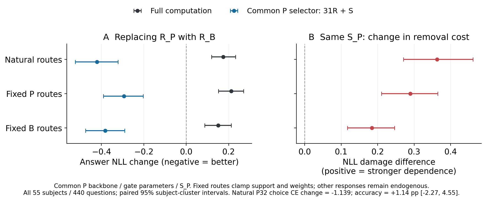
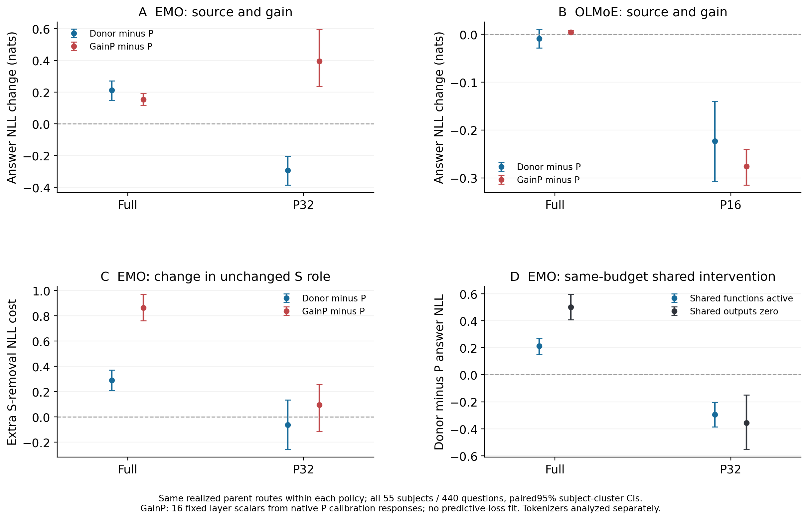

# MoE：学习历史怎样选择专家分担与可重用计算

> 母问题：相近任务为什么可以由不同的专家职责与协作实现？哪些关系由任务约束，哪些由学习历史选择；这些关系怎样影响预测和组件重用？

**截至2026-10-29：E144–E166已完成，当前0卡，总并发上限4卡，成熟阶段0新训练。** 三条结果、实际路由交叉、另一成熟谱系和增益/同预算伙伴干预已形成完整论证。C14保持L2；英文论文与五幅关键图可审阅，全部完整矩阵及独立复算可追溯。本批GPU实验收束，自动队列为空；下一工作集中在论文论证、复现和研究判断。头线CLOSED、正式ACTIVE登记不变。

原始动机见[10-22日语会议录](notes/MEETING_10-22_JA.md)；从导师原问到当前题目的转折统一维护在[研究主线与演进](RESEARCH_DIRECTION.md)。

## 当前最值得讲清的发现

| 结论 | 决定性证据 | 为什么重要 |
|---|---|---|
| **相近成功容纳不同分担** | B/F完整文本NLL=2.6218/2.6212，任务raw均39.06%；F选择部署更稳，去S的文本损伤却比B额外增加1.8509 [1.3311,2.3010] | 更易裁剪/选择与更依赖伙伴可以同时出现；部署可选择性没有唯一规定职责实现。见[E162](experiments/E162-full-course-native-division.md) |
| **性质载体与必要伙伴可以分离** | 共同P骨干/gate中，R_B单独使低预算答案NLL改善.1882 [.1155,.2641]，但完整NLL恶化.0802 [.0144,.1473]；S_B单独没有携带同样性质 | 原生删除最重要的组件，未必承载希望迁移的性质；性质迁移与完整能力重用需要分别验证。见[E156](experiments/E156-native-common-parent-function-cross.md) |
| **同函数消息仍需合适的使用背景** | 固定S_P换R_B，其移除代价增加.3386 [.2354,.4439]；实际消息跨背景重用有.2605 NLL代价，norm/残差投影校正后仍为.2459 [.2096,.2819] | 函数身份、产生的消息及其使用关系是不同对象；所测局部几何校准只解除小部分配套代价。见[E159](experiments/E159-unchanged-function-partner-role.md)、[E160](experiments/E160-fixed-shared-signal-context-cross.md)、[E163](experiments/E163-native-message-geometry-and-reuse.md) |

**论证中心：学习历史塑造MoE的计算组织。** 可选择的函数怎样产生有用计算、性质由谁携带、预测依赖谁，构成同一个分工问题。三条结果、固定实际路由与跨成熟谱系的反向趋势，连接了部署、性质来源和协作使用；这份组织是进一步研究分工形成与重复性的直接入口。



五幅主图有73项估计及共同成功计数的[逐项来源](paper/figures/figure_sources.json)，CI沿用原统计，共同成功计数不补造CI；无新检验。[英文论证稿](paper/main.pdf)连接三条结果、E164与E165；[选择与依赖图](paper/figures/01_selection_and_dependence.png)、[实际消息图](paper/figures/03_actual_message_reuse.png)补全证据顺序。

## 模型和符号

R指每层被路由专家的加权输出，S指始终激活的共享专家输出；这里的R/S干预均覆盖16层函数套件。D是骨干与其余稠密计算，G是gate参数；固定G仍允许实际路由随hidden state改变。

| 端点 | 公开训练路径 |
|---|---|
| P | 标准预训练1T，退火前父状态 |
| A | 标准1T后，标准退火50B |
| B | 标准1T后，引入EMO约束退火50B |
| F | 全程EMO预训练1T，再退火50B |

四者同架构/tokenizer/active k；公开pin和权重SHA见[ASSETS](ASSETS.md)。这些是成熟公开路径，不是已核实的独立初始化总体或单变量时机实验。LM为64窗口/20文件簇，任务为生物/数学各64题；区间条件于模型和输入范围。

## 怎样读现有证据

| 需要了解 | 入口 |
|---|---|
| 科学问题、竞争解释与边界 | [RESEARCH_DIRECTION](RESEARCH_DIRECTION.md) |
| 领域位置、论文主旨与下一研究决定 | [PAPER_SHAPE](PAPER_SHAPE.md) |
| 主张、等级、撤回和逐次更新 | [CLAIMS](../CLAIMS.md)；[PAIN_LOG](../PAIN_LOG.md) |
| 全部协议、结果和未取得项 | [实验索引](experiments/INDEX.md)；每张原卡链接自己的raw/manifest/审计 |
| 权重、原始数据、精确源码包和恢复 | [ASSETS](ASSETS.md) |
| 复算与代码使用 | [scripts/README](scripts/README.md)；执行前读[AGENTS](../AGENTS.md) |

E120–E142是受控可重复分解的起点，摘要见[历史受控窗口](notes/CONTROLLED_E120_E142.md)。E144–E147建立小而真实的预测配套及gate-only强对照；E148/E149短历史有预测响应、未检出强配套障碍。E158/E161保留内容组合的实测边界。它们是支持与边界，原数字、阴性和失败均保留，不强拼成同一机制。

## 最新结果：固定实际路由后，两种分离仍存在

[E164](experiments/E164-runtime-routing-property-transport.md)保持P骨干/gate/S_P，交叉R_P/R_B与两者产生的实际路由（支持和门值）。主分析为此前未使用的55个MMLU学科各8题，全部440题；旧128题只作精确guard和次分析。

| 新55科读数 | 估计与配对95%学科簇区间 |
|---|---|
| R_B低预算答案NLL改善：自然 / 固定P路由 / 固定B路由 | .4207 [.3221,.5234] / .2937 [.2027,.3904] / .3824 [.2904,.4746] |
| 同S_P的移除NLL代价增加：自然 / 固定P / 固定B | .3628 [.2703,.4612] / .2891 [.2104,.3645] / .1840 [.1169,.2461] |
| 完整质量与正确率边界 | 自然full NLL反而增加.1746 [.1196,.2325]；低预算raw准确率仅+1.14pp [−2.27,4.55]，尚未区分优势 |

**解释推进：** 性质迁移和同函数伙伴作用变化都不要求由R变化诱发的后续路由变化。路由也不是无关：B轨迹额外帮助R_B低预算NLL .1270 [.0877,.1667]，但在R_P下仅.0383 [−.0042,.0812]，函数×轨迹交互为−.0887 [−.1242,−.0500]。这把参数包来源与实际实现通路分开；固定路由仍允许S、attention等响应内生，不能叫孤立专家的自治能力。

低预算choice CE同向改善1.1386 [.8431,1.4676]；正确率单列，不把概率质量收益说成已提高答题能力。新旧面板同时改变任务与validation校准样本数，不能把幅度差单归任务；区间不是训练seed总体。

[完整矩阵与逐学科结果](results/e164/summary.json)；[全部来源对比图](results/e164/figures/source_effects_NLL.png)；[固定路由的共享作用图](results/e164/figures/shared_partner_role.png)。13238数值/13548元数据独立公式复算最大差7.99e−15，旧LL/KL、回放对角、因果前缀及来源终态全部通过。1.444648 GPU·时，峰值55.112GB，最多1卡，监督exit0，0新训练/下载。源码43aee97a、plan43877611…048a7与raw SHA见[manifest](results/e164/manifest.json)、[资产入口](ASSETS.md)。结果提交48f30265，[封存凭证](results/e164/artifact_seal.json)逐项核对90个实文件，保留精确源码/输入与原始结果。

```bash
~/.venvs/mechpop/bin/python -B moe/scripts/reproduce.py E164 all
```

E163的局部几何结论与29650项独立复算保持不变；完整结果/失败/源码包均由[结果导航](results/README.md)进入。E143未运行；E158原逐层扫描未取得。跨成熟谱系及建设性干预已由下方E165/E166继续推进；形成与重复性仍沿母问题研究，不把旧下一步当执行队列。

## 另一成熟谱系的新结果：整机曲线会掩盖函数性质

[E165](experiments/E165-mature-olmoe-selection-transport.md)的OLMoE成熟父→100B普通退火，26条件×55科440题全量完成。使用同一个父校准16/64池，native预算NLL损伤A−P为+.1050 [.0021,.2059]；但把E_A单独移入共同P接收者，固定实际P/A路由后仍分别改善.2230 [.1459,.3021] / .2357 [.1545,.3248]。只换D_A则在G_P/E_P或G_P/E_A下使P16 NLL恶化.3575 [.2640,.4602] / .3176 [.2343,.3975]。

**解释推进：** 原生预算曲线不能单调追踪专家函数在共同背景下的预算性质；骨干变化能够抵消函数来源带来的改善。这将来源—使用分离扩展到无常驻shared的另一成熟谱系，不是原三条结论全部跨架构复现。

必须并列：OLMoE P16本身严重损伤，P/A完整raw43.64/43.18%，P16仅22.05/21.14%；这里确认概率质量的可迁移变化，不包装成可部署压缩。固定P路由的choice CE改善.4876 [.0844,.8817]，正确率差仍未区分；不换预算/selector救结果。[关键图](paper/figures/04_native_trends_and_transport.png)与[完整矩阵](results/e165/summary.json)保留所有来源/反向条件。

E165含预检.953168 GPU时、最多1卡、峰值32.875GB、0新权重训练；24940数值/25383元数据独立复算最大差1.42e−14，监督均exit0。source0fb295d6/plan9570789c…e25a2和raw85b101dd…0de8ce3见[manifest](results/e165/manifest.json)。

## E166：把部署性质与合作依赖分开干预

[E166](experiments/E166-gain-matched-property-transport.md)在同55科440题、同真实P路由下，用cal上闭式匹配的16个逐层R增益，与原父/真实donor比较，并在EMO P32加入shared-zero。两谱系18格完整完成，无损失优化、增益或mask扫描。

| 关键干预（答案NLL；95%配对学科簇区间） | 实际结果 | 对计算组织的解释 |
|---|---|---|
| EMO增益调整 | full下S移除代价额外+.8628 [.7596,.9696]；P32反而恶化+.3943 [.2375,.5941]，真实R_B改善.2937 [.2043,.3849] | 更强伙伴依赖可以在没有预算收益时出现；统一RMS增益没有复制EMO的函数性质 |
| EMO同P32关闭S | R_B仍改善.3557 [.1480,.5531]；共享本身仍有1.333/1.271 NLL移除成本 | 性质由R来源携带，其相对优势在固定路由下不要求该在线S输出通路继续开启；伙伴重要性与性质实现分开识别 |
| OLMoE增益调整 | P16改善.2760 [.2407,.3147]，donor改善.2230 [.1396,.3081]；gain完整NLL仅+.0042，首token KL=.0037 | 同一预算性质可以由不同函数变化实现；响应接口是可操作的组织因素 |



**主线推进：** 学习历史同时组织可选择的函数、响应接口和协作使用。E164排开路由唯一路径解释；E165表明整机曲线能掩盖组件性质；E166进一步用建设性干预把性质与依赖分开。这是一条关于MoE计算组织的机制论文主线。概率质量、choice CE、正确率和输出KL在[EMO矩阵](results/e166/emo_summary.json)及[OLMoE矩阵](results/e166/olmoe_summary.json)分别报告；不把部署性质等同于所有实际计算。

E166计时1.073925 GPU时、最多1卡、峰值55.024GB，16356数值/16938元数据独立复算最大差1.07e−14，两个worker及恢复监督exit0。原CPU慢读中断/费用、NVMe适配及所有来源只读记录保留，原数值27文件未变。[完成凭证](results/e166/execution_complete.json)、[143文件封存](results/e166/artifact_seal.json)、[分析性描述](paper/e166_descriptive_patterns.json)、[资产恢复](ASSETS.md)。

```bash
~/.venvs/mechpop/bin/python -B moe/scripts/reproduce.py E166 all
```

**下一决定：** 优先完成论文论证与关键图的集中审阅；不自动E167、gain/层/selector扫描。若进一步扩实验，选择能回答协作何时形成的成熟公开分叉或中间状态，不默认自训多seed。
